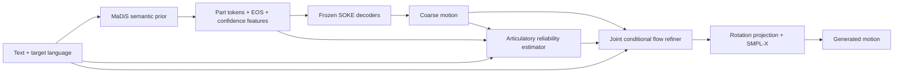

# PACT-Sign: Part-coupled Articulatory Correction with conditional Transport

Toàn bộ đặc tả này là **[P]**, chưa có kết quả thực nghiệm. Đây là phương án được chọn sau khảo sát, không phải mô tả một model đã triển khai. Các cơ chế nền tảng được ghi nguồn ở [04](04_transfer_and_novelty.md).

## 1. Giả thuyết có thể bác bỏ

Semantic prior kiểu MaDiS có thể sinh đúng phần lớn cấu trúc câu nhưng còn lỗi articulatory và phối hợp. Một flow refiner chung có thể sửa phần lỗi, trong khi **reliability của coarse evidence** giúp tránh sửa quá mức phần đã đúng. Tác dụng phải lớn hơn plain refiner, ordinary confidence gating và smoothing/projection khi dùng cùng prior/data/compute.

Không giả định residual chỉ là style. Handshape, orientation, location và timing có thể thay đổi nghĩa. Không kỳ vọng refiner luôn sửa được prior chọn sai lexical sign.

## 2. Pipeline và tensor contract



Input inference chỉ có text \(c\), target sign-language ID \(\ell\), và random seed. Track retrieval có thêm dictionary độc lập; không phải cấu hình chính đầu tiên.

Prior sinh \(\hat z\in\mathbb N^{L\times3}\), \(L\le100\) ở setting MaDiS gốc. Decoder sinh \(\bar x\) dài \(\hat T=4L\) sau EOS. Không có EOS thì dùng cap đã khóa; EOS rỗng dùng minimum-length fallback được chọn trên train/dev và báo tỷ lệ fallback. Không lấy chiều dài hay mask từ target test motion.

Đổi rotations axis-angle của SOKE thành 6D cho mạng refiner; expression coefficients hiện có giữ nguyên. Schema vòng đầu giữ nguyên **11 upper-body joints + 30 hand joints + 10 expression coefficients**, tức \(D=41\times6+10=256\) chiều trước khi padding. Không dùng trực tiếp layout 10-body-joint của SignSparK. Joint-map file cần chỉ rõ joint nào là global/root và joint nào local; các kênh không sinh dùng hằng số đúng benchmark.

Chuẩn hóa train-only theo nhóm rotation/expression. Network state ở không gian Euclidean 6D đã chuẩn hóa; chỉ project về \(SO(3)\) khi tính hình học hoặc xuất motion. Không project state sau từng Euler step vì như vậy đổi ODE đã huấn luyện. Projection dùng Gram–Schmidt 6D→rotation với epsilon và fallback cho hai vector gần suy biến; log tỷ lệ fallback và kiểm tra rotation orthogonality.

## 3. Prior: giữ cố định để đo đúng tác động correction

Dùng MaDiS official architecture và pretraining/SFT protocol sau khi đối chiếu checkpoint provenance. Giữ tokenizer và prior frozen khi train refiner vòng đầu. Dùng last hidden features hoặc frozen multilingual text token features, không chỉ pooled sentence vector, cho refiner. MaDiS UTC/MoP là inherited components, không phải contribution của PACT-Sign.

Cache coarse motions bằng **free-running generation** từ training text với nhiều seeds/checkpoint stages. Cache gồm part-token logits tại lần token được chốt, entropy/top-2 margin, decoder output và EOS. Tránh lấy max-probability sau khi đã feed token đó vào mạng rồi xem đây là confidence dự đoán độc lập. Ghi policy đo confidence nhất quán train/test.

Một prior đã thấy training sequence có thể cho coarse cache quá sạch. Làm pilot cross-fitting: chia train theo signer/source video khi có IDs, huấn luyện prior trên phần còn lại hoặc dùng prior checkpoint chưa fine-tune vào fold, sinh conditioning cho fold. So với cache in-sample và corrupted-token cache. Không khẳng định official checkpoint là out-of-fold khi thực tế đã pretrain trên fold đó. Cross-fitting toàn phần có chi phí riêng; nếu không thực hiện, phải công bố exposure-mismatch limitation.

## 4. Reliability theo articulator

Ước lượng \(q_{tp}\in[0,1]\), \(p\in\{B,L,R\}\), từ coarse motion, token confidence, text features, hand activity và quan hệ hai tay. Đây là **geometric compatibility với reference distribution**, không phải xác suất “dịch đúng ngôn ngữ ký hiệu”.

Trong train, resample reference về grid dài \(\hat T\) của coarse bằng SLERP rotations và linear interpolation expressions. Gọi target này \(x^*\). Đây là alignment bằng dữ liệu train để xây loss; inference không có phép resample theo reference. Chọn global normalized-time resampling trước để không dùng một oracle DTW path sửa nội dung conditioning. Ablate cách alignment trên train; báo riêng lệch độ dài và timing.

Tạo nhãn mềm:

\[
e_{tp}=\operatorname{mean}_{j\in p}\|J_j(\bar x_t)-J_j(x^*_t)\|_2,
\qquad q^*_{tp}=\exp[-e_{tp}^2/(2\tau_p^2)].
\]

Với body dùng torso-relative joints; với hand dùng hỗn hợp wrist-relative articulation và torso-relative placement, sau khi scale mỗi thành phần bằng train statistics. \(\tau_p\) đặt từ train error quantiles và cố định trước test. Không sử dụng PA từng frame cho label placement vì sẽ bỏ thông tin orientation/location.

Huấn luyện estimator bằng Brier/MSE \(\sum(q-q^*)^2\), bỏ vùng fitting không tin cậy nếu có extraction confidence hợp lệ. Khi không có fitting confidence, không tự chế “quality labels”; báo mask unavailable và kiểm tra robust loss thay thế.

Reliability estimator được fit trên train folds; dev dùng để kiểm tra calibration và chọn ngưỡng. Freeze \(q\) trong giai đoạn flow training, stop-gradient qua noise scale/anchor weight để tránh estimator tự hạ confidence nhằm giảm loss. So với raw token max probability, entropy-only và constant-q.

Một reference có thể khác một production hợp lệ: label thấp không nhất thiết là coarse sign sai. Phải đo ranking/calibration với hình học và dùng signers/semantic diagnostics bổ sung; không tuyên bố calibrated semantic uncertainty.

## 5. Conditional transport có source distribution phù hợp inference

Đặt \(C=(c,\ell,\bar x,q,\hat z)\). Với \(q\) được broadcast tới feature channels của từng part:

\[
\sigma(q)=\sigma_{\min}+(1-q)(\sigma_{\max}-\sigma_{\min}),
\quad x_0=\bar x+\sigma(q)\odot\epsilon,
\quad \epsilon\sim\mathcal N(0,I).
\]

Giữ \(\sigma_{\min}>0\): coarse confidence cao vẫn có thể sai. Các scale là hyperparameters trên chuẩn hóa train; không có số liệu để ấn định tối ưu trước pilot. Expressions dùng scale riêng. Khi dropout coarse condition, dùng zero mean + standard Gaussian và missing-condition flag, cùng policy ở train/inference.

Path và objective:

\[
x_s=(1-s)x_0+s x^*,\quad s\sim U(0,1),
\qquad u^*=x^*-x_0,
\]
\[
\mathcal L_{FM}=\mathbb E\big[\|v_\theta(x_s,s,C)-u^*\|^2_{\text{valid}}\big].
\]

Đây là conditional flow giữa source quanh coarse và target motion; không gọi source–target coupling này là globally optimal transport. Lấy \(x_0\) cùng công thức tại inference rồi giải \(dx/ds=v_\theta\) bằng Euler 10–25 bước đầu tiên. Không dùng target-dependent noise level.

Endpoint estimate khi train:

\[
\tilde x_1=x_s+(1-s)v_\theta(x_s,s,C).
\]

Với velocity target đúng, phép thế trả về \(x^*\). Auxiliary geometry được tính trên projected \(\tilde x_1\), không trên noisy rotations của \(x_s\). Không dùng công thức \(x^*-x_s\) như instantaneous target của path thẳng.

**Giới hạn:** geometry/reconstruction regularizers làm objective khác pure FM optimum; không có định lý bảo đảm exact target distribution khi cộng các loss này. Cần quality/diversity trade-off và ablate trọng số.

## 6. Joint refiner và anchors mềm

Khởi điểm kỹ thuật: 8 blocks, width 384, 6 heads, part-specific input/output projections; giá trị này là cấu hình pilot, chưa phải tối ưu được xác nhận. Temporal attention theo part xen kẽ cross-part attention ở cùng frame và lân cận nhỏ; text cross-attention truy cập toàn câu. Dùng token-level text để tránh ép monotonic mapping từ spoken-word order. Event boundaries không bắt buộc có gloss.

Chọn sparse evidence bằng các cực trị hand velocity, thay đổi finger angles và coarse predicted contact, cộng uniform temporal coverage với số anchors tối đa đã khóa trên dev. Đây là **kinematic candidate events**, không được gọi là gloss boundaries. Nếu event selector không giúp, giữ uniform selection làm baseline chính.

Anchor \(a_{kp}\) lấy từ \(\bar x\) tại frame \(t_k\), reliability \(q_{t_kp}\). Cung cấp anchor features, relative time distance và missing flag cho mạng. **Không hard clamp** các frame này trong main method. Optional preservation regularizer:

\[
\mathcal L_A=\sum_{k,p}\underbrace{\max(0,q_{t_kp}-q_0)}_{w_{kp}}\,
\rho\!\left(\phi_p(\tilde x_{1,t_k})-\phi_p(a_k)\right),
\]

với \(\rho\) là Huber, \(\phi\) là local articulation/placement features, và \(q_0\) chọn trên dev. Trọng số nhỏ, có ablation \(\lambda_A=0\). FM target có thể yêu cầu di chuyển khỏi coarse anchor; preservation loss là trade-off, không là constraint bất khả vi phạm. Không cắt correction bằng \(1-q\), vì như vậy high-confidence lexical error sẽ không sửa được.

## 7. Hình học tương tác và loss đầy đủ

Từ projected endpoint lấy joints \(J\) bằng cùng SMPL-X/hand regressor của benchmark. Các feature relational:

- Vector hai wrists trong torso frame và wrist-to-head/chest vectors.
- Distances giữa fingertip–fingertip và fingertip–palm của hai tay trên một tập joint pairs cố định, chọn trước train.
- Palm orientation và finger-joint geodesic rotation errors.

\[
\mathcal L_R=\sum_{t,(i,j)\in\mathcal P}\omega_{tij}\,
\rho\!\left(d_{ij}(J(\tilde x_1))-d_{ij}(J(x^*))\right).
\]

\(\omega\) cân bằng near-contact và non-contact pairs theo train statistics, không dùng generated confidence để che loss ở vùng khó. Contact pseudo-label từ distance chỉ là noisy cue; không ép mọi pair tới zero. Collision loss nếu thêm phải mask contact hợp lệ, và là ablation sau, không thành phần bắt buộc đầu tiên.

\[
\mathcal L=\mathcal L_{FM}
+\lambda_J\mathcal L_{FK}
+\lambda_R\mathcal L_R
+\lambda_V\|\Delta J(\tilde x_1)-\Delta J(x^*)\|_1
+\lambda_A\mathcal L_A.
\]

Mỗi loss chuẩn hóa theo valid frames và số phần tử; tính theo part trước khi average, không để 30 hand joints bị body/expression scale lấn át. \(\mathcal L_{FK}\) dùng Huber vị trí joints; rotation geodesic có thể thêm vào reconstruction ablation. Không minimize velocity về zero: mục tiêu là khớp chuyển động, không làm mượt đến mất handshape transition.

Không dùng SiCLIP/BT evaluator báo cáo để train/rerank main model. Nếu thử semantic auxiliary loss bằng teacher riêng, teacher chỉ train trên train split, độc lập evaluation checkpoint và tách thành một ablation.

## 8. Training và inference cụ thể

```text
TRAIN
  freeze verified prior and SOKE tokenizers
  cache free-running coarse samples on train text; retain EOS/logit metadata
  build train-only resampled targets at predicted coarse lengths
  fit and calibrate articulatory reliability using train folds; freeze it
  for a train example:
      choose coarse cache sample or corrupted coarse augmentation
      compute reliability and sparse evidence from available coarse inputs
      sample source x0 around coarse; sample s; construct xs and true velocity
      predict joint velocity; form endpoint estimate
      optimize FM + selected geometry losses on valid target frames

INFERENCE
  input text, target language, seed
  generate tokens and EOS with prior; decode coarse and convert representation
  estimate reliability; select coarse evidence
  sample x0 by the same source rule as training
  integrate refiner ODE with fixed steps and fixed guidance policy
  project rotations; convert to benchmark output schema; keep predicted length
  score only after all predictions and configuration are frozen
```

Token corruptions: swap nearby codebook alternatives, drop a short span, perturb local timing/pose, remove anchors; rates selected on train/development errors. They supplement **real generated errors**, not replace them. Never use target pose to choose which test anchors are trustworthy.

Main setting preserves MaDiS capacity/EOS để so sánh. Long sequences cần một track khác với variable-length prior/chunking; không resample test targets xuống 400 frames để giảm độ khó rồi gọi full-length SOTA.

## 9. Khả năng thất bại và cách phát hiện

| Failure | Dấu hiệu | Phản ứng nghiên cứu |
|---|---|---|
| Prior chọn sai nội dung | Hình học mượt nhưng text-shuffle gap/BT không tốt | Chuyển sang alignment/coverage research; không tăng preservation loss |
| Estimator tự tin sai | Calibration curve kém, lỗi tập trung high-q bins | Bỏ q hoặc sửa training cache; không lấy entropy làm chân lý |
| Refiner làm mất handshape | DTW giảm nhưng minimal-pair/user scores giảm | Giảm smoothing/anchor bias, giữ semantic guardrail |
| Single-reference bias | Valid production bị chấm reliability thấp | Đánh giá multiple renditions/subset do signers xác nhận |
| Timing bị ép sai | Length error và sign-order errors tăng | Sửa prior/EOS hoặc nhánh duration; refiner không có oracle length |
| Chi phí quá lớn | Prior + 25-step refiner chậm hơn đáng kể | Báo quality-first trade-off; chỉ distill sau khi teacher có lợi ích |

Candidate contribution thực tế: bằng chứng có kiểm soát về **articulatory correction dưới predicted evidence**, cách reliability giúp hoặc không giúp preservation–repair, và đánh giá relational geometry mà root/wrist-aligned DTW chưa bao phủ. Tính mới tổng quát của masked generation, flow, uncertainty, sparse anchors và inter-part attention không được nhận là của proposal này.
