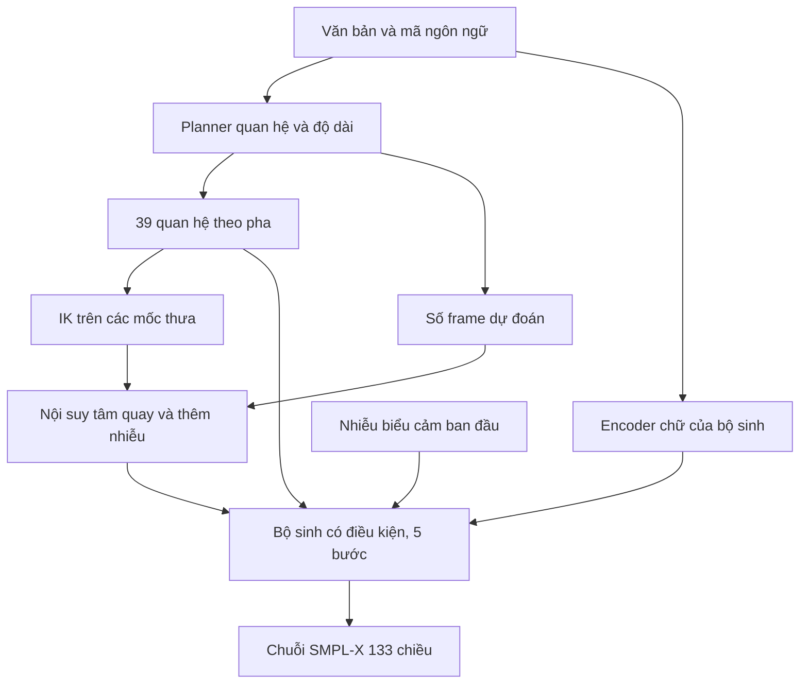

# Đặc tả triển khai Flow Matching cho Sign Language Production

**Phiên bản 1.0 · 23/11/2026 · Bài toán text → chuyển động SMPL-X liên tục.** Tài liệu này là đầu vào cho agent triển khai một hệ thống nghiên cứu từ đầu. Đầu ra ứng dụng là chuỗi pose ký hiệu có độ dài dự đoán được. Đầu ra nghiên cứu là so sánh ghép cặp có thể tái lập với SignNMFlow. Các điểm benchmark trong tài liệu do tác giả paper công bố. Các ngưỡng mục tiêu và siêu tham số mới là lựa chọn cho thí nghiệm.

| Ký hiệu nguồn | Cách sử dụng |
|---|---|
| **[Gốc]** | Công thức, thông số hoặc số liệu đối chiếu được với bài báo hoặc mã tác giả. |
| **[Đề xuất]** | Thiết kế cần triển khai và kiểm chứng. Khi thiếu chi tiết công khai, dùng mặc định ghi ở đây và ghi vào manifest của lần chạy. |
| **[Chẩn đoán]** | Cho phép dùng thông tin đặc quyền như độ dài hoặc quan hệ thật, hoặc thay một điều kiện để phân tích lỗi. Các dòng này có tên riêng trong bảng kết quả. |

**Quy ước đọc.** IK là động học ngược, FK là động học thuận. NFE đếm số lần gọi mạng dự đoán đích. DTW căn hai chuỗi theo thời gian, JPE đo sai số vị trí khớp, PA là căn chỉnh Procrustes. B-T là phép dịch ngược từ chuyển động sang văn bản, chấm bằng corpus BLEU-4. Tất cả dòng thực nghiệm dùng tên A–F theo §10.

### Mục lục

1. [Giả thuyết, đầu vào và đầu ra](#scope)
2. [Dữ liệu, tensor và codec SOKE-133](#data)
3. [Nhãn quan hệ tay–cơ thể](#relations)
4. [Planner văn bản và mô hình độ dài](#planner)
5. [Động học ngược và phân phối khởi đầu](#source)
6. [Đường flow, metric độ tự nhiên và mạng hiệu chỉnh](#bridge)
7. [Mạng sinh, objective và thuật toán suy luận](#generator)
8. [Các giai đoạn huấn luyện và quản lý trạng thái](#training)
9. [Cấu hình khởi điểm có thể sao chép](#config)
10. [Ma trận thí nghiệm và ngân sách công bằng](#experiments)
11. [Đo lường, thống kê và đánh giá người ký](#metrics)
12. [Điều kiện dừng và quyết định nghiên cứu](#gates)
13. [Giao diện mã, lệnh chạy và đầu ra phải bàn giao](#implementation)
14. [Bộ kiểm thử và ví dụ NumPy chạy độc lập](#verification)
15. [Nguồn, tài sản và các điểm còn phải xác minh](#sources)

<a id="scope"></a>

## 1. Giả thuyết, đầu vào và đầu ra

**Giả thuyết chính.** Với cùng câu, cùng thông tin planner, cùng bộ sinh và cùng năm lần gọi mạng, đặt phân phối nguồn quanh chuyển động thô dựng bằng động học ngược (IK) sẽ giảm lỗi đặt tay và tăng khả năng hiểu câu. Cơ chế có thể kiểm tra độc lập bằng lỗi cổ tay theo hệ thân, hướng lòng bàn tay, khoảng cách nguồn–đích và so sánh với một nguồn thô được học trực tiếp.

**Hệ thống chính C.** Văn bản và mã ngôn ngữ → độ dài và quỹ đạo quan hệ thưa → IK → tâm nguồn quay. Thêm nhiễu tiếp tuyến quanh tâm. Bộ sinh có điều kiện văn bản và quan hệ dùng đường flow trên đa tạp để sinh góc quay và biểu cảm. Đối chứng quyết định **B** có cùng planner, cùng nhánh điều kiện, cùng đầu ra và cùng seed, nhưng khởi đầu bằng nguồn của SignNMFlow. Đối chứng **D** thay IK bằng đầu dự đoán pose thô từ câu. Cần chạy cả B và D để phân biệt hai giả thuyết này.



| Hợp đồng | Giá trị |
|---|---|
| Yêu cầu suy luận | `text, source_language, target_sign_language, sample_id, seed`. Không nhận video, gloss, độ dài thật, keyframe, ID người ký hay shape của clip tham chiếu. `sample_id` chỉ để truy vết và tạo seed. |
| Trả về | `pose133[T_hat,133]` ở đơn vị vật lý của codec, `fps`, `T_hat`, ngôn ngữ đích, seed, hash phiên bản. Tùy chế độ debug lưu quan hệ, tâm nguồn và trạng thái từng bước. |
| Phạm vi mặc định | CSL-Daily đơn ngữ trước. Sau khi qua cổng xác nhận mới mở PHOENIX-2014T và How2Sign đơn ngữ, sau đó huấn luyện một mô hình ba ngôn ngữ. |
| Ký hiệu thời gian | $u$ là chỉ số frame/pha của câu ký hiệu. $t\in[0,1]$ là thời gian vận chuyển của flow. Một trạng thái ở $t$ chứa **toàn bộ** chuỗi theo $u$. |
| Ký hiệu hình học | $R\in SO(3)$ là phép quay vật lý. $q=(w,x,y,z)\in S^3$ lưu cùng phép quay. $e\in\mathbb R^{10}$ chứa biểu cảm. $x$ là tập các quaternion ở một frame hoặc cả batch tùy shape đã ghi. |

**[Gốc]** SignNMFlow dùng nguồn quaternion đồng đều trên bán cầu theo quy ước dấu, metric tự nhiên từ các prototype, objective dự đoán đích và lấy mẫu 5 bước. Vị trí đưa thông tin vào **nguồn** là biến nghiên cứu ở đây. Phần C.1–C.5 cùng bảng 6 của paper là tham chiếu hình học. [SignNMFlow v1](https://arxiv.org/html/2609.33339v1)

<a id="data"></a>

## 2. Dữ liệu, tensor và codec SOKE-133

### 2.1 Nhập và đóng phiên bản

Dùng split chính thức và pose SOKE cho PHOENIX-2014T, CSL-Daily. Dùng pose NSA cho How2Sign để đối chiếu cấu hình SignNMFlow. PHOENIX ghép tiếng Đức–DGS, CSL-Daily ghép tiếng Trung–CSL, How2Sign ghép tiếng Anh–ASL. Ghi lại file split, phiên bản fitting, timestamp/FPS nguồn, vùng cắt, phiên bản tokenizer văn bản, phiên bản SMPL-X và SHA-256 các tài sản. MV3D, dữ liệu ngoài và từ điển là các thí nghiệm riêng. [SignNMFlow](https://arxiv.org/html/2609.33339v1) · [SOKE](https://github.com/2000ZRL/SOKE) · [MV-Sign](https://arxiv.org/abs/2611.07811)

Một dòng JSONL cho một clip. Đường dẫn dưới đây minh họa schema của adapter cần viết.

```json
{"clip_id":"csl_train_example_001","video_id":"csl_video_example","corpus":"csl_daily","split":"train","source_language":"zh_CN","target_sign_language":"CSL","text":"示例文本","pose_path":"poses/csl_train_example_001.npz","pose_layout":"soke133_physical","fps":25.0,"num_frames":97,"timebase_source":"release_metadata","pose_fit_id":"soke_release","signer_id":null}
```

`fps=25` chỉ là giá trị minh họa. Chế độ tái lập giữ timebase của bản dữ liệu được chấm. Nếu đầu vào có timestamp không đều, lưu timestamp, quy định resampling chung cho mọi mô hình, SLERP cho quay và nội suy tuyến tính cho biểu cảm. Ghi số frame trước/sau. Với thời lượng, dùng giây ở FPS của clip. Nếu ngôn ngữ/corpus có nhiều FPS, chọn một FPS suy luận định trước theo cấu hình corpus, resample train vào cùng timebase cho track đó. Không tra FPS của clip GT để suy luận. Không cắt GT test về độ dài mà mô hình dự đoán.

Kiểm tra ID trùng, tách train/dev/test và gắn nhóm các clip từ cùng video khi có. Ghi số clip lỗi, tỷ lệ frame thiếu, phân bố độ dài theo split. Dùng thống kê train để chuẩn hóa nhãn planner, ước lượng nhiễu và fit prototype. Bộ thống kê đi kèm SOKE chỉ dùng tại ranh giới codec/scorer yêu cầu đúng phiên bản. Mẫu thiếu nhãn cục bộ có mask theo nhóm đặc trưng. Với clip test mất toàn bộ tham chiếu, ghi rõ ID và lý do, báo coverage trên cùng tập cho mọi phương pháp.

### 2.2 Layout chính xác ở biên ứng dụng

**[Gốc]** Với `H2SDataModule.feats2joints` ở commit `5cbc55d84b5a7cbf05a9cf020c468052e8d94d00`, mã SOKE giải chuẩn hóa, thêm **36 số 0 phía trước**, rồi đọc root, body, left hand, right hand, jaw, expression. Điều này xác định layout 0-based nửa mở dưới đây. Sau hai bàn tay (30 khớp), 11 phép quay còn lại trong chính layout này gồm 10 khớp thân trên và hàm. [H2S.py ở commit đã đối chiếu](https://github.com/2000ZRL/SOKE/blob/5cbc55d8/mGPT/data/H2S.py) · [Hàm FK của cùng commit](https://github.com/2000ZRL/SOKE/blob/5cbc55d8/mGPT/utils/human_models.py)

| Lát `pose133` | Lát `q[...,j,:]` nội bộ | Nội dung |
|---|---|---|
| `[0:30]` | `j=0..9` | 10 góc axis-angle theo thứ tự neck, L/R collar, head, L/R shoulder, L/R elbow, L/R wrist. Tương ứng các joint body đầy đủ 12..21. |
| `[30:75]` | `j=10..24` | 15 khớp ngón tay trái. Thứ tự SMPL-X trong mỗi tay là index, middle, pinky, ring, thumb, mỗi ngón khớp 1, 2, 3. |
| `[75:120]` | `j=25..39` | 15 khớp ngón tay phải, cùng quy ước. |
| `[120:123]` | `j=40` | Góc hàm, tách khỏi vector biểu cảm. |
| `[123:133]` | `e[...,0:10]` | Mười hệ số biểu cảm Euclid. |

Baseline codec sử dụng đúng shape cố định của SOKE, SMPL-X neutral, `use_pca=False` và cùng cấu hình hand mean, face contour, regressor, eye rotations như mã tham chiếu. Đừng cộng hand mean hai lần. Lấy landmark ngón và mũi bằng tên trên bộ khớp **đầu ra thực tế** của SMPL-X. Chỉ số của joint pose và chỉ số landmark sau khi bổ sung đầu ngón/mặt nằm trong hai danh sách khác nhau. Nên giữ một layer SMPL-X trên mỗi device và so số học với `feats2joints` trước khi dùng bản tối ưu. [SMPL-X joint names](https://github.com/vchoutas/smplx/blob/main/smplx/joint_names.py)

Trong bản đối chiếu, vector shape cố định theo thứ tự 10 betas là `[-0.07284723, 0.17951290, -0.27608207, 0.13515500, 0.10748172, 0.16037364, -0.01616933, -0.03450319, 0.01369138, 0.01108842]`. Hai mắt dùng axis-angle 0. Khi debug, lưu đồng thời tọa độ landmark bằng mét, quaternion đầu vào và hash layer để khoanh vùng sai khác. [Tham số shape và cách gọi FK trong SOKE](https://github.com/2000ZRL/SOKE/blob/5cbc55d8/mGPT/data/H2S.py)

`pose133_norm` từ loader phải giải chuẩn hóa **đúng một lần** trước axis-angle → quaternion hoặc FK. `pose133_physical` đã ở miền giải chuẩn hóa. Nếu gọi trực tiếp `feats2joints`, đầu vào lại phải là feature đã chuẩn hóa theo mean/std của chính hàm. Chỉ chuẩn hóa $e$ cho mạng sinh nếu config bật và lưu mean/std train. Cấu hình mặc định bên dưới để $e$ ở hệ số vật lý, áp dụng giống nhau A–F. Tách rõ biểu diễn feed mạng và biểu diễn đưa cho evaluator.

### 2.3 Hợp đồng batch

| Tensor | Shape và dtype | Ý nghĩa |
|---|---|---|
| `ids, text_valid` | `[B,L] int64/bool` | Token mBART, mask `True=valid`. Chuyển đổi mask tại API attention theo đúng quy ước thư viện. |
| `q1, e1, frame_valid` | `[B,T,41,4], [B,T,10], [B,T]` | Pose canonical và biểu cảm đích. Đây là input train hoặc reference của evaluator. |
| `q_valid, expr_valid` | `[B,T,41], [B,T,10] bool` | Tính cả padding và chất lượng nhãn. Nếu GT hợp lệ toàn bộ thì broadcast `frame_valid`. |
| `r_star, r_valid` | `[B,K,39] float/bool` | Nhãn quan hệ thưa và mask, chỉ có trong huấn luyện planner hoặc oracle F. |
| `r_hat, qbar, q0` | `[B,T,39], [B,T,41,4], [B,T,41,4]` | Quan hệ dự đoán đã lấy mẫu lại, tâm nguồn và mẫu nguồn. `T` là độ dài batch đã pad cho giai đoạn hiện tại. |
| `t` | `[B,1,1,1] float32` | Mỗi clip một thời gian flow khi train generator. Mạng correction có thể lấy mẫu frame độc lập. |
| `pred_q, pred_e` | như `q1, e1` | Dự đoán đích. Chuỗi xuất file bỏ padding. |

Mọi reduction có mask chia cho số phần tử hợp lệ theo đúng định nghĩa của loss. Quaternion padding là đơn vị $(1,0,0,0)$, biểu cảm padding bằng 0, frame pad không làm key/value hoặc góp loss. Nếu khớp hỏng ở train, đặt giá trị hữu hạn bằng nội suy giữa frame hợp lệ cùng clip, biên giữ gần nhất, cả trajectory thiếu thì dùng rest. Giữ `q_valid=False` tại vị trí đã thay để loss/prototype bỏ qua. Không dùng cách này để tự tạo reference test. Khi mọi phần tử của một hạng bị mask, bỏ hạng đó và log số lượng.

### 2.4 Chuyển đổi tham số quay trong codec

Với vector axis-angle $a\in\mathbb R^3$, $\omega=\lVert a\rVert$, quaternion scalar-first là $q=(\cos(\omega/2),\tfrac12\,\mathrm{sinc}_0(\omega/2)a)$. Chuẩn hóa norm rồi chọn dấu canonical. Khi xuất, lấy $q=(w,v)$ canonical và $\omega=2\operatorname{atan2}(\lVert v\rVert,w)$. Trả $a=\omega v/\lVert v\rVert$, dùng giới hạn $2v$ gần identity. So round-trip bằng ma trận quay hoặc góc vật lý. Với cập nhật local bên phải, quaternion tương ứng $q_{\rm new}=q\otimes q_\Delta$ theo tích Hamilton scalar-first. Khoảng cách vật lý và log S³ dùng cho flow có quy ước riêng ở §6.

Khi tạo nhãn thực nghiệm, tập train và nhánh IK dùng cùng phiên bản FK. Khi so với baseline công bố, đường giải mã evaluator phải giữ đúng fits, betas và chi tiết biểu diễn của từng release. Đối với file NSA có layout khác SOKE-133, viết adapter ánh xạ **theo tên tham số** trước khi vào hợp đồng nội bộ, so FK trước/sau trên clip thật, lưu các kênh không biểu diễn được trong báo cáo coverage.

<a id="relations"></a>

## 3. Định nghĩa 39 nhãn quan hệ

**[Đề xuất]** Tính $F(R)$ bằng FK cùng shape chuẩn, root/translation như codec, và đặt $e=0$ trong **bộ trích quan hệ** cho cả GT, dự đoán và IK. Khi benchmark pose hoàn chỉnh, dùng $e$ của từng hệ thống. Đơn vị tọa độ FK là mét. Dùng cơ số phải, vector cột, quay local từ frame khớp sang frame cha. Ký hiệu $P_L,P_R$ là hai vai và $P_p$ là pelvis. Hệ tọa độ thân được xác định bởi các phương trình sau.

$$
o=(P_L+P_R)/2,\quad s=\|P_R-P_L\|,\quad a=(P_R-P_L)/s,
$$

$$
b=\operatorname{unit}\big((o-P_p)-a\,a^\top(o-P_p)\big),\qquad
U=[a,b,a\times b],\qquad \bar p=U^\top(p-o)/s .
$$

Áp $U^\top$ lên **hướng**, không chia $s$. Giữ bên L/R theo giải phẫu. Nếu norm dưới $10^{-6}$ hoặc input hỏng, dùng frame hợp lệ trước, đầu clip dùng hệ rest của asset, đồng thời mask nhãn liên quan. Các ma trận trục phải có determinant dương. Trong IK, tính lại hệ trục từ tư thế hiện tại theo cùng hàm FK.

| Offset trong mỗi block 18D | Định nghĩa bằng đúng thứ tự này |
|---|---|
| `0:3` | Tọa độ $\bar p$ của cổ tay. |
| `3:6, 6:9` | Trục dọc $d=\operatorname{unit}(P_{\rm middle1}-P_{\rm wrist})$ và pháp tuyến $n=\chi_h\operatorname{unit}(d\times(P_{\rm index1}-P_{\rm pinky1}))$ trong hệ thân. Quy ước $\chi_L=-1,\chi_R=+1$. Kiểm tra bằng render rest và khóa phiên bản. |
| `9:14` | Độ gập 5 ngón theo thứ tự **thumb, index, middle, ring, pinky** của descriptor. Với chuỗi landmark $p_1,p_2,p_3,p_{\rm tip}$, lấy trung bình góc đổi hướng giữa hai cặp đoạn liên tiếp, đơn vị radian. Dùng atan2 của norm tích có hướng và dot cho các đoạn đã chuẩn hóa. |
| `14:16` | Khoảng cách thumb-tip–index-tip, index-tip–middle-tip, chia $s$. |
| `16:18` | Khoảng cách từ tâm bàn tay (trung bình wrist, index1, middle1, ring1, pinky1) tới `nose` và `spine3`, chia $s$. Hai mốc là đại diện mặt và ngực. Khoảng cách nhỏ mô tả sự gần nhau, chưa xác nhận có tiếp xúc. |

Nối `L[18], R[18], (wrist_R – wrist_L)[3]` trong hệ thân thành **39**. Vector cuối bằng $\bar p_R-\bar p_L$. Khi học, có thể dự đoán trực tiếp cả 39 đầu ra và ghi sai số nhất quán so với hiệu hai cổ tay. Trọng số vùng tay–tay nhỏ hơn vị trí đơn tay để xử lý phần dư thừa. Thứ tự ngón trong descriptor khác thứ tự khớp packed của SOKE, cần bảng map tên rõ ràng.

Đối với palm axes dự đoán, chuẩn hóa trục thứ nhất rồi trực giao hóa trục thứ hai bằng Gram–Schmidt. Khi gần suy biến, chọn trục cơ sở ít song song nhất. Đo góc theo arccos(dot) với clipping để báo cáo, dùng cosine loss khi train. Với khoảng cách/độ gập, dùng output softplus hoặc $\pi\,\mathrm{sigmoid}$ tương ứng. Bản mặc định dùng softplus cho khoảng cách và sigmoid có nhân $\pi$ cho độ gập. Với tọa độ và interwrist, output tuyến tính. Scale mỗi chiều vô hướng bằng `max(std_train,0.05)` khi tính loss, áp sau khi chuyển về đơn vị vật lý. Trục đơn vị dùng cosine trực tiếp.

Trọng số nhãn $m$ là tích mask frame, landmark và độ tin cậy nếu release có giá trị thích hợp (chuẩn hóa về [0,1] với quy tắc lưu trong manifest). Nếu chỉ có pose, mask NaN, suy biến trục và outlier động học vượt percentile 99.9 của vận tốc góc theo nhóm khớp ở train. Chỉ mask kênh bị ảnh hưởng. Báo tỷ lệ bị mask theo ngón và ngôn ngữ. Kiểm tra một mẫu các chuyển động nhanh bị đánh dấu trước khi khóa ngưỡng. Giữ nguyên các clip của tập đánh giá chính.

<a id="planner"></a>

## 4. Planner văn bản và thời lượng

**[Đề xuất]** Khởi đầu với encoder của `facebook/mbart-large-cc25`, token nguồn tương ứng `zh_CN/de_DE/en_XX`, embedding học riêng cho target sign language `CSL/DGS/ASL`. Dùng tokenizer/config cùng revision, lưu revision trong run. Planner dùng một bản encoder đóng băng, `eval()` kể cả dropout, có thể cache states. Bộ sinh có **bản encoder riêng** để fine-tune. Khi nhân bản từ pretrained, không dùng chung optimizer hoặc bộ nhớ tham số với planner đã đóng băng. [mBART-cc25](https://huggingface.co/facebook/mbart-large-cc25)

1. Text states `H[B,L,1024]`. Masked mean-pool, nối embedding ngôn ngữ đích 32D, qua `Linear(1056,256) → GELU → Linear(256,1)` để dự đoán $\ell=\log T$. $\hat T=\operatorname{clip}(\operatorname{round}(\exp\ell),1,T_{\rm cap})$, $T_{\rm cap}$ lấy từ độ dài lớn nhất **trên train** của track. Giới hạn $\ell$ trước exp khi suy luận để tránh overflow. Ghi tỷ lệ chạm biên. Không cắt reference theo $T_{\rm cap}$.
2. Stride khởi điểm $s_k=4$ frame. $K(T)=1+\lceil(T-1)/s_k\rceil$. Với $K>1$, pha $\tau_k=k/(K-1)$, gồm hai đầu. $T=1$ dùng $K=1,\tau_0=0$. Khi lấy target ở các mốc phân số, nội suy quaternion các frame GT bằng SLERP vật lý, nội suy scalar tuyến tính, rồi áp FK. Mask chỉ hợp lệ khi các đầu mút cần thiết hợp lệ. Với $T$ ngắn hơn stride, dùng quy tắc này nguyên vẹn.
3. Nhúng pha bằng sinusoidal 256D tần số kiểu Transformer trên vị trí $100\tau$, cộng embedding ngôn ngữ chiếu 256D và `Linear(1,256)` của log độ dài đang có. Ba decoder block hai chiều, width 256, 4 head, FFN 1024, GELU, dropout 0.1, pre-LayerNorm. Mỗi block self-attention các mốc có mask rồi cross-attention toàn bộ `Linear(1024,256)(H)` rồi FFN, mỗi nhánh có residual. Đầu tuyến tính 39 kênh, tiếp theo các biến đổi miền giá trị ở §3. Không buộc mốc theo thứ tự token nguồn.
4. **Khi train planner**, dùng grid của $T_{\rm GT}$, nhúng log $T_{\rm GT}$ cho nhánh quan hệ và huấn luyện head độ dài riêng. Khi đánh giá planner theo đúng điều kiện sinh, luôn chạy ở $\hat T$, rồi so quan hệ sau khi đưa GT và dự đoán về cùng grid pha. **Khi train flow**, planner tự sinh ở $\hat T$. Chỉ sau đó nội suy dự đoán vào grid pha của $T_{\rm GT}$ để ghép tensor huấn luyện. **Khi suy luận**, chạy hoàn toàn ở $\hat T$. Cách này tránh đưa thời lượng thật vào câu hoặc nguồn khi suy luận.

Với $h_\beta$ là SmoothL1 của PyTorch có $\beta=1$ trong đơn vị đã chuẩn hóa, $M_g$ là trung bình trên phần tử hợp lệ của nhóm $g$, mục tiêu huấn luyện planner là

$$
L_{\rm plan}=L_{\rm wrist}+0.5L_{\rm axes}+0.5L_{\rm flex}
 +0.5L_{\rm aperture}+0.25L_{\rm face/chest}+0.25L_{\rm inter}+0.2L_{\rm len}.
$$

Mọi $L_g$ vô hướng/tọa độ là $M_g[h_1((\hat r-r^*)/\mathrm{scale}_g)]$. $L_{\rm axes}$ là trung bình $1-\hat d^\top d^*$ và $1-\hat n^\top n^*$ cho cả hai tay. $L_{\rm len}$ là $\mathrm{SmoothL1}_{0.2}(\ell-\log T_{\rm GT})$ theo clip. Đầu ra cho IK vẫn có đơn vị của §3. Mặc định dùng mask/weight cố định ở train và weight định trước ở inference. **Ablation bất định** có thể thêm dự đoán log scale, NLL với hạng phạt log scale, cận scale và kiểm tra calibration. Giữ khỏi bản C đầu tiên.

<a id="source"></a>

## 5. Động học ngược và phân phối khởi đầu

### 5.1 Bài toán IK hữu hạn, xác định được

Dùng **cùng hàm** $F$ ở §3 cho IK và kiểm tra. Trong codec SOKE, góc tay nạp vào SMPL-X có thể được layer cộng hand mean nội bộ. $R=\mathrm{Exp}_{SO(3)}(\mathrm{axisangle}_{\rm stored})$ trong tensor flow là phép quay của **tham số lưu trữ**. Để lấy góc quay giải phẫu hiệu dụng và vị trí thế giới, luôn đi qua adapter FK. Điều này đặc biệt quan trọng khi dùng solver riêng ngoài SMPL-X.

**[Đề xuất]** Tạo một tư thế nghỉ ký hiệu $R_{\rm rest}$ cố định cho một track. Lấy tối đa 100.000 frame train hợp lệ theo seed cố định. Tính quaternion trung bình trội của $\sum_i q_iq_i^\top$ cho từng khớp rồi chọn **một frame train thực** gần bộ trung bình đó nhất theo khoảng cách góc SO(3) bình phương trung bình trên 41 khớp. Lưu ID frame và hash. Dùng nó cho mọi câu và đối chứng tâm cố định. Đây là cách khởi động với khuỷu tay hơi gập, giảm trường hợp Jacobian suy biến ở cánh tay duỗi thẳng.

Tại mỗi mốc, tối ưu 6 khớp vai, khuỷu, cổ tay hai bên và hai khớp đầu của mỗi chuỗi ngón (20 khớp ngón). Mỗi khớp có 3 tọa độ tangent, tổng cộng **78 biến**. Các khớp còn lại giữ $R_{\rm rest}$ khi dựng tâm nguồn, nhưng bộ sinh cuối vẫn sinh đủ 41. Khởi tạo mọi mốc bằng $R_{\rm rest}$. Landmark ngón cuối và hàm vẫn đi qua FK. Biểu cảm dùng 0 khi dựng tâm. Dùng $\ominus$ cho log của quay tương đối trong hệ local, tính theo radian. Năng lượng IK cần tối thiểu hóa là

$$
E(R)=\sum_k\left(\|W^{1/2}(F(R_k)-\hat r_k)\|^2+
 \lambda_r \|R_k\ominus R_{\rm rest}\|^2_{\rm avg}\right)
 +\lambda_s\sum_{k>0}\|R_k\ominus R_{k-1}\|^2_{\rm avg}.
$$

Trong $W$, chuẩn hóa tọa độ/khoảng cách/độ gập theo scale train, so trục dưới dạng vector đơn vị, dùng trọng số nhóm của $L_{\rm plan}$ trừ hạng length. Mỗi hạng nhóm chia cho số chiều và số tay của nhóm để cân bằng. `avg` chia số tọa độ tangent đang tối ưu. Tại inference chỉ dùng giá trị và độ tin cậy **do hệ thống biết từ câu/cấu hình**. Bản chính dùng trọng số nhóm cố định, không dùng confidence fitting của test. Fitting mask chỉ phục vụ tạo nhãn train và đánh giá.

Mỗi sweep Jacobi giữ láng giềng ở trạng thái sweep trước. Xếp residual đã cân của quan hệ, rest và hai láng giềng hợp lệ thành vector $b_k$. Jacobian $J_k$ là đạo hàm theo bước cập nhật local phải $R_k\gets R_k\,\mathrm{Exp}_{SO(3)}([\Delta]_\times)$ tại $\Delta=0$. Để tương ứng với năng lượng toàn cục, dùng hệ số $\sqrt{\lambda_s}$ cho mỗi láng giềng của bài toán local. Dùng 3 sweep, $\lambda_r=0.02$, $\lambda_s=0.05$ và damping $\lambda_d=0.10$ trong hệ phương trình

$$
(J_k^\top J_k+\lambda_d^2 I)\Delta_k=-J_k^\top b_k .
$$

Dùng `solve`/Cholesky, giới hạn norm mỗi bước ở 0.25 rad/khớp. Thử hệ số 1, 0.5, 0.25, 0.125 cho tất cả mốc của một clip, nhận bước đầu tiên làm giảm hoặc giữ $E$ toàn clip, còn lại giữ trạng thái cũ. Với hệ hỏng, thử tăng damping 10 lần và ghi cờ. Nếu vẫn lỗi, dùng trạng thái hữu hạn cuối cùng và ghi số lần fallback. Scale nghỉ cho các góc PIP/DIP ngoài miền hình thể khi cần là một ablation riêng. Giữ đạo hàm FK đối với các biến IK ngay cả nếu planner đã đóng băng, sau khi giải xong thì `detach(qbar)`. Có thể cache tâm cho train theo hash planner, pose layout, rest, stride, quy tắc thời lượng và cấu hình IK.

Nội suy các tâm quay thưa lên lưới frame bằng SLERP **đường ngắn vật lý** (flip dấu theo dot ở bước nội suy này). Nội suy vị trí và scalar của $\hat r$ tuyến tính, chuẩn hóa và trực giao hóa lại hai trục lòng bàn tay. Khi $T=1$, broadcast mốc đầu. Kiểm tra residual sau IK theo nhóm trước khi tinh chỉnh bằng flow. [Tiền lệ IK cho định vị tay ký hiệu](https://inria.hal.science/hal-03324348/file/2021_MachineTranslation_Naert-Larboulette-Gibet.pdf)

### 5.2 Lấy mẫu nguồn quanh tâm

Với vector $\xi_{u,j}$ trong $\mathbb R^3$, cho $\xi_{0,j}\sim\mathcal N(0,I)$ và $\xi_{u,j}=\alpha\,\xi_{u-1,j}+\sqrt{1-\alpha^2}\,z_{u,j}$ với $z$ chuẩn độc lập. Chạy AR(1) riêng từng khớp và clip trên frame thật. Mặc định $\alpha=0.75$. Mỗi khớp nhận nhiễu trong hệ local bằng phép nhân bên phải

$$
R_{0,u,j}=\bar R_{u,j}(c)\,\mathrm{Exp}_{SO(3)}([\sigma_j\xi_{u,j}]_\times).
$$

Chuyển $R_0$ thành quaternion scalar-first, canonical hóa như §6. Độ lệch chuẩn từng tọa độ tangent theo radian là thân 0.30, hai cổ tay 0.40, ngón 0.55, hàm 0.20. Jaw và wrist là các nhóm loại trừ nhau với thân. Kênh biểu cảm bắt đầu độc lập $e_0\sim\mathcal N(0,I_{10})$ tại mỗi frame, giống đối chứng. Thử hệ số chung cho $\sigma$ trong {0.5, 1, 2} và $\alpha$ trong {0, 0.75} trên dev nếu nguồn mất đa dạng. Giữ cùng giá trị cho C/D/E trong phép so cơ chế.

Nguồn của A/B là `canon(normal4 / norm(normal4))`, độc lập theo khớp/frame. A/B giữ cùng head độ dài cho phép so nội bộ. Bắt đầu mỗi lần huấn luyện generator/correction với một mẫu nguồn mới. Cache tâm được phép, cache vĩnh viễn một mẫu nhiễu cho mỗi câu sẽ làm thay đổi phân phối huấn luyện. Dùng seed tách biệt cho planner split, source, sampler, bootstrap.

Ở train, lấy $(c,q_1,e_1)$ cùng clip. Điều kiện $c$ xác định phân phối quanh tâm của chính câu, rồi lấy $q_0$ độc lập với pose GT khi đã biết câu và grid pha dùng để ghép. Không ghép minibatch bằng OT qua hai câu khác nhau. Phân phối thực nghiệm mỗi clip sử dụng phép đẩy (pushforward) của nhiễu tiếp tuyến qua phép nhân quay và canonical hóa. Các loss endpoint lấy kỳ vọng trên nhiễu này và trên thời gian flow.

<a id="bridge"></a>

## 6. Đường flow, metric độ tự nhiên và mạng hiệu chỉnh

### 6.1 Hai quy ước quay cần mã hóa tách riêng

**[Gốc]** Baseline SignNMFlow mô hình hóa $(S^3)^{41}$. Canonical hóa quaternion **đầu mút dữ liệu** bằng cách chọn dấu để thành phần khác 0 đầu tiên của $(w,x,y,z)$ dương. Hai quaternion canonical có thể có dot âm. Đường sphere trong bản tái lập dùng dot **có dấu**, không thay bởi $|\mathrm{dot}|$. Trong điều kiện có code tác giả, kiểm tra toàn bộ quy ước với code. Phép quay thật giữa hai tư thế để báo cáo dùng $2\arccos(|q^\top p|)$ với clamp. SLERP dựng tâm IK ở §5 và khoảng cách báo cáo sử dụng nhánh vật lý ngắn. Hai phép log này phải có tên hàm riêng. [SignNMFlow, §3.1 và phụ lục C.1](https://arxiv.org/html/2609.33339v1)

Với $q,p$ đơn vị, $d=\mathrm{clip}(q^\top p,-1,1)$, $h=p-dq$, $\theta=\mathrm{atan2}(\|h\|,d)$. Với $v$ thuộc không gian tiếp tuyến tại $q$, các phép toán có dạng

$$
\mathrm{Log}^S_q(p)=\theta h/\|h\|,\qquad
\mathrm{Exp}^S_q(v)=\cos(\|v\|)q+\mathrm{sinc}_0(\|v\|)v,\qquad
P_q(v)=v-(q^\top v)q ,
$$

với $\mathrm{sinc}_0(z)=\sin(z)/z$. Trong PyTorch dùng `torch.sinc(z / pi)` nếu dùng hàm sinc đã chuẩn hóa. Dùng khai triển gần 0 để JVP và gradient hữu hạn (cos gần 0 theo $\|v\|^2$, sinc gần 0 là $1-\|v\|^2/6$). $p=q$ trả log 0. Nếu đối cực chính xác, chọn một tangent đơn vị xác định bằng chiếu vector cơ sở ít song song nhất, nhân $\pi$, đồng thời log tần suất. Gần đối cực nhưng $h$ còn phân giải được thì giữ hướng $h/\|h\|$. Tại nhánh suy biến, tránh tính sẵn phép chia 0 trong `where`. Không canonical hóa các **trạng thái trung gian** dọc đường, thao tác flip dấu giữa đường sẽ làm hỏng đạo hàm. Phân biệt phép chiếu radial lên sphere với canonical hóa dấu.

### 6.2 Đường bridge và mạng correction

**[Đề xuất]** Mỗi frame đưa vào MLP vector nối `flatten(q0)=164`, `flatten(q1)=164`, thời gian `t` và 32 Fourier features $\sin(k\pi t),\cos(k\pi t)$, $k=1..16$. Phổ hữu hạn này giới hạn đạo hàm của từng Fourier feature theo thời gian ở mức $16\pi$. **[Gốc]** MLP 3 lớp, hidden 512. **[Đề xuất]** Cách đi dây khi chưa có code chi tiết là `361 → 512 → 512 → 164`, SiLU giữa hai lớp đầu, không dropout, lớp cuối khởi tạo bằng 0. MLP thấy toàn bộ khớp cùng frame. Project output theo từng khớp tại $q_0$.

$$
a=\mathrm{Log}^S_{q_0}(q_1),\quad
b_\theta(t)=P_{q_0}\epsilon_\theta(q_0,q_1,t),\quad
x_t=\mathrm{Exp}^S_{q_0}\big(t a+t(1-t)b_\theta(t)\big).
$$

Tại $t=0,1$ trả chính xác tensor đầu mút thích hợp, kể cả khi dùng nhánh rút gọn cho suy luận. Trong train correction lấy $0<t<1$ để tránh phải lấy đạo hàm của shortcut tại biên. `delta=zero` là biến thể geodesic rẻ, thích hợp để xác minh đại số trước khi học correction. Không áp thêm FFT, guidance hoặc loss semantic vào baseline này.

### 6.3 Prototype và objective kinetic energy

**[Gốc]** K-means Euclid trên quaternion canonical theo từng khớp từ frame train, sau đó chuẩn hóa mỗi centroid thành $c_{jk}\in S^3$, lưu $w_{jk}=n_{jk}/\sum_k n_{jk}$. Dùng $K_p=500$ prototype/khớp, bandwidth $\sigma_{\rm ker}=0.50$ (đơn vị góc **sphere**), $\rho=10^{-6}$. Giữ tâm có norm hữu hạn. Khởi tạo lại cluster rỗng với frame train có sai số gán lớn, gán và đếm lại. Với track smoke ít dữ liệu có thể dùng $K_p=8$ và gắn nhãn smoke. Track cuối dùng 500 và báo số cluster hữu hiệu. Dùng cùng bank giữa các arm trong cùng track. [SignNMFlow, §3.2, C.2 và bảng 6](https://arxiv.org/html/2609.33339v1)

**[Đề xuất]** Để có bank tái lập, thứ tự ingest theo `(clip_id, frame_index)` và chỉ lấy quaternion hợp lệ cho từng khớp. Khởi tạo k-means++ với 3 restart seed xác định, tối đa 100 lần Lloyd, giữ inertia Euclid nhỏ nhất. Có thể gán cluster theo chunk mà vẫn cộng đủ tổng/số mẫu toàn bộ train. Lưu checksum các centroid, count, số iteration, seed và tổng quan sát từng khớp. Nếu dùng mini-batch k-means để tiết kiệm chi phí, ghi biến thể và dùng chung một bank cho A–F.

Tại một frame/khớp, đặt $d_k=\mathrm{Log}^S_{x_t}(c_k)$, $\tilde w_k=w_k\exp(-\|d_k\|^2/(2\sigma_{\rm ker}^2))$, $m=\sum_k\tilde w_k$, $S=\sum_k\tilde w_k d_kd_k^\top$. Bài gốc định nghĩa $G=m(S+\rho I)^{-1}$. Kinetic energy **nhân $G^{-1}$**. Có thể tính cùng giá trị trực tiếp từ prototype bằng biểu thức

$$
v=\partial_t x_t,\qquad
L_{\rm corr}=\mathbb E\left[
\frac{\rho\|v\|^2}{m}+
\sum_k \frac{\tilde w_k}{m}(d_k^\top v)^2
\right].
$$

Tính $v$ bằng JVP theo **thời gian flow**, giữ $q_0,q_1$ cố định, truyền tangent bằng một. Gradient của loss về $\theta$ phải đi qua **cả $x_t$ lẫn $v$**, gồm đạo hàm của MLP theo $t$. Nếu backend không hỗ trợ một toán tử, thay bằng primitive tensor tương đương hoặc JVP tương thích và kiểm tra gradient số. Không tắt autograd trong bước này. Lấy trung bình theo frame/khớp hợp lệ, không tính expression. Log $m$, norm $v$, tỷ lệ gradient hữu hạn. Tính log-kernel với logsumexp và tiling theo frame/prototype nếu cần, giữ cùng tổng trên toàn bộ 500 prototype. Mặc định precision fp32 và kiểm tra công thức bằng fp64. [PyTorch JVP](https://docs.pytorch.org/docs/2.8/generated/torch.func.jvp.html)

Để tính ổn định, dùng `log_w = log(w) − ||d||²/(2*sigma²)`, `log_m = logsumexp(log_w)`, `p = exp(log_w − log_m)`. Hạng ridge dùng `rho * exp(−log_m) * ||v||²`. Bỏ prototype trọng số 0 trong phép log. Log phân vị `log_m` và các clip có năng lượng lớn để phát hiện bank/đơn vị góc bị sai.

```text
one_correction_update(batch, arm):
    plan, center = frozen_source_inputs(batch.text, arm, train_grid=batch.T)
    q0 = sample_source(center, arm, fresh_noise)
    t = sample_open_unit_interval(batch_size)
    path(s) = bridge(q0, batch.q1, s, correction)
    xt, vt = jvp(path, primals=(t,), tangents=(ones_like(t),))
    loss = masked_mean(naturalness_energy(xt, vt, prototype_bank), batch.q_valid)
    backward_to(correction, loss)
    optimizer_step()
```

<a id="generator"></a>

## 7. Mạng sinh, objective và thuật toán suy luận

### 7.1 Kiến trúc có điều kiện

**[Gốc]** Transformer decoder 8 block, width 512, FFN 2048, 8 head, dropout 0.1, embedding thời gian 2048, cross-attention với mBART-large-cc25. Fine-tune encoder chữ cùng bộ sinh. Mạng dự đoán trạng thái đích. **[Đề xuất]** Khi triển khai lại các lớp mà bài không mô tả đầy đủ, dùng cấu hình sau.

- Motion token mỗi frame là `Linear(174,512)(concat(flatten(xt), et))`. Cộng sinusoidal vị trí frame 512D và embedding mã ngôn ngữ đích. A-paper dùng đúng điều kiện ngôn ngữ gốc. Nhánh mã đích riêng có thể tắt ở A-paper. Trong B/C/D/E dùng chung `Linear(39,512)` cho $\hat r$ đưa về lưới frame, cộng vào token motion. Đầu vào branch này là tọa độ đã chuẩn hóa bằng thống kê train và trục đơn vị. Dùng cùng weight ban đầu giữa các arm.
- Chiếu `H_text[1024] → 512` cho memory. Self-attention hai chiều trên motion thật, text cross-attention với text mask, FFN GELU. Dùng pre-LN và residual. `t → sinusoid(512) → Linear(512,2048) → SiLU → Linear(2048,2048)`. Sau mỗi nhánh attention/FFN, một head thời gian riêng dự đoán $(\gamma,\beta)$ rộng $2\times512$. Cập nhật $h\leftarrow h+\mathrm{Dropout}((1+\gamma)\odot y+\beta)$, $y$ là output nhánh. Khởi tạo head điều chế bằng 0. Đây là một cách cụ thể để tái tạo Stylization block khi không nạp lớp chính thức.
- `LayerNorm → Linear(512,174)`, tách `164 quaternion activations + 10 expression`. Chuẩn hóa per joint $\hat q=\tilde q/\|\tilde q\|$. Khởi tạo bias scalar của mỗi group quaternion bằng 1. Nếu norm raw dưới $10^{-8}$ dùng identity hữu hạn có cờ chẩn đoán. Không đổi dấu dự đoán trong pose loss của track công thức gốc. GT đã canonical. Không thay objective bằng $1-|\hat q^\top q|$ trong phép so chính.
- Không có causal mask, teacher forcing theo frame, CFG, truy hồi hoặc nhãn gloss trong nhánh chính. Trong API của model không cho phép truy cập `q1/e1` ở `generate`. Độ dài đến từ planner.

### 7.2 Huấn luyện generator

Khóa correction đã huấn luyện theo đúng arm. Lấy $q_0\sim p_0(\cdot|c)$ hoặc từ nguồn đồng đều theo arm, $e_0\sim\mathcal N(0,I)$, $t\sim U[0,1]$. Tạo $x_t$ bằng bridge, $e_t=(1-t)e_0+t e_1$. Gọi mạng $\phi(x_t,e_t,t,H,\hat r)$ để dự đoán $(\hat q_1,\hat e_1)$. Hai loss theo từng kênh được kết hợp theo công thức

$$
L_{\rm gen}=10\,L_q+0.1\,L_e,\qquad
L_q=\frac{\sum M_q\|\hat q_1-q_1\|_2^2}{4\sum M_q},\qquad
L_e=\frac{\sum M_e(\hat e_1-e_1)^2}{\sum M_e}.
$$

[Gốc] Dự đoán đích, phép chiếu radial và tỷ trọng pose/expression 10/0.1 đến từ SignNMFlow. [Đề xuất] Mean per scalar ở trên quy định reduction rõ ràng cho bản nội bộ. Nếu code tác giả dùng norm-sum theo frame, lưu config tương ứng ở A-paper và chạy B/C theo cùng reduction khi đối chiếu phiên bản đó. Không backprop vào planner, IK hoặc correction ở bước này. Kết quả baseline phải dùng cùng decoder/objective với phiên bản liên quan. [SignNMFlow, Eq. 13 và phụ lục C.5](https://arxiv.org/html/2609.33339v1)

**Ablation loss vật lý** sau thí nghiệm chính. Có thể cộng $\lambda_{\rm rel} L_F+\lambda_{\rm vel}L_v$ với $L_F$ là cùng loss quan hệ masked của §4 trên $F(\hat q_1)$ và $F(q_1)$ ở grid thật, $L_v$ là SmoothL1 của chênh lệch vận tốc cổ tay và đầu ngón theo thân giữa các frame liên tiếp, chia scale vận tốc train và mask giao của hai frame. So B/C đều dùng cùng hạng, ví dụ $(\lambda_{\rm rel},\lambda_{\rm vel})=(0.10,0.05)$ so với $(0,0)$. Scorer B-T/SiCLIP đánh giá độc lập.

Một update generator dùng cache theo clip và mask độc lập cho từng phần.

```text
one_generator_update(batch, arm, step_key):
    oof = train_plan_cache.lookup(batch.clip_id)     # predictor trained on other folds
    r = resample_by_phase(oof.r_sparse, oof.T_hat, batch.T_valid)
    center = resolve_center(arm, oof, batch.T_valid) # IK or D computed on predicted grid
    with no_grad():
        x0 = sample_pose_source(center, arm, subkey(step_key, "pose"))
        e0 = normal_like(batch.e1, subkey(step_key, "expression"))
        t = uniform_per_clip(subkey(step_key, "time"))
        xt = frozen_bridge(arm, x0, batch.q1, t)
        et = (1 - t[..., 0]) * e0 + t[..., 0] * batch.e1  # [B,1,1] broadcast
    H = generator.text_encoder(batch.text_ids, batch.text_mask)
    qhat, ehat = generator(xt, et, t, H, relation_input(arm, r), batch.frame_valid)
    Lq = sum_masked(sum_over_4((qhat - batch.q1) ** 2), batch.q_valid) / (4 * n_valid_q)
    Le = sum_masked((ehat - batch.e1) ** 2, batch.expr_valid) / n_valid_e
    step(generator_and_its_text_encoder, 10 * valid_term(Lq) + 0.1 * valid_term(Le))
```

Ở hai phép chia, kiểm số đếm **trước khi chia**. Nếu một mask rỗng, trả scalar 0 có gradient 0 cho hạng đó. Nếu cả hai rỗng, bỏ optimizer step lẫn scheduler step và log batch. Tâm IK được tính với autograd cục bộ ở bước tạo cache, tách khỏi training graph tại đây. Với một clip dự đoán 89 frame, tham chiếu train 97 frame và stride 4, planner sinh 23 mốc trên 89 frame. IK giải 23 mốc này. Sau đó nội suy theo pha về 97 frame để train với đích cùng shape. Khi generate, cùng câu và cùng predictor trả 89 frame.

### 7.3 Suy luận năm bước

```text
generate(text, src_lang, sign_lang, sample_id, seed, arm, N=5):
    T_hat, r_pred_sparse = planner.predict(text, src_lang, sign_lang)
    r = interpolate_relations(r_pred_sparse, length=T_hat)
    center = build_center_for_arm(arm, r_pred_sparse, text, T_hat)
    x0, e = sample_pose_source(center, arm, seed), sample_expression_noise(seed)
    x = x0
    H = generator.text_encoder(text, src_lang)       # tính một lần
    for k in range(N):
        t, s = k / N, (k + 1) / N
        q_end, e_end = generator.predict_target(x, e, t, H, relation_input(arm, r))
        if k + 1 == N:
            x, e = q_end, e_end
        else:
            x = bridge(x0, q_end, s, frozen_correction_for_arm)
            x = normalize_each_quaternion(x)             # radial only, preserve sign
            e = e + ((s - t) / (1 - t)) * (e_end - e)
    return pack_physical_soke133(x, e), T_hat
```

Giữ **$x_0$ ban đầu** ở mọi lần đánh giá bridge với endpoint mới. Kênh expression cập nhật từ **$e$ hiện tại**, theo phương trình phụ lục C.5. Bước cuối trả endpoint để tránh phép chia thừa và sai số gần $t=1$. Với N=1, có đúng một lần gọi generator. Tách RNG pose và expression bằng hai subkey khác nhau của seed. Đếm NFE ở đây là số lần gọi mạng dự đoán đích. Ghi riêng số lần correction, IK và thời gian toàn tuyến. Bộ sinh chuẩn hóa output quaternion. Canonical hóa ở lúc xuất axis-angle. Nếu buộc flip dấu mỗi endpoint dự đoán trước bridge để cứu một bản triển khai, khai báo đây là biến thể và tái chạy cùng quy ước cho các arm.

<a id="training"></a>

## 8. Paradigm huấn luyện và quản lý trạng thái

| Giai đoạn | Học / đóng băng | Đầu ra và phép kiểm tra trước khi chuyển |
|---|---|---|
| 0. Chuẩn hóa dữ liệu | Tạo manifest, schema, FK, labels, masks, train stats và prototype. | Hash input/split, 30 clip round-trip, render mẫu và bảng coverage. |
| 1. Planner + length | Đóng băng encoder planner. Học decoder quan hệ và head độ dài bằng $L_{\rm plan}$. | `planner.pt`, dự đoán quan hệ trên dev bằng $\hat T$, duration MAE, lỗi từng nhóm. |
| 2. Nguồn train ngoài fold | Chia train thành 3 fold theo video gốc (nếu thiếu dùng clip gốc), giữ tỷ lệ ngôn ngữ cho track đa ngữ. Train planner trên 2 fold, sinh plan cho fold còn lại. Train lại planner cuối trên toàn train với cùng số epoch đã chọn. | Cache ngoài fold (OOF) cho train. Dev/test và deploy dùng planner cuối. Lưu phiên bản fold, số epoch, text hash. Dùng chung cơ chế này cho B/C/D/E. |
| 3. IK và D direct head | C dựng IK từ plan ngoài fold. D có head nguồn pose ở §10 cũng phải dự đoán ngoài fold. A/B có thể chia sẻ correction vì cùng phân phối nguồn. | Tâm theo clip/arm, sai số IK ban đầu và sau mỗi sweep, kiểm tra nguồn hoán đổi. |
| 4. Học correction | Freeze planner/source builder. Mỗi arm có nguồn mới train $\epsilon_\theta$ bằng $L_{\rm corr}$. K-means bank dùng chung cho cùng train split. | `correction.pt` cho từng nguồn, đường hợp lệ, kinetic energy dev trên bank và mẫu nhiễu cố định. |
| 5. Học generator | Freeze planner, IK, correction. Fine-tune encoder chữ của generator và decoder bằng $L_{\rm gen}$. | `generator.pt`, `last.pt`, validation curves, checkpoint chọn trước khi mở test. |
| 6. Sinh, chấm và phân tích | Khóa weights, quy tắc thời lượng, seed, phiên bản scorer và config. | Prediction theo clip, kết quả evaluator, paired delta và kết luận theo §12. |

**OOF thực dụng.** Chọn kiến trúc và siêu tham số planner trên train/dev. Khi fit các fold, dùng số epoch cố định đã chọn hoặc một inner validation nằm bên trong phần train fold. Mọi tham số học từ nhãn pose cho head của fold (kể cả scale mục tiêu nếu cross-fit chặt) lấy từ những fold huấn luyện. Đổi đầu ra về đơn vị vật lý trước khi cache. Đầu vào $\hat r$ của bộ sinh dùng scale chung từ train. Kiểm tra chênh lệch giữa phân bố sai số OOF và dev. Smoke trên 8–32 clip có thể dùng planner in-sample để kiểm tra kết nối và ghi tag `smoke`. Phép so chính dùng OOF.

**Chiều dài, batch và cập nhật.** Train generator trên grid thật để mỗi frame có một endpoint đích. Ở phép đánh giá chính, $\hat T$ do cùng planner dự đoán cho A-matched/B/C/D/E. Đưa trường hợp biết độ dài thật vào bảng `oracle_length`. Bucket theo độ dài. Giảm microbatch rồi dùng gradient accumulation khi thiếu VRAM. Với loss masked nhiều device/microbatch, cộng numerator/denominator trên toàn effective batch để thu đúng mean, có tính hệ số average gradient của DDP. Ghi world size, batch/device, effective batch, số global optimizer step và tổng frame hợp lệ. Giữ optimizer step, số frame và dữ liệu tương đương trong phép so nhân quả.

**Dữ liệu dài.** Dùng dynamic padding cho frame. Với văn bản vượt giới hạn vị trí mBART, chia cửa sổ token tại giới hạn của model với token đặc biệt hợp lệ, nối memory của các cửa sổ theo thứ tự, dùng cùng chính sách cho mọi baseline. Nếu clip quá dài cho GPU, thử microbatch 1, gradient checkpointing hoặc attention tiết kiệm bộ nhớ và kiểm tra parity. Nếu phải cắt đoạn, tạo track riêng và áp dụng cho mọi arm. Ghi số mẫu bị ảnh hưởng.

**Checkpoint và resume.** Lưu model, optimizer, scheduler, gradient scaler nếu có, global step, epoch, RNG của Python/NumPy/framework/device, trạng thái sampler phân tán, config đã resolve, hash dữ liệu/OOF/bank/asset/scorer và checkpoint cha. Checkpoint sau optimizer step, ghi file tạm rồi rename nguyên tử. Khi resume, giữ thứ tự batch/seed, không nhân đôi clip đã ghi. Seed **suy luận** theo clip lấy từ SHA-256 của `run_seed | corpus | clip_id | stream`. Với nguồn khi train, thêm `epoch | draw_index` vào khóa để mỗi lượt lấy được nhiễu mới, lưu bộ đếm khi resume. Không dùng `hash()` của Python hoặc thứ tự batch. Kiểm thử đổi batch size và resume tại biên step. Với phần cứng khác, ghi mức sai số và backend.

<a id="config"></a>

## 9. Cấu hình khởi điểm có thể sao chép

Khối YAML là profile **CSL-Daily đơn ngữ cho bản triển khai nội bộ**. Tên khóa là giao diện đề xuất. Mỗi asset cần resolve thành checkpoint, commit hoặc đường dẫn hợp lệ trước khi chạy với dữ liệu thật. Bảng bên dưới ghi xuất xứ các giá trị.

```yaml
schema_version: 1
track: csl_daily_mono_matched
arm: C
seeds: [17, 29, 43]
data:
  corpus: csl_daily
  source_lang: zh_CN
  sign_lang: CSL
  splits: official
  pose_fit: soke
  codec: soke133_physical
  timebase: verified_release
  T_cap: max_training_frames
  dtype: float32
  shuffle_train: true
  eval_samples_per_clip: 1
  expression_standardize: false
text:
  encoder: facebook/mbart-large-cc25
  planner_encoder_trainable: false
  generator_encoder_trainable: true
planner:
  relation_dim: 39
  stride_frames: 4
  width: 256
  layers: 3
  heads: 4
  ffn: 1024
  dropout: 0.1
  sign_lang_dim: 32
  oof_folds: 3
  optimizer: adamw
  lr: 0.0002
  betas: [0.9, 0.999]
  weight_decay: 0.01
  batch_effective: 32
  max_epochs: 80
  warmup_fraction: 0.05
  schedule: cosine
  grad_clip_norm: 1.0
  loss_weights: {wrist: 1.0, axes: 0.5, flex: 0.5, aperture: 0.5, face_chest: 0.25, inter: 0.25, length: 0.2}
direct_pose_head:
  output_width: 246
  optimizer: adamw
  lr: 0.0002
  weight_decay: 0.01
  batch_effective: 32
  warmup_fraction: 0.05
  schedule: cosine
  max_epochs: 40
  patience_epochs: 8
ik:
  active_dof: 78
  sweeps: 3
  damping: 0.10
  rest_weight: 0.02
  temporal_weight: 0.05
  step_cap_rad_per_joint: 0.25
  line_search: [1.0, 0.5, 0.25, 0.125]
  rest_sample_limit: 100000
source:
  pose_distribution: relational_ik
  ar1_alpha: 0.75
  std_radians: {upper: 0.30, wrist: 0.40, finger: 0.55, jaw: 0.20}
  expression: standard_normal_iid
bridge:
  mode: naturalness
  metric: s3_signed_canonical_endpoints
  prototypes_per_joint: 500
  kmeans_init: kmeans++
  kmeans_restarts: 3
  kmeans_max_iter: 100
  kernel_sigma: 0.50
  ridge_rho: 0.000001
  correction_dims: [361, 512, 512, 164]
  time_harmonics: 16
  time_frequency_rule: linear_pi
  activation: silu
  correction_optimizer: adamw
  correction_lr: 0.0002
  correction_weight_decay: 0.0
  correction_epochs: 100
  correction_batch_effective: 8
  correction_schedule: cosine
  correction_warmup_fraction: 0.0
generator:
  width: 512
  layers: 8
  heads: 8
  ffn: 2048
  time_embedding: 2048
  dropout: 0.1
  pose_weight: 10.0
  expression_weight: 0.1
  aux_relation_weight: 0.0
  aux_velocity_weight: 0.0
  optimizer: adamw
  lr: 0.0002
  weight_decay: 0.0
  max_epochs: 300
  batch_per_device_reference: 64
  batch_effective_reference_4gpu: 256
  batch_effective_pilot: 64
  schedule: cosine
  warmup_fraction: 0.0
  precision: fp32
  grad_clip_norm_matched: 1.0
evaluation:
  length_mode: predicted
  nfe_main: 5
  nfe_sweep: [1, 3, 5, 10]
  bootstrap_repetitions: 5000
  bootstrap_seed: 20261123
  confidence_level: 0.95
  min_training_seeds: 3
  primary: [hand_dtw_pa_jpe, corpus_bt_bleu4]
  guards: [hand_dtw_jpe, wrist_torso_error, comprehension]
  validation_period_epochs: 5
stopping:
  planner_patience_epochs: 12
  correction_pilot_epochs: 20
  generator_pilot_epochs: 60
  gen_matched_patience_evals: 6
  target_hand_pa_csl_same_protocol: 1.26
  target_bt_csl_same_protocol: 15.64
  max_hand_jpe_csl_same_protocol: 7.43
  target_relative_hand_pa_gain: 0.03
  target_absolute_bleu_gain: 0.5
```

| Xuất xứ và cách thay đổi | Chi tiết |
|---|---|
| **[Gốc]** từ bảng 6 | 41 + 10 kênh, MLP correction 3 lớp rộng 512, generator 8×512/8 head/FFN 2048/time 2048/dropout 0.1, AdamW cosine bắt đầu $2\times10^{-4}$, weight decay 0, fp32, 100 epoch correction và 300 epoch generator, weights 10/0.1, $K_p=500,\sigma_{\rm ker}=0.5,\rho=10^{-6}$, 5 bước. Bài báo ghi batch 8 cho correction và 64/GPU cho generator, huấn luyện trên 4 A40. [Bảng 6, phụ lục D](https://arxiv.org/html/2609.33339v1) |
| **[Đề xuất]** optimizer | AdamW betas (0.9, 0.999), eps $10^{-8}$ cho các module. Cosine theo optimizer step, end LR 0 ở cuối horizon định trước. Ghi warmup/clip thực dùng. Correction batch 8 **effective** là lựa chọn khi mô tả không nói rõ per-device. |
| **[Đề xuất]** thứ tự dò | Planner stride 4 trước, thử 2/8 nếu mất chuyển động ngắn. IK 3 sweep trước, thử 1/5 theo residual và latency. Sau đó dò độ rộng nhiễu và $\alpha$. Mỗi lần đổi một nhóm trên dev. |
| **[Đề xuất]** ít tài nguyên | Dùng đường geodesic, effective batch generator 64 và pilot 20/60 epoch trước. Khi so số công bố, chạy profile đầy đủ nếu có thể và báo step/VRAM/GPU-giờ thực. Giữ A–D cùng profile trong mỗi bảng. |
| **[Đề xuất]** đa ngữ | Sau các lượt đơn ngữ, trộn batch với xác suất corpus $\propto\sqrt{N_c}$ cho track matched. Stats và bank fit trên union train. Ghi chiến lược sampling A-paper-M độc lập nếu xác minh được. |

<a id="experiments"></a>

## 10. Ma trận thí nghiệm và ngân sách công bằng

| Run | Nguồn quay | Điều kiện ngoài text trong generator | Ước lượng được |
|---|---|---|---|
| **A-paper** | Bán cầu đồng đều | Theo cấu hình bài gốc | Mốc tái lập. Ghi rõ nếu duration rule, code hay B-T checkpoint chưa đối chiếu. |
| **A-matched** | Bán cầu đồng đều | Không có quan hệ. Dùng cùng head độ dài ngoài generator. | Mốc nội bộ cùng data/scorer/NFE. |
| **B** | Bán cầu đồng đều | Quan hệ **dự đoán** | B−A đo lợi ích của việc cung cấp thêm đặc trưng/planner. |
| **C** | IK theo quan hệ của câu + nhiễu | Chính quan hệ dự đoán như B | C−B là phép kiểm tra chính về toàn bộ thay đổi phân phối nguồn, gồm tâm, độ rộng và tương quan theo thời gian. |
| **D** | Pose thô học trực tiếp từ câu + cùng nhiễu như C | Chính quan hệ dự đoán như B/C | C−D đo lợi ích cụ thể của dựng hình qua IK. |
| **E-shuffle / E-rest** | Tâm của câu khác hoặc tâm nghỉ cố định + cùng nhiễu | Quan hệ và text gốc | Kiểm tra nội dung nguồn và lợi ích của việc khởi đầu bằng tư thế giống người. |
| **F-oracle-dev** | IK từ quan hệ GT lấy thưa | Mặc định giữ input decoder từ predictor | Ước lượng phần lỗi do planner. Ghi dòng `F-both` riêng nếu decoder cũng nhận quan hệ thật. Chỉ trên dev. |

**Head D.** Dùng cùng query grid, encoder và hidden state planner, tạo head tuyến tính 256→246 (41×6). Huấn luyện head trên pose mốc train với trunk planner frozen, trong các lượt cross-fit tương ứng. Trực giao hóa 6D theo hai **cột** quay, chuyển SO(3) → quaternion. Loss D là trung bình $1-(q_{\rm pred}^\top q^*)^2$ theo khớp hợp lệ. Upsample SLERP như C. B/C/D nhận cùng $\hat r$ trong generator. D chỉ dùng head thêm để định nghĩa tâm nguồn. Báo số tham số tăng thêm, stride, độ rộng nhiễu và runtime. **[Đề xuất]** Dùng AdamW LR 0.0002, weight decay 0.01, batch 32, warmup 5%, cosine, tối đa 40 epoch. Chọn loss góc dev nhỏ nhất, patience 8 epoch ở pilot. Mỗi head OOF chỉ thấy nhãn của fold-train và dùng số epoch đã chọn hoặc inner validation của fold. Mỗi head theo fold dùng đúng trunk đã học trên fold-train đó. Head triển khai dùng trunk học trên toàn train. Khởi tạo bias dưới dạng hai cột đầu của ma trận đơn vị lặp 41 lần. Với vector 6D $(a,b)$, đặt $u=\operatorname{unit}(a)$, $v=\operatorname{unit}(b-(u^\top b)u)$, $R=[u,v,u\times v]$. Nếu norm suy biến, dùng basis xác định như §3 và ghi tần suất.

**E và F.** Với E-shuffle, thay tâm bằng câu khác trong cùng ngôn ngữ, khác nội dung văn bản, gần $\hat T$ nhất trong ngân hàng train chỉ chứa **dự đoán từ chữ**. Resample theo pha, giữ seed nhiễu của clip gốc. Ghi donor ID và tie-break. E-rest dùng $R_{\rm rest}$ ở mọi frame. `E-swap-at-eval` dùng weights C để đo phản ứng với can thiệp. `E-retrained` học lại correction/generator với nguồn xáo trộn/cố định để kiểm soát lệch phân phối. Với F, lấy GT quan hệ trên grid pha của $\hat T$ để tránh đồng thời cho đúng độ dài. Ghi riêng `F-oracle-length` nếu dùng $T_{\rm GT}$. F là phép chẩn đoán vì weights C có thể chưa từng gặp oracle.

Khi E-rest đạt gần C, chạy B/C và E-rest với `alpha=0` ở cùng ngân sách để cô lập phần làm trơn của nhiễu. Giữ D và E cùng độ rộng, tương quan và stride với C. Nếu B vượt A, kiểm biến thể A giữ nguyên nhánh projection 39D nhưng đưa vector 0 vào ở train/test để cân bằng số tham số.

**Thứ tự ưu tiên.** Chạy A-matched/B/C geodesic để gỡ lỗi, sau đó A/B/C/D có correction đầy đủ. Chạy E-rest, E-shuffle và F trên dev. Chạy cặp B/C cùng $\delta=0$ khi phân tích tương tác với đường trắc địa. Ablate hướng lòng bàn tay hoặc độ gập ngón bằng cách zero kênh đó ở điều kiện và bỏ trọng số IK liên quan cho các arm được so. Khi đánh giá loss bổ sung, chạy lại cả B và C với đúng loss. C/D có cùng ngân sách dò siêu tham số trên dev.

Giữ cùng ID, split, pose fitting, scaler, model text, initialization các phần chung, dự đoán độ dài, NFE và số mẫu/câu. SOKE có/không từ điển, SignSparK no-KF/KF2P, MaDiS đa ngữ, SIGNTOK latent và bộ mới dùng MV3D là các hàng có ghi rõ điều kiện. Đo latency batch 1 và batch 16 (hoặc batch khả dụng chung), cùng GPU/precision và cùng bucket độ dài, 20 lần warmup rồi ít nhất 100 lượt, synchronize GPU trước/sau mỗi phép đo. Báo p50/p95, memory peak, thời gian text/plan/IK/refiner/FK và chi phí train. Nếu đo cả cache, báo thêm thời gian chạy mới toàn tuyến.

<a id="metrics"></a>

## 11. Giao thức đo lường và thống kê

### 11.1 Bảng đối chiếu phải lưu nguyên cột

**[Gốc]** Giá trị tác giả SignNMFlow công bố trên test. DTW dùng quy ước tích lũy, B-T là corpus BLEU-4 theo evaluator của bài. Bảng này cũng là fixture kiểm tra chương trình lập báo cáo không đảo cột. [SignNMFlow, bảng 1–2](https://arxiv.org/html/2609.33339v1)

| Tập | Chế độ | Body JPE ↓ | Hand JPE ↓ | Body PA ↓ | Hand PA ↓ | B-T ↑ |
|---|---|---:|---:|---:|---:|---:|
| PHOENIX-2014T | Mono | 4.37 | 5.57 | 3.85 | 1.07 | 16.15 |
| PHOENIX-2014T | Multi | 4.42 | 5.75 | 3.91 | 1.08 | 14.45 |
| CSL-Daily | Mono | 5.73 | 7.43 | 5.10 | 1.30 | 15.14 |
| CSL-Daily | Multi | 5.94 | 7.73 | 5.31 | 1.33 | 15.23 |
| How2Sign | Mono | 6.76 | 9.72 | 6.01 | 2.07 | 16.88 |
| How2Sign | Multi | 6.74 | 9.77 | 5.99 | 2.06 | 17.49 |

**Hình học chuẩn.** Dùng evaluator SOKE có version cố định. Với mỗi cặp frame, đo trung bình norm sai số joint trong vùng đánh giá. Quy ước tái lập được mô tả trong trao đổi tác giả là `align_idx=0` bỏ tịnh tiến gốc vùng (cổ tay cho hand JPE) và `align_idx=None` cho phép Procrustes trong hand/body PA. Truy nguyên và lưu đúng danh sách upper body, hand regressor từ vertices, cách xử lý scale/rotation/reflection của implementation, từng tay tính riêng rồi lấy trung bình. Giữ đồng nhất FK, hand mean và shape. Điểm `JPE` chưa PA vẫn có thể đã bỏ tịnh tiến cổ tay. Đây là lý do cần **một phép đo cổ tay trong hệ thân riêng**. [Thảo luận protocol SignSparK/SOKE](https://github.com/JianHe0628/SignSparK/issues/7) · [Quy ước tích lũy trong SIGNTOK](https://arxiv.org/abs/2611.23944)

Để viết test đối chiếu, với local cost $c_{ij}$, dùng $D_{0,0}=0$, biên còn lại vô cực và $D_{i,j}=c_{ij}+\min(D_{i-1,j},D_{i,j-1},D_{i-1,j-1})$. Giá trị chính là $D_{\hat T,T}$ theo mét tích lũy, trung bình theo clip. Nếu code chính thức cài stepping, phép PA hoặc tập khớp khác, wrapper theo code đó và log version. Điểm bổ sung `per_aligned_frame_mm` bằng $1000D_{\hat T,T}/|\pi|$ với path của chính vùng đó. Với diagnostic, ưu tiên bước chéo khi các predecessor hòa nhau để path tái lập được.

**Ngữ nghĩa.** Chấm pose GT, A, B, C, D bằng cùng checkpoint B-T, adapter input, bộ từ, tokenizer/detokenizer, beam, casing và cấu hình BLEU ghi version. Đặc biệt khóa xử lý tiếng Trung. Tính BLEU trên **toàn corpus**, scale 0–100. Nếu checkpoint B-T SOKE chính xác chưa sẵn, dùng scorer công khai cho tất cả dòng và tính chênh lệch so với A-matched. Release SignSparK_BT đã thay dữ liệu/weights. Adapter của nó cần đúng bộ đặc trưng thân/tay theo release. Chuyển bằng FK và mapping có fixture, không đưa thẳng 133 số vào model nhận vector 240. Chấm GT qua adapter, so với GT của cùng release khi fitting trùng hoặc báo độ lệch miền nếu khác. Nếu chưa có scorer tương thích, tiếp tục phần hình học và đánh dấu B-T là `unavailable`. [SignSparK_BT](https://github.com/JianHe0628/SignSparK_BT)

Báo thêm SiCLIP R@1 theo đúng config MaDiS cho từng corpus, cùng candidate pool, hướng retrieval, mask và preprocessing. Lưu hash danh sách ứng viên. Khi có nhiều bản dịch/câu lặp, tuân đúng script và nêu cách xử lý tie. SiBLEU dựa vào tokenizer rời rạc. Với flow liên tục, ghi N/A trong bảng gốc, hoặc đưa một tokenizer cố định cho tất cả mô hình trong bảng thí nghiệm riêng. [MaDiS và lệnh đánh giá SiCLIP](https://github.com/2000ZRL/MaDiS)

### 11.2 Chẩn đoán quan hệ và khả năng hiểu câu

| Phép đo | Định nghĩa và cách căn |
|---|---|
| Lỗi cổ tay theo thân | Tạo **một path DTW trên thân** và dùng chung cho cả hai tay. Tính norm sai số hai vector $\bar p$ tại các cặp frame. Báo theo bề rộng vai và thêm mm bằng cách nhân với $1000s$ khi bề rộng vai $s$ của reference được đo bằng mét ở từng frame. |
| Hướng và hình tay | Trên cùng path, lấy arccos dot của trục dọc và pháp tuyến, báo độ. Báo MAE độ gập ngón, khẩu độ theo bề rộng vai. Chia mẫu gần mặt/hai tay gần nhau theo các ngưỡng ấn định bằng dữ liệu train. |
| Nhịp và độ dài | $\lvert\hat T/f_{\rm gen}-T/f_{\rm ref}\rvert$ giây. Báo median, MAE, tỷ lệ tới cap. Tính jerk trên timeline gốc của từng chuỗi sau đưa về cùng tần số $f$, bằng cách nhân sai phân bậc ba của vị trí cổ tay/đầu ngón với $f^3$. Báo ratio RMS gen/GT và hai phân bố. Bỏ chuỗi dưới 4 frame chỉ cho jerk, ghi coverage. |
| Tác dụng của source | Trên dev, so C, D, E-rest, E-shuffle bằng $d_{SO(3)}(q_0,q_1)$ và lỗi cổ tay/hướng ở phase tương ứng. Báo riêng tâm sạch và mẫu có noise, chia theo độ dài/vị trí tay. |
| Đa dạng | 5 mẫu/câu ở **bảng riêng**. Tính khoảng cách cặp trong embedding và không gian quan hệ, so phân bố ký khác người cùng câu khi có. Bảng chính giữ một mẫu/clip/seed, không chọn mẫu gần GT nhất. |

**Đánh giá người ký.** Pilot gợi ý 60 câu CSL, ít nhất 3 lượt chấm độc lập/câu, trả thù lao theo thời gian. So A-matched và C, xáo thứ tự và cân bằng người chấm theo arm, avatar/góc nhìn giống nhau, phát ở tốc độ gốc. Lượt 1 giấu câu nguồn, yêu cầu chọn nghĩa trong phương án nhiễu được người ký xác nhận hoặc diễn đạt lại. Cho phép “không rõ”. Xác định trước quy tắc chấm bản diễn đạt. Lượt 2 hiển thị nghĩa đích để chấm bảo toàn nghĩa và độ tự nhiên độc lập, cho phép hòa. Lưu nhãn lỗi hình tay, vị trí, hướng, thứ tự, tín hiệu phi thủ công. Ước lượng cỡ mẫu xác nhận từ pilot, tách clip pilot khỏi nghiên cứu xác nhận. Chỉ khái quát sang DGS/ASL sau khi có người ký đúng ngôn ngữ. Scorer thân/tay có thể bỏ qua nét mặt.

### 11.3 Ước lượng chênh lệch

Mỗi arm dùng ít nhất 3 seed train khi xác nhận. Ghép cặp theo cùng seed và cùng clip ID. Phép kiểm chính của benchmark là C−A-matched. Phép kiểm cơ chế là C−B, với C−D dùng cho tuyên bố lợi ích riêng của IK. Đặt $g_{\rm PA}=H_{\rm đối\ chứng}-H_C$, $g_{\rm BT}=B_C-B_{\rm đối\ chứng}$ để chiều tốt đều dương. Báo delta từng seed, trung bình, độ lệch chuẩn giữa seed và CI 95%. Đừng tính mỗi frame như một quan sát độc lập.

Bootstrap paired 5.000 lần, resample cluster video/câu rồi lấy tất cả clip của cluster cho **cả hai** arm, cùng một draw qua các seed. Tính lại corpus BLEU trên tập lấy mẫu ở mỗi seed, rồi lấy trung bình delta qua seed. CI percentile 2.5–97.5% này là CI theo clip/video **có điều kiện trên các seed đã chạy**. Có thể thêm bootstrap hai cấp resample cả seed để đánh giá nhạy cảm. Ghi rõ độ bất định do chỉ có 3 seed. Với human study, bootstrap theo câu và người chấm hoặc mô hình hiệu ứng hỗn hợp. Khi so nhiều ablation, đăng ký trước phép kiểm chính, ghi phần còn lại là thăm dò. Nếu chỉ có số công bố chứ không có prediction theo clip của bài gốc, chỉ so mô tả với số công bố. CI ghép cặp tính với lần tái lập.

<a id="gates"></a>

## 12. Điều kiện dừng, sửa và xác nhận

Các ngưỡng chẩn đoán dưới đây là mặc định để ra quyết định đầu tư. Ghi chúng vào config trước lần chạy so sánh. Chỉ dùng **dev** để sửa kiến trúc và chọn checkpoint. Giữ riêng mục tiêu **test**.

| Thời điểm | Tín hiệu và ngưỡng khởi điểm | Hành động |
|---|---|---|
| Trước huấn luyện thật | Kích thước khớp sai, leakage train/test, NaN, round-trip FK lệch reference trên cùng asset quá $10^{-4}$ m ở fixture hợp lệ, hoặc mask pad làm đổi output thật quá tolerance. | Dừng job phụ thuộc, sửa codec/mask, chạy lại fixture. Nếu thiếu asset, tiếp tục mock/synthetic và các phần độc lập. |
| Kết thúc planner | Eval mỗi epoch. Chạy predictor với độ dài tự dự đoán, đưa nhãn về cùng grid pha và chọn $L_{\rm plan}$ dev thấp nhất, patience 12 epoch, tối đa 80, hòa lấy checkpoint sớm. Báo cả metric khi planner dùng $\hat T$. Trên dev, so MAE độ dài với predictor median train và lỗi quan hệ với quỹ đạo nghỉ. | Nếu không hơn baseline đơn giản ở cả độ dài lẫn quan hệ, ưu tiên sửa planner trước khi học nguồn đầy đủ. |
| Kết thúc IK thử | Trên 100 clip dev cố định khác nhau, chạy nguồn oracle ở mốc thưa. Với clip có residual rest hữu hạn và lớn hơn $10^{-6}$, median quan hệ sau IK phải giảm tối thiểu 20% so với rest cho pilot. Cùng solver không được tăng tổng energy sau bước được chấp nhận. | Nếu oracle cũng không cải thiện, kiểm tra hệ trục, hand mean, Jacobian, damping và scale. Nếu oracle tốt nhưng plan chữ yếu, quay về planner. |
| Correction | Pilot 20 epoch cùng horizon cosine của lượt tương ứng. Theo dõi dev energy với cặp endpoint và noise cố định so với $\delta=0$. Norm unit, endpoints và gradient phải qua §14. Full reference 100 epoch. Với track matched, chọn checkpoint có energy dev trung bình thấp nhất trên bộ cặp cố định, hòa lấy checkpoint sớm. | Nếu energy/gradient NaN, dừng và chẩn đoán tại clip/khớp cụ thể. Nếu NG không giúp trên dev, giữ nhánh geodesic làm đối chứng và kiểm tra công thức $G^{-1}$. |
| Generator | Eval chung mỗi 5 epoch. Khi đủ scorer, chọn checkpoint có $S_{\rm dev}=\mathrm{BT}-10H_{\rm PA}-0.1H_{\rm raw}$ lớn nhất, hòa lấy sớm. Với bảng chỉ hình học, dùng hand PA rồi hand raw để phá hòa, gắn nhãn exploratory. | Trong track matched có thể dừng sau 6 kỳ eval không cải thiện, tối đa 300 epoch. Giữ một so sánh fixed-step nếu các arm dừng rất khác nhau. A-paper báo thêm kết quả theo lịch gốc. |
| Quyết định sau pilot | Trên dev sau ngân sách pilot 60 epoch, so C với B và D bằng cùng $g_{\rm PA},g_{\rm BT}$. Theo dõi lợi ích của nguồn đúng câu so với E ở cổ tay, hướng và độ dài. | Nếu C không hơn cả hai arm ở bất kỳ chỉ số chính nào, dừng mở rộng và chạy F/E. Nếu tín hiệu hai chỉ số trái chiều, chẩn đoán trước. Nếu cả hai cùng tốt, chuyển sang xác nhận ba seed. Không chọn kiến trúc bằng test. |
| Xác nhận CSL đơn ngữ | Với **đúng** protocol và B-T gốc, mục tiêu test hand PA ≤1.26, B-T ≥15.64, hand JPE ≤7.43. Yêu cầu CI 95% của $g_{\rm PA}$ và $g_{\rm BT}$ so A-matched đều có cận dưới >0 cho tuyên bố vượt đối chứng. | Nếu thiếu scorer gốc hoặc fitting khác, mục tiêu nội bộ là giảm tương đối hand PA ≥3%, tăng B-T ≥0.5 điểm, hand JPE không tăng, CI tương ứng. Chỉ gọi kết quả là vượt baseline trong giao thức đã chạy. |
| Xác nhận cơ chế và chuyển corpus | C−B cải thiện có CI đúng chiều trên hai primary cho tuyên bố “đổi nguồn có lợi”. Với C−D, chỉ gán lợi ích cho cấu trúc IK nếu có bằng chứng vượt nguồn pose trực tiếp. Theo dõi cổ tay theo thân và mức hiểu câu. | Nếu chỉ PA tăng chất lượng, giới hạn kết luận ở hình học. Nếu comprehension thấp hơn, điều tra và chưa tuyên bố ưu thế ngữ nghĩa. Chỉ chuyển PHOENIX → How2Sign → đa ngữ sau quyết định trên dev và xác nhận CSL theo kế hoạch. |

Khi đánh giá human study, có thể đăng ký biên không kém hơn về tỷ lệ hiểu câu là −5 điểm phần trăm, rồi yêu cầu cận dưới CI chênh lệch C−A cao hơn biên này. Cỡ mẫu xác nhận và biên phải được chốt **trước** đánh giá chính. Một pilot ít người chỉ giúp phát hiện dạng lỗi và ước lượng power. Nếu đã dùng test để xem một thất bại, ghi lại lịch sử. Các vòng sau trên cùng test không còn là đánh giá mù lần đầu.

<a id="implementation"></a>

## 13. Giao diện mã, lệnh chạy và đầu ra phải bàn giao

Tên module/lệnh sau là **hợp đồng cho project mới**. Nếu tích hợp vào repo có sẵn, ánh xạ vào entry point tương đương. Đặc tả này không giả định các lệnh đã tồn tại.

| Module | Trách nhiệm và chữ ký tối thiểu |
|---|---|
| `data/codec.py, data/manifest.py` | `unpack133, pack133, load_split, collate`. Validate layout, đơn vị, state normalize, hash, mask. |
| `geometry/rotations.py, geometry/fk.py` | `canon, so3_exp, so3_log_short, sphere_exp, sphere_log_signed, slerp_short, fk_soke`. Trả rõ batch shape. |
| `geometry/relations.py, geometry/ik.py` | `extract_relations(q, valid) → r, mask`, `solve_ik(r, rest, settings) → qbar_sparse, residuals, status`. |
| `models/planner.py, models/source.py` | `predict(text, languages) → T_hat, r_sparse`, `build_center(arm, ...), sample_source(center, key)`. |
| `models/bridge.py, models/generator.py` | `build_bank(train), bridge(x0, x1, t), naturalness_energy(x,v), predict_target(xt,et,t,H,r)`. |
| `train.py, sample.py, evaluate.py` | Stage orchestration, OOF, resume, checkpoint selection, text-only generation, scorer adapters và lưu per-clip outputs. |
| `experiments/compare.py` | Ghép ID/seed/track, kiểm tra manifest/scorer đồng nhất, tính paired CI, xuất bảng và quyết định ở §12. |

Block shell mô tả CLI cần hiện thực. `--profile smoke` tự tạo fixture tổng hợp với 8–32 clip, bỏ external scorer. `--profile pilot/full` dùng các tài sản đã khai báo. `--arms` resolve distribution, branch điều kiện và correction riêng theo bảng §10, thay mặc định `arm: C` trong YAML. CLI trả exit code khác 0 nếu input/schema không tương thích.

```bash
python -m slp verify --config configs/csl.yaml --profile smoke
python -m slp prepare --config configs/csl.yaml --manifest data/csl.jsonl
python -m slp fit-planner --config configs/csl.yaml --oof 3 --fit-full
python -m slp fit-direct-head --config configs/csl.yaml --oof 3 --fit-full
python -m slp build-sources --config configs/csl.yaml --arms A-matched,B,C,D,E-rest,E-shuffle
python -m slp fit-bank --config configs/csl.yaml --split train
python -m slp train-correction --config configs/csl.yaml --arms A-matched,B,C,D --profile full
python -m slp train-generator --config configs/csl.yaml --arms A-matched,B,C,D --profile full
python -m slp sample --config configs/csl.yaml --split dev --arms A-matched,B,C,D,E-rest,E-shuffle,F-oracle-dev --nfe 5
python -m slp evaluate --config configs/csl.yaml --split dev --protocol protocols/csl.json
python -m slp compare --config configs/csl.yaml --split dev --baseline A-matched --challenger C
```

Lệnh `sample` cho E/F trên dev mặc định dùng weights C ở chế độ can thiệp, log `weights_from=C`. Biến thể retrained cần chạy train-correction và train-generator cho E trước. Hub/registry asset cần giữ revision cụ thể. Resolver báo tài sản chưa có và consumer nào cần nó (ví dụ SiCLIP chỉ cần ở eval, thiếu nó không ngăn kiểm thử FK). Agent tự xây CPU smoke trước. Environment huấn luyện cần framework autograd, CUDA nếu dùng GPU, SMPL-X hợp lệ, tokenizer mBART và manifest dataset. Ghi lockfile theo môi trường thực, không gán revision/đường dẫn giả cho checkpoint gốc.

**Artifact tối thiểu mỗi run.** `run.json` lưu config, commit, dependency versions, seed, train budget và hash artifact cha. `splits.json`, `protocol.json`, `stats.npz`, `bank.npz`, `fold_map.json`, checkpoint từng stage và `dev_history.jsonl`. Với prediction lưu `pose133` vật lý, `T_hat`, `fps` và ID. Tách file GT khỏi input generate. Lưu `per_clip.parquet` chứa ID/seed, độ dài GT/pred, chi phí DTW, độ dài path, MAE quan hệ, B-T hypothesis/reference hoặc sufficient counts, cờ fallback và latency. `results.csv` ghi kiểu kết quả (published/reproduced/new), mono/multi, pose fit, input mode, cohort, scorer ID, mean, CI và scope. `decision.md` ghi cổng đạt/chưa đạt cùng phép đo dẫn tới quyết định.

Sau khi khóa config, chạy cùng `sample/evaluate/compare` với `--split test` và A-matched/B/C/D, một mẫu/clip/seed. Không cho runner test chính nhận F-oracle hoặc `oracle_length`. Khi nối lại job, kiểm tra hash cấu hình và split trước khi dùng cache. Với multilingual, báo riêng từng corpus trước mọi macro-average.


<a id="verification"></a>

## 14. Bộ kiểm thử, ví dụ số và nghiệm thu

### 14.1 Kiểm thử cần có trong project triển khai

| Nhóm | Fixture và kết quả mong đợi |
|---|---|
| Codec và FK | Với 30 clip train gồm frame đầu, giữa, cuối, round-trip axis-angle → quaternion → axis-angle phải giữ ma trận quay, sai số Frobenius tối đa $10^{-5}$ ở fp32 trên fixture thường. Góc gần $\pi$ có thể đổi dấu axis-angle. So joint/vertex đã chọn với SOKE cùng asset trong $10^{-4}$ m. Kiểm riêng từng ngón, jaw và expression bằng cách chỉ đổi đúng một lát. |
| Hệ thân và quan hệ | Tịnh tiến, xoay rigid và scale dương toàn bộ landmark vẫn cho cùng 39 nhãn trong ngưỡng $10^{-5}$ ở fixture fp64 không suy biến. Thay một tay phải chỉ tác động block phải và interwrist khi mốc thân giữ cố định. Thử đoạn ngón thẳng/gập, trục gần song song, vai trùng và landmark bị thiếu. |
| SO(3), sphere và gradient | Kiểm tra unit, canonical, đối cực, near-zero, biên dấu $w=0$, lặp round-trip 10.000 cặp. Bridge giữ hai đầu trong ngưỡng $10^{-5}$ fp32. Tangent velocity phải thỏa $\lvert x^\top v\rvert<10^{-4}$ trên fixture. Tránh đúng điểm cắt khi so gradient trơn. |
| Correction | Dùng fp64 trên một frame, 2 khớp, 8 prototype. So JVP với sai phân giữa tại $t=0.37$, rồi so **gradient của loss theo trọng số MLP** với sai phân giữa của chính loss. Bước $10^{-5}$, relative error mục tiêu $10^{-3}$ hoặc absolute $10^{-6}$ khi gradient gần 0. Chọn một weight có tác động khác 0 và một neuron hoạt động. Đường biết nghiệm để so năng lượng dùng $G^{-1}$ ở §14.2. |
| IK | So $Jv$ của differentiable FK với sai phân có tâm trên phép cập nhật local phải, bước $10^{-5}$ ở fp64, relative error mục tiêu $10^{-3}$ với fixture thường. Mốc đơn, clip dài, nhãn bất khả thi, solver suy biến đều trả pose hữu hạn. Các bước được chấp nhận không tăng energy toàn clip ngoài tolerance $10^{-7}$ tương đối + $10^{-8}$ tuyệt đối ở fp64. |
| Mask và lưới | Chạy $T=1,2,4,5,6$, clip không chia hết stride, batch hỗn hợp, toàn bộ một ngón mất nhãn. So cùng clip chạy riêng và có pad ở `eval()` với cùng seed, sai số đầu ra tối đa $10^{-5}$ fp32 trên backend xác định. Với $T=1$, temporal loss có mẫu số 0 phải bỏ hạng đó. |
| Rò rỉ dữ liệu và cache | Hoán đổi pose GT, độ dài GT, signer ID và reference giữa hai clip sau khi đã tạo request text-only. Khoá seed và weights, `generate` phải trả cùng pose và $\hat T$. Trace file-read của sampler chỉ cho phép config, weights, train stats/rest và nguồn OOF hoặc donor bank phù hợp. Thay split/hash phải invalidate cache. |
| Randomness, DDP và resume | Cùng `clip_id/seed` nhưng đổi thứ tự batch hoặc resume tại biên step vẫn sinh cùng kết quả trong tolerance. Đổi `epoch/draw_index` trong train phải đổi mẫu nguồn. So gradients masked của hai microbatch có độ dài lệch nhau với một batch nối ở fp64. |
| Số bước và phân quyền gradient | Instrument model để assert số lần gọi decoder bằng N, số lần gọi correction khi replan bằng N−1 và text encoder của generator chạy một lần/câu. Snapshot tham số planner/IK/correction trước và sau update generator, tất cả trọng số cố định phải giữ nguyên. Encoder text của generator nhận gradient. |
| Evaluator | Chấm GT với chính GT cho cả body/hand DTW xấp xỉ 0. Dịch chuyển rigid riêng bàn tay, xác nhận metric hand có căn cổ tay và metric cổ tay theo thân phản ứng đúng theo quy ước. Dùng corpus giả gồm câu có ít nhất 4 token khác nhau để kiểm tra BLEU tự so đạt 100 với cấu hình đã chọn. Cặp output giống hệt → paired bootstrap delta 0. |
| End-to-end | Trên 8–32 clip train, overfit một batch có noise/t cố định cho loss sanity, sau đó chạy chuẩn với noise mới. Với mock predictor trả đích cố định, kết quả tại N=1 và N=5 khớp đích và biểu cảm. Chạy pipeline A/B/C/D từ raw manifest tới kết quả dev và test ảnh hưởng của shuffle/oracle trên dev. |

### 14.2 Smoke test NumPy tự chạy trước khi có GPU

Sao chép nguyên khối sau vào `smoke_slp_math.py`, chạy `python smoke_slp_math.py` với Python 3 và NumPy. Đoạn mã kiểm sáu nhóm bất biến toán học và layout bằng fixture xác định. FK thật, gradient PyTorch và điểm benchmark cần các kiểm thử tích hợp ở bảng trên.

```python
# RUNNABLE_SMOKE
import numpy as np

EPS = 1e-12

def unit(x):
    return x / np.linalg.norm(x)

def project(q, v):
    return v - (q @ v) * q

def sphere_log(q, p):
    dot = float(np.clip(q @ p, -1.0, 1.0))
    h = p - dot * q
    length = np.linalg.norm(h)
    if length > EPS:
        return (np.arctan2(length, dot) / length) * h
    if dot >= 0.0:
        return np.zeros_like(q)
    basis = np.eye(len(q))[np.argmin(np.abs(q))]
    return np.pi * unit(project(q, basis))

def sphere_exp(q, v):
    a = np.linalg.norm(v)
    return np.cos(a) * q + np.sinc(a / np.pi) * v

def bridge(q, p, t, raw):
    tangent = t * sphere_log(q, p) + t * (1.0 - t) * project(q, raw)
    return sphere_exp(q, tangent)

def check_layout_and_grid():
    row = np.arange(133, dtype=float)
    pose = row[:123].reshape(41, 3)
    expr = row[123:]
    padded = np.r_[np.zeros(36), row]
    # Padded order: root+body = 66, two hands = 90, jaw = 3, face = 10.
    np.testing.assert_equal(padded[66:111], pose[10:25].ravel())
    np.testing.assert_equal(padded[111:156], pose[25:40].ravel())
    np.testing.assert_equal(padded[156:159], pose[40])
    np.testing.assert_equal(padded[159:169], expr)
    np.testing.assert_equal(np.r_[pose.ravel(), expr], row)
    def grid(frames, stride=4):
        count = 1 + (frames - 1 + stride - 1) // stride
        return np.linspace(0.0, 1.0, count)
    assert [len(grid(n)) for n in (1, 2, 4, 5, 6, 9, 10)] == [1, 2, 2, 2, 3, 3, 4]
    np.testing.assert_equal(grid(1), [0.0])
    np.testing.assert_equal(grid(6), [0.0, 0.5, 1.0])

def check_quaternion_geometry(q, p, raw):
    signed = sphere_log(q, p)
    physical = 2.0 * np.arccos(np.clip(abs(q @ p), 0.0, 1.0))
    assert np.linalg.norm(signed) > np.pi / 2.0 and physical < 0.5
    for endpoint in (p, q, -q):
        np.testing.assert_allclose(
            sphere_exp(q, sphere_log(q, endpoint)), endpoint, atol=1e-10
        )
    np.testing.assert_allclose(bridge(q, p, 0.0, raw), q, atol=1e-10)
    np.testing.assert_allclose(bridge(q, p, 1.0, raw), p, atol=1e-10)
    for t in np.linspace(0.0, 1.0, 11):
        np.testing.assert_allclose(np.linalg.norm(bridge(q, p, t, raw)), 1.0, atol=1e-10)

def check_energy(q, p, raw):
    t, step, rho, sigma = 0.37, 1e-5, 1e-6, 0.5
    x = bridge(q, p, t, raw)
    v = (bridge(q, p, t + step, raw) - bridge(q, p, t - step, raw)) / (2.0 * step)
    assert abs(x @ v) < 1e-8
    prototypes = np.array([q, p, unit(np.array([0.75, 0.1, 0.4, 0.5]))])
    delta = np.array([sphere_log(x, c) for c in prototypes])
    weights = np.array([0.3, 0.25, 0.45]) * np.exp(-np.sum(delta ** 2, axis=1) / (2 * sigma ** 2))
    mass = weights.sum()
    scatter = delta.T @ (weights[:, None] * delta)
    metric = mass * np.linalg.inv(scatter + rho * np.eye(4))  # dense reference only
    reference = v @ np.linalg.solve(metric, v)
    fast = (rho * (v @ v) + np.sum(weights * (delta @ v) ** 2)) / mass
    assert fast > 0.0
    np.testing.assert_allclose(fast, reference, rtol=1e-8, atol=1e-8)

def check_damped_ik():
    jac = np.array([[1.0, 0.3], [0.4, -0.9], [0.1, 0.5]])
    target = np.array([0.2, -0.1, 0.3])
    residual = -target
    delta = np.linalg.solve(jac.T @ jac + 0.1 ** 2 * np.eye(2), -jac.T @ residual)
    assert np.linalg.norm(jac @ delta - target) < np.linalg.norm(residual)

def check_replanning(q, p, raw):
    for n in (1, 3, 5, 10):
        e0, end_e = np.array([0.4, -1.2]), np.array([1.3, 0.5])
        x, e, calls = q, e0.copy(), 0
        for k in range(n):
            t, s = k / n, (k + 1) / n
            calls += 1  # mock predictor always returns (p, end_e)
            x = bridge(q, p, s, raw) if k + 1 < n else p
            e = e + (s - t) / (1.0 - t) * (end_e - e)
            np.testing.assert_allclose(e, (1.0 - s) * e0 + s * end_e, atol=1e-10)
        assert calls == n
        np.testing.assert_allclose(x, p, atol=1e-10)
        np.testing.assert_allclose(e, end_e, atol=1e-10)

if __name__ == "__main__":
    q0 = np.array([0.1, np.sqrt(0.99), 0.0, 0.0])
    q1 = np.array([0.1, -np.sqrt(0.99), 0.0, 0.0])
    raw_delta = np.array([0.1, 0.2, -0.3, 0.4])
    check_layout_and_grid()  # codec plus variable-length grid
    check_quaternion_geometry(q0, q1, raw_delta)
    check_energy(q0, q1, raw_delta)
    check_damped_ik()
    check_replanning(q0, q1, raw_delta)
    print("PASS: codec, grid, sphere bridge, kinetic energy, DLS, replanning")
```

### 14.3 Nghiệm thu công việc của agent

1. **Mốc dựng được phần mềm.** Commit có loader, unit test, YAML hợp lệ và lệnh smoke chạy được từ môi trường sạch. Báo kết quả từng nhóm test, phiên bản phụ thuộc thực dùng và lệnh tái tạo.
2. **Mốc chạy được thực nghiệm.** Một clip thật hoàn thành vòng manifest → labels → hai nguồn B/C → sinh từ chữ → FK → evaluator. Một pilot nhiều clip ghi được dev history, lỗi từng nhóm, chi phí và output theo clip. Một người khác có thể tiếp tục từ checkpoint.
3. **Mốc kiểm chứng khoa học.** A-matched, B, C, D chạy theo protocol đã khóa, có bảng per-seed, paired CI, guardrail ngôn ngữ/hình học và kết luận phù hợp §12. Điểm không vượt cũng là kết quả được bàn giao, kèm bằng chứng phân biệt lỗi planner, IK, bridge hay thiếu bằng chứng về giả thuyết. Mỗi phần thiếu asset hoặc chưa chạy ghi `pending` hoặc `unavailable` và lý do. Không điền điểm từ bảng paper vào cột chạy lại.


<a id="sources"></a>

## 15. Nguồn, tài sản và những điểm chưa xác minh

### 15.1 Từ nguồn nghiên cứu đến các quyết định trong đặc tả

| Nguồn | Vai trò khi implement và phản biện |
|---|---|
| SignNMFlow | Phương pháp đối chứng chính. §3 và phụ lục C cho manifold, prototype, correction, loss dự đoán đích và replan. Bảng 1–2, 5–6, 8 cho benchmark, objective, cấu hình và NFE. Chọn phiên bản paper trước khi so. [Bản v1](https://arxiv.org/html/2609.33339v1) · [Trang arXiv](https://arxiv.org/abs/2609.33339) |
| SOKE | Nguồn codec, pose release và scorer khớp. Kiểm layout ngay tại hàm giải chuẩn hóa/FK. [Paper ICCV 2025](https://arxiv.org/abs/2411.17799) · [H2S.py](https://github.com/2000ZRL/SOKE/blob/5cbc55d8/mGPT/data/H2S.py) · [human_models.py](https://github.com/2000ZRL/SOKE/blob/5cbc55d8/mGPT/utils/human_models.py) |
| MaDiS | Đối chứng rời rạc đa ngữ và nguồn evaluator SiCLIP. Kiểm thiết lập đánh giá khi so continuous pose với token model. [Paper](https://arxiv.org/abs/2601.19577) · [Mã tác giả](https://github.com/2000ZRL/MaDiS) |
| SignSparK | Tiền lệ cho keyframe và conditional flow trong SLP. Phân biệt điều kiện suy luận có keyframe với text-only. Kiểm checkpoint và protocol thực dùng. [Paper](https://arxiv.org/abs/2603.10446) · [Mã tác giả](https://github.com/JianHe0628/SignSparK) · [Xác nhận về DTW và phiên bản checkpoint](https://github.com/JianHe0628/SignSparK/issues/7) · [Scorer B-T](https://github.com/JianHe0628/SignSparK_BT) |
| SignFlow | Đối chứng flow trong SLP có trước SignNMFlow. Tra protocol và đại lượng thực sự so được. [Bài báo tại ICMI](https://doi.org/10.1145/3716553.3750765) |
| Flow Matching và Riemannian Flow Matching | Cơ sở về đường xác suất có điều kiện và trường vận tốc trên đa tạp. Hệ thống ở đây kế thừa biến thể **target prediction** của SignNMFlow. [Lipman và cộng sự](https://arxiv.org/abs/2210.02747) · [Flow Matching on General Geometries, ICLR 2024](https://proceedings.iclr.cc/paper_files/paper/2024/hash/d1f9936d3be6997ffffab692977eebe6-Abstract-Conference.html) |
| Conditional priors | Hai tiền lệ trực tiếp cho việc đưa điều kiện vào nguồn ở miền khác. Chúng làm đối chứng D/E cần thiết và giới hạn phạm vi tuyên bố mới ở cơ chế dùng quan hệ ngôn ngữ ký hiệu, IK và kiểm chứng thực nghiệm. [Designing a Conditional Prior Distribution](https://arxiv.org/abs/2502.09611) · [CNP-Flow](https://embodiedai-ntu.github.io/cnpflow/) |
| MotionHiFlow và biểu diễn quay 6D | MotionHiFlow nêu tiền lệ cho điều khiển nhiều mức thời gian trong text-to-motion trên HumanML3D/KIT-ML. Biểu diễn 6D cung cấp phép tham số hóa cho head D. Đánh giá lợi ích cho bàn tay bằng dữ liệu SLP. [MotionHiFlow](https://arxiv.org/abs/2604.23264) · [Zhou và cộng sự, CVPR 2019](https://openaccess.thecvf.com/content_CVPR_2019/html/Zhou_On_the_Continuity_of_Rotation_Representations_in_Neural_Networks_CVPR_2019_paper.html) |
| SMPL-X | Model layer, joint names, shape/hand mean, face và landmark. Tên khớp, phiên bản model và bộ regressor phải khớp adapter. [SMPL-X, CVPR 2019](https://smpl-x.is.tue.mpg.de/) · [Tên joint](https://github.com/vchoutas/smplx/blob/main/smplx/joint_names.py) |
| SIGNTOK | Đối chứng continuous latent mới, đặc biệt liên quan đến ý nghĩa của câu và sự phụ thuộc vào scorer. Score chỉ ghép chung bảng khi data, scorer và protocol tương thích. [Paper](https://arxiv.org/abs/2611.23944) |

### 15.2 Tài sản tối thiểu và phạm vi kết luận

- **Smoke CPU** cần Python và NumPy cho §14.2. Project thật cần PyTorch có autograd/JVP, NumPy, thư viện SMPL-X, Transformers với hỗ trợ tokenizer mBART, PyYAML, thư viện đọc manifest, k-means, DTW và BLEU phù hợp với evaluator. Ghi phiên bản cài thực tế trong lockfile. Dùng fixture số kiểm tương thích khi thay backend. [SMPL-X](https://smpl-x.is.tue.mpg.de/) · [mBART](https://huggingface.co/facebook/mbart-large-cc25)
- **Train và đánh giá trên dữ liệu thật** cần file pose và văn bản khớp split, SMPL-X model files mà nhóm có quyền sử dụng, mBART, mốc landmark, thống kê pose, regressor, evaluator geometry. Mỗi scorer ngữ nghĩa cần checkpoint và tiền xử lý tương ứng. Tạo `assets.lock.json` lưu `name, source_url, revision, sha256, local_path, consumers, availability` cho từng tài sản. Dùng pose mẫu công khai hoặc fixture tổng hợp cho CI nếu dataset không thể phân phối lại. [Hướng dẫn SOKE](https://github.com/2000ZRL/SOKE) · [SMPL-X download](https://smpl-x.is.tue.mpg.de/)
- **Phần cần xác minh trong môi trường triển khai** gồm phiên bản chính xác B-T mà SignNMFlow dùng trên từng corpus, quy tắc cấp độ dài cho từng baseline, revision fitting, motion mask, hand regressor và chi tiết dây nối/khởi tạo optimizer không nêu trong paper. Ghi `verified/reconstructed/unavailable` cho từng trường protocol. Hai mức chứng cứ là so sánh với lần A-matched tự chạy và so sánh với con số tác giả trên giao thức khớp.
- **Điều kiện bác bỏ giả thuyết.** Nếu C không vượt B cùng ngân sách, chưa có bằng chứng cho lợi ích thực nghiệm của đổi nguồn. Nếu D tốt ngang C trong khoảng bất định, chưa tách được lợi ích riêng của IK. Nếu shuffle/rest cho kết quả tương tự C, có thể phần cải thiện đến từ nguồn gần pose người hoặc nhiễu có tương quan thời gian. Nếu oracle tốt nhưng C yếu, chất lượng planner là hướng điều tra. Nếu cải thiện hand PA đi kèm B-T hoặc khả năng hiểu giảm, kết luận ở mức hình học. Các điều này quyết định phép thử tiếp theo và giới hạn tuyên bố trong báo cáo.

**Trạng thái khi bàn giao đặc tả.** Các cấu hình số, công thức và fixture ở đây phục vụ việc triển khai. Kết quả mô hình C trên CSL-Daily, PHOENIX-2014T và How2Sign cần được đo qua pipeline ở §13 với tài sản thật. Mọi ô kết quả mới khởi đầu ở trạng thái `pending`.
