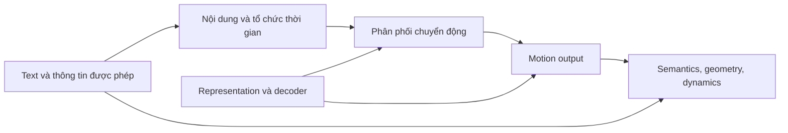

# Motion Generation: cơ chế, điều kiện hiệu quả và phản bằng chứng

Bản tổng hợp motion được hình thành trước vòng đọc sâu SLG và trước lựa chọn method; bản hiện tại đã được biên tập để đọc cùng bộ tài liệu cuối. Đây là **critical scoping review**, không nhận exhaustive coverage hoặc meta-analysis. [Ledger](02_reading_ledger.md) ghi đúng phạm vi đọc; acquired/abstract-only sources không thay deep evidence.

Kết luận từ motion literature là: **chưa đủ căn cứ chọn một họ kiến trúc chỉ vì nó đứng đầu một bảng benchmark.** Nhiều papers đổi representation, data, text encoder, supervision, duration input và evaluator cùng lúc. Cần chuyển giao những cơ chế có điều kiện rõ, kèm cách kiểm chứng chúng trên SLG.

## 1. Tách những quyết định thường bị gom thành “method”

| Quyết định | Các lựa chọn đã khảo sát | Câu hỏi |
|---|---|---|
| Representation | Positions/rotations, compact features, discrete codes, continuous latents | Thông tin nào mất trước khi sinh? |
| Factorization | Whole sequence, temporal AR, random-order masks, next-scale, chunks | Những outputs nào phụ thuộc nhau và nhìn được future context nào? |
| Distribution head | Categorical CE, regression, diffusion/flow từng latent hoặc toàn sequence | Một điều kiện cho nhiều kết quả hợp lệ bằng cách nào? |
| Conditioning | Pooled sentence, text tokens, events, typed part descriptions | Model có đủ thông tin để phân biệt yêu cầu chi tiết không? |
| Timing | Given length, EOS, learned stopping/duration, supplied boundaries | Model tự quyết định thời gian hay benchmark đã cung cấp? |
| Evaluation | Distribution, retrieval, paired geometry, dynamics/contact, structural tests | Motion plausible, đúng condition, hay chỉ hợp evaluator? |

MoMask dùng discrete representation và masking; T2M-GPT dùng discrete temporal AR. MARDM/MoLingo dùng continuous latents nhưng vẫn iterative masked factorization. MDM direct whole-sequence diffusion, còn DisCoRD giữ discrete predictor và thay decoder bằng flow. “AR”, “VQ” và “diffusion” không loại trừ nhau. [Foundations](evidence/M11_generator_foundations.md), [MoMask](evidence/M07_momask.md), [MARDM](evidence/M05_mardm.md), [DisCoRD](evidence/M13_discord.md).

Đây là sơ đồ phân tích, không phải pipeline bắt buộc. Học chung hoặc tách stages là quyết định cần evidence; thêm module chưa tự tạo novelty.

## 2. Reconstruction tốt chưa đồng nghĩa dễ conditional generation

Phân biệt khả năng decoder tái tạo từ reference code và khả năng text predictor sinh đúng code. Capacity cao có thể giữ detail nhưng làm target distribution khó học.

- MLD tăng latents 1→7 giảm reconstruction error nhưng generation FID tăng. Đây là continuous model, nên trade-off không riêng VQ.
- MoMask tăng residual depth, LG-Tok tăng token count: có settings reconstruction tốt hơn mà generation xấu hơn.
- MotionStreamer near-identity AE tái tạo rất tốt nhưng generation kém regularized causal TAE.
- DisCoRD full-sequence decoder training cho rFID tốt hơn local windows nhưng generated-code performance kém hơn.

Các kết quả hội tụ ở kết luận có phạm vi: **reconstruction không là tiêu chí đủ chọn representation**. Chúng chưa xác lập một compression ratio tối ưu phổ quát. [MLD](evidence/M11_generator_foundations.md), [MoMask](evidence/M07_momask.md), [LG-Tok](evidence/M03_lgtok.md), [MotionStreamer](evidence/M12_motionstreamer.md), [DisCoRD](evidence/M13_discord.md).

Với SLG cần chẩn đoán input fitting→representation→decoded reference, rồi text→generated representation. Nếu code đúng còn giữ contrast mà predictor chọn sai, chưa thể kết luận quantization là bottleneck chính. Nếu fitting đã mất thông tin, đổi generator là một can thiệp khác với sửa observation pipeline.

## 3. Discrete và continuous đều có điều kiện hiệu quả

Discrete codes cung cấp finite vocabulary/classification targets. Continuous models bỏ nearest-code quantization nhưng còn encoder/normalization/compression/decoder errors. MAR cho thấy AR chỉ cần conditional distribution và sampler, có thể dùng diffusion head; nguyên lý đã được MARDM/MotionStreamer/MoLingo chuyển sang motion. Continuous AR hoặc AR+diffusion vì thế đã có prior art. [MAR và transfer](evidence/M17_cross_domain_transfer.md).

Hai phản bằng chứng quan trọng: T2M-GPT cho thấy EMA/reset/history corruption có tác động lớn, nên một VQ baseline train yếu không đại diện giới hạn discrete modeling. DisCoRD có trường hợp FID tốt hơn nhưng alignment giảm khi codes quá thô; stochastic decoder có thể thêm plausible detail mà thiếu evidence để giữ đúng thuộc tính được yêu cầu. [T2M-GPT](evidence/M11_generator_foundations.md), [DisCoRD](evidence/M13_discord.md).

Ngược lại, FID tốt chưa chứng minh discrete codes giữ semantics. Gesture probing cho thấy geometry dễ đọc hơn handshape/communicative intent, nhưng pooled probes có thể che temporal information. Cần sequence-aware/raw-input/pre-quantization controls trước khi kết luận thông tin đã mất. [Gesture semantics](evidence/M06_gesture_token_semantics.md).

## 4. Semantic conditioning phụ thuộc thông tin và supervision

MLD một condition token cho concatenation tốt hơn cross-attention; MoLingo nhiều T5 tokens/adapter lại cho cross-attention tốt hơn. Hai findings khác điều kiện, không triệt tiêu nhau hoặc xác lập một conditioning primitive tốt nhất.

| Cơ chế | Nguồn | Thông tin/supervision thêm |
|---|---|---|
| Semantic-aware representation | MoLingo, LG-Tok | Frame labels hoặc text path trong codec |
| Semantic units | Event-T2M | Caption decomposition và motion-aware text encoder |
| Typed part conditions | FrankenMotion, ParTY, HandX | Timelines, part descriptions hoặc left/right/relation roles |
| Sequence alignment loss | HumanTOMATO | Pretrained aligned text/motion model |

Nguồn và locators: [MoLingo](evidence/M01_molingo.md), [LG-Tok](evidence/M03_lgtok.md), [Event-T2M](evidence/M04_event_t2m.md), [FrankenMotion](evidence/M02_frankenmotion.md), [ParTY](evidence/M10_party.md), [HandX](evidence/M15_handx.md), [HumanTOMATO](evidence/M08_human_tomato.md).

Các giới hạn không được bỏ:

- Thêm BABEL/LLM descriptions/motion pretraining là information gain, chưa riêng architecture gain.
- MoLingo SAE, HumanTOMATO TMA và Event-T2M có các quality/alignment trade-offs; không gọi mọi semantic regularization là all-metric improvement.
- Ordered event list đi vào attention chưa tự là order constraint. Hoán vị đồng thời K/V không đổi attention nếu thiếu position cues; global caption vẫn có thể giữ order. Event-T2M cũng có failure case đủ events nhưng hơi đảo thứ tự. Muốn causal claim cần intervention/code audit.

## 5. Whole-body cần xét capacity và coordination riêng

HumanTOMATO tách body/hand codebooks nhưng coupling và shared decoder; published face generator là RVQ+GPT riêng, khác facial cVAE trong arXiv v1. EMAGE có bốn priors cùng body hints/audio. FrankenMotion joint-denoise theo part timelines; ParTY sinh part guidance trước holistic output; HandX có left/right/relational conditions. Các factorization này không đồng nghĩa independent articulators. [HumanTOMATO](evidence/M08_human_tomato.md), [EMAGE](evidence/M09_emage.md), [FrankenMotion](evidence/M02_frankenmotion.md), [ParTY](evidence/M10_party.md), [HandX](evidence/M15_handx.md).

Tách capacity là một cách bảo vệ channels nhỏ, nhưng evidence chưa xác định factorization tối ưu chung. Cần giữ các giới hạn transfer:

- MoLingo/ParTY chủ yếu body; LG-Tok bỏ fingers/face dù dùng Motion-X. Dataset name không chứng minh detailed whole-body output.
- HumanTOMATO expression/activity hoặc EMAGE speech rhythm chưa xác nhận grammatical NMM scope.
- HandX both-hands-active filtering có thể loại one-handed signs/holds hợp lệ.
- Text2BFM executable body prior không tự thêm fingers/face ngoài action space của nó.

Đây là điều kiện cần kiểm tra khi vào SLG, không phải bottleneck đã được review tái lập trên sign datasets.

## 6. Duration, order, continuity và coarticulation khác nhau

| Hướng | Timing có sẵn | Đã kiểm tra | Chưa được tự suy ra |
|---|---|---|---|
| MDM/MoMask | Target length trong setup đã đọc | Generation theo caption | End-to-end duration prediction |
| T2M-GPT | EOS/max length | Token-sequence stopping | Đủ nội dung trước khi dừng |
| MotionStreamer | Learned end latent/prompt stream | Causal continuation | Mọi evaluation path đều không oracle |
| FlowMDM | Descriptions/durations/boundaries | Composition và transitions | Tự dịch/tạo timeline |
| FrankenMotion | Structured part/action windows | Asynchronous control | Predicted timeline từ text chất lượng tương đương |
| Glow-TTS | Train-only MAS, test duration predictor | Monotonic phoneme alignment | Spoken-order→sign-order translation |
| F5-TTS | Audio reference rate và character ratio | Implicit local alignment | Duration-free inference |

Nguồn: [foundations](evidence/M11_generator_foundations.md), [MotionStreamer](evidence/M12_motionstreamer.md), [planning/composition](evidence/M16_temporal_planning.md), [speech transfer](evidence/M17_cross_domain_transfer.md).

FlowMDM hỗ trợ joint realization khi biết cả trước/sau, MotionStreamer giữ causal prefix cho online response. Chọn context phải theo input/application constraints, không chỉ FID. Boundary smoothing có thể xóa stroke/hold; coarticulation chưa được đo bằng jerk thấp đơn thuần.

Glow-TTS minh họa train-only alignment không cần reference tại inference, nhưng monotonic/surjective phoneme assumption không thể áp thẳng lên spoken words nếu sign order khác. Cần target-order representation hoặc alignment class khác. ACT cho same-timestamp consistency trong closed loop; offline sign generation không có robot observations để sao chép cơ chế đó nguyên trạng.

## 7. Metric gain chưa là linguistic correctness

MDM có FID tốt hơn nhưng retrieval thấp hơn baseline. MARDM cho thấy representation/evaluator thay thứ hạng. DisCoRD có naturalness/paired-error trade-offs. STRIDE cho thấy coarse retrieval có thể bỏ structural contrasts; shuffle caption–motion pairings không đổi FID vì motion marginal giữ nguyên. [Foundations](evidence/M11_generator_foundations.md), [MARDM](evidence/M05_mardm.md), [DisCoRD](evidence/M13_discord.md), [STRIDE](evidence/M14_stride.md).

Từ đó suy ra thiết kế SLG cần **distribution quality, conditional semantics, articulation/dynamics và comprehension**. Semantic teacher không nên là evaluator quyết định duy nhất. Hard negatives cần được xác nhận thay meaning trong đúng sign language, tránh phạt valid variants.

Không có source nào ở đây xác lập định lượng rằng mọi SLG evaluator có cùng bias với HumanML3D; phải audit tại target domain.

## 8. Ma trận chuyển giao

| Nguyên lý | Cơ sở | Điều chỉnh bắt buộc cho SLG |
|---|---|---|
| Continuous stochastic heads | MAR/MARDM/MotionStreamer | Joint coordination, compute và limited data |
| Representation theo semantic needs | MoLingo/LG-Tok/HumanTOMATO | Teacher/labels phải grounded trên contrasts cần giữ |
| Capacity riêng + context chung | Whole-body/part methods | Hands/body/face có quan hệ và time scopes khác nhau |
| Alignment/duration learning | Glow-TTS/F5-TTS | Xử lý translation/reordering và input availability |
| History/chunk training | T2M-GPT/MotionStreamer/ACT | Generated-history errors, không giả có closed-loop feedback |
| Structural evaluation | STRIDE/gesture probes | Language-valid interventions, independent comprehension |

Không hàng nào tự bảo đảm novelty/SOTA. Ma trận tạo tập cơ chế cạnh tranh trước vòng SLG và candidate comparison.

## 9. Phạm vi, bổ sung sau synthesis và trace quyết định

Trục peer-reviewed gồm CVPR/ICCV, ICML HumanTOMATO, NeurIPS MAR/Glow-TTS, ACL F5-TTS và RSS ACT. Preprints như STRIDE/Text2BFM bổ sung hypotheses/counterevidence với status riêng. OpenT2M/Möbius chỉ đọc chọn lọc; MATE/SoPo/GMMotion/VeMo mới metadata, không là causal evidence cho method được chọn. Không đọc một source chưa phải bằng chứng prior art không tồn tại.

Sau SLG synthesis, targeted search bổ sung [SegMo](evidence/M18_segmo.md), cho uniform segmentation tốt hơn CPD/clustering trong study của nó; và [segmental uncertainty foundations](evidence/M19_segmental_uncertainty.md), xác nhận DP/distributional segmentation đã có. Các nguồn này giới hạn claim của temporal candidate, không được dùng để đổi retrospective story rằng mọi evidence đều ủng hộ nó.

Chuỗi đọc: motion synthesis → [SLG](04_slg_literature_synthesis.md) → [benchmark](05_benchmark_contract.md) → [ba phương án](06_candidate_methods.md) → [lựa chọn/main method](07_main_method.md). Sự độc lập thể hiện qua các nguồn và đối chứng này, không qua việc cố chọn một tên kiến trúc khác repo.
