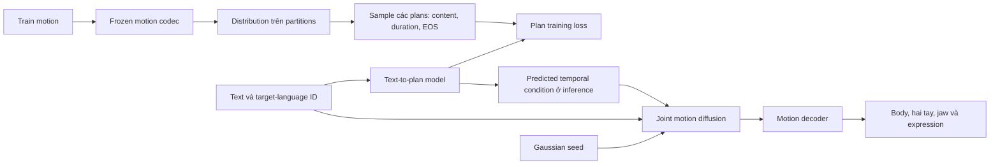

# Phương án chính: học temporal plans từ nhiều cách phân đoạn hợp lý

**Đây là proposal nghiên cứu, chưa có kết quả thực nghiệm.** Tôi ưu tiên phương án B trong [so sánh ba ứng viên](06_candidate_methods.md), với một claim hẹp: kiểm tra liệu việc học trên phân phối các temporal partitions có giúp text-to-sign generation ổn định hơn khi motion-derived boundaries nhiễu. Chưa đặt tên như một method đã được xác thực, chưa khẳng định novelty toàn literature và chưa hứa SOTA.

## 1. Vì sao chọn hướng này sau khi so sánh

A nhắm trực tiếp semantic distinctions, nhưng phụ thuộc một bộ contrast annotations và teacher đủ đáng tin trên cả ASL, CSL, DGS. C tận dụng motion thật, nhưng sentence retrieval chưa đảm bảo cùng signing content; gloss retrieval lại làm How2Sign cần thêm một nguồn supervision. C còn rất gần SignRR và SignSparK. Đây là những hướng có giá trị nhưng hiện có rủi ro dữ liệu hoặc prior art lớn đối với một đề xuất chung cho ba datasets.

B có thể dùng text–motion pairs của cả ba datasets, không yêu cầu gloss toàn corpus. Câu hỏi của nó cũng có đối chứng rõ: giữ nguyên codec, planner và generator, chỉ đổi point partition thành structured distribution. SIGNER cho thấy timing/conditioning interface quan trọng trong study của nó; BLANC đã cho thấy motion-derived scheduling là khả thi mà không gloss. Phần đề xuất cần vượt là cách xử lý **bất định của pseudo targets**, không phải phát minh duration hoặc clock. [SIGNER](evidence/S04_signer.md), [BLANC](evidence/S09_blanc.md).

Phản bằng chứng mạnh là SegMo: uniform segmentation tốt hơn CPD/clustering trong study của nó. Vì vậy lựa chọn B là ưu tiên một giả thuyết có thể bác bỏ, không phải kết luận càng nhiều segmentation càng tốt. Nếu structured uncertainty không hơn point/jitter/uniform ở predicted-plan inference, không còn lý do giữ cơ chế chính. [SegMo](evidence/M18_segmo.md).

## 2. Giải thích trực giác và một ví dụ

Giả sử input tiếng Anh cho ASL là “Tomorrow, will it rain?”. Model cần học cách diễn đạt bằng ASL từ paired examples. Proposal không tự viết một gloss sequence giả hoặc giả định ba cụm tiếng Anh phải tương ứng ba signs theo cùng thứ tự.

Trong một training motion, vùng chuyển từ một articulation sang articulation tiếp theo có thể kéo dài vài frames. Teacher có thể chọn cut ở frame 40, nhưng frame 38 hoặc 43 cũng hợp lý về tổ chức motor sequence. Nếu chọn một cut rồi coi nó là nhãn tuyệt đối, planner bị phạt cho những cách bố trí gần nhau dù cùng reference motion. Đề xuất giữ nhiều partition hợp lệ, học content và duration từ chúng, rồi yêu cầu planner tự sinh một plan khi chỉ có text.

Khi inference, planner có thể sinh bốn motor intervals với durations 12, 18, 10, 16 frames. Các số này chỉ là ví dụ minh họa, không là ASL transcription hoặc dự đoán thật. Realizer nhận toàn câu và plan đó để sinh motion liên tục 56 frames. Bốn intervals không được gọi là bốn signs nếu chưa có linguistic annotation xác nhận.

Jaw, expression và head rotations có thể được sinh cùng tay/body trong representation hỗ trợ. Model chưa có quy tắc riêng đảm bảo question marker có scope đúng; điều đó phải được kiểm tra bằng evaluation, và không được suy ra chỉ từ việc output có mặt.

Nhánh từ training motion kết thúc ở teacher/supervision. Nó không chạy trên reference test motion để cung cấp plan hoặc length cho inference.

## 3. Representation và scaffold cụ thể

### 3.1 Motion channels

Để giữ khả năng đối chiếu với SOKE/MaDiS, primary representation lấy cùng active parameters của SOKE: 10 body joints, 15 joints mỗi hand, jaw và 10 expression coefficients. Body joints tương ứng phần còn lại sau 11 early body joints trong SMPL-X body-pose order; implementation sau này phải pin joint map từ public source đã audit, không suy theo tên biến. Root, early body joints và shape xử lý như common benchmark contract. [SOKE code audit](evidence/S01_soke.md).

Đổi axis-angle sang 6D rotations cho learning: body 60D, left hand 90D, right hand 90D, jaw 6D và expression 10D, tổng 256D/frame. Output được project về valid rotations trước FK rồi đổi về common evaluation representation. Hai rotation vectors được orthonormalize bằng Gram–Schmidt; nếu vector thứ nhất gần zero, dùng basis axis e1. Nếu thành phần trực giao của vector thứ hai gần zero, chọn basis axis ít cùng phương nhất với vector thứ nhất rồi project/normalize; cross product tạo trục cuối. Ghi tỷ lệ fallback/degenerate outputs như diagnostic, không giấu bằng projection. Không tính Euclidean loss trực tiếp trên axis-angle quanh discontinuity nếu có thể dùng geodesic/FK.

Làm rõ khi triển khai: SOKE dùng official SMPL-X với hand-pose mean. Vì vậy 6D mã hóa effective rotations sau khi cộng pose mean; khi xuất raw 133D phải trừ mean trước khi gọi SMPL-X. Điều này bảo toàn chuyển động khi axis-angle có wrap, giữ cùng fitting convention; không âm thầm đổi flat_hand_mean. Pose-mean offsets được lưu cùng checkpoint. Kiểm tra CPU với official engine/rig tổng hợp nằm trong tests/temporal_plan/test_smplx_adapter.py; đây là kiểm tra quy ước hình học, chưa là benchmark trên human assets.

Jaw/expressions tạo face stream 16D; head/neck rotations ở body stream theo joint map. Representation này chưa chứa explicit eye gaze hoặc mọi mouth detail. Mở rộng NMM representation là một benchmark track riêng, không phải claim chính đã được giải quyết.

Mỗi dataset giữ common FPS giữa candidate và baselines. Durations được định nghĩa theo frame rate đã pin, không tự coi “một token = một sign”. Chỉ số sau codec là latent timestep, khác frame index.

### 3.2 Motion codec

Bốn local temporal encoders, mỗi stream output 64D Gaussian latent, temporal stride 2. Các encoder dùng Conv1D kernel 3, residual temporal blocks với dilations 1/2/4; decoder mirror upsampling. Sau upsampling, concatenate part features và joint temporal projection để decode 256 channels. Với `T` frames, `L=ceil(T/2)` và `z∈R^(L×4×64)`.

Training codec dùng per-part rotation/geometric reconstruction, expression Smooth L1, velocity matching và KL regularization nhỏ. Giá trị khởi đầu: KL coefficient 1e-4; FK 1; velocity 0.1 sau khi chuẩn hóa từng thành phần theo train statistics. Đây là cấu hình đề xuất, cần validation, không phải số đã tối ưu. Body/hand/face losses được lấy mean trong mỗi part trước khi cộng để tránh số chiều quyết định trọng số.

Viết gọn objective codec: `L_codec = Σ_p(L_rot^p + L_expr^p) + L_FK + 0.1 L_vel + 1e-4 L_KL`. Chỉ tính rotation/expression terms ở channels có loại tương ứng. L_rot là mean geodesic rotation distance; L_expr là Smooth L1 trên normalized expression coefficients; L_FK là mean joint-position error sau inverse normalization/valid-rotation projection; L_vel khớp finite differences ở cùng FPS. Với Gaussian posterior mean μ/log-variance v, `L_KL=0.5 mean(μ²+exp(v)−1−v)` so standard normal. Đó là regularization của latent distribution, chưa bảo đảm physical correctness. Decoder được freeze về weights khi train generator nhưng gradient từ decoded losses vẫn truyền về predicted latents.

Sau codec training, freeze encoder/decoder; teacher dùng posterior mean để không thêm sampling noise vào boundary evidence. Cần kiểm tra raw fitted motion và codec reconstruction bằng semantics/articulation diagnostics trước khi quy lỗi cho generator. Nếu codec làm mất contrasts, sửa representation hoặc đổi sang matched VQ/raw-pose baseline; không dùng thêm planner để che mất thông tin. [Motion review](03_motion_literature_synthesis.md).

## 4. Teacher distribution: giữ các partition hợp lệ, không gán lexical labels

Gọi `f_t∈R^256` là concatenated frozen codec features, chuẩn hóa bằng train means/stds. Với mỗi possible interval `(i,j]`, duration `d=j-i` trong `[1,Dmax]`, tính score. Khởi đầu `Dmax=32` latent steps; đây là motor scheduling limit, không là maximum sign duration.

### 4.1 Segment score

Tại một cut `j`, tính change evidence `b_j` từ chênh lệch trung bình features trước/sau ở radii 1/2/4. Mỗi part được normalise trước tổng hợp. Có thể kế thừa multi-scale boundary scoring của BLANC như một control; không nhận novelty từ score này.

Với interval `(i,j]`, lấy 8 phase samples của `f_(i+1:j)` bằng linear interpolation, rồi nội suy ngược lên duration gốc để tính distortion `R(i,j)`. Short intervals được xử lý bằng interpolation cùng quy tắc, không nhân bản padding vào loss. `R` là mean squared error trên standardized features, không phải linguistic quality.

Định nghĩa:

`a(i,j) = -α R(i,j) + β b_j 1[j<L] - η`.

Penalty `η` hạn chế chia quá nhiều đoạn; `b_L` không thưởng thêm endpoint. Một setting ban đầu là `α=1, β=0.5, η=0.3`, sau khi normalise change evidence về thang tương đương. Những trọng số này là giả định thiết kế. Validation sensitivity phải đo cả số segments, mean duration và generation, tránh chọn temperature bằng test BT.

### 4.2 Distribution và sampling

Với partition `τ=(0=τ_0<…<τ_K=L)` phủ hết sequence:

`q(τ|X) = exp(Σ_s a(τ_(s-1),τ_s)/temp) / Z(X)`.

Mọi duration nằm trong support, không có gap/overlap. Tính log-normalizer:

`F(0)=0`,

`F(j)=logsumexp_(d=1..min(Dmax,j)) [F(j-d)+a(j-d,j)/temp]`.

`log Z=F(L)`. Backward sampling chọn predecessor `i` với probability tỷ lệ `exp(F(i)+a(i,j)/temp-F(j))`. Lặp tới 0 rồi đảo thứ tự segments. Không sampling từng cut độc lập. Complexity của DP là `O(L·Dmax)` sau khi đã precompute interval scores; cost tính `R(i,j)` phải tính thêm, không bị giấu trong claim này.

Initial temperature 0.5; so với 0.1/1.0 và point-MAP. `q` là **pseudo-target distribution theo teacher score**, không phải calibrated probability của các sign boundaries thật. Không dùng ký hiệu posterior để ngụ ý nó đã được suy từ một linguistic generative model đúng.

Hai partitions được sample cho mỗi selected training example, dùng cùng reference motion. Decoder không average hai motions hoặc hai semantic plans trước loss. Nó học expected loss qua từng sampled plan; điều này tránh coi trung bình của hai interpretations là một interpretation hợp lệ.

## 5. Content units và text-to-plan model

### 5.1 Content targets

Từ 8 phase samples của mỗi interval, một frozen segment encoder nén `8×256` features thành `e_s∈R^128`; một small decoder tái tạo phase samples. Segment codec được pretrain trên segments của **train motions**, theo cùng teacher support, bằng mean squared error tái tạo 8×256 phase features rồi freeze. Encoder/decoder khởi đầu là MLP 2048→512→128 và chiều ngược lại, GELU ở hidden layer. Segment-code reconstruction được báo riêng, không giả định code 128D luôn đủ articulation. Mean/std của `e_s` cũng chỉ fit train.

Duration `d_s` giữ riêng; plan unit là `(e_s,d_s)`. Nén phase trajectory giữ nhiều thông tin hơn chỉ mean pooling, nhưng có thể mất articulation hoặc mang signer style khó dự đoán từ text. Đây là giả thuyết representation cần oracle-plan reconstruction và probe, không khẳng định `e_s` đã là lexical code.

### 5.2 Prior từ text

Text encoder khởi đầu dùng encoder của mT5-Base, lựa chọn multilingual đã xuất hiện trong [SignFLIP](evidence/S07_signflip.md); pin checkpoint/tokenizer trước experiment. Text features được project về 512D trước planner/realizer. Mặc định đóng băng pretrained text encoder trong các stages, chỉ train adapters/projections và language embedding ASL/CSL/DGS. Fine-tuning encoder là ablation riêng cùng budget cho controls, không âm thầm đổi giữa variants. Planner 4-layer causal Transformer, hidden 512, 8 heads; mỗi plan step cross-attend **toàn bộ text tokens**. Prefix gồm các content/duration units trước đó cùng position embedding.

Planner dự đoán:

- `p(e_s|e_<s,d_<s,y,l)`: mixture bốn diagonal Gaussians 128D; predict log-variance, khởi đầu clamp trong [-6,2] trên content latents đã chuẩn hóa; sensitivity kiểm tra trên validation, không trên test.
- `p(d_s|e_≤s,d_<s,y,l)`: categorical trên 1…32 latent steps.
- `p(stop_s|e_≤s,d_≤s,y,l)`: Bernoulli, quyết định sau unit hiện tại.

Không ép attention vào words theo thứ tự. Model học target motion order từ plan sequences của training pairs, vì spoken order có thể khác sign order. Một motor unit cũng có thể cross-attend nhiều words; attention map không được coi là linguistic alignment ground truth.

Loss trên sampled teacher plans:

`L_plan = E_(τ~q) mean_s [-log p(e_s|prefix,y,l) - λ_d log p(d_s|prefix,e_s,y,l) + λ_stop BCE(stop_s,1[s=K])]`.

Khởi đầu `λ_d=λ_stop=1`, các thành phần được normalize theo units và dimensions trước so sánh. Đây là expected NLL pseudo supervision; không tự gọi là exact likelihood của toàn motion sequence hoặc exact ELBO. Đối với content term, dùng −log mixture density chia 128 để cân với duration/EOS; đây là weighting của training objective, không phải joint plan likelihood nguyên dạng. Dùng teacher prefix ở training gây exposure gap; phải đo free-running planner thay vì chỉ report plan NLL.

## 6. Motion realization và training schedule

### 6.1 Biến plan thành temporal condition

Với một plan cụ thể, cumulative durations đặt start/end cho mỗi interval. Tại mỗi latent step `t`, condition gồm content `e_s`, normalized phase trong interval, `log d_s` và embedding part. Gần boundary, dùng linear overlap trong cửa sổ tối đa hai latent steps, rút ngắn nếu interval quá ngắn. Blending là motion transition conditioning, không xác nhận coarticulation đúng ngôn ngữ.

Realizer dự đoán toàn sequence, có context cả trước và sau. Nó không khóa body khi sửa hand, cũng không decode các intervals độc lập. Part-specific temporal attention và same-timestep cross-part attention hạn chế chi phí so với full attention trên `4L` tokens. Text cross-attention vẫn mở để không buộc mọi semantic detail đi qua compressed plan.

### 6.2 Diffusion objective

Dùng cosine DDPM schedule với 1.000 noise levels trong training:

`z_t = sqrt(αbar_t) z_0 + sqrt(1-αbar_t) ε`, `ε~N(0,I)`.

Denoiser `Fθ(z_t,t,y,l,C)` dự đoán clean latent `zhat_0`. Main loss:

`L_gen = E mean_parts ||zhat_0-z_0||² + λ_fk αbar_t L_FK(D(zhat_0),X) + λ_v αbar_t L_velocity(D(zhat_0),X)`.

Expression reconstruction dùng Smooth L1 riêng. `αbar_t` giảm ảnh hưởng auxiliary decoded losses khi noise cao. FK và velocity targets lấy từ fitted training reference, nên không gọi đây là real physics hoặc contact constraint. Initial `λ_fk=1`, `λ_v=0.1` sau normalization; same losses cho point/jitter/distribution controls.

Model khởi đầu 8 layers, hidden 512, 8 heads. Plan dropout 0.1 chỉ là regularization đã có precedent, không là novelty. Sampler khởi đầu DDIM 50 steps; các 10/25/50-step comparisons tính cả planner/content sampling cost. Không thay bằng flow chỉ vì literature có flow.

### 6.3 Các stages

1. Fit/normalize common representation; train motion codec, kiểm tra information preservation. Không thay fitting riêng cho candidate.
2. Tính teacher scores/distribution trên train, train segment codec và freeze. Cache scores cùng source IDs, không cache test-derived targets vào training.
3. Train planner với sampled plans. Baselines point, confidence-weighted point, jitter và uniform dùng cùng architecture và số plan examples.
4. Đóng băng planner, train joint diffusion bằng teacher plans. Loss expectation dùng từng plan sample, không nối hai samples làm thêm data mà bỏ qua compute.
5. Exposure training: planner vẫn đóng băng; một tỷ lệ ban đầu 25% examples dùng free-running text-predicted plans. Chỉ trong training, normalize relative predicted durations lên reference latent length bằng quy tắc tích phân overlap bên dưới để so paired motion; content units vẫn do planner dự đoán. 75% còn lại tiếp tục sampled teacher plans. So cùng schedule cho point controls.

Với predicted cumulative times u_s, tổng Lhat và training reference length L, đặt boundaries liên tục b_s=L*u_s/Lhat. Tại latent cell [t−1,t), lấy trọng số w_ts bằng độ dài giao với [b_(s−1),b_s). Temporal content là tổng w_ts*e_s; phase được lấy trung bình trên chính phần giao và duration feature dùng scaled duration. Tổng weights ở mỗi valid cell bằng 1. Không làm tròn từng duration độc lập nên vẫn xác định được condition khi số predicted units lớn hơn L; những units dưới một cell sẽ cùng đóng góp vào condition, cần báo tỷ lệ này vì có thể làm mờ content. Ở inference durations là số nguyên dự đoán và không có bước normalize bằng reference length. Prior tự sinh plan trước khi canvas training được căn; GT length không được cấp cho text-to-plan model.

Đây là căn condition cho paired training, không phải resample reference để chọn test result. Text/plan input dropout, noise level và loss weights phải giống nhau giữa point và distribution controls. Không backprop qua discrete backward sampling hoặc tự gọi toàn pipeline là exact end-to-end differentiable marginal inference.

Stage 5 chưa giải quyết mọi mismatch: inference tổng duration vẫn do prior quyết định, còn training reference length giúp ghép supervised tensors. Tỷ lệ teacher/predicted plan là hyperparameter; nếu model học bỏ qua plan hoặc predicted timing gap quá lớn, nghiên cứu phải báo thất bại của cơ chế. Không báo teacher-plan scores như text-only results.

Khởi đầu AdamW, learning rate 1e-4 cho planner/generator, batch effective 64; codec 2e-4. Dùng validation early stopping/compute budget chung và báo actual updates. Những lựa chọn này làm proposal triển khai được, chưa là bằng chứng hội tụ; không chuyển nguyên runtime của paper khác thành runtime dự kiến chắc chắn.

## 7. Inference hoàn chỉnh và input audit

1. Nhận text `y`, target-language ID `l`, seed; encode text.
2. Bắt đầu BOS plan. Sample/mode theo policy khóa trước: sample Gaussian mixture content, chọn duration mode, rồi stop decision với threshold khởi đầu 0.5. Threshold được khóa theo validation và dùng cùng policy cho controls. Primary policy không chọn plan bằng reference geometry hoặc teacher score trên test motion.
3. Lặp tới EOS. Tổng latent durations `Lhat=Σ d_s`; output length `That=2Lhat`. Odd target frame lengths chỉ ảnh hưởng reconstruction crop trong training; main inference không biết target odd/even.
4. Phân bổ `Lhat×4×64` Gaussian noise; tạo temporal conditions từ predicted plan, chạy DDIM và decode motion. Project rotations, lấy common joints và outputs.
5. Nếu vượt duration/step cap, đánh dấu cap-stop. Đặt Lcap=ceil(max training motion length/2), Kcap=Lcap vì minimum duration là một latent step. Mỗi duration choice bị giới hạn bởi remaining capacity; dừng nếu EOS, hết capacity hoặc đạt Kcap. Đây là policy khởi đầu cố định từ training support, không từ GT test length; mọi cap-stop vẫn nằm trong denominator và report failure/truncation rate.

| Thông tin | Train | Inference primary |
|---|---|---|
| Spoken text, target-language ID | Có | Có |
| Paired fitted motion và actual length | Có, để supervision | Không |
| Teacher partitions/content units | Tính từ train reference | Không |
| Gloss, linguistic boundaries | Không bắt buộc | Không |
| Predicted plan và predicted length | Dùng thêm trong exposure stage | Có, model tự sinh |
| Reference keyframes, retrieval exemplars | Không cần cho phương án này | Không |
| Ground-truth geometry để sample/rerank | Chỉ training loss | Không |

Không tuyên bố fully open vocabulary chỉ vì text encoder nhận mọi token. Unseen signs còn phụ thuộc training data và compositional generalization.

## 8. Kế thừa, đóng góp ứng viên và các giới hạn

| Thành phần | Nguồn/cơ sở | Trạng thái claim |
|---|---|---|
| Continuous motion codec, latent diffusion | MLD, MARDM/MoLingo family | Kế thừa; không mới |
| Part capacity và joint coordination | HumanTOMATO, EMAGE, SIGNER | Kế thừa/adaptation |
| Train-only timing targets, inference duration prediction | Glow-TTS; SIGNER; BLANC | Kế thừa; phải bỏ spoken-order assumption |
| Motion-derived boundary evidence | BLANC và segmentation literature | Kế thừa; không mới |
| Log-sum-exp DP và backward sampling | [Segmental/semi-Markov inference](evidence/M19_segmental_uncertainty.md) | Kỹ thuật chuẩn; không mới |
| Structured distribution thay point pseudo partition, kiểm chứng downstream SLG | Câu hỏi đề xuất từ ambiguity và BLANC/SegMo tension | Đóng góp ứng viên, novelty có phạm vi tìm kiếm |
| Chẩn đoán predicted/oracle gap và evaluator independence | Protocol nghiên cứu | Giá trị phương pháp luận, không tự là model novelty |

Đóng góp chỉ đáng giữ nếu uncertainty treatment tạo hiệu quả ngoài generic jitter/extra augmentation và ngoài teacher-forced evaluation. Hiện chưa có thực nghiệm xác nhận. Mục tiêu SOTA trên ba datasets được giữ trong [benchmark contract](05_benchmark_contract.md); nó không được thay bằng thắng một noise stress test. [Kế hoạch kiểm chứng](08_experiments.md) gắn từng claim với baseline và tiêu chí bác bỏ.

## 9. Kiểm tra công thức ở ví dụ nhỏ

[Diagnostic đại số](evidence/temporal_plan_math_check.json) đã liệt kê mọi partition với L=4, Dmax=2 và đối chiếu normalizer với forward recurrence: khớp tới sai số số thực. Ví dụ exposure có năm units trên hai latent cells vẫn có overlap weights tổng 1 mỗi cell. Check này chỉ xác nhận các công thức toy nhất quán, không xác nhận quality hoặc calibration của teacher.

Cùng diagnostic cho q=(.5,.5), likelihoods (.8,.2): expected negative log khoảng .9163, còn negative log của expected likelihood khoảng .6931. Vì vậy main objective đúng tên là expected-loss training trên structured pseudo plans; không được đổi tên thành exact marginal likelihood để tăng novelty claim.

## 10. Đọc method bằng những khái niệm đơn giản

- **Fitting** là ước lượng pose/mesh từ video. Reference thu được có thể sai, nhất là ở ngón tay bị che; khớp reference chưa luôn khớp cách ký hiệu thật.
- **Latent** là vector số nén chuyển động, không phải từ hoặc gloss. Codec học chuyển motion thành latent rồi giải mã lại; plan content code cũng chỉ là vector cho một đoạn motor trajectory.
- **Teacher** trong method là quy tắc tạo các cách phân đoạn từ training motion. Nó không phải chuyên gia biết sign boundaries đúng. Distribution q thể hiện các lựa chọn theo score của teacher, chưa là độ chắc chắn ngôn ngữ đã được xác nhận.
- **Planner** học từ câu đầu vào để dự đoán các content vectors, durations và thời điểm kết thúc. Nó không nhận chuyển động đích khi sử dụng thật. Full-text attention cho phép học khác thứ tự, nhưng không bảo đảm dịch đúng.
- **Realizer** biến plan và text thành motion liên tục. Diffusion bắt đầu từ noise và sửa dần; việc sửa noise nhiều bước cho phép học một phân phối chuyển động, thay vì luôn regress về một pose trung bình.
- **Ablation** là đối chứng bỏ/đổi đúng yếu tố cần kiểm tra. Ví dụ, nếu same-budget random jitter tốt bằng distribution q, ta không có evidence rằng structured uncertainty tạo lợi ích riêng.

Method học ba việc theo stages: giữ được motion information, dự đoán một temporal plan từ text, rồi hiện thực plan thành motion. Ý tưởng đáng kiểm tra nằm ở cách học temporal supervision, không nằm ở tên gọi của ba modules hoặc việc dùng diffusion. Train cần reference để học; inference phải tự tạo plan/length. Phần khác biệt giữa hai chế độ đó chính là một rủi ro trung tâm của proposal, không được che bằng oracle results.
