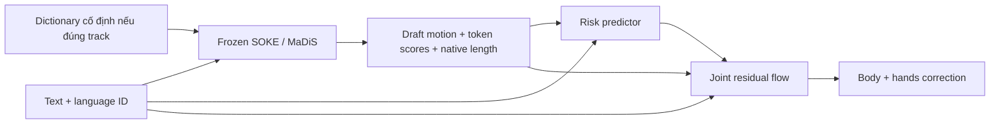

# Proposal v1 — giả thuyết post-refiner đã được hạ ưu tiên

**Bản này giữ để review trade-off, không còn là method khuyến nghị chính.** Đối chiếu primary evidence DisCoRD/HybridSign dẫn đến [proposal v2](05_revised_proposal.md). Không dùng kết quả experiment cũ trong repo SLP làm căn cứ.

**Tên làm việc:** RACE-Sign — Risk-Aware Coupled Error Correction for Text-to-Sign Motion.

**Trạng thái:** giả thuyết nghiên cứu, chưa có thực nghiệm và chưa xác lập novelty đầy đủ. Mục tiêu là vượt baseline đã tái lập trên protocol SOKE; không cam kết đạt SOTA. Đọc [benchmark audit](01_benchmark_audit.md) trước khi dùng bất kỳ số đích nào.

## 1. Câu hỏi nghiên cứu và lập luận

**RQ:** Với cùng tokenizer, dữ liệu và generator ban đầu, học sửa lỗi trên các rollout do generator thực sự sinh, đồng thời dự đoán vùng cần sửa và phối hợp tay–thân, có cải thiện độ chính xác ký hiệu hơn continuous refiner sửa mọi frame không?

SOKE tách body/hands để giữ chi tiết nhưng generation vẫn bị ràng buộc bởi codebook và phân phối lỗi LM. MaDiS đưa supervision xuống token/latent/physical space và học gate theo part, nghĩa là chỉ thêm geometry loss hoặc gate không còn đủ mới. SignSparK cung cấp continuous generation từ anchor, nhưng anchor mạnh không sẵn có trong GF. SIGNER đã có temporal local conditioning và IPA; BLANC đã có multi-rate tokens, adaptive clock và hand refinement. Những kết quả đó buộc proposal tập trung vào **phân phối sai số khi chạy generator và quyết định sửa đồng thời những phần nào**, thay vì tuyên bố phát minh part-wise, duration hay refinement. [SOKE](https://arxiv.org/html/2411.17799), [MaDiS](https://2000zrl.github.io/madis/), [SIGNER](https://arxiv.org/abs/2506.07460), [SignSparK](https://arxiv.org/html/2603.10446v4), [BLANC](https://arxiv.org/html/2610.24109v1).

Suy luận của proposal: motion ký hiệu có thể giữ hình dạng bàn tay tương đối wrist nhưng đặt tay sai trước mặt/ngực, hoặc hai tay lệch pha. Một hand-local metric không kiểm tra đầy đủ điều này vì đã bỏ wrist translation. Vì thế chất lượng local và quan hệ giữa bộ phận phải được đo riêng. Đây là động cơ từ metric/code, chưa phải bằng chứng rằng đây là lỗi chi phối dữ liệu.

**Đóng góp có điều kiện:** (i) phân tích generator error theo articulator và loại quan hệ; (ii) risk map dự đoán từ text/draft thay vì oracle GT; (iii) continuous correction được điều phối chung giữa body/hands và học trên rollout held-out. Nếu không vượt generic joint refiner ở cùng compute thì chỉ còn engineering baseline, không được quảng cáo method mới.

## 2. Gate chẩn đoán trước khi xây mô hình lớn

Trên dev, tạo bốn loại đầu ra và ghi per-sentence score: GT, tokenizer reconstruction, base generation, correction. Không xem reconstruction là lower bound toán học của generation; nó chỉ chẩn đoán một phần lỗi representation.

- Nếu reconstruction đã mất handshape và semantic probe tụt mạnh, một LM mới khó khôi phục chi tiết không còn trong decoder. Thử continuous correction trên reconstruction trước.
- Nếu reconstruction tốt nhưng generation thiếu cả dấu hoặc sai thứ tự, refiner giữ nguyên length khó sửa. Ưu tiên nâng semantic generator (MaDiS/mBART alignment), không dùng smoothing để che lỗi.
- Nếu wrist/body relations sai dù hand-local tốt, kiểm tra coupled correction.
- Nếu phần lớn lỗi đến từ pose fitting hoặc evaluator, giải quyết data/eval trước. Không gọi denoising fitting artifacts là linguistic improvement.

Cần báo cáo ablation **GT risk map** như oracle chẩn đoán riêng, không đưa vào hàng method chính. Nếu oracle risk không giúp refiner thì bỏ risk head. Đây là tiêu chí bác bỏ được, không phải module mặc định phải giữ.

## 3. Kiến trúc tối thiểu có thể triển khai

Dùng SOKE làm base đầu để giảm chi phí integration, sau đó thử cùng refiner trên MaDiS nếu checkpoint/eval khớp. **Không** gộp hai generator trong model chính. Các dòng dưới là thiết kế đề xuất:

- Input draft: pose 133 chiều theo SOKE, decode về rotations và expression. Đổi rotations sang 6D liên tục cho refiner, chuẩn hóa bằng thống kê train; output chiếu về SO(3), chuyển về đúng 133 chiều để evaluator cũ nhận được. Body/hand index phải lấy từ schema, không hard-code theo giả định “11 body joints” vì source đang chia 30+45+45+13.
- Motion encoder: ba nhánh body/LH/RH, width khởi đầu 256, 6 block, temporal stride 1 cho hands, body có thể stride 2 như ablation. Chỉ dùng multi-rate nếu giữ đúng timestamps sau upsample; không gọi đây là novelty.
- Joint interaction: ở mỗi frame, concat wrist, handshape summary và shoulder/head reference; attention giữa ba nhánh với relative wrist-to-body, wrist-to-wrist và orientation. Giữ identity LH/RH; không buộc mirror symmetry vì handedness có thể thay nghĩa.
- Text: token-level multilingual encoder của base, cross-attention toàn câu. Không áp monotonic alignment trên thứ tự từ ngôn ngữ nói. Local temporal conditioning chỉ thêm sau khi có latent sign-order alignment được kiểm chứng; chưa đưa gloss GT vào GF.
- Risk head: dự đoán `r[t,p]∈[0,1]` từ draft, token entropy, temporal variation và text features. Entropy chỉ là một feature, không mặc định là calibrated error probability. Khi base không trả logits, chạy feature-only ablation; không âm thầm đổi inference bằng ensemble đắt tiền.
- Correction: một continuous residual flow cho cả ba nhánh. Face/expression giữ từ base ở MVP và báo cáo limitation; full-face extension chỉ làm nếu dữ liệu/metric hỗ trợ. Cải thiện body/hand không đồng nghĩa SOTA non-manual grammar.

## 4. Xây dữ liệu lỗi mà không đưa GT vào inference

Gọi draft là `b=G(x)`, GT pose train là `y`. Không chỉ huấn luyện refiner với `b=Decode(Encode(y))`: reconstruction không có distribution của missing/repeated signs và sai lexical selection.

Dùng 3-fold cross-fitting ở train: generator huấn luyện trên hai fold sinh draft cho fold còn lại. Tokenizer/statistics chỉ dùng train; khai báo tokenizer đã thấy toàn train nếu giữ tokenizer chung. Sau đó freeze các rollout để train refiner, rồi huấn luyện base cuối trên toàn train. Kiểm tra distribution shift giữa fold-base và full-base trên dev. Nếu quá tốn, dùng train holdout generator và đánh dấu đây là approximation; không gọi in-sample drafts là out-of-fold.

Length của draft thường khác GT. **Phương án MVP:** giữ length `T_b` do base sinh; chỉ trong training, dùng DTW monotonic để map GT vào draft timeline:

`y_tilde[t] = rotation-aware average of {y[s] : (t,s) thuộc path}`.

Không average axis-angle trực tiếp: dùng quaternion/rotation averaging hợp lệ, expression dùng trung bình. DTW cost là weighted joint distance có body và hai wrist trong cùng coordinate frame. Path không là semantic alignment ground truth; lặp/thiếu dấu có thể làm target sai. Loại hoặc giảm trọng số các cặp có length ratio quá cực đoan bằng ngưỡng train/dev đã khóa; báo tỷ lệ bỏ. So với linear length resampling và correspondence từ reconstruction để đo độ nhạy.

**Giới hạn thực:** với target đã warp và output giữ native length, method không thể chắc chắn khôi phục dấu đã thiếu toàn bộ. Nếu lỗi này chi phối, dừng hướng MVP; chuyển sang generator có khả năng sửa length, không thêm GT duration để làm đẹp điểm. Báo native duration error, repetition và semantic adequacy bên cạnh DTW.

## 5. Flow objective nhất quán và risk conditioning

Làm trong standardized 6D rotation/expression coordinates. Gọi `δ* = y_tilde − b`, `ε~N(0,I)`, `δ_t=(1−t)ε+tδ*`, với `t∈[0,1]`. Học:

`L_FM = E ||vθ(δ_t,t,b,text,r) − (δ*−ε)||²_valid`.

Endpoint estimate: `δ_hat = δ_t + (1−t)vθ(...)`, output `y_hat = Project(b+δ_hat)`. Khác biệt với SignSparK: condition là draft sinh từ text và predicted risk; **không clamp GT keyframe**. Velocity target là endpoint difference, không phải `δ*−δ_t` chưa chuẩn hóa. Công thức áp dụng cho proposed refiner, không sửa lại paper SignSparK bằng suy đoán.

Risk target chỉ có trên train: `q[t,p]=1` nếu weighted joint/orientation error của draft vượt threshold τ_p chọn trên train/dev. Dùng BCE hoặc focal BCE, báo precision–recall, Brier và reliability bins. Pose fitting noise làm q nhiễu nên weight theo confidence nếu có; không tự tạo confidence từ score test.

Trong MVP, `r` là conditioning và weight của **trust loss**, không hard-zero correction. Tránh trường hợp risk dự đoán thấp làm vùng sai vĩnh viễn không được sửa:

`L = L_FM + λ_J L_joint + λ_rel L_relation + λ_v L_velocity + λ_tr mean[(1−r_detached)||y_hat−b||²] + λ_r BCE(r,q)`.

`r_detached` ngăn refiner giảm trust loss bằng cách tăng risk giả. Warm-up risk head rồi freeze trước giai đoạn refiner chính; kiểm tra lại joint training như ablation. Giá trị loss weight được chọn theo scale gradient trên train và grid nhỏ dev, không có căn cứ để ấn định trọng số “tối ưu” trước thực nghiệm.

`L_relation` so wrist-to-shoulder/head và wrist-to-wrist displacement của prediction với target train; có orientation/relative phase diagnostic. Đây là supervised matching, **không phải ép hai tay tránh nhau**. Nhiều ký hiệu cần contact; generic collision penalty có thể phá nghĩa. `L_velocity` khớp velocity GT đã warp thay vì phạt velocity về zero; giữ contrastive diagnostic các động tác ngắn/nhanh. Không thêm foot-contact loss của HumanML3D vào signing chỉ vì MDM có dùng.

Geometry loss trên endpoint dùng FK qua rotations đã project; mask padding cho mọi loss và cả finite differences. Khảo sát ổn định gần t=1, projection singularity, NaN và gradient clipping. Tránh trộn coordinate units trong loss nếu chưa normalization.

## 6. Inference cụ thể

1. Nhận text, sign-language ID và dictionary input được track cho phép.
2. Base sinh tokens/EOS; decode draft và native length. Không đọc GT motion, GT gloss hoặc GT duration.
3. Risk predictor xuất map. Khởi tạo residual noise có seed định trước; tích phân Euler 4/8/16 bước, chọn budget trên dev.
4. Project rotations về SO(3), trả schema gốc. Trả nguyên sample theo policy cố định; không dùng DTW test để chọn seed.
5. Lưu predicted length, risk, draft và output để audit. Cache text features được phép nhưng báo riêng cold/warm latency; tổng latency bao gồm base, retrieval, risk, flow và conversion.

Không cam kết model 4 bước sẽ đủ; step count là tham số thực nghiệm. Flow nhỏ bổ sung **không làm pipeline nhanh hơn base** nếu chưa có phép đo và thay đổi hợp lệ ở base.

## 7. Vì sao kế thừa có điều chỉnh domain

| Nguồn idea | Kế thừa | Thay đổi cần thiết | Phép thử chứng minh |
|---|---|---|---|
| MDM / SignSparK | Endpoint prediction cho geometric supervision | Chỉ sửa draft, không dùng anchor GT; velocity nhất quán | Linear-path analytic fixture; FM-only vs FM+geometry |
| MoMask / MaDiS | Chi tiết nhiều cấp và model biết uncertainty | Giữ tokenizer để tránh confound; risk học error rollout chứ không chỉ token confidence | Entropy-only vs calibrated-risk vs oracle-risk |
| SIGNER / HumanTOMATO | Phân tách bộ phận và trao đổi thông tin | Quan hệ tay với body được giám sát trực tiếp; không word-order monotonic | Independent vs generic joint attention vs relational model |
| ReMoDiffuse / SOKE | Reference motion là condition | Chỉ dictionary track; split/dictionary cố định; không copy cứng signs | Same dictionary, retrieval on/off; retrieval coverage strata |
| Rethinking Diffusion | Representation/evaluator phải kiểm chứng | Giữ angular features cần cho handshape, không bỏ rotation theo HumanML3D một cách máy móc | Same-data representation control và evaluator fixtures |
| MotionHiFlow | Coarse motion hỗ trợ detail | Không downsample hands mạnh; MVP không cần toàn bộ hierarchical framework | Uniform refinement vs hand-preserving variant |

Đây là lựa chọn thiết kế, không phải bằng chứng tổng các module sẽ cộng hiệu quả.

## 8. Novelty và phản biện mạnh nhất

**Đối thủ gần nhất:** [RAM](https://feifeifeiliu.github.io/RAM/) đã có reconstruction-based error guidance trong T2M; cần thêm REG control sau full-text audit. BLANC đã có hand refinement; MaDiS đã học geometry/gates; SIGNER đã phối hợp parts; SignSparK đã học sparse-conditioned continuous flow. RACE-Sign không thể claim “đầu tiên discrete+continuous”, “đầu tiên hand-aware” hoặc “đầu tiên adaptive generation”. Đóng góp chỉ có thể là cách **error-calibrated, rollout-trained, relational correction** hoạt động tốt hơn các đối chứng thích hợp.

Các cách giải thích khác cần loại:

- Tăng parameter/compute, không phải risk hay relations → refiner cùng parameter/NFE và unconditional residual MLP/Transformer.
- Học thêm dữ liệu hoặc dictionary → cùng dữ liệu, cùng dictionary, cùng base frozen.
- DTW alignment reward làm đẹp geometric metric → báo native timing, semantic evaluation, correspondence ablations; không dùng oracle alignment inference.
- Risk chỉ học speed hoặc length → report theo strata speed/length/frequency và counterexample confidently-wrong tokens.
- Smoothness xóa articulation → per-hand orientation/velocity spectrum và người dùng hiểu nội dung, không chỉ preference đẹp mắt.
- Gains do updated pose/BT → giữ old-pose và matched-new-pose experiments riêng.

Không có định lý bảo đảm SOTA. Nếu generic refiner đạt ngang kết quả, rút claim mechanism; nếu geometry tốt nhưng intelligibility xấu hơn, xem method thất bại cho SLP.

## 9. Thực nghiệm và tiêu chí tiếp tục

| ID | Thí nghiệm | Câu hỏi |
|---|---|---|
| B0 | SOKE frozen, đúng track/eval | Baseline có tái lập được? |
| B1 | SOKE + parameter-matched deterministic joint refiner | Có cần generative correction? |
| B2 | SOKE + all-frame residual flow | Tổng lợi ích flow là bao nhiêu? |
| B3 | B2 + risk conditioning/trust | Có giảm sửa hỏng vùng đúng? |
| B4 | B2 + relational features/loss, không risk | Coupling có ích riêng không? |
| B5 | B2 + risk + relations | Có interaction hay module dư thừa? |
| O1 | GT risk + B5 | Upper diagnostic, tuyệt đối tách hàng chính |
| D1 | Reconstruction-only vs in-sample vs cross-fit rollouts | Distribution gap có thật không? |
| D2 | Same refiner on MaDiS | Method sửa lỗi có độc lập base không? |
| D3 | Dictionary off/on cùng resource | Mức tăng đến từ retrieval hay correction? |

Pilot engineering trên tập train nhỏ không được dùng để suy ra SOTA. Pilot khoa học dùng dev đủ kích thước, báo variance và effect size; ngưỡng go/no-go đề xuất: giảm ≥5% hand JPE so B2, body không xấu quá 1%, và semantic score không giảm có ý nghĩa. Đây là **mục tiêu nội bộ**, không phải kết quả hay ngưỡng chuẩn cộng đồng. Dùng Pareto nếu geometric và semantic không đồng thuận, không chọn lại primary endpoint sau khi nhìn test.

Chạy chính CSL, xác nhận PHOENIX; How2Sign là extension kiểm tra miền rộng nếu compute đủ. Training giờ/GPU chưa đo nên chỉ lập budget theo measured steps/s, max VRAM và tokens/frames, không hứa số GPU-hour. Bắt đầu refiner nhỏ, batch với length bucket/gradient accumulation; profile 100–500 steps trước khi commit ngân sách. Chi phí cross-fitting phải được tính vào tổng training, không chỉ refiner.

Human study: blinded random order, người dùng fluent đúng sign language, nội dung comprehension và lỗi handshape/location/non-manual tách biệt naturalness; xác định sample size bằng pilot power analysis. Dữ liệu pseudo-3D không thay thế đánh giá người dùng. Không ứng dụng kết quả nghiên cứu như thông dịch đáng tin cậy trước đánh giá này.

## 10. Kết quả mong đợi và điều kiện thất bại

Kết quả mong đợi là kiểm chứng được quan hệ giữa generator error, risk và repair; SOTA là mục tiêu thực nghiệm tiếp theo. Dừng hoặc đổi hướng nếu (i) evaluator paper không tái lập, (ii) oracle repair không có headroom, (iii) lexical omission áp đảo, (iv) gains chỉ từ data/version hoặc compute, (v) semantic adequacy giảm. Khi (iii), ưu tiên MaDiS/time-grounded generation thay vì cố giữ refiner.

Nghiên cứu và văn bản được hỗ trợ bởi AI; các đề xuất và phép suy luận chưa được xác nhận qua training. Việc đọc source không tương đương tác giả/chuyên gia ký hiệu xác nhận mọi diễn giải. Novelty search hiện còn giới hạn, xem [reading status](research/reading_status.md).
