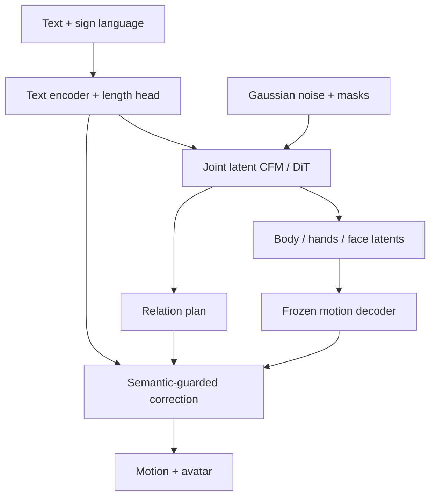

# Từ text-to-motion đến sign language production
## Literature review, phản biện và proposal đủ để triển khai

Ngày chốt nguồn: **10/11/2026**. Ngôn ngữ báo cáo: tiếng Việt. Tên phương pháp làm việc: **CPR-Flow — Contrast-Preserving Relational Flow for Sign Language Production**. Tên này là nhãn của proposal, chưa phải phương pháp đã được kiểm chứng hoặc một tuyên bố “first”.

### Quyết định nghiên cứu

Chọn **conditional flow matching trong latent liên tục**, với một Transformer chung cho body, hai tay, mặt và một luồng quan hệ hình học. Sinh text-to-sign offline trước; dự đoán độ dài từ text; không cần keyframe, gloss, pose tương lai hoặc video tham chiếu ở inference. Sau sinh, hiệu chỉnh quan hệ bằng một số bước nhỏ, có kiểm tra giữ đặc trưng ký hiệu và mức phù hợp với text.

Giả thuyết chính: mô hình hóa quan hệ và hiệu chỉnh có giới hạn có thể tăng độ chính xác không gian/phối hợp mà không làm giảm khả năng phân biệt ký hiệu. **Chưa có kết quả training trong báo cáo này.** Công thức, kiến trúc, hệ số loss và ngân sách dưới đây là thiết kế đề xuất, trừ khi ghi rõ là kết quả của tác giả.

Không lấy “dùng FM”, “DiT cho signing”, “multi-scale”, “part-wise tokenizer”, “contact map” hay “semantic loss” riêng lẻ làm đóng góp mới. Các ý tưởng đó đã có tiền lệ. Giá trị cần chứng minh nằm ở bài toán bảo toàn phân biệt ngôn ngữ khi sửa các quan hệ giữa bộ phận, cùng một thực nghiệm kiểm soát được representation, fitting và evaluator.

### Cách dùng tài liệu

Đọc mục 1–5 để đánh giá hướng nghiên cứu; mục 6–12 là specification; mục 13–17 là protocol thực nghiệm và kế hoạch lab. Gói implementation đi kèm có cấu hình khởi đầu, schema dữ liệu, ma trận ablation, danh mục nguồn và mã tham chiếu toán học CPU. Đó là blueprint; chưa phải code huấn luyện end-to-end.

## 1. Phạm vi và mức độ bằng chứng

Đây là focused research review có mở rộng truy tìm tiền lệ và ba vòng tự phản biện. Không phải một systematic review hoàn chỉnh theo PRISMA, và không thay thế phản biện độc lập của đồng nghiệp hoặc người dùng Deaf.

Đã tải full text của 33 paper vào phiên nghiên cứu: bảy paper được cung cấp, 25 paper mở rộng và JointHOI. Độ đọc được phân biệt rõ:

| Mức | Đã kiểm tra | Cách dùng |
| --- | --- | --- |
| A | Method, experimental setting và các phần appendix liên quan trực tiếp | Cơ sở quyết định kiến trúc/toán/protocol |
| B | Nguồn sơ cấp, abstract và/hoặc các phần chọn lọc | Lập bản đồ hướng, không gán chi tiết chưa đọc |
| C | Tiêu đề/chương trình hội nghị hoặc thông báo phát hành | Cảnh báo chồng lấn; chưa kết luận nội dung |

Bảy paper đầu vào đều ở mức A. Nhóm mở rộng được đọc tập trung ở mức A gồm MotionHiFlow, HY-Motion, MARDM, FM, RFM, REPA, MeanFlow và JointHOI. Các paper còn lại được kiểm tra ở mức B hoặc đọc chọn lọc; có full text không đồng nghĩa đã kiểm tra mọi chứng minh hay tái lập kết quả. Danh mục nguồn cuối tài liệu và `sources.csv` ghi mức sử dụng. Chỉ nguồn sơ cấp được dùng làm bằng chứng kỹ thuật; các trang tổng hợp chỉ hỗ trợ tìm paper.

Truy tìm gồm: citation chaining từ bảy paper; tìm text-to-motion + diffusion/FM; kiểm tra kỹ thuật nền; kiểm tra tiền lệ cho multirate, geometry, contact và semantic guidance; kiểm tra repo, file tree, README và license. Không có code upstream nào được chạy để tái lập bảng kết quả; không tải hoặc huấn luyện trên các dataset signing trong phiên này.

## 2. Bảy paper đầu vào: điều gì đã được giải quyết?

### 2.1 SignNMFlow — arXiv:2609.33339v1, 09/2026 [S01]

Paper xây đường vận chuyển trên tích các quaternion đơn vị, thay vì nội suy trực tiếp tọa độ rotation trong không gian Euclid. Nó học một độ lệch khỏi geodesic, dùng measure từ các motion prototype để định hướng đường đi; sau đó huấn luyện mạng dự đoán đích. Mặt vẫn ở không gian Euclid. Appendix mô tả sampling tái dự đoán đích và tái lập đường đi.

Bài học: phân biệt tính hợp lệ của rotation với phân bố motion tự nhiên. Phản biện của báo cáo: rotation hợp lệ chưa bảo đảm đúng handshape, tiếp xúc hay ngữ nghĩa; metric PA theo tay có thể bỏ qua sai vị trí tay trong signing space. Khi kế thừa, phải đọc cả target parameterization và sampler, không chỉ thay phép nội suy. Không suy diễn rằng mọi endpoint-regression loss đều giữ nguyên bảo đảm của velocity-matching. Đây là preprint tại thời điểm kiểm tra.

### 2.2 SignSparK — arXiv:2603.10446v4, ECCV 2026 [S02]

FAST lấy temporal anchors; mô hình CFM học sinh motion có điều kiện text và keyframes. Paper phân biệt text-to-pose, gloss-to-pose/stitching và keyframe-to-pose. Với retrieval, keyframes phải được lấy từ dictionary; dùng keyframes từ test motion là chế độ oracle khác. Body, tay và mặt có luồng riêng; loss tái tạo endpoint và vận tốc bổ sung cho flow.

Bài học: anchors giảm bất định và giúp điều khiển. Phản biện: không so số từ KF2P với text-only. README hiện tại thông báo dữ liệu đã re-optimize và checkpoint dùng lượng dữ liệu lớn hơn bản paper; vì thế cần version dữ liệu và retrain baseline nếu muốn suy luận nhân quả. Tái sử dụng pipeline khả thi, nhưng weights công bố không mặc nhiên là checkpoint tái lập đúng setting paper. [R01]

### 2.3 MaDiS — arXiv:2601.19577v2, 03/2026 [S03]

MaDiS dùng masked discrete diffusion language model, pretraining ở token, latent và không gian vật lý; temporal checkpoints tổ chức unmasking và mixture-of-parts trộn thông tin các luồng. Nó không phải Gaussian diffusion trên pose liên tục. Paper giới thiệu SiBLEU/SiCLIP để đánh giá và báo cáo lợi ích throughput.

Bài học: pretraining liên phương thức và sinh hai chiều đáng học. Phản biện: ưu thế có thể đến từ LM, pretraining hoặc tokenizer, không chỉ diffusion; phải match dữ liệu và compute. Các metric mới cần được kiểm tra sensitivity với ngón tay/mặt. Không xem metric do một hệ thống đề xuất là xác nhận độc lập. Abstract ghi sẽ công bố mã và mô hình; phiên nghiên cứu chưa xác minh một training release hoàn chỉnh.

### 2.4 SOKE — arXiv:2411.17799v3, ICCV 2025 [S04]

SOKE có tokenizer tách body/hands, generator mBART đa ngôn ngữ và retrieval dictionary. Multi-head decoding dự đoán nhiều part token mỗi bước. Bộ fitting công bố là điểm xuất phát thực dụng cho benchmark 3D.

Bài học: representation theo articulator và text conditioning mạnh. Phản biện: retrieval là nguồn thông tin bổ sung; cần hàng no-retrieval riêng. Không đồng nhất spoken-language word với sign/gloss. Fittings và latent phục vụ body/hands chưa tự chứng minh fidelity của NMF. Repo có license CC BY-NC-ND: dùng làm baseline/reference; không mặc định phát hành một fork sửa đổi. Điều kiện dữ liệu và body model phải kiểm tra riêng với điều kiện code. [R02]

### 2.5 SeRV — arXiv:2609.05742v2, 10/2026 [S05]

SeRV thêm global và token-level text alignment vào RVQ tokenizer; Hierarchical GPT sinh theo tầng residual. Bản v2 được đọc mô tả OpenASL, khác một số thông tin v1 còn nằm trên trang tổng hợp. Đây là lý do không trộn số liệu hoặc dataset giữa các version.

Bài học: học latent có thể dự đoán từ ngôn ngữ quan trọng không kém reconstruction. Phản biện: global text similarity dễ bỏ qua khác biệt rất nhỏ nhưng đổi nghĩa. Với CPR-Flow, alignment là thành phần kế thừa, không là novelty. Cần đo xem latent và guard có phân biệt minimal pairs hay chỉ nhận biết nội dung câu tổng quát. Không coi nguồn 3D tái dựng là MoCap ground truth.

### 2.6 BLANC — arXiv:2610.24109v1, 10/2026 [S06]

BLANC dùng body/hands ở hai temporal rates, học block duration và termination từ motion-derived partitions, rồi denoise song song trong từng block. Nó còn refine tay khi giữ body làm context. Project page ghi under review và code/weights coming soon khi kiểm tra.

Bài học: duration và tốc độ riêng từng articulator phải được mô hình hóa. Phản biện: multirate representation khác với adaptive generation duration; không gọi hai thứ là cùng một đóng góp. Boundaries từ motion chưa tự động là ranh giới ngôn ngữ. Vì BLANC đã có hướng này, CPR-Flow dùng multirate như lựa chọn engineering/ablation, không làm luận điểm mới chính.

### 2.7 M3T — arXiv:2603.23617v2, BMVC 2026 [S07]

M3T dùng face fitting giàu biểu đạt hơn và FSQ theo modality, cùng nhiệm vụ sign-to-text phụ. SMPL-FX kết hợp native FLAME face với body; paper nhấn mạnh hạn chế nằm ở fitting và biểu diễn được cung cấp cho generator. SMPL-X tự nó có khả năng hỗ trợ expression rộng hơn cấu hình 10 hệ số thường được dùng.

Bài học: phải kiểm tra reconstruction của mặt trước khi sửa generator. Phản biện: codebook utilization cao không phải thước đo khả năng hiểu; cần minimal pairs và đánh giá người ký hiệu. Temporal compression vẫn có thể làm mất fingerspelling. Website/repo còn coming soon; thiết kế chính không phụ thuộc việc release SMPL-FX. Không lấy sự tồn tại của FSQ làm bảo đảm toán học rằng mọi NMF được giữ lại. [R03]

## 3. Mở rộng đủ rộng sang text-to-motion

### 3.1 Các họ mô hình và phần có thể chuyển giao

| Paper / nguồn | Cơ chế đáng học | Áp dụng vào SLP | Điều không được suy diễn |
| --- | --- | --- | --- |
| MDM, ICLR 2023 [H01] | Denoising và dự đoán clean motion để thêm loss hình học | Baseline diffusion trực tiếp, kiểm tra endpoint loss | Hình học locomotion không thay cho ngữ âm ký hiệu |
| MotionDiffuse, TPAMI 2024 [H02] | Text-conditioned temporal modeling, điều khiển theo vùng/thời gian | Token-level text attention và phân tích articulation | HumanML3D không kiểm chứng ngón tay/mặt |
| MLD, CVPR 2023 [H03] | Tách motion autoencoder và latent diffusion | Giảm chi phí; đo representation ceiling trước | VAE có thể bỏ mất tín hiệu đổi nghĩa |
| MoMask, CVPR 2024 [H04] | RVQ và masked iterative generation | Baseline discrete mạnh; tổ chức coarse/detail | Masked modeling không tự động tương đương một MDLM xác suất |
| FlowMDM, CVPR 2024 [H05] | Blended positional encoding cho composition | Ghép câu/đo transition trong extension dài hạn | Đây là diffusion, không phải FM |
| MotionLCM, ECCV 2024 [H06] | Latent consistency và ControlNet | Hướng nén inference sau khi teacher tốt | Không lấy latency công bố làm latency signing |
| MARDM, CVPR 2025 [H07] | Continuous AE, masked autoregression, kiểm tra representation/evaluator | Baseline continuous latent; repo tham khảo nhỏ | Đổi evaluator có thể đổi thứ hạng; phải công bố protocol |
| LaMP, ICLR 2025 [H08] | Language–motion pretraining | Huấn luyện sign-specific motion/text encoder | CLIP ảnh hoặc encoder HumanML3D không là sign semantic oracle |
| HY-Motion 1.0, 2025 [H09] | DiT/FM và pretrain → curation/SFT → alignment | Học curriculum chất lượng dữ liệu và cách điều kiện text | Representation công bố là 22 body joints, không có fingers; không phải signing foundation model |
| MotionHiFlow, CVPR 2026 [H10] | Hierarchical FM, transition có denoise/upsample/renoise, topology-aware VAE | Thiết kế baseline multiscale; chú ý noise consistency | Downsample vẫn giữ action semantics không có nghĩa giữ sign semantics |
| FlowCoMotion, 2026 [H11] | Kết hợp discrete semantic branch và continuous detail branch | Giả thuyết hybrid latent nếu AE thuần thất bại | Thêm tokenizer chưa chắc đáng chi phí và khó attribution |
| ViMoGen, ICLR 2026 [H12] | Curation, gated multimodal priors, benchmark generalization | Phân tầng đánh giá theo prompt và OOD | Video-generated priors có thể chứa lỗi handshape |
| FUSION, CVPR Findings 2026 [H13] | Body+hand prior và constraints cho self-interaction | Prior hình học và bài học về contact | Unconditional motion prior không tự là prior ngôn ngữ |
| JointHOI, 2026 [H14] | Đồng sinh motion và dynamic distance maps; consistency guidance | Tiền lệ trực tiếp cho nhánh quan hệ của proposal | Không được claim đồng sinh motion–relation là ý tưởng mới |

### 3.2 Đọc kỹ hơn: những kết luận làm thay đổi thiết kế

**MotionHiFlow.** Tách coarse semantics và temporal details là một inductive bias có cơ sở trong action generation. Nhưng thí nghiệm giữ R-precision khi giảm frame rate dùng action-level evaluator. Trong signing, một thay đổi handshape, hướng lòng bàn tay hoặc mouthing ngắn có thể mang nghĩa. Vì thế không dùng downsampling mạnh mặc định. Bắt đầu stride 2, kiểm tra fingerspelling và tốc độ tay; stride 4 cho body chỉ được bật sau khi đo reconstruction. Hierarchy cần transition đúng phân bố noise, không chỉ resize tensor nhiễu. [H10]

**MARDM.** Nhận xét về feature redundancy và evaluator là cảnh báo quan trọng: hai mô hình có thể tạo mesh tương tự nhưng bị đánh giá khác nếu các feature phụ không nhất quán. CPR-Flow phải tái tính vị trí, vận tốc và relation từ decoded geometry, thay vì chấm chính các auxiliary head mà nó học. Continuous latent là lựa chọn thực dụng, không phải bảo đảm ưu thế trước discrete token. [H07]

**HY-Motion.** Kết quả quy mô lớn gắn với cả dữ liệu và training pipeline; không thể quy mọi cải thiện cho DiT/FM. Không chuyển nguyên checkpoint body-only rồi gọi là sign model. Curation → fine-tune chất lượng cao là phần có thể học với ngân sách lab. Human preference alignment chỉ làm sau khi đã có dữ liệu đánh giá ký hiệu đủ tin cậy; không khởi đầu bằng RL. [H09]

**JointHOI và FUSION.** Quan hệ hình học có thể là biến sinh hoặc constraint. Đây là tiền lệ cần trích dẫn, không là cơ sở claim novelty rộng. Khác biệt cần kiểm tra ở signing là sửa geometry có thể phá một phân biệt ngôn ngữ rất nhỏ; “tiếp xúc tự nhiên hơn” chưa đủ. Cần baseline contact/relation-only và đối chứng có guard, đánh giá cùng một input và cùng random seed. [H13–H14]

### 3.3 Các tiền lệ SLP cần bổ sung ngoài bảy paper

| Nguồn | Hệ quả cho proposal |
| --- | --- |
| SignFlow, ICMI 2025 [S08] | Đã có CFM/OT trong SLP trước hai paper được nêu; thêm vào baseline map |
| Spectral Optimal Transport, ECCV MoCHA workshop 2026 [S09] | OT theo dynamics không thể claim mới; mới xác minh thông báo/chương trình, chưa full-text review |
| SignFML, BMVC 2026 [S10] | Chương trình chính thức liệt kê multi-scale latent FM; paper chưa có trong nguồn đã truy cập; novelty blocker cần đọc trước submission |
| Neural Sign Actors, CVPR 2024 [S11] | Diffusion trên representation SMPL-X và fitting; baseline lịch sử quan trọng |
| FGDM, CVPR 2026 [S12] | Đã có local/global denoising và semantic consistency; setting G2P, không gộp với text-only |
| HybridSign, ACL 2026 [S13] | Confidence-aware, multiscale và causal hybrid đã có; bản đọc dùng 2D pose, không so DTW trực tiếp với 3D |
| Phonology-guided diffusion baseline, CVPR workshop 2026 [S14] | Structured phonological conditioning đã có; ASL-LEX không tự cung cấp labels cho CSL/DGS |
| ASL-MTP, 2026 [S15] | Minimal translation pairs là tiền lệ đánh giá ngôn ngữ; không dùng như dataset training motion mặc định |
| SignCLIP, EMNLP 2024 [S16] | Có sign-specific cross-modal encoders; phải kiểm tra domain, modality và độ nhạy NMF trước khi dùng làm teacher |

## 4. Kỹ thuật diffusion/FM hiện đại: chọn gì và vì sao?

| Kỹ thuật / nguồn | Ý nghĩa kỹ thuật | Quyết định |
| --- | --- | --- |
| DDPM, score-SDE, DDIM [F01–F03] | Noise/score prediction và reverse SDE/ODE; diffusion cũng có sampler xác định | Dựng diffusion baseline có scheduler và NFE được tune công bằng |
| EDM [F04] | Tách preconditioning, schedule, solver | Học cách kiểm soát các biến; không so một diffusion sampler yếu với FM tốt |
| DiT, SiT [F05–F06] | Transformer là backbone; objective/path/sampler là các lựa chọn khác | Dùng DiT nhỏ; giữ backbone giống nhau khi so objective |
| FM và Rectified Flow [F07–F08] | Regression conditional velocity; rectification có thể làm đường đi dễ tích phân hơn | Linear conditional path là baseline chính; không hứa one-step vì conditional paths thẳng |
| Minibatch OT-CFM [F09] | Thay coupling để giảm variance/đơn giản hóa transport | Ablation sau; không tráo text–motion pairs khi matching |
| RFM [F10] | Vector field trong tangent space, metric và conditional path tương thích | Baseline SO(3) trực tiếp; không trộn công thức Euclid và manifold |
| REPA [F11] | Hidden noisy states học representation sạch từ encoder ngoài | Optional sign-specific teacher; không dùng DINO ảnh để chứng minh semantic signing |
| Consistency, MotionLCM [F12, H06] | Direct/few-step generation bằng consistency/distillation | Extension khi teacher đã đạt semantic quality |
| MeanFlow [F13] | Học average velocity phụ thuộc hai thời điểm | Hướng tiết kiệm NFE, chưa là lựa chọn đầu tiên cho low-data signing |
| Riemannian MeanFlow, ICML 2026 [F14] | Average velocity cần xử lý các tangent spaces khác nhau | Nếu làm one-step SO(3), đọc hướng này; không cộng tangent vectors tại các điểm khác nhau một cách tùy tiện |

**DiT không phải đồng nghĩa với diffusion.** Cùng Transformer có thể huấn luyện DDPM, stochastic interpolant hoặc CFM. **FM không mặc định hơn diffusion về semantics.** Ưu thế về tốc độ phải được đo trên đường chất lượng–chi phí, cùng dữ liệu, representation, kích thước model và tuning budget.

**Quy ước thời gian trong proposal:** `t=0` là noise, `t=1` là data. MeanFlow nguyên bản và một số diffusion paper dùng chiều ngược; phải đổi cả schedule, target velocity và hướng sampler nếu chuyển convention. [F07, F13]

### 4.1 Recipe toán học để so objective công bằng

Với cùng continuous latent, có thể đặt một họ interpolants. Theo chiều noise→data của proposal:

$$
U_t=\alpha_t U_1+\sigma_t\epsilon,\qquad u_t=\dot\alpha_t U_1+\dot\sigma_t\epsilon.
$$

Linear path dùng `alpha=t, sigma=1-t`. Một VP-type trigonometric path dùng `alpha=sin(pi*t/2), sigma=cos(pi*t/2)`. Giữ backbone và latent, thay path/objective có kiểm soát. Noise prediction, clean prediction và velocity prediction có thể chuyển đổi khi các hệ số không suy biến, nhưng MSE không cùng weighting theo thời gian/SNR. Vì thế không kết luận một objective kém chỉ từ một schedule duy nhất. [F04, F06–F07]

Riêng linear path Euclid, nếu định nghĩa velocity từ một clean predictor, ta có:

$$
\widehat v_t=\frac{\widehat U_1-U_t}{1-t},\qquad \|\widehat U_1-U_1\|^2=(1-t)^2\|\widehat v_t-v^*\|^2.
$$

Do đó thêm endpoint MSE chính là thêm time weighting trong trường hợp này; không phải một bảo đảm one-step mới. Tránh chia trực tiếp cho `1-t` gần endpoint; chọn parameterization và numerics rõ ràng. Đẳng thức trên không được bê nguyên sang learned manifold paths. Trong benchmark, ghi cả training time distribution, prediction target, loss weighting và sampler; ghi “diffusion baseline” thôi là chưa đủ để tái lập.

### 4.2 Học từ REPA mà không nhầm teacher

Một ablation phù hợp là align hidden states nhiễu với clean signing features từ teacher frozen, với temporal correspondence rõ ràng:

$$
\mathcal{L}_{align}=-\mathbb{E}\left[\operatorname{mean}_{n\in valid}\cos\big(h_\phi(H_\theta(U_t,t,c)_n),\operatorname{sg}(P(X)_n)\big)\right].
$$

Đây là adaptation đề xuất từ REPA. Hidden layer và teacher stride phải map cùng khoảng thời gian; không match frame với một global sentence vector rồi gọi là local alignment. Teacher học face/hands có thể hữu ích hơn generic image features, nhưng phải qua metric sensitivity gate. So alignment-only với relational branch để biết gain có đơn thuần là representation learning. [F11]

### 4.3 MeanFlow: hướng sau teacher, không chỉ giảm số bước Euler

MeanFlow gốc có thể huấn luyện standalone từ đầu, không bắt buộc teacher hay distillation. Đặt nó sau baseline nhiều bước trong lộ trình này là quyết định quản lý rủi ro của lab, không phải yêu cầu của thuật toán.

Đoạn này dùng **chiều của paper MeanFlow: t=0 data, t=1 noise**. Average-velocity field và material-derivative identity khác instantaneous field:

$$
u(z_t,r,t)=\frac{z_t-z_r}{t-r},\qquad u=v-(t-r)\big(\partial_t u+(\partial_z u)v\big).
$$

MeanFlow huấn luyện bằng target có stop-gradient và JVP theo identity này; không phải chỉ huấn luyện velocity thông thường rồi dùng một bước lớn. One-step theo convention đó là `z0=epsilon-u(epsilon,0,1)`. Nếu đổi sang convention của CPR-Flow phải đổi signs/time arguments nhất quán. Khi đánh giá bản SLP một bước, đo riêng fingerspelling, mouthing và rare contrasts, vì metric toàn cục có thể bỏ qua các chi tiết mất đi. Với rotations trực tiếp, Riemannian MeanFlow còn cần parallel transport/tangent-space treatment. [F13–F14]

## 5. Ba vòng phản biện và quyết định chốt

### Vòng 1: novelty và phạm vi

Ý tưởng ban đầu “multirate/multiscale latent FM cho SLP” bị loại làm luận điểm chính do MotionHiFlow, BLANC và SignFML. Ý tưởng “joint contact–motion generation” bị hạ thành phần kế thừa sau khi đọc JointHOI. Geometry-aware paths đã có SignNMFlow/RFM. Semantic alignment đã có SeRV, SOKE, MaDiS, LaMP và FGDM.

Giữ lại câu hỏi hẹp: **geometric relational improvement có thể đạt được đồng thời với bảo toàn linguistic distinctions hay không?** Đóng góp khả dĩ là một thiết kế bảo vệ phân biệt ký hiệu, bằng chứng can thiệp/ablation và benchmark có human judgments. Không tuyên bố novelty tuyệt đối: SignFML chưa full text, và contact/motion literature còn rộng.

### Vòng 2: tính đúng toán học

Loại việc project noisy latent thành pose hợp lệ ở mọi training time: latent nhiễu không phải physical rotation. Loại OT ghép nhầm motion với text của sample khác. Giữ unweighted CFM; confidence phụ thuộc endpoint chỉ đặt trong auxiliary losses vì nó có thể đổi optimum của vector-field regression. Loại giả định “straight conditional path ⇒ marginal trajectories thẳng ⇒ one-step chính xác”.

Chấp nhận geometric/semantic auxiliary losses và inference correction là **regularization/guidance có thể làm lệch phân bố FM gốc**. Không viết một theorem bảo đảm sampling distribution cho mô hình sau các thay đổi này. Bảo toàn semantics của guard là giả thuyết thực nghiệm; feature similarity không là chứng minh ngôn ngữ.

### Vòng 3: khả năng bác bỏ và triển khai

Khóa cùng fittings, cùng AE, cùng text encoder và cùng thông tin inference trong bảng controlled. Không gộp BT từ recognizer khác nhau; không lấy riêng PA-hand tốt để suy ra đúng signing space. Đặt quality gate cho AE, metric sensitivity và người ký hiệu. So cả matched parameters/FLOPs và matched latency, vì guard dùng gradient/FK sẽ tốn thêm compute.

**Chốt:** triển khai CPR-Flow theo lộ trình tối thiểu → relational co-generation → guard. Không bật RFM, multiscale, REPA, RL và distillation đồng thời. Nếu relational branch không hơn auxiliary-only baseline hoặc guard không giữ được minimal-pair performance, bác bỏ luận điểm chính, giữ baseline và báo cáo kết quả âm.

## 6. Bài toán, dữ liệu vào/ra và representation

Mục tiêu là học phân bố có điều kiện theo text `y`, ngôn ngữ ký hiệu `ell` và độ dài `T`. Độ dài được học từ text. Input không quy định một chuỗi hand actions bằng tiếng Anh: đây là translation sang một sign language cụ thể, bao gồm word order, signing space và non-manual behavior. Cùng text có nhiều realization hợp lệ; cần phân biệt variation phong cách với variation đổi nghĩa.

### 6.1 Profile dữ liệu khởi đầu: 296D

Chọn profile đã có schema của SignSparK: `B=60`, `LH=90`, `RH=90`, `F=56`, tổng `296`. `F` gồm jaw rot6D và 50 expression coefficients. Data adapter phải xác minh thứ tự và basis; không pad mười expression coefficients thành năm mươi rồi coi là dữ liệu giàu hơn. Body lấy mười joint cuối của body pose trong schema này; root/lower body cố định theo profile, không đánh giá locomotion. [R01]

| Nhóm | Tensor một clip | Nội dung |
| --- | --- | --- |
| Body | T × 60 | 10 upper-body rotations × 6D; có head, không lặp jaw |
| Tay trái/phải | mỗi tay T × 90 | 15 rotations × 6D; giữ nhãn trái/phải thực |
| Mặt | T × 56 | jaw 6D + expression 50; không có đầy đủ eye/eyelid controls của SMPL-FX |
| Metadata | clip record | text, sign language, fps, split, source video, fitting version, shape profile |
| Reliability | optional T × J | Chỉ dùng nếu nguồn có hoặc đã đo; không bịa confidence cho LMDB thiếu field này |

Khi decode 6D về rotation, dùng Gram–Schmidt ổn định và FK/body model tương ứng. Chỉ kiểm tra hợp lệ SO(3) ở decoded clean motion, không yêu cầu noisy latent là một rotation. Hợp lệ rotation không đồng nghĩa plausible anatomy.

Mặt 56D là lựa chọn khả thi hiện tại, không ngang khả năng biểu đạt của profile SMPL-FX 108D. Khi fitting nâng cấp có sẵn, làm một track riêng, retrain cả baseline và ours. Nếu facial reconstruction không vượt quality gate, thu hẹp claim về manual/spatial coordination; không tuyên bố giải quyết đầy đủ NMF.

### 6.2 Chuẩn hóa và augmentation

Giữ native fps và timestamp; resample sang 30 fps cho training track mới nếu cần, dùng SLERP cho rotations và interpolation cho coefficients. Bảng tái lập published protocol giữ đúng fps quy định. Metrics vật lý dùng giây/metre sau unnormalize; không chấm chuẩn hóa z-score như một đơn vị vật lý.

Tính mean/std trên train; floor std để tránh hệ số mặt gần hằng số làm nổ gradient. Decode với neutral shape cố định khi so model. Xây test riêng cho khác body shape nếu muốn claim personalization. Không normalize từng frame theo từng bàn tay: làm vậy mất quan hệ tay–mặt và vị trí trong signing space.

Không random crop motion mà giữ nguyên transcript cả câu. Dùng utterance hoàn chỉnh; crop chỉ khi có text/span alignment hợp lệ. Không mirror cả clip như augmentation bất biến mặc định: handedness và không gian có thể mang nghĩa. Có thể share hand encoder bằng reflection có đảo ngược đúng ở decoder, trong khi giữ side embedding và handedness metadata.

## 7. Kiến trúc CPR-Flow

Sơ đồ là kiến trúc đề xuất. Guard đọc pose đã decode và text; nhánh relation là đầu ra sinh, không lấy từ target ở inference.

### 7.1 Motion autoencoder liên tục

Mỗi part có temporal encoder/decoder 1D residual convolution. Latent dimension `128/part`, temporal stride `2` cho tất cả trong bản controlled đầu tiên. Dùng continuous AE trước; không bắt buộc VQ hoặc KL vì flow có thể học empirical latent distribution. Ablation VAE dùng KL warm-up nhỏ, phải đo collapse và reconstruction.

Mỗi encoder dùng stem projection → residual blocks ở các kênh 128/256 → một stride-2 temporal conv → latent 128. Decoder đảo thứ tự với upsample+conv; output head theo modality. Cross-part residual fusion ở decoder dùng cùng module cho baseline và ours. Không thêm latent noise lúc inference AE; `z=E(X)` là deterministic. Latent normalization dùng train statistics, freeze cùng AE.

Loss AE: robust reconstruction của rotations/expressions, geodesic rotation loss, FK positions, local handshape và velocity matching. FK gồm cả vị trí wrist trong body frame và vị trí ngón relative-to-wrist. Tránh tối ưu chỉ PA-hand. Không tối thiểu hóa vận tốc tuyệt đối; dùng sai khác với vận tốc target để giữ movement nhanh.

### 7.2 Nhánh quan hệ 33D

Đây là feature design mới đề xuất cho thí nghiệm, không phải công thức của paper được trích dẫn. Từ decoded geometry ở cùng frame, xác định torso frame và bốn body anchors: jaw joint, midpoint neck–pelvis, left shoulder, right shoulder. Dùng sáu điểm mỗi tay: wrist và năm fingertip. Mọi mapping joint phải lưu theo body-model version, có render sanity check.

| Feature | Số chiều |
| --- | ---: |
| Vị trí hai wrist trong torso frame, chia shoulder width | 6 |
| Vector giữa hai wrist trong torso frame | 3 |
| Hai palm normals tính từ wrist và MCP index/pinky | 6 |
| Khoảng cách gần nhất của mỗi tay tới bốn anchors | 8 |
| Khoảng cách gần nhất giữa hai tập điểm tay | 1 |
| Soft proximity của chín khoảng cách trên | 9 |
| Tổng | 33 |

Soft proximity dùng sigmoid với ngưỡng khởi đầu bằng `0.08 × shoulder_width`, softness `0.02 × shoulder_width`; tune trên dev đã gán nhãn. Vì anchors là khớp/điểm đại diện, đây là **proximity proxy**, không phải ground truth tiếp xúc da–da. Đánh giá contact thực sự cần mesh và nhãn độc lập. Khi thay bằng surface distance, phải đổi feature version và retrain baseline tương ứng.

Lấy relation mỗi hai frame sau anti-alias/resampling thống nhất; normalize train-only. Không lượng tử hóa relation trong MVP. Nhánh flow sinh trực tiếp tensor `ceil(T/2) × 33`; không phải một relation plan oracle cho trước ở inference. Loss consistency về cùng representation sau decode; ngoài evaluation phải tái tính relation từ geometry, không chấm đầu ra relation head.

### 7.3 Text và length

Dùng mT5-base encoder frozen/cached với token features, không chỉ sentence embedding; spoken text được token hóa đúng ngôn ngữ, thêm sign-language ID riêng (ASL/CSL/DGS). Điều này không coi ba sign languages là cùng một ngôn ngữ. Có adapter/LoRA ở ablation, giữ cùng thiết lập cho baseline.

Length head dùng pooled text → MLP dự đoán `mu, log_sigma` cho `log(T)`. Supervise bằng negative log likelihood, output `T_hat=round_to_stride(exp(mu))` ở chế độ deterministic; sample duration nếu cần đa dạng. Báo length MAE/relative error và calibration. Không dùng GT duration cho kết quả chính. Oracle-duration chỉ là upper-bound diagnostic có gắn nhãn.

### 7.4 Relational DiT

Flatten tokens của bốn motion parts và relation stream; projection riêng vào hidden `384`, eight blocks, six heads, FFN width `1536` trong pilot. Time embedding, sign-language ID và predicted/training length đi qua adaLN-Zero. Text cross-attention giữ toàn bộ token features. Temporal positions dùng thời gian thật `frame/fps`; part embeddings giữ modality/side.

Mỗi block: temporal attention trong từng stream → cross-part attention tại lân cận thời gian → cross-attention với text → FFN. Thêm một global pooled token/part để truyền phạm vi dài, tránh chỉ nhìn tại cùng frame. Window khởi đầu ±8 original frames, mọi hai block có global temporal mixing. Face được attend text trực tiếp; không đặt face chỉ phụ thuộc hand/body, vì NMF không suy ra đầy đủ từ manual motion.

Output heads dự đoán velocity cho bốn latent parts và relation. Padding mask loại đúng positions khỏi attention/loss; padded tokens luôn zero sau mỗi ODE step. Base model so sánh dùng cùng AE, conditioning và capacity; nếu bỏ relation stream, dùng thêm hidden capacity để có đối chứng matched parameters/FLOPs.

## 8. Flow matching: công thức và các invariant

Gọi `Z1=E(X)` là các motion latents đã normalize và `R1` là relation đã normalize. `U1=(Z1,R1)`. Ghép các part dưới dạng token pack có mask và projection tương ứng; không yêu cầu các input feature dimensions bằng nhau. Sample noise độc lập cùng shape, một thời điểm chung cho toàn clip:

$$
U_t=(1-t)\epsilon+tU_1,\qquad \epsilon\sim\mathcal{N}(0,I),\qquad t\sim\mathcal{U}(0,1).
$$

$$
v^*=U_1-\epsilon,\qquad \mathcal{L}_{FM}=\mathbb{E}\left[\sum_p\lambda_p\operatorname{MSE}_{valid}\big(v^p_\theta(U_t,t,y,\ell,T),U_1^p-\epsilon^p\big)\right].
$$

`lambda_p` là hằng số theo stream, không phụ thuộc endpoint hoặc noise; đầu tiên đặt bằng 1 sau khi chuẩn hóa mỗi stream và lấy mean riêng theo số phần tử hợp lệ. Không để body nhiều channel/token tự lấn át mặt. Noise cho từng part độc lập, nhưng target pair và thời điểm chung bảo toàn joint conditional distribution.

Ước lượng clean endpoint để áp dụng auxiliary loss:

$$
\widehat U_1=U_t+(1-t)v_\theta(U_t,t,c),\qquad \widehat X=D(\widehat Z_1).
$$

Đây là endpoint estimate từ linear-path parameterization, không bảo đảm là đúng clean sample với mạng hữu hạn. Chỉ decode auxiliary khi `t>=0.5` lúc khởi đầu để tránh quá nhiều out-of-distribution latent; mở rộng time range là ablation. AE frozen nhưng không detach gradient theo latent.

### 8.1 Coupling và OT

Bản chính dùng independent Gaussian–data coupling. Với minibatch OT, giữ nguyên `(X_i,y_i,ell_i,T_i)` và chỉ gán lại noise endpoint phù hợp, hoặc giữ toàn bộ data/context tuple khi reindex. Nếu code ghép noise với `X_j` nhưng vẫn conditioning bằng `y_i` khác nghĩa thì thí nghiệm sai. Kể cả giữ đúng tuple, global OT qua nhiều context khác nhau có thể làm conditional source noise lệch khỏi Gaussian theo từng context; phải kiểm tra giả định này hoặc dùng coupling trong cùng điều kiện. Không xem việc giữ pairing là đủ chứng minh conditional OT đúng. Với lengths khác nhau, matching trong length buckets và mask-normalized cost; benchmark cùng một noise distribution. Không thêm cost label từ test.

### 8.2 Latent so với Riemannian flow

Linear path trong latent không tuyên bố một physical geodesic. Decoded endpoint hợp lệ được xử lý bằng rotation decoder/FK. Muốn so với manifold: dựng baseline riêng trên `SO(3)^J × R^d_face`, dùng log/exp map, tangent velocity và intrinsic integration. Geodesic một joint có dạng sau; đây là baseline toán học, chưa phải thuật toán SignNMFlow đầy đủ:

$$
Q_t=Q_0\operatorname{Exp}\big(t\operatorname{Log}(Q_0^\top Q_1)\big).
$$

Quaternions phải xử lý double cover, cut locus và normalization; không dùng subtraction Euclid như một tangent field nội tại. Không thực hiện “RFM trên latent” nếu chưa định nghĩa metric/manifold của latent. [F10]

## 9. Objectives và semantic guard

### 9.1 Loss của generator

Ngoài FM, dùng bốn nhóm có mục đích riêng. Mọi hệ số dưới đây là starting values cần tune trên dev, không là kết quả công bố.

$$
\mathcal{L}=\mathcal{L}_{FM}+\lambda_g\mathcal{L}_{geom}+\lambda_c\mathcal{L}_{cycle}+\lambda_\tau\mathcal{L}_{lag}+\lambda_s\mathcal{L}_{sem}.
$$

`L_geom`: Huber distance từ relation tái tính của `X_hat` đến relation target; FK joint/relative-hand reconstruction và velocity residual. Đơn vị normalize cố định trước khi cộng. `L_cycle`: relation head estimate phải thống nhất với relation tái tính từ `X_hat`. Chỉ cycle có thể cho hai nhánh cùng sai; vì vậy luôn có supervision từ training motion.

Để implementation có điểm bắt đầu cụ thể, loss AE dùng `L_recon + 0.5 L_rot + 1.0 L_FK + 0.1 L_velocity`; `L_geom` dùng `L_relation + 1.0 L_FK + 0.1 L_velocity`. `L_recon` lấy Huber trên normalized parameters, `L_rot` lấy geodesic radians chia pi, FK position chia shoulder width và mean riêng mỗi part; local-hand FK có hệ số 2. Velocity residual chia train RMS velocity cố định theo part. Các hệ số này là defaults của proposal; sweep nhỏ trên dev, khóa trước confirmatory test.

`L_lag`: matching phân bố độ trễ giữa các activity signals của tay, head và face, trong các cửa sổ thời gian. Tính activity bằng chuẩn vận tốc đã chuẩn hóa theo modality; correlations tại offsets `[-0.5s,+0.5s]` được softmax thành phân bố. Dùng KL từ target sang prediction, loại cửa sổ hầu như tĩnh/không tin cậy. **Không ép tất cả parts đồng bộ zero lag.** NMF có thể có phạm vi và thời điểm khác manual signs. Đây chỉ là kinematic proxy; không gọi nó là grammatical scope supervision.

$$
c_{pq}(k)=\operatorname{corr}_{f\in W_k}\big(a_p(f),a_q(f+k)\big),\quad P_{pq}(k)=\operatorname{softmax}_k\big(c_{pq}(k)/\tau\big).
$$

`W_k` chỉ gồm samples còn nằm trong cả hai signals; activity được chuẩn hóa trong window, có variance floor. Dùng window 32 frames và temperature 0.1 làm khởi đầu; nếu signal thứ hai trễ ba frame thì peak theo quy ước trên ở `k=+3`. Mã tham chiếu kiểm tra quy ước này.

`L_sem`: một motion/text encoder frozen, huấn luyện trên train-only signing, cung cấp multi-positive contrastive alignment cho predicted clean motion. Các transcript trùng/paraphrase đã xác nhận là positives, không dùng làm false negatives. Không sinh phonology/NMF labels bằng suy đoán LLM. Có thể thêm gloss-CTC supervision nếu có, nhưng phải ghi rõ training có gloss; inference vẫn text-only. No-gloss-training là hàng riêng nếu muốn claim gloss-free hoàn toàn.

Khi có reliability thật, dùng nó để mask/weight các **auxiliary** labels và báo coverage. LMDB thiếu reliability thì dùng mask hợp lệ thông thường, không tự chế một q-score như ground truth. Đặt confidence phụ thuộc sample vào FM có thể đổi target vector field; proposal không làm vậy.

### 9.2 Huấn luyện semantic teacher

Teacher dùng pose, không dựa vào RGB identity. Một graph-temporal motion encoder có heads body, LH, RH, face và global; text encoder frozen hoặc adapter riêng. Train global multi-positive InfoNCE trên train split, cộng masked-part reconstruction/temporal tasks để heads không bỏ qua face/hands. Không mặc định dùng HumanML3D evaluator làm semantic teacher.

Muốn gọi guard “semantic”, phải kiểm tra teacher bằng bộ contrast đã được người ký hiệu xác nhận: đổi location, handshape, orientation và NMF; thêm biến đổi style giữ nguyên nghĩa. Tách calibration-dev với evaluation-test. Nếu teacher không phân biệt contrast nhưng nhạy với rendering/style, gate không đạt: dùng guard dưới tên **feature-preservation heuristic**, không claim linguistic guarantee. REPA/SignCLIP/LaMP là gợi ý cơ chế, không thay việc kiểm chứng này. [F11, H08, S16]

### 9.3 Hiệu chỉnh quan hệ có giới hạn

Sau ODE lấy `(Z0,R0)` và `X0=D(Z0)`. Tối ưu một residual nhỏ `delta` trong latent; relation plan sinh ra được giữ cố định. Energy gồm consistency với plan và penalty xuyên mesh nếu body-model assets cho phép. Contact hợp lệ không bị đẩy ra chỉ vì khoảng cách nhỏ.

$$
E(\delta)=\left\|\mathcal{R}(D(Z_0+\delta))-R_0\right\|_{Huber}+\lambda_{pen}E_{pen}(D(Z_0+\delta)).
$$

Chạy tối đa hai bước gradient ở inference, mỗi bước backtracking tối đa ba lần. Chấp nhận candidate chỉ khi energy giảm, semantic score với text không giảm quá epsilon đã calibrate và cosine distance của từng hand/face feature không vượt trust budget. So sánh luôn với `X0` ban đầu để tránh drift cộng dồn. Nếu không đạt, trả lại kết quả trước đó; lưu acceptance/coverage và cost.

MVP đặt `lambda_pen=0` khi chưa có mesh contact/penetration implementation được xác minh. Sau khi có, dùng energy đã normalize và thử `lambda_pen=0.01` như một ablation riêng; không bật một collision penalty chưa biết xử lý hợp lệ các tiếp xúc khi signing.

Thresholds chọn bằng dev contrast pairs, không tune test. Giá trị khởi đầu: cosine budget `0.01/part`, semantic-score slack `0.01` nếu score đã normalize, latent step size `0.05` sau RMS gradient normalization. Đây là heuristic scale; phải calibrate lại, không là tham số universal. Trường hợp teacher confidence thấp, mặc định bỏ hiệu chỉnh và báo coverage. Guard không sửa được một bản ký hiệu ban đầu đã sai nghĩa; nó chỉ thử tránh làm hỏng thêm trong quá trình sửa hình học.

Inference correction làm thay đổi phân bố sinh và tăng chi phí. Phải báo kết quả trước/sau guard, cùng sample seeds. Không diễn giải guard là một xác suất conditioning chính xác hoặc chứng minh không đổi nghĩa.

## 10. Training paradigm và hyperparameters khởi đầu

| Stage | Nội dung | Khởi đầu đề xuất | Điều kiện chuyển stage |
| --- | --- | --- | --- |
| S0 | Audit dữ liệu, fitting, units, masks; fit length model | 200 clip stratified được kiểm tra hình ảnh; stats train-only | Không đảo trái/phải, timestamps và mesh mapping đúng |
| S1 | Train continuous AE; train teacher riêng | AE tối đa 200k updates; batch effective 128; AdamW 2e-4 | Reconstruction/teacher quality gates đạt |
| S2 | Pure latent CFM baseline | 200k updates; batch effective 64; AdamW 1e-4; EMA 0.9999 | Loss/sampling ổn, overfit smoke set thành công |
| S3 | Joint relation stream + auxiliary curriculum | Khởi tạo từ baseline; thêm tối đa 100k updates, các controls train thêm cùng số updates | Relational benefit vượt matched control |
| S4 | Calibrate và đánh giá guard | Teacher frozen; hai correction steps; không train trên test | Semantic non-inferiority và gain hình học |
| S5 | Extension tùy kết quả | Distillation/MeanFlow, multirate, multilingual | Không làm trước khi S1–S4 có bằng chứng |

Text encoder frozen/cached; bf16 cho network, FP32 cho loss hình học/log maps. Gradient clip 1.0, weight decay 0.01, warm-up 5k updates rồi cosine decay. Không coi số update này là đủ hội tụ mặc định; early selection theo dev, budget ngang nhau cho mọi method. Save optimizer, scaler, EMA, RNG, sampler và data manifest hashes.

Auxiliary curriculum: 20k update đầu S3 chỉ joint FM; ramp trong 20k tiếp theo đến `lambda_g=0.1, lambda_c=0.05, lambda_lag=0.01, lambda_sem=0.05`. Decode geometry mỗi bốn training updates để giảm chi phí, không dùng subset cố định làm bias. Báo gradient norms theo loss; nếu auxiliary lấn át, giảm hệ số theo rule đã chốt trên dev, không sửa test-driven.

Bucket lengths 128/256/512/1024 original frames; gradient accumulation theo số tokens. Pilot ít GPU có thể dùng utterances <=300 frames như development subset, nhưng bảng cuối phải giữ test đầy đủ và báo coverage. Không âm thầm truncate câu dài. Với câu vượt giới hạn model, ghi failure hoặc dùng extension chunking đã đánh giá riêng.

Pretraining: ưu tiên unlabeled **sign motion thuộc train split** cho AE/teacher. Generic human motion pretraining là ablation body-only với adapter, không là mặc định. Không train tokenizer/normalizer/teacher trên test motion rồi gọi là unsupervised harmless. Multilingual là stage sau single-language; sampling theo căn bậc hai số clips, có language-specific embeddings/adapters và bảng riêng từng sign language.

## 11. Inference end-to-end

1. Nhận text và sign-language ID; tokenize; không tự chuyển text thành chuỗi English gesture instructions.
2. Length head dự đoán số frame; tạo token masks cho bốn streams và relation.
3. Sample Gaussian noise cùng shape; tích phân `dU/dt=v_theta` từ 0 tới 1.
4. Decode motion qua frozen decoder; tái tạo rotations, joints và avatar bằng body model đúng version.
5. Tái tính relation từ decoded geometry; chạy semantic-guarded correction nếu quality gate cho phép.
6. Trả pose/motion parameters, fps, predicted duration, random seed và rendering. Không cho evaluation code đọc GT length hoặc keyframes trong main track.

Sampler mặc định để phát triển: Euler 16 steps, CFG scale 1.0. Sweep NFE 4/8/16/32 và CFG 1/1.5/2/3 trên dev. CFG >1 cần conditional và unconditional evaluations; báo actual forward calls/FLOPs kể cả khi gộp batch. So Euler-16 với Heun-8 ở cùng khoảng 16 vector-field evaluations. Guard cost và text/AE/FK/rendering cost được ghi riêng; tổng latency là một số khác với ODE latency.

Nếu thêm overlap/chunk generation: train với cùng prefix conditioning và exposure distribution, không chỉ ghép các chunks bằng smoothing. Không claim streaming từ một offline bidirectional generator. Bản đầu tiên không cần real-time claim.

## 12. Datasets và data protocol

| Dataset | Vai trò đề xuất | Giới hạn và quyền truy cập |
| --- | --- | --- |
| CSL-Daily [D01] | Dataset chính cho manual/relational benchmark, đời sống thường ngày | Raw data cần research agreement theo trang USTC; dùng official splits |
| How2Sign [D02] | Kiểm tra generalization theo miền nội dung và ASL; có nhiều modality | Hơn 80 giờ video; chỉ subset Panoptic, không coi toàn bộ là 3D MoCap; tuân thủ research terms |
| PHOENIX-2014T [D03] | Pilot/tái lập, domain thời tiết hẹp | Resolution thấp, 25 fps; không dùng làm bằng chứng mạnh nhất cho fidelity mặt |
| OpenASL [D04] | Scale/OOD extension sau khi baseline ổn | 288 giờ theo paper gốc; 3D là reconstruction, web subtitles/occlusion và quyền nguồn cần kiểm tra |
| NMFs-CSL [D05] | Probe về NMF và evaluation subgroup | Isolated recognition corpus, không thay dataset sentence-level production |
| ASL-MTP [S15] | Thiết kế minimal-pair diagnostic/human study | Là translation-analysis benchmark; không giả định có native 3D training motion |

Đề xuất thứ tự: CSL-Daily main nếu lab đã có quyền; PHOENIX pilot nhỏ; How2Sign xác nhận cross-dataset/cross-language. Nếu chưa có CSL access, bắt đầu How2Sign, giữ nguyên hypothesis nhưng không tự nhận đã benchmark CSL. Không tự gửi yêu cầu truy cập thay người dùng.

### 12.1 Hai track tránh confound fitting

**Track P — Published-protocol replication.** Dùng đúng fitting/split/recognizer của baseline nguồn nếu có. Các output profiles khác nhau chỉ so trên joints/units đã map và document. Kết quả từ bài báo đặt trong bảng tham khảo riêng, không gộp với retrained controlled table.

**Track C — Controlled architecture study.** Dùng một release pose fitting duy nhất và cùng tập clips cho diffusion, CFM, relational CFM và guard variants. Từ SignSparK reoptimized data, train lại tất cả model cần so; không dùng official checkpoint thêm dữ liệu 15x như một causal baseline. Nếu có hai fitting versions, chạy 2×2 representation/fitting study để xem geometry gains có đến từ data cleaning.

Split trước mọi preprocessing có học tham số. Giữ source video ID để phát hiện segments từ cùng video xuất hiện ở nhiều splits. Official splits không mặc nhiên là unseen signer: công bố signer overlap và làm signer-held-out supplement nếu đủ dữ liệu. Deduplicate text paraphrases/video overlap khi thêm OpenASL hoặc web corpora. Không claim unseen-sign generalization bằng random split có cùng lexical inventory.

### 12.2 Quality audit trước training

Lấy 200 clips cân bằng dataset, độ dài, tốc độ tay, occlusion và khả năng NMF; xem video gốc, fitting và re-render cạnh nhau. Đánh dấu wrong-hand, joint flip, mouth collapse, camera failure và timestamp drift. Chỉ tạo training quality filters trên train; không “sửa” test dựa vào model errors. Nếu lọc evaluation do fitting hỏng, phải báo cả full-test và curated-test với quy tắc độc lập/model-blind.

Raw confidence không có thì quality field là null. Có thể re-extract 2D keypoints/reprojection errors cho calibration subset nhưng không gọi chúng là 3D uncertainty đã được calibrate. Khi fitting dùng smoothed trajectories, đo attenuation high-frequency để tránh học một training target đã mất fingerspelling.

## 13. Thực nghiệm kiểm chứng và ablations

### 13.1 Bảng controlled tối thiểu

| ID | Model | Câu hỏi được cô lập |
| --- | --- | --- |
| B0 | Same AE + same DiT, diffusion objective/sampler tuned | Diffusion so với CFM khi representation không đổi |
| B1 | Same AE + same DiT, plain CFM | Baseline chính, text-only/predicted length |
| B2 | B1 + geometry/lag auxiliary, không relation tokens | Lợi ích có phải chỉ do thêm loss? |
| B3 | B1 + extra tokens/parameters được match, không relation meaning | Lợi ích có phải do capacity/compute? |
| C0 | Joint motion–relation CFM + cycle/geometry | Relational co-generation có giúp vượt B2/B3? |
| C1 | C0 + unconstrained relation correction | Geometry correction có thể làm hỏng semantics không? |
| C2 | C0 + feature-only guard | Guard theo feature có đủ không? |
| C3 | C0 + calibrated semantic guard: CPR-Flow đầy đủ | Semantic-aware constraint có thêm giá trị? |
| O1 | Oracle relation hoặc oracle length | Diagnostic upper bound; không là main result |

Mọi hàng controlled có cùng tổng updates/data exposure, kể cả 100k continuation sau warm-start; nếu chi phí/update khác, báo thêm bảng matched compute. C1 phải giữ cùng maximum correction steps/gradient budget với C3. B3 match bằng parameters và đo FLOPs thực tế, không chỉ cùng hidden width. Thêm relation-shuffled negative control trong training subset để kiểm tra mô hình có dùng quan hệ đúng thời gian; không dùng output của control như một model deployable.

### 13.2 Baselines literature

Tái lập hoặc dùng official outputs có provenance: SOKE no-retrieval và retrieval; SignSparK text-only và retrieval/keyframe-conditioned thành hàng riêng; SignFlow; continuous diffusion kiểu NSA; MaDiS/M3T/BLANC khi code/weights đủ. Paper chưa có code không được giả vờ đã reproduced; implementation của mình phải gắn tên “reimplementation”, kèm khác biệt.

Thêm baseline RFM trực tiếp ở cùng text encoder; không gọi geodesic-only baseline là SignNMFlow đầy đủ. Multiscale latent FM lấy cảm hứng MotionHiFlow là control quan trọng nếu claim về fine detail. SignFML phải được đọc/đối chiếu trước khi chốt related-work cho submission.

### 13.3 Ablations có thứ tự

1. AE stride 1/2/4, per-part vs joint; chọn theo cả reconstruct geometry và phân biệt ký hiệu.
2. CFM vs diffusion: cùng latent/text/capacity, tune schedule và sampler ngang ngân sách.
3. Relation tokens, auxiliary-only, shuffled relations, matched extra capacity.
4. Geometry-only vs lag-only vs both; giữ legitimate nonzero phase lag.
5. Guard off, feature-only, semantic; sweep budget và báo acceptance/coverage.
6. Profile/fitting gốc vs reoptimized; nguyên nhân data quality phải tách khỏi architecture.
7. Single-language vs multilingual; optional generic-body pretraining và REPA.
8. NFE/CFG/solver; teacher → consistency hoặc MeanFlow chỉ sau cùng.

Không chạy factorial tất cả ngay: screening trên một dev subset và một seed, rồi confirm hypotheses được chọn bằng ba training seeds trên main datasets. Ghi trước selection rule để tránh chọn kết luận theo bảng đẹp nhất.

## 14. Evaluation: đánh giá đúng signing, không chỉ giống motion

| Trục | Metric / quy trình | Rủi ro cần xử lý |
| --- | --- | --- |
| Hình học | DTW-JPE body/hands; global wrist–face error; relative-hand error; orientation | PA tay riêng có thể che sai signing location; cần cả unaligned/relative metrics |
| Thời gian | Duration error, phase-lag distribution error, transitions, handshape change rate | DTW có thể che sai timing; báo cả có/không DTW trong các paired tasks |
| Phân bố | FID trong sign-specific embedding, conditional diversity, precision/recall | FID phụ thuộc encoder/sample count; motion đa dạng nhưng sai nghĩa không là tốt |
| Ngữ nghĩa máy | Một BT model cố định; SiBLEU/SiCLIP khi có code; sign/text retrieval | Không so BLEU giữa recognizers; metric learning có blind spots NMF |
| Ngôn ngữ có chủ đích | Minimal pairs theo handshape/location/orientation/NMF, contrast sensitivity | Chỉ dùng contrasts được người ký hiệu xác nhận; không giả định mọi perturbation đổi nghĩa |
| Vật lý/quan hệ | Proximity trajectories, mesh penetration, labeled contact F1/distance nếu có | Joint-distance proxy không được gọi là physical-contact GT |
| Human | Comprehension, sign correctness, NMF, fluency được hỏi riêng | Preference “trông đẹp” không thay comprehension |
| Hiệu suất | Pose-generation latency, total latency, GPU memory, NFE, forward/backward/FK costs | Guard tốn gradient; báo cost ngoài NFE |

Trước dùng metric để chọn model, chạy **metric sanity suite** trên real/fit/AE reconstructions: đảo trình tự, tráo text, dịch wrist, đổi một handshape đã được xác nhận, thay mouthing, và smoothing mạnh. Metric nên phát hiện semantic negatives và chấp nhận paraphrase/style positives. Nếu BT vẫn tốt sau xóa mặt, nó không đủ chứng minh NMF quality. Không sửa metric để riêng ours được lợi. [H07, S15]

### 14.1 Human study đề xuất

Pilot với 5–8 fluent signers của đúng ngôn ngữ để sửa câu hỏi. Confirmatory study dự kiến 20–30 người/ngôn ngữ, 100–150 prompts phân tầng và balanced incomplete-block design; đây là planning range, cần power analysis từ pilot trước khi chốt. Prompt và participant là đơn vị có tương quan, không coi mọi rating là độc lập.

Ẩn tên method, randomize order, cùng avatar/camera/fps và không cho text gợi đáp án trước comprehension task. Hỏi nội dung người xem hiểu hoặc chọn giữa các translations tương phản; sau đó mới hỏi naturalness và alignment. Bao gồm real video, 3D fitted motion và AE reconstruction để biết ceiling. Compensate participants; tổ chức cùng người ký hiệu/nhà ngôn ngữ học, theo quy trình đạo đức của lab.

Đánh giá ít nhất ba nhóm: câu thông thường, high-speed/fingerspelling, NMF/hand-location contrasts. Không dịch nhãn của một sign language sang ngôn ngữ khác rồi coi cùng hiện tượng. Với minimal pairs, xác nhận sự khác biệt diễn đạt trong sign language thực tế trước khi đưa vào benchmark.

### 14.2 Statistical protocol

Ba training seeds cho kết quả xác nhận; nhiều sampling seeds trên cùng prompts được xem là repeated measures. Báo mean, SD giữa training seeds; paired bootstrap theo prompt/source video cho automatic metrics. Human dùng mixed-effects logistic/ordinal model hoặc cluster bootstrap theo participant và prompt. Fix sample count cho FID và báo uncertainty; so sánh chính có multiplicity correction nếu nhiều hypotheses.

Primary endpoint đề xuất là comprehension/contrast accuracy; geometry là co-primary mechanistic endpoint. Chỉ gọi thành công khi geometry tăng và comprehension đạt non-inferiority. Margin khởi đầu 3 điểm phần trăm phải được hiệu chỉnh theo nhu cầu người dùng và power analysis; nếu interval quá rộng, kết luận “chưa đủ bằng chứng”, không kết luận tương đương. Không lấy best-of-N theo GT motion làm main metric.

## 15. Gates, rủi ro và điều kiện bác bỏ

| Gate | Tiêu chí vận hành đề xuất | Nếu không đạt |
| --- | --- | --- |
| G0 Data | 200-clip audit không có lỗi mapping/left-right có hệ thống; hashes và splits đầy đủ | Dừng training lớn, sửa adapter/fittings |
| G1 AE | Reconstruction không giảm quá 3 pp contrast accuracy so với fit; kiểm tra fingertip/global location | Giảm stride/đổi AE; không thêm flow để bù bottleneck |
| G2 Relation | C0 hơn B2/B3 trên error quan hệ và không giảm comprehension | Loại claim co-generation; giữ auxiliary-only nếu tốt hơn |
| G3 Teacher | Contrast sensitivity cao, false alarm thấp trên dev đã xác nhận; target ban đầu ≥0.8 sensitivity | Guard chỉ là feature heuristic hoặc bỏ guard |
| G4 Guard | C3 hơn C1/C2 về semantic retention với geometry/compute tương đương | Bác bỏ semantic-guard contribution |
| G5 Efficiency | Gain còn tồn tại trên quality–latency Pareto frontier | Không claim nhanh hơn; báo trade-off |
| G6 Generalization | Lặp lại benefit ở dataset thứ hai; face subset đủ chất lượng | Giới hạn claim theo language/domain/profile |

Các thresholds ở đây là proposed preregistration defaults, không phải standard của ngành. Chốt lại sau pilot và trước confirmatory test.

Rủi ro lớn nhất: text không xác định một realization signing duy nhất; pseudo-3D fitting sai ở occlusion; encoder semantic không nhìn NMF; ràng buộc hình học xóa motion có nghĩa; gate bỏ qua quá nhiều samples khiến cải thiện chỉ ở easy cases; profile 56D hạn chế mặt; paper mới trùng ý tưởng; compute của guard lớn hơn lợi ích. Mỗi rủi ro đều có control/gate phía trên. Không hứa các rủi ro đã được giải quyết.

## 16. Repo kế thừa: lựa chọn có thể hành động

Đã kiểm tra README, file tree và license của chín repo công khai, chưa chạy training. Exact refs/snapshot metadata ở `repo_audit.json`; cần pin lại trước implementation và lưu dependency lock. Trạng thái dưới đây là tại 10/11/2026.

| Repo | Phần hữu ích | Trạng thái / quyết định |
| --- | --- | --- |
| JianHe0628/SignSparK [R01] | `pose_datasets_lmdb.py`, `rflow.py`, training/sampling utilities, data schema | Có code và release data/weights; Apache-2.0 ở root. Base tốt cho adapter; retrain controlled setting |
| neu-3dvi/MARDM [R04] | `models/AE.py`, continuous diffusion/transport, length estimator | MIT ở root; base tốt để tham khảo continuous AE/transport; thay representation và evaluator cho signing |
| facebookresearch/flow_matching [R05] | Paths, solvers, manifold utilities | CC BY-NC 4.0 ở root; dùng theo điều kiện research, không gọi là MIT |
| 2000ZRL/SOKE [R02] | Benchmark outputs, fitting schema, retrieval baseline | CC BY-NC-ND 4.0; reference/baseline, không mặc định phát hành derivative code |
| foxrei-n/SignFlow [R06] | CFM/OT baseline và experimental setting | CC BY-NC-ND 4.0; cùng lưu ý về derivative |
| ai-lh/MotionHiFlow [R07] | `tmdit.py`, scheduler, topology-aware VAE | Có training code; README nói MIT nhưng tree audit chưa thấy file LICENSE; xác minh trước copy code |
| Dai-Wenxun/MotionLCM [R08] | Consistency distillation/ControlNet | License research phi thương mại riêng; extension, không là dependency core |
| Tencent-Hunyuan/HY-Motion-1.0 [R09] | `hymotion_mmdit.py`, attention/pipeline design | Release inference/weights, community license riêng; không mặc định có full training pipeline hoặc fingers |
| enesduran/FUSION [R10] | Body/hand prior, self-contact optimization | Có code; audit chưa thấy root license; đọc điều kiện assets trước reuse |

M3T [R03] và BLANC [S06] ghi coming soon khi kiểm tra. SignNMFlow chưa xác minh được official code; SeRV có project URL trong PDF nhưng không xác minh được training release đầy đủ. Không dùng các trạng thái “paper nói sẽ release” như cam kết phụ thuộc implementation.

**Lựa chọn thực dụng:** own repository cho CPR-Flow; tham khảo/carry notices từ các thành phần đủ điều kiện của SignSparK và MARDM; tự viết relational DiT, losses và experiment runner. SOKE/SignFlow dùng làm nguyên bản baseline/reference trong phạm vi điều kiện cho phép. Code license không cấp quyền thay cho raw dataset, SMPL-X/MANO/FLAME assets hoặc pretrained encoders. Đây là mô tả tình trạng đã kiểm tra, không là tư vấn pháp lý.

## 17. Kế hoạch lab và implementation contract

### 17.1 Module boundaries

| Module | API / invariant |
| --- | --- |
| Dataset adapter | Native source → canonical record; không đổi split; lưu fitting/fps/shape/mapping hashes |
| Geometry | `decode_rotations`, `forward_kinematics`, `relation33`; kiểm tra flip-left và units bằng re-render |
| Autoencoder | `encode(parts,masks)`, `decode(latents,length)`; reconstruction report trước flow |
| Text/length | Token features + language ID; duration model không truy cập target ở inference |
| Flow path | `sample(U1,eps,t) -> Ut,target_velocity`; chiều noise→data nhất quán |
| DiT | Typed token pack, masks, text cross-attention, per-stream velocity heads |
| Teacher | Train-only semantic representation; freeze; calibration report độc lập |
| Guard | Geometry energy, trust constraints, bounded backtracking; log acceptance và costs |
| Evaluator | Freeze version; compute relations từ geometry, không đọc auxiliary head |
| Experiment runner | Seed/config/manifest/checkpoint provenance; tự chặn oracle inputs trong main track |

Mã tham chiếu `reference_math.py` đi kèm chỉ kiểm tra invariants của linear path, clean endpoint và lag sign convention; không chứa body model/DiT/training loop. Không trình bày các checks này như xác nhận chất lượng SLP.

### 17.2 Mốc thực hiện đề xuất

| Giai đoạn | Deliverable lab | Ước lượng lịch, phụ thuộc dữ liệu |
| --- | --- | --- |
| W1 | Data audit, canonical adapter, render/left-right tests, source locks | 1 tuần khi đã có access |
| W2 | AE + reconstruction ceiling; teacher prototype | 1–2 tuần |
| W3 | Matched diffusion/CFM baselines, predicted length | 1–2 tuần |
| W4 | Relation-only/auxiliary/capacity controls | 1–2 tuần |
| W5 | Teacher calibration, guard, pilot human study | 1–2 tuần; phụ thuộc tuyển người ký hiệu |
| W6+ | Confirmatory seeds, dataset thứ hai, human study và analysis | 2–4 tuần hoặc hơn |

Đây là planning estimate, không là cam kết hoàn thành trong sáu tuần; annotation, permissions và fitting có thể là critical path. Bản lab nhỏ có thể dừng sau B0/B1 nếu AE hoặc data gate không đạt.

### 17.3 Compute và ngân sách

Pilot được thiết kế để thử trên một GPU 24–48 GB bằng batch nhỏ, cached text và accumulation; khả năng fit phải đo, chưa benchmark. Bản main dùng 2–4 GPU 48–80 GB là lựa chọn thực dụng, không là yêu cầu từ lý thuyết. Chưa có con số training hours được đo.

Đo 1,000 updates sau warm-up, lấy median seconds/update và peak allocated memory. Ngân sách GPU-hours tính bằng `updates × seconds_per_update × number_of_GPUs / 3600`. Ví dụ **giả định** 300k updates, 0.5 s/update, bốn GPU là khoảng 167 GPU-hours/run; không dùng ví dụ này làm dự báo tốc độ thật. Nhân thêm số seeds, baselines, AE và teacher; dành riêng preprocessing/FK, không cộng chúng ẩn vào training.

Screening chỉ 1 seed/subset; confirm khoảng 4–6 variants quan trọng × 3 seeds × 2 datasets. Có thể giảm phạm vi variants sau pilot, không giảm statistical standard sau khi nhìn test. Fitting nguyên video và rich facial extraction có thể tốn hơn generator training; tận dụng release phù hợp nếu quyền sử dụng rõ.

### 17.4 Các kiểm tra bắt buộc trước chạy lớn

Kiểm tra time endpoints và velocity target; noise/data dtype/masks; text-motion pairing sau OT; không có gradients vào frozen AE weights nhưng có gradients qua decoder theo latent; rotation orthogonality; hand reflection round trip; relation head đúng 33D; units/fps derivative đúng; evaluator không dùng GT length/anchors trong main track. Dùng 32–64 train clips để overfit smoke test, rồi xem motion, không chỉ loss.

Giữ test set sealed sau khi protocol đã chốt. Mỗi weekly review cần có error taxonomy và ví dụ thất bại, không chỉ FID/BT tốt nhất. Đưa real/fitting/AE/model vào cùng hình để biết lỗi xuất hiện ở stage nào.

## 18. Giới hạn của kết luận và câu hỏi còn mở

Proposal này đã đủ để chia module, chuẩn bị dữ liệu và chạy một chương trình kiểm chứng, nhưng **chưa đủ bằng chứng để nói kiến trúc tốt hơn SOTA hoặc có novelty tuyệt đối**. Việc chưa có full text SignFML là một khoảng trống cụ thể cần đóng trước submission. Teacher semantic và minimal-pair annotation là phần nghiên cứu thật, không thể thay bằng vài dòng loss.

Nếu mục tiêu của lab là đóng góp lý thuyết FM mới, CPR-Flow hiện là hướng ứng dụng/thiết kế và đánh giá; cần thêm một câu hỏi toán học riêng. Nếu mục tiêu là một hệ thống signing dùng được, data fidelity, linguistic validity và đánh giá Deaf users phải được ưu tiên cùng model design. Distillation/MeanFlow chỉ nên theo sau khi teacher đã giữ được các phân biệt đó.

Các quyết định mở sau pilot: stride tối thiểu giữ fingerspelling; có cần full facial profile; relation tokens có hơn auxiliary loss; semantics encoder có đủ nhạy; guard đáng compute hay không; multilingual có positive transfer hay chỉ chia sẻ body prior. Mỗi câu hỏi có một ablation/gate trong tài liệu, không cần giải quyết bằng cách bật thêm tất cả modules.

## 19. Nguồn và đường dẫn sơ cấp

Các nguồn bên dưới là nguồn đọc hoặc kiểm tra trong phiên, không phải mọi paper đã từng có về SLP/T2M. Mức A/B/C theo mục 1. Không đưa bản PDF của tác giả vào gói deliverable; chỉ cung cấp đường dẫn và metadata.

### SLP và ngôn ngữ ký hiệu

- [S01] Naturalness-guided Manifold Flow Matching for Sign Language Production. arXiv:2609.33339v1, 2026. A. https://arxiv.org/abs/2609.33339v1
- [S02] SignSparK: Efficient Multilingual Sign Language Production via Sparse Keyframe Learning. ECCV 2026; arXiv:2603.10446v4. A. https://arxiv.org/abs/2603.10446v4
- [S03] MaDiS: Taming Masked Diffusion Language Models for Sign Language Generation. arXiv:2601.19577v2. A. https://arxiv.org/abs/2601.19577v2
- [S04] Signs as Tokens: A Retrieval-Enhanced Multilingual Sign Language Generator. ICCV 2025; arXiv:2411.17799v3. A. https://arxiv.org/abs/2411.17799v3
- [S05] SeRV: Semantic-Aligned Residual Vector Quantization for American Sign Language Generation. arXiv:2609.05742v2. A. https://arxiv.org/abs/2609.05742v2
- [S06] BLANC: Adaptive Temporal Scheduling for Sign Language Production. arXiv:2610.24109v1. A. https://arxiv.org/abs/2610.24109v1 ; project: https://winston1214.github.io/BLANC/
- [S07] M3T: Discrete Multi-Modal Motion Tokens for Sign Language Production. BMVC 2026; arXiv:2603.23617v2. A. https://arxiv.org/abs/2603.23617v2
- [S08] SignFlow: End-to-End Sign Language Generation for One-to-Many Modeling using Conditional Flow Matching. ICMI 2025. B. https://doi.org/10.1145/3716553.3750765 ; https://icmi.acm.org/2025/proceedings/
- [S09] Spectral Optimal Transport for Dynamics-Aware Sign Language Generation. ECCV MoCHA workshop 2026. C: listing/announcement only. https://mocha.care-pd.ca/ ; https://github.com/foxrei-n/SignFlow
- [S10] SignFML: Gloss-Free Sign Language Production via Multi-Scale Latent Flow Matching. BMVC 2026 tentative programme, paper 126. C: title only. https://bmvc2026.bmva.org/programme/tuesday/
- [S11] Neural Sign Actors: A Diffusion Model for 3D Sign Language Production from Text. CVPR 2024. B, full text available/read selectively. https://openaccess.thecvf.com/content/CVPR2024/html/Baltatzis_Neural_Sign_Actors_A_Diffusion_Model_for_3D_Sign_Language_CVPR_2024_paper.html
- [S12] Focal-General Diffusion Model with Semantic Consistent Guidance for Sign Language Production. CVPR 2026. B, method/setting checked. https://openaccess.thecvf.com/content/CVPR2026/html/Yu_Focal-General_Diffusion_Model_with_Semantic_Consistent_Guidance_for_Sign_Language_CVPR_2026_paper.html
- [S13] Hybrid Autoregressive-Diffusion Model for Real-Time Sign Language Production. ACL 2026. B, 2D setting and latency definition checked. https://aclanthology.org/2026.acl-long.31/
- [S14] Toward Phonology-Guided Sign Language Motion Generation: A Diffusion Baseline and Conditioning Analysis. CVPR Workshops 2026. B. https://arxiv.org/abs/2603.17388
- [S15] Targeted Linguistic Analysis of Sign Language Models with Minimal Translation Pairs. 2026. B. https://arxiv.org/abs/2604.27232
- [S16] SignCLIP: Connecting Text and Sign Language by Contrastive Learning. EMNLP 2024. B, primary abstract/method overview. https://aclanthology.org/2024.emnlp-main.518/

### Human motion generation

- [H01] Human Motion Diffusion Model. ICLR 2023. B. https://arxiv.org/abs/2209.14916
- [H02] MotionDiffuse: Text-Driven Human Motion Generation with Diffusion Model. TPAMI 2024. B. https://arxiv.org/abs/2208.15001
- [H03] Executing Your Commands via Motion Diffusion in Latent Space (MLD). CVPR 2023. B. https://openaccess.thecvf.com/content/CVPR2023/html/Chen_Executing_Your_Commands_via_Motion_Diffusion_in_Latent_Space_CVPR_2023_paper.html
- [H04] MoMask: Generative Masked Modeling of 3D Human Motions. CVPR 2024. B, primary overview. https://openaccess.thecvf.com/content/CVPR2024/html/Guo_MoMask_Generative_Masked_Modeling_of_3D_Human_Motions_CVPR_2024_paper.html
- [H05] Seamless Human Motion Composition with Blended Positional Encodings (FlowMDM). CVPR 2024. B. https://arxiv.org/abs/2402.15509
- [H06] MotionLCM: Real-time Controllable Motion Generation via Latent Consistency Model. ECCV 2024. B. https://arxiv.org/abs/2404.19759
- [H07] Rethinking Diffusion for Text-Driven Human Motion Generation: Redundant Representations, Evaluation, and Masked Autoregression (MARDM). CVPR 2025. A. https://openaccess.thecvf.com/content/CVPR2025/html/Meng_Rethinking_Diffusion_for_Text-Driven_Human_Motion_Generation_Redundant_Representations_Evaluation_CVPR_2025_paper.html
- [H08] LaMP: Language-Motion Pretraining for Motion Generation, Retrieval, and Captioning. ICLR 2025. B. https://arxiv.org/abs/2410.07093
- [H09] HY-Motion 1.0: Scaling Flow Matching Models for Text-To-Motion Generation. 2025 technical report. A. https://arxiv.org/abs/2512.23464
- [H10] MotionHiFlow: Text-to-Motion via Hierarchical Flow Matching. CVPR 2026. A. https://arxiv.org/abs/2604.23264
- [H11] FlowCoMotion: Text-to-Motion Generation via Token-Latent Flow Modeling. arXiv:2604.11083v2. B. https://arxiv.org/abs/2604.11083v2
- [H12] The Quest for Generalizable Motion Generation: Data, Model, and Evaluation (ViMoGen). ICLR 2026; arXiv:2510.26794v2. B. https://arxiv.org/abs/2510.26794v2
- [H13] FUSION: Full-Body Unified Motion Prior for Body and Hands via Diffusion. CVPR Findings 2026. B, primary project/method. https://fusion.is.tue.mpg.de/
- [H14] JointHOI: Jointly Generating Contact Maps Enhances Hand Object Interaction Generation. arXiv:2607.01768. A, selected method/setting. https://arxiv.org/abs/2607.01768

### Diffusion và flow foundations

- [F01] Denoising Diffusion Probabilistic Models. NeurIPS 2020. B, foundational primary overview. https://arxiv.org/abs/2006.11239
- [F02] Score-Based Generative Modeling through Stochastic Differential Equations. ICLR 2021. B. https://arxiv.org/abs/2011.13456
- [F03] Denoising Diffusion Implicit Models. ICLR 2021. B. https://arxiv.org/abs/2010.02502
- [F04] Elucidating the Design Space of Diffusion-Based Generative Models. NeurIPS 2022. B. https://arxiv.org/abs/2206.00364
- [F05] Scalable Diffusion Models with Transformers. ICCV 2023. B. https://arxiv.org/abs/2212.09748
- [F06] SiT: Exploring Flow and Diffusion-based Generative Models with Scalable Interpolant Transformers. 2024. B. https://arxiv.org/abs/2401.08740
- [F07] Flow Matching for Generative Modeling. ICLR 2023. A, conditional path/objective checked. https://arxiv.org/abs/2210.02747
- [F08] Flow Straight and Fast: Learning to Generate and Transfer Data with Rectified Flow. ICLR 2023. B. https://arxiv.org/abs/2209.03003
- [F09] Improving and Generalizing Flow-Based Generative Models with Minibatch Optimal Transport. TMLR 2024. B. https://arxiv.org/abs/2302.00482
- [F10] Flow Matching on General Geometries. ICLR 2024. A, tangent/path requirements checked. https://arxiv.org/abs/2302.03660
- [F11] Representation Alignment for Generation: Training Diffusion Transformers Is Easier Than You Think. ICLR 2025. A, alignment objective/setting checked. https://arxiv.org/abs/2410.06940
- [F12] Consistency Models. ICML 2023. B, primary overview. https://arxiv.org/abs/2303.01469
- [F13] Mean Flows for One-step Generative Modeling. NeurIPS 2025. A, average/instantaneous velocity and time convention checked. https://arxiv.org/abs/2505.13447
- [F14] Riemannian MeanFlow for One-Step Generation on Manifolds. ICML 2026. B, primary proceedings overview. https://proceedings.mlr.press/v306/zhong26p.html

### Datasets

- [D01] CSL-Daily, official USTC page and agreement. https://ustc-slr.github.io/datasets/2021_csl_daily/
- [D02] How2Sign, official dataset page. https://how2sign.github.io/
- [D03] RWTH-PHOENIX-Weather 2014 T, official dataset page. https://www-i6.informatik.rwth-aachen.de/~koller/RWTH-PHOENIX-2014-T/
- [D04] Open-Domain Sign Language Translation Learned from Online Video (OpenASL). EMNLP 2022. https://aclanthology.org/2022.emnlp-main.427/
- [D05] NMFs-CSL, official USTC page. https://ustc-slr.github.io/datasets/2020_nmfs_csl/

### Repositories và trạng thái release

- [R01] SignSparK. https://github.com/JianHe0628/SignSparK ; schema: https://github.com/JianHe0628/SignSparK/blob/main/DATA.md
- [R02] SOKE. https://github.com/2000ZRL/SOKE
- [R03] M3T. https://github.com/ASH-FortyFive/M3T ; project: https://cogvis-cvssp.github.io/papers/m3t/
- [R04] MARDM. https://github.com/neu-3dvi/MARDM
- [R05] Meta flow_matching. https://github.com/facebookresearch/flow_matching
- [R06] SignFlow. https://github.com/foxrei-n/SignFlow
- [R07] MotionHiFlow. https://github.com/ai-lh/MotionHiFlow
- [R08] MotionLCM. https://github.com/Dai-Wenxun/MotionLCM
- [R09] HY-Motion-1.0. https://github.com/Tencent-Hunyuan/HY-Motion-1.0
- [R10] FUSION. https://github.com/enesduran/FUSION

## 20. Checklist bàn giao proposal

Đã có: problem statement và hypothesis bác bỏ được; prior-work map và negative novelty findings; architecture và tensor contracts; CFM equations/time convention; objectives; guard và giới hạn; data profile/access protocol; staged training/inference; repo inventory; controls/ablations; evaluator sanity checks; human/statistical plan; quality gates; implementation modules và compute estimation rule.

Chưa có, không được ngầm coi là đã hoàn thành: dataset permissions/downloads; verification trên dữ liệu thực của joint mapping và 56D facial basis; human annotation/teacher calibration; full model implementation; training; empirical benchmark; independent peer review; full-text SignFML comparison. Các việc này là các bước đầu của chương trình lab được đề xuất.
