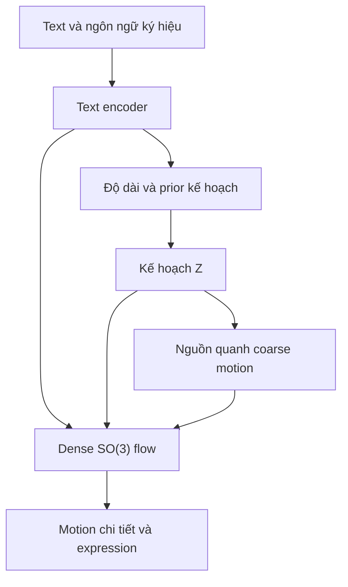

# CoPlan-SO3: đề xuất cải tiến Sign Language Production từ SignNMFlow

**Tên phương pháp làm việc:** Joint Plan-Conditioned Kinematic Flow Matching for Sign Language Production.  
**Ngày đối chiếu tài liệu:** 17/11/2026.  
**Bài toán:** spoken text → chuyển động ký hiệu 3D; đánh giá trên PHOENIX-2014T, CSL-Daily và How2Sign.  
**Trạng thái:** đề xuất nghiên cứu, phân tích toán học và thiết kế thực nghiệm. Chưa huấn luyện mô hình SLP, chưa có kết quả thực nghiệm chứng minh vượt SignNMFlow.

## Mục lục

1. [Kết luận nghiên cứu và lựa chọn phương pháp](#1-kết-luận-nghiên-cứu-và-lựa-chọn-phương-pháp)
2. [Mốc so sánh từ SignNMFlow](#2-mốc-so-sánh-từ-signnmflow)
3. [Bản đồ tài liệu và điều có thể chuyển giao](#3-bản-đồ-tài-liệu-và-điều-có-thể-chuyển-giao)
4. [Phản biện các giả thuyết](#4-phản-biện-các-giả-thuyết)
5. [Research questions và giả thuyết có thể bác bỏ](#5-research-questions-và-giả-thuyết-có-thể-bác-bỏ)
6. [Phương pháp CoPlan-SO3](#6-phương-pháp-coplan-so3)
7. [Lập luận và bảo đảm toán học](#7-lập-luận-và-bảo-đảm-toán-học)
8. [Dataset và giao thức dữ liệu](#8-dataset-và-giao-thức-dữ-liệu)
9. [Training paradigm và cấu hình khởi đầu](#9-training-paradigm-và-cấu-hình-khởi-đầu)
10. [Thiết kế implementation](#10-thiết-kế-implementation)
11. [Thực nghiệm, ablation và điều kiện thành công](#11-thực-nghiệm-ablation-và-điều-kiện-thành-công)
12. [Lộ trình và quyết định tiếp tục hoặc dừng](#12-lộ-trình-và-quyết-định-tiếp-tục-hoặc-dừng)
13. [Rủi ro và các hướng mở rộng](#13-rủi-ro-và-các-hướng-mở-rộng)
14. [Tài liệu tham khảo và mức độ kiểm chứng](#14-tài-liệu-tham-khảo-và-mức-độ-kiểm-chứng)
15. [Phụ lục kiểm tra số học](#15-phụ-lục-kiểm-tra-số-học)

Quy ước trong tài liệu:

- **Thông tin từ nguồn:** đi kèm mã tham khảo và, khi cần, section/table.
- **Suy luận:** lập luận được xây dựng trong báo cáo này từ các định nghĩa đã nêu.
- **Giả thuyết:** cần huấn luyện, đo đạc hoặc nghiên cứu người dùng để kiểm chứng.
- **Cấu hình đề xuất:** giá trị khởi đầu cho implementation; không phải hyperparameter đã tối ưu.

## 1. Kết luận nghiên cứu và lựa chọn phương pháp

**Tôi đánh giá còn dư địa cải thiện SignNMFlow, nhưng hướng đáng đầu tư nhất không phải chỉ thay K-means bằng một density estimator lớn hơn.** Tôi chọn một mô hình hai cấp: sinh kế hoạch chuyển động có điều kiện theo câu, sau đó vận chuyển một phân phối quanh kế hoạch đó tới chuyển động chi tiết trên SO(3), với loss nhạy với động học bàn tay và bộ lấy mẫu tích phân từ trạng thái hiện tại.

Ba thành phần cốt lõi:

1. **Kế hoạch ngẫu nhiên có phối hợp:** latent theo thời gian giữ cấu hình bàn tay, vị trí ký hiệu và phối hợp cơ thể; prior học phân phối kế hoạch từ text. Khi suy diễn chỉ dùng text và nhiễu.
2. **Flow chi tiết trên SO(3):** dùng ma trận quay làm trạng thái hình học, biểu diễn 6D làm đầu vào mạng, vận tốc góc 3D làm đầu ra. Không đồng nhất một bán cầu quaternion với toàn bộ hình học SO(3).
3. **Loss flow theo động học:** so khớp vận tốc bằng một metric pullback từ forward kinematics, quan hệ hai tay và sai phân theo thời gian chuyển động. Metric phụ thuộc trạng thái đang xét; vì vậy có thể giữ nghiệm tối ưu population của conditional flow matching.

Đây là sự kết hợp có chủ đích của những kỹ thuật đã có với các điều chỉnh cho SLP. Không tuyên bố “lần đầu dùng manifold”, “lần đầu dùng part tokens” hay “lần đầu coarse-to-fine”. Những hướng đó đã xuất hiện trong [R03–R06, R12, R19, R21].

**Mệnh đề nghiên cứu chính:** trong SLP ít dữ liệu song song, khó khăn quan trọng là bất định ngữ nghĩa và phối hợp articulators. Hình học phép quay là một điều kiện cần của thiết kế, nhưng tự nó không giải quyết sự thiếu xác định của ánh xạ text → sign.

Lý do tôi tin phương pháp đáng thử:

- Một kế hoạch có ích có thể làm nguồn gần phân phối đích hơn và giảm phương sai của mục tiêu flow có điều kiện.
- Metric động học biến sai số góc thành sai số ở các vị trí và quan hệ mà người ký hiệu nhìn thấy.
- Objective vận tốc và solver từ trạng thái hiện tại có mối liên hệ rõ với phương trình liên tục.
- Không cần thêm dataset motion ngoài ba bộ yêu cầu để kiểm tra giả thuyết chính.

**Điều không suy ra:** không có định lý nào ở đây chứng minh BLEU-4 chắc chắn tăng hoặc DTW-JPE chắc chắn giảm trên dữ liệu thực. Các kết quả toán học chỉ chứng minh những tính chất cụ thể dưới giả thiết được nêu; lợi ích benchmark còn phụ thuộc chất lượng kế hoạch, fitting SMPL-X, công suất mô hình và protocol.

Tôi sẽ triển khai theo hai mức:

| Mức | Nội dung | Mục đích |
|---|---|---|
| Thử nghiệm nhỏ | SO(3) đúng nghĩa + velocity field + sampler nhất quán, giữ backbone và dữ liệu | Đo phần lợi ích từ hình học và train–sample consistency |
| Phương pháp đầy đủ | Thêm prior kế hoạch và metric động học có phối hợp | Kiểm tra giả thuyết cải thiện ngữ nghĩa và chi tiết bàn tay |

Nếu mức nhỏ đã thất bại, không ghép thêm nhiều module để che nguyên nhân. Nếu kế hoạch chỉ tốt khi lấy từ ground truth, chưa có bằng chứng cho phương pháp text-to-sign đầy đủ.

## 2. Mốc so sánh từ SignNMFlow

SignNMFlow [R01, §3, Appendix C] sử dụng quaternion, đường geodesic có correction học được, measure từ prototypes và dự đoán đích. Các công thức liên quan đến phản biện bên dưới:

$$
\delta_k=\operatorname{Log}_x(c_k),\qquad
m(x)=\sum_k \widetilde w_k(x),\qquad
S(x)=\sum_k\widetilde w_k(x)\delta_k\delta_k^\top,
$$

$$
G(x)=m(x)(S(x)+\rho I)^{-1},\qquad
\mathcal E(\gamma)=\int_0^1\dot\gamma_s^\top G(\gamma_s)^{-1}\dot\gamma_s\,ds.
$$

Nguồn số liệu: **Table 1–2 của [R01]**. Giữ nguyên thang đo của paper; chưa tự tái lập.

| Dataset | Phiên bản | DTW-JPE Body ↓ | DTW-JPE Hand ↓ | DTW-PA-JPE Body ↓ | DTW-PA-JPE Hand ↓ | BT BLEU-4 ↑ |
|---|---|---:|---:|---:|---:|---:|
| PHOENIX-2014T | SignNMFlow | 4.37 | 5.57 | 3.85 | 1.07 | 16.15 |
| PHOENIX-2014T | SignNMFlow-M | 4.42 | 5.75 | 3.91 | 1.08 | 14.45 |
| CSL-Daily | SignNMFlow | 5.73 | 7.43 | 5.10 | 1.30 | 15.14 |
| CSL-Daily | SignNMFlow-M | 5.94 | 7.73 | 5.31 | 1.33 | 15.23 |
| How2Sign | SignNMFlow | 6.76 | 9.72 | 6.01 | 2.07 | 16.88 |
| How2Sign | SignNMFlow-M | 6.74 | 9.77 | 5.99 | 2.06 | 17.49 |

Trong báo cáo này, so sánh chính là mô hình đơn bộ với SignNMFlow; mô hình ba bộ với SignNMFlow-M. So sánh với giá trị tốt nhất giữa hai phiên bản là kiểm tra bổ sung, phải ghi rõ nguồn ngân sách dữ liệu khác nhau.

Không xem bảng trên là một leaderboard hợp nhất cho mọi paper. Ví dụ SOKE có retrieval và SignSparK tách GF-T2P, SR-T2P, KF2P [R03, R05]. Evaluator back-translation cũng có thể khác. Một số nghiên cứu SLP dùng gloss hoặc bộ USTC-CSL, không thể lấy số của chúng làm kết quả trực tiếp trên CSL-Daily.

## 3. Bản đồ tài liệu và điều có thể chuyển giao

### 3.1. Sign Language Production

Các mô tả ngắn sau dựa trên paper hoặc tài liệu chính thức; cột cuối là đánh giá ứng dụng trong đề xuất này.

| Công trình | Ý tưởng liên quan | Bài học cho CoPlan-SO3 |
|---|---|---|
| Neural Sign Actors, CVPR 2024 [R02] | Diffusion cho avatar 3D và cấu trúc skeleton | Dùng đúng motion cache; tách chất lượng capture khỏi chất lượng generation |
| SOKE, ICCV 2025 [R03] | Part-wise motion tokens, multilingual LM, retrieval | Tách hand/body hữu ích nhưng phải duy trì trao đổi thông tin; phân biệt điều kiện retrieval |
| SignFlow, ICMI 2025 [R04] | Conditional FM và OT cho one-to-many | Không lấy một output gần reference làm bằng chứng đã học được đa dạng có nghĩa |
| SignSparK, ECCV 2026 [R05] | Sparse anchors, CFM, các chế độ điều kiện khác nhau | Kế hoạch có thể hữu ích; phải tự sinh được kế hoạch khi chỉ có text |
| T2S-GPT, ACL 2024 [R06] | Mã chuyển động có độ dài động và duration | Timing là phần của bài toán, không chỉ là hậu xử lý |
| Sign-IDD, AAAI 2025 [R07] | Quan hệ bone direction/length cho gloss-to-pose | Học quan hệ không gian thay vì chỉ tọa độ riêng lẻ; không trộn G2P với T2P |
| Conditional Collapse, bản v2 2026 [R08] | Chẩn đoán độ bám điều kiện, đa dạng và faithfulness | Thêm text-shuffle và matched-versus-random diagnostics |
| Hybrid AR-Diffusion, ACL 2026 [R09] | Multi-scale articulators, attention có confidence | Độ tin cậy nhãn và cấu trúc đa tốc độ là đối chứng cần có |
| HandMDM/BOBSL3DT, CVPR 2026 [R10] | Điều khiển hand motion bằng mô tả thuộc tính | Handshape/location/movement cần tín hiệu rõ; facial capture có giới hạn |
| Spectral OT, ECCV MoCha 2026 [R11] | Coupling nhạy phổ thời gian | Dùng làm đối chứng cho phần temporal; không gọi mọi dynamics-aware cost là mới |

Hai điểm phản biện chính với cách chuyển kỹ thuật từ tài liệu:

**Thứ nhất, “anchor giúp reconstruction” không đồng nghĩa “text-to-anchor đã giải được”.** Cần đánh giá riêng dense generator dùng kế hoạch thật, kế hoạch nhiễu từ posterior và kế hoạch do text prior sinh. Khoảng cách giữa chúng xác định nút thắt.

**Thứ hai, kết quả collapse của [R08] không chứng minh SignNMFlow collapse.** Công trình đó đánh giá những kiến trúc và checkpoint nhất định. Nó cung cấp một phép thử có giá trị, không thay thế việc chạy phép thử trên mô hình đang quan tâm.

### 3.2. Flow matching và hình học

| Công trình | Phần có thể dùng | Giới hạn khi chuyển sang SLP |
|---|---|---|
| Flow Matching, ICLR 2023 [R13] | Hồi quy conditional velocity, marginalization | Không bảo đảm condition thực sự được sử dụng ở mô hình hữu hạn |
| Riemannian FM, ICLR 2024 [R12] | Tangent supervision, conditional probability paths | Phải xác định đúng manifold, metric và solver |
| FoldFlow, ICLR 2024 [R14] | Flow trên SO(3)/SE(3), Riemannian OT | Protein không có ngữ nghĩa ký hiệu; không bê nguyên equivariance hay coupling |
| FrameFlow [R15] | Rotation/translation flow và schedule | Đổi schedule phải đổi target derivative tương ứng |
| Metric Flow Matching, NeurIPS 2024 [R16] | Metric phụ thuộc dữ liệu, học interpolant | Metric naturalness cần kiểm chứng; đường probability transport khác quỹ đạo vật lý |
| RG-VFM, ICLR 2026 [R17] | Góc nhìn endpoint likelihood trên manifold | Một loss endpoint hợp lý về hình học chưa đủ bảo đảm marginal velocity |
| Compatible Likelihoods, 2026 [R18] | Điều kiện compatibility của objective | Không suy rộng phản ví dụ cho RG-VFM thành kết luận thực nghiệm về mọi endpoint model |

Phân biệt hai cách dùng metric:

- [R16] dùng metric để **thay đổi đường conditional transport**.
- CoPlan-SO3 mặc định giữ đường geodesic và dùng metric để **đo sai số velocity**.

Hai việc này khác nhau về distribution path, gradient và ý nghĩa lý thuyết. Metric loss của đề xuất không được gọi là đã học “đường đi tự nhiên tối ưu”.

### 3.3. Motion representations

| Công trình | Quan sát liên quan | Quyết định thiết kế |
|---|---|---|
| Rotation representations, CVPR 2019 [R22] | Có trở ngại tô pô với biểu diễn quay ít chiều toàn cục | Dùng 6D cho input; giữ trạng thái và cập nhật trên SO(3) |
| HuProSO3, CVPR 2024 [R23] | Phân phối liên kết trên tích SO(3) | Product manifold không có nghĩa các khớp độc lập thống kê |
| RMG, 2026 [R19] | Motion trên product manifold, tangent targets và manifold integration | Baseline RFM trực tiếp là bắt buộc; chỉ đổi sang manifold không đủ mới |
| PoseD-Flow, CVPR 2026 [R20] | Prior pose và guidance hình học | Pose plausibility khác sentence-level signing correctness |
| PoseRieFlow, 2026 [R21] | SO(3), part tokens, bàn tay chi tiết | Là prior art trực tiếp cho geometry + part-token architecture |
| HumanML3D/text-to-motion, CVPR 2022 [R24] | Local motion snippets và length modeling | Học cấu trúc thời gian có ích; không nhập nguyên representation cho locomotion |
| TMR, ICCV 2023 [R25] | Latent motion–text contrastive và lọc false negatives | Có thể học kế hoạch bám text; evaluator phải độc lập với loss |
| SMPL-X, CVPR 2019 [R26] | Mô hình articulated body, hands và face | Forward kinematics ràng buộc chiều dài xương, nhưng không bảo đảm giải phẫu và ngữ pháp |

**Biểu diễn được chọn:** rotations + expression là state; Cartesian joints, palm orientation và physical-time differences là features/loss suy ra từ state. Không sinh tự do cả joint positions lẫn rotations rồi hy vọng hai đầu ra tự khớp.

## 4. Phản biện các giả thuyết

### 4.1. Ở trên rotation manifold chưa đồng nghĩa chuyển động tự nhiên

Một phần tử của SO(3) chỉ thỏa:

$$
R^\top R=I,\qquad \det R=1.
$$

Các điều kiện này không biểu diễn giới hạn khớp, va chạm bàn tay, sự phối hợp hai tay, vị trí bàn tay so với mặt hay ngữ pháp nonmanual.

Có thể tạo chuỗi mọi rotation đều hợp lệ nhưng đảo thứ tự sign, mất lần lặp, đổi tay trội hoặc sai vị trí ký hiệu. Do đó:

$$
\text{valid rotations}\;\not\Rightarrow\;\text{natural signing}
\;\not\Rightarrow\;\text{correct meaning}.
$$

Đây là phản biện về phạm vi kết luận, không phủ nhận lợi ích thực nghiệm của geodesic interpolation.

Chiều ngược lại cũng cần thận trọng: **noise states của một ambient generative model không bắt buộc là pose có thể render**. Một mạng học trong \(\mathbb R^6\) rồi decode qua Gram–Schmidt vẫn có thể xuất rotations hợp lệ. “Điểm giữa không nằm trong image của rotation encoder” không đủ chứng minh distribution cuối hoặc motion cuối sai. Phải phân biệt image manifold của encoder 6D với miền đầu vào rộng hơn của decoder 6D [R22]. Lợi ích của manifold transport nên được kiểm chứng như một inductive bias và cách giảm approximation/discretization error, không coi mọi ambient model là bất hợp lệ.

**Thí nghiệm cần làm:** giữ phân phối các pose gần như không đổi nhưng tráo thứ tự các đoạn, hoán đổi hand trajectories hoặc thay text. Nếu naturalness score vẫn cao trong khi signers đánh giá sai nghĩa, score đang đo tính phổ biến của pose nhiều hơn tính đúng của signing.

### 4.2. Không được đồng nhất flow time với thời gian ký hiệu

Trong toàn bộ đề xuất:

- \(s\in[0,1]\): thời gian vận chuyển từ noise sang data.
- \(\tau=1,\ldots,T\): thời gian vật lý bên trong câu ký hiệu.

Năng lượng theo \(\partial_s X_s\) không trực tiếp ràng buộc:

$$
\partial_\tau X,\quad
\partial_\tau^2 X,\quad
\text{holds},\quad
\text{repetition},\quad
\text{relative timing giữa các articulators}.
$$

Một đường transport rất ngắn có thể kết thúc tại một chuỗi rung hoặc sai thứ tự. Một đường transport cong vẫn có thể sinh chuỗi vật lý tốt. Vì vậy cần đo chất lượng ở cả hai trục thời gian, không dùng “smooth transport” thay cho “smooth signing”.

### 4.3. Canonical quaternion không loại bỏ mọi vấn đề của double cover

SO(3) tương đương \(\mathbb S^3/\{q\sim -q\}\), không tương đương đẳng cự toàn cục với một bán cầu đóng mà không xét cách dán biên. Quy ước dấu trong [R01, C.1] chọn đại diện duy nhất, nhưng tính duy nhất không tạo ra tọa độ liên tục toàn cục [R22].

**Phản ví dụ tự xây dựng.** Xét:

$$
R_a=R_z(\pi-\varepsilon),\qquad
R_b=R_z(-\pi+\varepsilon),\qquad 0<\varepsilon\ll1.
$$

Hai quaternion canonical có scalar dương:

$$
q_a=(\sin(\varepsilon/2),0,0,\cos(\varepsilon/2)),
$$

$$
q_b=(\sin(\varepsilon/2),0,0,-\cos(\varepsilon/2)).
$$

Suy ra:

$$
\langle q_a,q_b\rangle=-\cos\varepsilon,\qquad
d_{\mathbb S^3}(q_a,q_b)=\pi-\varepsilon.
$$

Trong khi:

$$
d_{\mathrm{SO}(3)}(R_a,R_b)
=2\arccos|\langle q_a,q_b\rangle|=2\varepsilon.
$$

Geodesic cầu không căn chỉnh dấu của cặp này ánh xạ xuống một đường quay dài \(2\pi-2\varepsilon\), thay vì cung ngắn \(2\varepsilon\). Với \(\varepsilon=0.01\), tỉ lệ độ dài khoảng 313.16.

**Điều phản ví dụ chứng minh:** canonicalization riêng từng endpoint không tự bảo đảm geodesic ngắn trong quotient.

**Điều chưa chứng minh:** vấn đề này xảy ra thường xuyên trong rotations đã fitting của ba dataset, hoặc là nguyên nhân chính của sai số SignNMFlow. Cần đo tần suất \(q_0^\top q_1<0\), chênh lệch độ dài cung và mức liên quan với lỗi.

**Giải pháp:** thực hiện Exp/Log trên SO(3), hoặc dùng quaternion với pairwise antipodal alignment cho distances/paths. Pairwise alignment không tạo được một chart quaternion liên tục toàn cục; không dùng nó làm lập luận tô pô quá mức.

### 4.4. Measure theo từng khớp không xác định phân phối phối hợp

Appendix C.2 của [R01] triển khai prototypes theo từng khớp. Hạn chế được nêu ở đây thuộc về **measure đó**, không phải khẳng định transformer generation của paper không học tương quan.

Phản ví dụ với hai biến:

$$
P_+=\tfrac12\delta_{(a,a)}+\tfrac12\delta_{(b,b)},\qquad
P_-=\tfrac12\delta_{(a,b)}+\tfrac12\delta_{(b,a)}.
$$

Hai phân phối có cùng mọi marginal một biến. Một measure chỉ nhìn các marginal không phân biệt chúng. Với hai tay, khác biệt này có thể là đối xứng, bất đối xứng, tiếp xúc hoặc vị trí tương đối.

Tương tự, hai chuỗi có cùng histogram pose nhưng thứ tự khác nhau có thể biểu đạt khác nhau. Cần cấu trúc theo thời gian và cross-joint, không chỉ tăng số prototypes mỗi khớp.

**Kiểm tra:** tạo negative cùng marginal bằng cách tráo tay giữa hai clip hoặc tráo đoạn trong clip; đo score naturalness và đánh giá của người ký hiệu. Chỉ sử dụng negatives này cho chẩn đoán khi chưa có nhãn ngôn ngữ xác nhận.

### 4.5. Scatter và density có vai trò tinh tế hơn trực giác “đi theo vùng tự nhiên”

Từ định nghĩa \(G\):

$$
G^{-1}
=\frac{S+\rho I}{m}
=\Sigma+\frac{\rho}{m}I,
\qquad \Sigma=\frac{S}{m}.
$$

Vì vậy:

$$
v^\top G^{-1}v
=v^\top\Sigma v+\frac{\rho}{m}\|v\|^2.
$$

Hai nhận xét suy ra từ đại số:

1. Khi \(\Sigma\) cố định, tác động của mass nằm trong \(\rho/m\), không phải toàn bộ cost tỉ lệ đơn giản với \(1/m\).
2. Theo eigenvector có scatter lớn hơn, cost của cùng độ lớn vận tốc lớn hơn.

Ví dụ \(\Sigma=\operatorname{diag}(1,0.001,0.001)\), \(m=1,\rho=10^{-6}\): cost theo trục thứ nhất là 1.000001; theo trục thứ hai là 0.001001. Nếu trục thứ nhất là hướng dữ liệu thực biến thiên, metric này không tự có tính chất “di chuyển dọc hướng biến thiên rẻ hơn”.

Đây vẫn là quadratic form dương xác định. Nó có thể là regularizer thực nghiệm hiệu quả. Nhưng tính SPD không chứng minh nó khớp motion probability, conditional semantics hay transition dynamics.

Không nên sửa bằng cách đảo covariance một cách máy móc: covariance của **offset pose** cũng không phải covariance của **vận tốc vật lý có điều kiện theo phase**. Hơn nữa, covariances ở các tangent spaces khác nhau cần được so sánh trong một frame/trivialization nhất quán.

Đối chứng hợp lý: metric hiện tại, isotropic density cost, covariance precision cost, và metric động học đề xuất; giữ mọi thành phần khác giống nhau.

### 4.6. Lập luận KDE cần điều kiện về bandwidth, normalization và số prototypes

Một bound kiểu:

$$
|m(x)-\widehat p_\sigma(x)|
\leq \frac{\overline r_K}{\sigma\sqrt e}
$$

chỉ kiểm soát lỗi nén prototypes tại một bandwidth. Nó chưa tự chứng minh consistency của density khi \(N\to\infty\).

Với phân phối liên tục, \(K\) cố định thường để lại quantization error dương. Khi \(\sigma\to0\), cần ít nhất kiểm soát \(\overline r_{K(N)}/\sigma\to0\) cho bound trên có ích. Nếu chuẩn hóa kernel theo \(\sigma^{-d}\), điều kiện đối với sai số nén còn phải tính lại.

Một Gaussian kernel mass chưa chuẩn hóa thường có quy mô \(m_\sigma(x)\asymp C_d\sigma^d p(x)\) ở miền trơn nội địa; nó không trực tiếp hội tụ tới \(p(x)\). Việc chuyển từ mass sang density đòi hỏi normalization và xét volume element.

Ngoài ra, “homogeneous manifold” không luôn có heat kernel chỉ phụ thuộc tổng geodesic distance. Tích các spheres có product heat kernel; tính homogeneous không đồng nghĩa two-point homogeneous. Với triển khai joint-wise, từng factor đơn giản hơn, nhưng phải nêu đúng miền áp dụng.

**Kết luận hẹp:** tính nhất quán tiệm cận và metric tốt ở \(K,\sigma\) hữu hạn là hai câu hỏi khác nhau. Các lưu ý này không làm mất giá trị bảng kết quả thực nghiệm.

### 4.7. Dự đoán endpoint rồi dựng lại từ nguồn không tự động là một solver ODE

Xét cấu trúc sampler ở [R01, C.5]. Viết đường đã học là:

$$
X_s=F_s(X_0,X_1).
$$

Tại mỗi bước, sampler dự đoán lại \(\widehat X_1\) rồi đặt:

$$
X_{s+h}=F_{s+h}(X_0,\widehat X_1(X_s,s,c)).
$$

Một numerical integrator nhất quán với một vector field hữu hạn cần:

$$
\Phi_h(x,s)=x+h\,v_s(x)+o(h).
$$

Trong cập nhật dựng lại, giới hạn \(h\to0\) là:

$$
F_s(X_0,\widehat X_1(X_s,s,c)),
$$

không mặc nhiên bằng \(X_s\). Cần một self-consistency identity hoặc một lập luận khác cho discrete generative map.

**Phản ví dụ Euclidean:** lấy \(X_0,Y\) độc lập, đều \(\mathcal N(0,1)\), và:

$$
X_s=(1-s)X_0+sY,\qquad
\mu_s(x)=\mathbb E[Y\mid X_s=x]
=\frac{s}{(1-s)^2+s^2}x.
$$

Tại \(s=1/2,\ X_0=1,\ X_s=1/2\):

$$
F_s(X_0,\mu_s(X_s))=\tfrac12+\tfrac14=\tfrac34\neq\tfrac12.
$$

Dù predictor là nghiệm Bayes chính xác của endpoint MSE, cập nhật vẫn có jump 0.25 khi \(h\to0\). Một solver ODE chuẩn không có jump này.

**Phạm vi:** phản ví dụ áp dụng cho cấu trúc dựng lại đường; nó không chứng minh mọi few-step discrete map như vậy là generator kém. Những map hữu hạn bước vẫn có thể cho metric tốt. Vấn đề là không được suy ra tính nhất quán ODE từ việc mỗi trạng thái nằm trên manifold.

Hai đối chứng cần tách:

- Retrain một velocity head với derivative chính xác của learned path, rồi tích phân từ \(X_s\).
- Giữ target head và sampler paper để đánh giá tác động riêng của parameterization.

Không thay sampler của checkpoint target prediction bằng một geodesic step tùy ý rồi gọi đó là cùng mô hình lý thuyết.

### 4.8. Endpoint regression trên manifold không mặc nhiên tương đương velocity regression

Trong Euclidean linear FM, velocity là affine theo endpoint, nên conditional mean endpoint có thể giải mã thành đúng conditional mean velocity.

Trên manifold hoặc learned curved paths:

$$
\mathbb E[f(Y)\mid X_s]\neq
f(\mathbb E[Y\mid X_s])
$$

nói chung. Với endpoint trên manifold, “mean” còn có thể là normalized extrinsic mean hoặc Fréchet mean, và có thể không duy nhất.

[R18] nghiên cứu compatibility theo nghĩa population minimizer khôi phục marginal velocity; không thể chỉ dựa vào một likelihood endpoint có vẻ hợp lý. Đây là lý do đề xuất dùng velocity supervision làm phần định nghĩa transport.

Tuy nhiên, ablation của [R01, Table 5] là bằng chứng **chống lại** ý tưởng “chỉ đổi sang velocity sẽ thắng”: trên CSL-Daily, hand PA-JPE của cấu hình velocity là 1.44, target là 1.30. Cần cải thiện source, tín hiệu học và coordination; không xem lý thuyết đúng là bảo đảm finite-data tốt hơn.

### 4.9. Các giới hạn thực nghiệm khác đáng ưu tiên

**Single-reference:** một output đúng nghĩa nhưng khác phong cách, vị trí hoặc tốc độ có thể bị phạt bởi joint error. Ngược lại, một output trung bình có thể gần reference nhưng thiếu thông tin.

**Procrustes và DTW:** alignment có thể làm mờ sai số placement, scale hoặc timing. Cần công bố chính xác align toàn thân hay từng tay, align frame hay sequence, DTW path riêng hay chung. Không suy đoán implementation của paper nếu chưa có code.

**Back-translation:** score phụ thuộc recognizer/translator, domain và decoder language prior. Phải đo GT→text, shuffled-motion→text và text-frequency baseline. GT BT score là mốc tham chiếu của evaluator, không phải cận trên toán học tuyệt đối.

**Nonmanual:** expression coefficients ít chiều và nhãn mặt fitting nhiễu có thể là giới hạn thông tin. Thêm một “face manifold” tùy ý không khôi phục được mouthing/eyebrow labels vốn không có.

**Multilingual:** chia sẻ motor patterns có lợi, nhưng lexicon và ngữ pháp DGS/CSL/ASL khác nhau. Chia sẻ không có routing có thể gây negative transfer. Cần tách lợi ích thêm dữ liệu khỏi lợi ích kiến trúc.

## 5. Research questions và giả thuyết có thể bác bỏ

| RQ | Giả thuyết | Phép kiểm tra chính | Bằng chứng bác bỏ |
|---|---|---|---|
| RQ1: quotient có quan trọng? | Một phần lỗi đến từ seam/cung dài quaternion | SO(3) vs canonical-S3, giữ backbone | Cặp gần seam hiếm và gain không đáng kể qua seeds |
| RQ2: sampler có quan trọng? | Dựng lại từ nguồn gây mismatch có thể đo được | Reanchor vs exact-path velocity + local integration | Residual self-consistency nhỏ và retraining không cải thiện |
| RQ3: kế hoạch có giải bất định? | Plan giúp text-conditioned transport | Oracle/posterior/prior plans; text shuffle | Chỉ oracle tốt; learned prior không tốt hơn direct model |
| RQ4: metric động học có ích? | Hand location và coordination học tốt hơn | Isotropic vs FK vs FK+relative vs temporal pullback | Loss giảm nhưng raw/relative hand errors hoặc sign accuracy không tăng |
| RQ5: low-rate plan có mất ký hiệu ngắn? | Stride nhỏ vẫn giữ key hand changes | Stride 2/4/8, fast-sign subset | Ngón tay/repetition bị mất khi stride tăng |
| RQ6: mô hình có dùng text? | Negatives có kiểm soát tăng faithfulness | Matched/random text, minimal pairs, independent evaluator | Chỉ FID/BT tăng; shuffling text ít ảnh hưởng |
| RQ7: multilingual có lợi? | Adapters giảm negative transfer | Single/shared/shared+adapters, cùng compute | Cải thiện chỉ do số bước/parameters tăng |
| RQ8: có thắng ở cùng chi phí? | Plan prior nhỏ bù được dense steps | Tổng NFE, latency, FLOPs, training hours | Gain biến mất khi giới hạn tổng budget |
| RQ9: nhãn noise là trần? | Lỗi tập trung ở fitting tay/mặt yếu | Audit theo confidence/occlusion | Mô hình chỉ bắt chước lỗi cache hoặc gain do lọc test |

**Giả thuyết chính được ưu tiên:** RQ3 + RQ4. RQ1 và RQ2 là kiểm tra tính đúng và thí nghiệm nền. Nếu chúng không tạo gain lớn, vẫn có thể tiếp tục; nhưng phải báo cáo trung thực.

## 6. Phương pháp CoPlan-SO3

### 6.1. State và điều kiện

Với câu \(c\), ngôn ngữ ký hiệu \(L\in\{\mathrm{DGS},\mathrm{CSL},\mathrm{ASL}\}\), độ dài \(T\):

$$
X=\{(R_{\tau,1:J},e_\tau)\}_{\tau=1}^T,\qquad
\mathcal M_T=\mathrm{SO}(3)^{T J}\times\mathbb R^{T d_e}.
$$

Cấu hình đối chiếu dùng \(J=41,d_e=10\), nhưng **danh sách joint indices phải lấy từ cache/protocol thực**, không suy ra rằng 41 khớp tự động trùng với một subset SMPL-X bất kỳ.

Ký hiệu \([\omega]_\times\) là skew matrix, \(\vee\) là phép ngược. Dùng body-frame angular velocity:

$$
\dot R_{\tau,j}=R_{\tau,j}[\omega_{\tau,j}]_\times.
$$

Không sinh thêm global translation nếu benchmark gốc không có kênh đó. Những kênh cố định của full SMPL-X phải được giữ đúng quy ước khi render và tính joints.

### 6.2. Factorization và luồng suy diễn

Mô hình:

$$
p(T,Z,X\mid c,L)
=p_\omega(T\mid c,L)\,
p_\psi(Z\mid c,L,T)\,
p_\theta(X\mid Z,c,L,T).
$$

\(Z\) là kế hoạch chuyển động liên tục, không phải gloss annotation. Nó có \(K_T=\lceil T/r\rceil\) temporal slots, stride khởi đầu \(r=4\), dimension khởi đầu 256.



Ground-truth motion chỉ đi vào encoder posterior trong training. Không có đường từ ground-truth keyframes/gloss/length vào suy diễn chính, trừ track length-controlled được công bố riêng.

### 6.3. Học kế hoạch từ motion

Encoder:

$$
Z=E_\eta(X)+\sigma_z\epsilon,\qquad
\epsilon\sim\mathcal N(0,I).
$$

Sau khi chuẩn hóa latent bằng thống kê train, đặt:

$$
q_\eta(Z\mid X)=
\mathcal N(E_\eta(X),\sigma_z^2I).
$$

Decoder \(A_\eta(Z,T)\) tạo coarse rotations và expression:

$$
\overline X=(\overline R,\overline e)=A_\eta(Z,T).
$$

Thiết kế encoder/decoder:

- Branch body, left hand, right hand và expression; có attention trao đổi giữa các branch.
- Encoder giảm temporal resolution nhưng nhìn được cả hai tay và torso.
- Decoder dùng temporal queries ở đủ \(T\) frames và cross-attention vào plan slots.
- Rotation head của coarse decoder xuất 6D rồi Gram–Schmidt về SO(3).
- Không gọi coarse decoder là một bộ lọc low-pass bắt buộc; latent ít slots nhưng decoder vẫn có thể giữ handshape nhanh.

Loss kế hoạch:

$$
\mathcal L_{\mathrm{plan}}
=\mathcal L_{\mathrm{recon}}
+\lambda_{\mathrm{NCE}}\mathcal L_{\mathrm{NCE}}
+\lambda_{\mathrm{mask}}\mathcal L_{\mathrm{masked}}.
$$

\(\mathcal L_{\mathrm{recon}}\) gồm geodesic rotation, FK joints, relative-hand features và physical velocity matching với nhãn. Dùng Huber cho những kênh Cartesian nhiễu. Không dùng phạt \(\|\partial_\tau X\|^2\) để kéo chuyển động về đứng yên.

Contrastive term so khớp pooled motion plan với text embedding cùng ngôn ngữ:

$$
\ell_i=-\log
\frac{\sum_{j\in P(i)}\exp(\operatorname{sim}(z_i,h_j)/\tau_c)}
{\sum_{j\in P(i)\cup N(i)}\exp(\operatorname{sim}(z_i,h_j)/\tau_c)}.
$$

\(P(i)\) gồm cặp thực và cùng câu đã xác nhận. Với paraphrases chỉ được nghi là tương đương, có thể bỏ khỏi negatives; không tự biến thành positives. Dùng quy tắc lọc false negatives theo tinh thần [R25].

Không ép attention phải monotonic theo thứ tự từ của spoken text: thứ tự từ và cấu trúc ký hiệu có thể khác nhau. Temporal order nằm trong motion plan; text cross-attention được phép reorder.

Kết thúc giai đoạn này, **đóng băng encoder, coarse decoder và thống kê latent** trong thí nghiệm chính. Nếu thay encoder về sau, phải huấn luyện lại prior hoặc tái tạo cache latent để tránh target distribution đổi ngầm.

Chuẩn hóa latent cần một wrapper nhất quán. Nếu autoencoder được train trong tọa độ raw với mean \(\mu_Z\), std \(s_Z>0\) từ train, đặt:

$$
E_{\mathrm{norm}}(X)=\frac{E_{\mathrm{raw}}(X)-\mu_Z}{s_Z},
\qquad
A_{\mathrm{norm}}(Z)=A_{\mathrm{raw}}(\mu_Z+s_Z\odot Z).
$$

Các công thức tiếp theo dùng \(E_{\mathrm{norm}},A_{\mathrm{norm}}\). Không đưa latent đã chuẩn hóa vào decoder raw mà quên inverse transform. Noise posterior \(\sigma_z\) được định nghĩa trong tọa độ chuẩn hóa.

### 6.4. Text-to-plan prior bằng Euclidean conditional FM

Học aggregated posterior:

$$
q_\eta(Z\mid c,L,T)=
\int q_\eta(Z\mid X)\,
p_{\mathrm{data}}(X\mid c,L,T)\,dX.
$$

Lấy \(Z_1\sim q_\eta(\cdot\mid X)\), \(Z_0\sim\mathcal N(0,I)\):

$$
Z_s=(1-s)Z_0+sZ_1,\qquad
U_s^Z=Z_1-Z_0.
$$

$$
\mathcal L_Z=
\mathbb E\left[
\|v_\psi(Z_s,s,h(c),L,T)-U_s^Z\|^2
\right].
$$

Huấn luyện masked slots có padding mask; inference tích phân từ \(Z_0\). Không dùng teacher-forced ground-truth plan lúc test.

**Vì sao dùng stochastic prior?** Một câu có thể có nhiều realization hợp lệ. Một predictor plan deterministic với MSE có nguy cơ trung bình hóa các realization. Flow prior không tự bảo đảm không collapse, nhưng ít nhất mô hình hóa một phân phối thay vì chỉ một mean.

**Không dùng OT toàn batch trong cấu hình chính.** Khi condition khác nhau, việc ghép noise dựa vào target có thể làm nguồn có điều kiện khác nguồn dùng khi inference. Muốn dùng OT phải nêu coupling và chứng minh các marginals có điều kiện vẫn đúng; không xem Hungarian matching là một cải tiến miễn phí.

### 6.5. Nguồn có điều kiện quanh coarse motion

Từ plan \(Z\), tạo \(\overline X=A_\eta(Z,T)\), rồi:

$$
R_{0,\tau,j}
=\overline R_{\tau,j}\,
\exp([\sigma_j\xi_{\tau,j}]_\times),
$$

$$
e_{0,\tau}=\overline e_\tau+\sigma_e\zeta_\tau.
$$

Noise theo thời gian có thể dùng AR(1):

$$
\xi_1\sim\mathcal N(0,I),\qquad
\xi_\tau=a\xi_{\tau-1}+\sqrt{1-a^2}\epsilon_\tau.
$$

Với \(|a|<1\), covariance trên sequence vẫn full rank. Bắt đầu \(a=0.7\), so sánh \(a=0\) và 0.9. Đây là cấu hình đề xuất, không phải giá trị đã tối ưu.

Nguồn không hard-clamp các angles vào một chart nhỏ. Gaussian trong Lie algebra được đẩy qua Exp; đây không mặc nhiên là heat-kernel distribution trên SO(3), cũng không cần giả định biết analytic density của nó để huấn luyện CFM.

Mục tiêu của nguồn quanh plan là giảm đoạn vận chuyển cần học, **không** cưỡng bức đầu ra ở gần một plan có thể sai. Dense flow vẫn hoạt động trên toàn \(\mathcal M_T\) và được condition đồng thời bởi text.

### 6.6. Conditional path và target vận tốc chính xác

Với \(X_1=X_{\mathrm{GT}}\), đặt:

$$
\Omega_{\tau,j}
=\operatorname{vee}\log(R_{0,\tau,j}^\top R_{1,\tau,j}),
$$

$$
R_{s,\tau,j}=R_{0,\tau,j}\exp(s[\Omega_{\tau,j}]_\times),
\qquad
e_s=(1-s)e_0+se_1.
$$

Target trong body trivialization:

$$
U_s=(\Omega,\ e_1-e_0).
$$

Vì \(\Omega\) commute với \(\exp(s\Omega)\):

$$
\partial_s R_s=R_s[\Omega]_\times.
$$

Không cần chia cho \(1-s\) để tính training target. Công thức \(\log(R_s^\top R_1)/(1-s)\) tương đương trên cung đã chọn, nhưng dễ gây lỗi số gần endpoint nếu tính trực tiếp.

Cut locus ở relative angle \(\pi\) cần xử lý nhánh ổn định; dưới phân phối liên tục nó có xác suất bằng 0, còn giá trị gần \(\pi\) vẫn cần audit số học. Không tuyên bố một Log duy nhất, trơn toàn cục trên SO(3).

### 6.7. Metric pullback từ động học và quan hệ ký hiệu

Định nghĩa một feature map \(F(X)\) trên **toàn bộ physical sequence**, gồm:

1. Joint positions thân và hai tay từ FK trên skeleton chuẩn.
2. Wrist positions tương đối torso/chest.
3. Hand-local fingertip positions để nhận ra handshape.
4. Palm normals/orientation features ở frame nhất quán.
5. Cross-hand relative positions và một tập fingertip-pair displacement vectors.

Mỗi nhóm được chuẩn hóa bằng scale/RMS chỉ tính từ train. Hand-local features phải đi cùng global/torso-relative wrist features, tránh bỏ mất vị trí từ vựng của ký hiệu.

Mở rộng theo physical time:

$$
\mathcal F(X)=
\begin{bmatrix}
W_0^{1/2}F(X)\\
W_1^{1/2}D_\tau F(X)\\
W_2^{1/2}D_\tau^2F(X)
\end{bmatrix}.
$$

\(D_\tau\) dùng khoảng thời gian giây, sau đó chuẩn hóa từng nhóm bằng train statistics. Không dùng flow time \(s\) ở đây.

Với tangent vector được biểu diễn bởi body angular velocities và expression velocities, đặt \(J_X=D\mathcal F_X\). Metric:

$$
M(X)=\lambda_0 I+J_X^\top J_X,\qquad \lambda_0>0.
$$

Loss chính:

$$
\boxed{
\mathcal L_{\mathrm{KFM}}
=
\mathbb E\left[
\lambda_0\|\widehat U_\theta-U_s\|^2
+
\|D\mathcal F_{X_s}[\widehat U_\theta-U_s]\|^2
\right].
}
$$

Các terms được lấy trung bình theo số frame/joint/features hợp lệ; các normalization đó là hằng số khi condition/state được cố định.

Điểm quan trọng:

- FK Jacobian tạo coupling giữa các khớp có cùng kinematic ancestors.
- \(D_\tau\) tạo coupling giữa các frame lân cận.
- Relative features làm lỗi hai tay “đúng riêng nhưng sai quan hệ” hiện rõ hơn.
- \(\lambda_0 I\) xử lý directions mà FK features không quan sát được, ví dụ twist hoặc kênh expression không nằm trong feature set.

**Không cần materialize Jacobian.** Tính JVP của \(\mathcal F\) theo perturbation:

$$
R_{\tau,j}(\epsilon)
=R_{s,\tau,j}\exp(\epsilon[\Delta\omega_{\tau,j}]_\times),
\qquad
e(\epsilon)=e_s+\epsilon\Delta v_e.
$$

JVP này tuyến tính theo \(\Delta U\). Base state được detach khỏi graph tạo dữ liệu, nhưng gradient qua \(\Delta U=\widehat U-U_s\) phải còn để huấn luyện mạng.

**Bảo toàn marginal minimizer:** metric chỉ phụ thuộc \(X_s,s,Z,c,L,T\) nếu có conditioning thêm; không phụ thuộc riêng endpoint ẩn \(X_1\). Chứng minh ở §7.3.

Nếu weight được lấy từ confidence của endpoint thật, điều kiện này có thể bị phá. Do đó confidence-weighting theo GT chỉ dùng cho auxiliary reconstruction hoặc một thí nghiệm có giải thích rõ, không trộn vào theorem của KFM.

### 6.8. Dense architecture

Backbone khởi đầu: transformer 8 layers, hidden 512, 8 heads, FFN 2048. Đây là cấu hình thử nghiệm; cần đo parameters/FLOPs thực tế.

Các input:

- \(R_s\) mã hóa 6D từ hai cột của ma trận quay.
- \(e_s\) chuẩn hóa.
- Physical-time positional embedding; flow-time \(s\) embedding riêng.
- Text token features từ mBART encoder cùng lựa chọn pretrained với baseline.
- Plan tokens \(Z\), language embedding \(L\), length mask.
- Relative/FK features lấy trực tiếp từ noisy state nếu chi phí cho phép.

Part tokens:

- Body branch gồm các rotations ngoài hai bàn tay theo manifest.
- Một token cho mỗi tay mỗi frame, qua MLP phi tuyến có cấu trúc ngón.
- Expression branch.
- Spatial attention trao đổi parts trong frame; temporal attention trong mỗi part; text/plan cross-attention ở các block.
- Hand decoders giữ per-finger outputs và residual skip từ high-resolution hand input. Không chỉ nén tay thành một vector rồi decode tuyến tính thiếu công suất.

Đầu ra:

$$
\widehat U_\theta=(\widehat\omega_{\tau,1:J},\widehat v^e_\tau),
$$

với \(\widehat\omega\in\mathbb R^3\) từng khớp. Mạng không phải xuất 9D matrix velocity rồi project một cách tùy ý.

Multilingual dùng adapters nhỏ theo **ngôn ngữ ký hiệu**, không chỉ token ngôn ngữ spoken text. Chia sẻ motor backbone, cho phép routing lexicon/ngữ pháp. Không dùng equivalence assumptions giữa DGS, CSL và ASL.

### 6.9. Auxiliary endpoint head là tùy chọn có đối chứng

Để kiểm tra lợi ích thực nghiệm của target supervision, thêm head dự đoán \(\widehat X_1\) với:

$$
\mathcal L_{\mathrm{aux}}
=\lambda_R d_{\mathrm{SO}(3)}^2(\widehat R_1,R_1)
+\lambda_P\operatorname{Huber}(F(\widehat X_1)-F(X_1))
+\lambda_e\operatorname{Huber}(\widehat e_1-e_1).
$$

Tổng loss nếu bật:

$$
\mathcal L=\mathcal L_{\mathrm{KFM}}
+\lambda_{\mathrm{aux}}\mathcal L_{\mathrm{aux}}.
$$

Bắt đầu \(\lambda_{\mathrm{aux}}\in\{0,0.01,0.05,0.1\}\), warm-up từ 0. Dùng head độc lập nhưng chia sẻ trunk.

**Giới hạn lý thuyết:** multi-task finite-capacity optimization có thể đổi nghiệm của velocity trunk. Bảo đảm ở §7.3 là cho objective KFM, không tự áp dụng cho mọi tổng loss có auxiliary terms.

Sampler vẫn sử dụng velocity head. Không lấy auxiliary endpoint để dựng lại toàn bộ đường từ noise.

### 6.10. Sampling

Sau khi sinh \(T,Z\) và lấy \(X_0\) quanh coarse motion, với \(h=s_{k+1}-s_k\):

$$
R_{k+1}=R_k\exp(h[\widehat\omega_\theta(X_k,s_k,Z,c,L)]_\times),
$$

$$
e_{k+1}=e_k+h\widehat v_\theta^e(X_k,s_k,Z,c,L).
$$

Đây là Lie-group Euler từ **trạng thái hiện tại**. Trong số học chính xác, mỗi bước giữ \(R^\top R=I,\det R=1\).

Khi có ngân sách, so sánh explicit Lie midpoint:

$$
\omega_1=v_R(X_k,s_k),\qquad
R_{\mathrm{mid}}=R_k\exp(\tfrac h2[\omega_1]_\times),
$$

$$
\omega_2=v_R(X_{\mathrm{mid}},s_k+h/2),\qquad
R_{k+1}=R_k\exp(h[\omega_2]_\times).
$$

Expression midpoint phải cập nhật đồng bộ. Một midpoint step dùng hai network evaluations; không so bằng số steps với Euler.

Không cộng trực tiếp ambient tangent vectors ở hai base points khác nhau. Các công thức trên dùng body trivialization nhất quán.

NFE phải tính cả plan prior:

| Tổng lần gọi mạng flow | Plan prior | Dense flow | Ý nghĩa |
|---:|---:|---:|---|
| 5 | 2 | 3 | Budget chặt, có thể chưa đủ chính xác |
| 10 | 4 | 6 | Điểm khởi đầu chất lượng/chi phí |
| 20 | 5 | 15 | Teacher hoặc kiểm tra hội tụ |

Plan prior nhỏ hơn dense flow nên NFE đơn thuần chưa phản ánh FLOPs. Báo cáo thêm latency toàn pipeline, FLOPs và memory. Nếu dùng CFG hai nhánh, phải tính chi phí cả hai; cấu hình chính bắt đầu không CFG.

## 7. Lập luận và bảo đảm toán học

Các kết quả dưới đây là lập luận của báo cáo, dựa trên hình học Lie group và nguyên lý conditional FM [R12–R15]. Chúng không thay thế thực nghiệm.

### 7.1. Cập nhật giữ rotations hợp lệ

Vì \([\omega]_\times^\top=-[\omega]_\times\), đặt \(Q=\exp(h[\omega]_\times)\):

$$
Q^\top Q=\exp(-h[\omega]_\times)\exp(h[\omega]_\times)=I,
$$

$$
\det Q=\exp(\operatorname{tr}(h[\omega]_\times))=1.
$$

Nếu \(R_k\in\mathrm{SO}(3)\), thì \(R_{k+1}=R_kQ\in\mathrm{SO}(3)\). Quy nạp cho mọi bước và mọi khớp/frame.

Đây là bảo đảm rotation validity trong số học chính xác. Sai số floating point cần monitor; không phải bảo đảm collision-free hay giới hạn giải phẫu.

### 7.2. Target geodesic có dạng đóng và không có chia số gần 0

Đặt \(\Omega=\log(R_0^\top R_1)\in\mathfrak{so}(3)\). Với nhánh geodesic được cố định:

$$
R_s=R_0\exp(s\Omega).
$$

Lấy đạo hàm:

$$
\dot R_s=R_0\exp(s\Omega)\Omega=R_s\Omega.
$$

Do đó body velocity là hằng số \(\Omega^\vee\). Loss không cần một target có độ lớn tăng nhân tạo do \(1/(1-s)\).

Nếu đổi schedule thành \(\alpha(s)\), target phải đổi thành \(\alpha'(s)\Omega^\vee\). Không thay schedule inference rồi giữ nguyên diễn giải training.

### 7.3. Metric state-dependent không đổi conditional mean velocity tối ưu

Cố định:

$$
\mathcal C=(X_s,s,Z,c,L,T),\qquad M=M(\mathcal C)\succ0.
$$

Với \(U\) là random conditional target tại cùng trạng thái và \(v=v(\mathcal C)\):

$$
\ell(v)=\mathbb E[(v-U)^\top M(v-U)\mid\mathcal C].
$$

Gọi \(\mu=\mathbb E[U\mid\mathcal C]\). Viết \(v-U=(v-\mu)+(\mu-U)\), cross-term có kỳ vọng bằng 0:

$$
\ell(v)
=(v-\mu)^\top M(v-\mu)
+\mathbb E[(\mu-U)^\top M(\mu-U)\mid\mathcal C].
$$

Vì \(M\succ0\):

$$
\boxed{v^\star(\mathcal C)=\mathbb E[U\mid\mathcal C].}
$$

Theo marginalization của CFM, đây là vector field sinh marginal path nếu các điều kiện regularity/integrability và tồn tại flow thích hợp được thỏa.

**Ý nghĩa:** có thể nhấn mạnh các lỗi động học mà không thay population minimizer của objective velocity.

**Không suy ra:** một mạng hữu hạn với SGD sẽ hội tụ tới nghiệm đó; metric lớn có thể gây conditioning xấu. Phải chuẩn hóa feature groups và kiểm tra gradient.

Nếu \(M=M(X_1,X_s)\) phụ thuộc endpoint còn ẩn thì nghiệm nói chung là:

$$
v^\star=
\big(\mathbb E[M\mid\mathcal C]\big)^{-1}
\mathbb E[MU\mid\mathcal C],
$$

không còn là \(\mathbb E[U\mid\mathcal C]\). Đây là lý do không đặt GT-confidence weights tùy ý vào core flow loss rồi giữ nguyên tuyên bố.

### 7.4. Hierarchical plan không nhất thiết tạo bottleneck phân phối

Gọi \(C=(c,L,T)\), \(P_C(X)=p_{\mathrm{data}}(X\mid C)\), và:

$$
Q_C(Z,X)=P_C(X)\,q_\eta(Z\mid X).
$$

Nếu:

$$
p_\psi(Z\mid C)=Q_C(Z),\qquad
p_\theta(X\mid Z,C)=Q_C(X\mid Z),
$$

thì:

$$
\begin{aligned}
p_{\psi,\theta}(X\mid C)
&=\int p_\psi(Z\mid C)p_\theta(X\mid Z,C)\,dZ\\
&=\int Q_C(Z,X)\,dZ=P_C(X).
\end{aligned}
$$

Do dense stage sinh toàn bộ rotations/expression, nó có thể khôi phục chi tiết mà coarse decoder không tái dựng hoàn hảo. Không có một reconstruction ceiling cứng từ decoder plan như khi chỉ decode một VQ code bị mất thông tin.

Với sai số hữu hạn, dùng contraction của total variation qua Markov kernel và bất đẳng thức tam giác:

$$
\operatorname{TV}(p_{\psi,\theta}(X\mid C),P_C)
\leq
\operatorname{TV}(p_\psi(Z\mid C),Q_C(Z))
+
\mathbb E_{Z\sim Q_C}
\operatorname{TV}(p_\theta(X\mid Z,C),Q_C(X\mid Z)).
$$

Nếu \(T\) cũng do model sinh, thêm sai số của length distribution khi xét joint law. Tại test length-controlled, chỉ đánh giá conditional law với \(T\) cho trước.

**Giới hạn:** prior kế hoạch học sai có thể khiến toàn pipeline kém hơn direct model. Bound chỉ ra hai nguồn sai số, không bảo đảm tổng của chúng nhỏ.

### 7.5. Nguồn quanh plan có thể giảm energy của geodesic transport

Xét một rotation, giả sử coarse plan có:

$$
d(\overline R,R_1)\leq\varepsilon,\qquad
R_0=\overline R\exp([\sigma\xi]_\times).
$$

Vì độ dài đường exponential là \(\|\sigma\xi\|\), geodesic distance không lớn hơn độ dài đó:

$$
d(R_0,R_1)\leq\varepsilon+\|\sigma\xi\|.
$$

Suy ra:

$$
\mathbb E[d^2(R_0,R_1)]
\leq 2\varepsilon^2+2\sigma^2\mathbb E\|\xi\|^2.
$$

Với \(\xi\sim\mathcal N(0,I_3)\):

$$
\mathbb E[d^2(R_0,R_1)]
\leq 2\varepsilon^2+6\sigma^2.
$$

Energy của constant-speed minimizing geodesic bằng \(d^2(R_0,R_1)\).

Mốc tham khảo: với \(R_0\) Haar-uniform trên SO(3), \(R_1\) cố định, relative angle có density \((1-\cos\theta)/\pi\), \(0\leq\theta\leq\pi\). Do đó:

$$
\mathbb E[\theta^2]
=\frac1\pi\int_0^\pi\theta^2(1-\cos\theta)\,d\theta
=\frac{\pi^2}{3}+2\approx5.2899.
$$

Bound quanh plan nhỏ hơn mốc này khi plan đủ chính xác và noise đủ nhỏ. Ví dụ \(\varepsilon=0.2,\sigma=0.2\) cho upper bound 0.32.

**Đây là lập luận có điều kiện, không phải kết quả đo của CoPlan-SO3.** Không giả sử learned text plan thực tế đạt sai số 0.2 rad. Phải đo residual angle distribution, nhất là khi dùng plan prior thay cho posterior.

### 7.6. Conditioning có thể giảm phương sai không thể hồi quy hết

Với một joint law cố định:

$$
\operatorname{Cov}(U\mid X_s,c)
=\mathbb E[\operatorname{Cov}(U\mid X_s,c,Z)\mid X_s,c]
+
\operatorname{Cov}(\mathbb E[U\mid X_s,c,Z]\mid X_s,c).
$$

Lấy trace và kỳ vọng:

$$
\mathbb E\operatorname{tr}\operatorname{Cov}(U\mid X_s,c,Z)
\leq
\mathbb E\operatorname{tr}\operatorname{Cov}(U\mid X_s,c).
$$

Đây là động cơ thống kê cho plan có thông tin.

**Không áp dụng sai:** khi đổi source thành plan-conditioned, \(X_s,U\) cũng đổi. Không được dùng bất đẳng thức này để tuyên bố đã chứng minh phương sai của toàn hệ mới nhỏ hơn mọi baseline có đường transport khác.

### 7.7. Metric động học đo đúng loại sai số ở bậc một

Giả sử feature map \(\mathcal F\) khả vi hai lần ở lân cận \(X\), perturbation tangent nhỏ \(\delta\):

$$
\mathcal F(\operatorname{Exp}_X\delta)-\mathcal F(X)
=J_X\delta+O(\|\delta\|^2).
$$

Do đó:

$$
\|\mathcal F(\operatorname{Exp}_X\delta)-\mathcal F(X)\|^2
=\delta^\top J_X^\top J_X\delta+O(\|\delta\|^3).
$$

Phần pullback là xấp xỉ bậc hai của feature displacement. Đây là cơ sở dùng nó khi mục tiêu đánh giá liên quan hand positions/relations.

Vì \(\delta^\top M\delta\geq\lambda_0\|\delta\|^2\), metric không suy biến khi FK thiếu quan sát một số rotational directions.

**Giới hạn:** metric linearized không tự đảm bảo endpoint error nhỏ ở mọi scale, không giải quyết multimodal semantics và không loại bỏ label noise.

### 7.8. Vì sao vẫn chưa thể “chứng minh thắng paper”

Trong giới hạn mô hình biểu đạt vô hạn, objective chính xác, dữ liệu vô hạn và tích phân chính xác, nhiều đường CFM khác nhau đều có thể sinh cùng conditional data distribution. Khi đó việc đổi đường không nhất thiết cho phân phối đích tốt hơn.

Lợi ích thực tế, nếu có, đến từ:

- Approximation error của mạng hữu hạn.
- Statistical efficiency khi dữ liệu ít.
- Optimization và gradient conditioning.
- Discretization error ở ngân sách few-step.
- Sự phù hợp giữa loss và thuộc tính đánh giá.

Các định lý trên làm thiết kế có cơ sở và tránh một số sai lệch; chúng không xác định trước leaderboard.

Hai giới hạn bổ sung:

- Khi xem training set như một phân phối nguyên tử, một smooth invertible ODE hữu hạn thời gian không tự biến density liên tục thành đúng các Dirac atoms. Diễn giải transport endpoint theo population distribution, dữ liệu có smoothing hoặc giới hạn \(s\to1\); không tuyên bố một finite-step network đã khớp chính xác empirical measure.
- Plan tự sinh từ text không bổ sung thông tin quan sát mới về một rendition thật chưa thấy. Lợi ích kỳ vọng đến từ factorization và inductive bias, không phải cách vượt qua giới hạn thông tin của text hay tự tạo phonological coverage còn thiếu.

## 8. Dataset và giao thức dữ liệu

### 8.1. Ba bộ dữ liệu chính

| Dataset | Ngôn ngữ ký hiệu / text | Split danh nghĩa train/dev/test | Motion cache ưu tiên |
|---|---|---|---|
| PHOENIX-2014T | DGS / tiếng Đức | 7,096 / 519 / 642 | SMPL-X từ SOKE theo thiết lập SignNMFlow |
| CSL-Daily | CSL / tiếng Trung | 18,401 / 1,077 / 1,176 | SMPL-X từ SOKE theo thiết lập SignNMFlow |
| How2Sign | ASL / tiếng Anh | 31,128 / 1,741 / 2,322 trong paper dataset | SMPL-X từ NSA theo thiết lập SignNMFlow |

Nguồn splits: [R06, §4], [R28, Table 2], [R29, Table 2]. Nguồn provenance motion: [R01, §4.1; D.1]. Các con số nominal không thay thế manifest thực tế sau khi ghép motion cache với annotations.

**How2Sign cần đặc biệt cẩn thận:** original sentence clipping và manually realigned timestamps là các lựa chọn khác nhau [R28]. Cache fitting có thể thiếu clip hoặc theo một bản annotation khác. Phải dùng cùng danh sách IDs với baseline để so trực tiếp; không ép số lượng sau xử lý bằng số trong paper dataset.

Không dùng BOBSL, HumanML3D, AMASS, PHOENIX-News hay isolated sign dictionaries trong track chính. Các công trình đó chỉ cung cấp ý tưởng hoặc thuộc một track external-data riêng.

### 8.2. Motion cache không phải ground-truth mocap hoàn hảo

Video→SMPL-X có thể mắc lỗi:

- Hand occlusion, motion blur, fingers bị fitting sai.
- Global/root orientation hoặc scale không nhất quán.
- Timestamp text–motion lệch, nhất là sentence boundaries.
- Expression/mouthing bị thiếu hoặc bị làm trơn.

Trong báo cáo kết quả phải gọi đúng là reference/pseudo-ground-truth motion khi phù hợp.

Làm một audit cố định chỉ từ train/dev: 100–200 clips mỗi bộ, trải theo độ dài, tốc độ, hai tay tương tác và confidence nếu có. Phân loại lỗi fitting và alignment. Không xem test để chọn sửa riêng cho phương pháp.

### 8.3. Data contract

Mỗi record cần ít nhất:

```text
clip_id
dataset_id, sign_language_id, spoken_language_id
split, parent_video_id, signer_id_if_available
text_original, gloss_optional
fps, timestamps, valid_length
rotations[T, J, 3, 3]
expression[T, 10]
joint_names[J], smplx_joint_indices[J]
fixed_full_body_parameters, shape_policy
hand_coordinate_convention
pose_extractor_version, annotation_version, checksum
```

Không suy đoán joint index từ số chiều. Đối chiếu một pose neutral và một clip có hand articulation bằng render, FK và named joints.

Tài liệu SignSparK public mô tả full feature schema khác [R30]. Nó hữu ích để kiểm tra conventions, nhưng không được thay cache SignNMFlow bằng SignSparK LMDB rồi gọi là cùng data setting.

### 8.4. Preprocessing được phép trong track so sánh chính

1. Dùng cùng train/dev/test IDs, text và motion extraction với baseline.
2. Chuyển axis-angle/quaternion/6D sang rotation matrices; kiểm tra valid rotations.
3. Dùng fps và timing của cache. Chỉ resample nếu protocol baseline có cùng phép resample.
4. Expression chuẩn hóa bằng train mean/std; rotations giữ hình học SO(3), không z-score từng phần tử ma trận.
5. FK dùng cùng skeleton, body-shape policy, root convention và joint regressor như evaluator.
6. Lập padding masks; temporal differences chỉ trên pairs/triples frames hợp lệ.
7. Train/dev statistics, latent whitening và mọi prototype/retrieval index đều chỉ fit từ train.

Nếu phải đổi extraction hay joint regressor, tách thành thí nghiệm dữ liệu mới và rerun baseline trên cùng representation.

**Không dùng random mirror mặc định.** Đổi trái/phải có thể đổi tay trội hoặc nghĩa. Không xoay độc lập từng frame để “canonicalize” torso, vì có thể xóa thông tin ký hiệu. Phép đổi camera frame toàn cục phải biến đổi mọi kênh liên quan nhất quán.

### 8.5. Missing data và confidence

Nếu cache không có quality scores, không bịa confidence bằng một công thức không hiệu chuẩn. Có thể xây một quality estimator từ reprojection và temporal discontinuity, nhưng phải audit và ghi thành nhánh phụ.

Không loại test clips chất lượng thấp để tăng kết quả. Clip thiếu hoàn toàn phải được xử lý giống nhau cho mọi mô hình và công bố danh sách.

Dùng confidence cho auxiliary reconstruction hoặc đánh giá theo strata. Core KFM giữ state-dependent weights như §7.3. Nếu chủ động học confidence-weighted target distribution, phải nêu rằng đây là phân phối khác.

### 8.6. Leakage và định nghĩa task

| Track | Điều kiện suy diễn | Vai trò |
|---|---|---|
| T2P chính | Text + sign-language ID + noise; độ dài do mô hình sinh | Đánh giá pipeline thực |
| Length-controlled | Text + \(T_{\mathrm{GT}}\) + noise | Đối chiếu khi benchmark cung cấp length |
| Posterior plan | Text + plan từ motion GT/nhiễu | Chẩn đoán decoder; không làm kết quả chính |
| Gloss-assisted | Text + GT gloss hoặc predicted gloss, ghi rõ | So sánh riêng với G2P/T2G+G2P |
| Retrieval-assisted | Text + train-only retrieved signs | Một regime riêng |

Không dùng GT keyframes để công bố text-only performance. Không dùng test captions/poses để xây retrieval bank, tune evaluator, chọn thresholds hay chọn seed.

Cần audit thêm parent-video overlap và repeated sentences giữa splits. Giữ official split cho benchmark, nhưng báo cáo một analysis theo sentence novelty để biết gain có dựa vào các câu lặp lại hay không.

### 8.7. Multilingual

Training sampling:

$$
p(D_i)=\frac{N_i^\alpha}{\sum_j N_j^\alpha},\qquad
\alpha\in\{0.5,1.0\}.
$$

Các kênh có calibration/extraction khác nhau được chuẩn hóa bằng thống kê train phù hợp. Language adapters điều kiện hóa rõ DGS/CSL/ASL; không xem chung “cử chỉ bàn tay” là cùng từ vựng.

Huấn luyện riêng từng dataset trước, sau đó mới chạy pooled model. Nếu pooled model thất bại trên PHOENIX mà tốt trên How2Sign, phải công bố trade-off, không chỉ báo cáo trung bình.

## 9. Training paradigm và cấu hình khởi đầu

### 9.1. Các giai đoạn

| Giai đoạn | Được cập nhật | Dữ liệu và loss | Khóa kiểm tra trước khi sang bước sau |
|---|---|---|---|
| A: plan representation | Motion encoder/decoder, projection heads | Train motion; reconstruction + contrastive + masked reconstruction | Handshape/timing còn được giữ ở stride 4 |
| B: plan prior + length | Plan FM, length head; text encoder có LR nhỏ nếu fine-tune | Text–motion train pairs; latent FM + length likelihood | Sampled plans bám text tốt hơn shuffled-text plans |
| C: dense FM | Dense network; tiếp tục plan prior nếu dùng shared text encoder | KFM, plan FM; endpoint auxiliary tùy chọn | End-to-end learned plans cải thiện direct baseline |
| D: multilingual | Shared backbone + language adapters | Chỉ ba bộ; cùng losses | Có lợi ở từng ngôn ngữ và budget được đo |
| E: few-step refinement | Student/flow map, nếu cần | Teacher sinh từ train conditions | Không mất semantics/diversity để đổi latency |

A–C là phương pháp chính. D là bản multilingual. E là mở rộng, không ghép sẵn vào claim chất lượng ban đầu.

**Tránh condition drift:** nếu text encoder dùng chung được cập nhật ở C, phải tiếp tục cập nhật plan prior với latent FM. Không freeze prior rồi làm thay đổi toàn bộ không gian text input của nó. Một đối chứng đơn giản hơn là freeze text encoder sau B.

Encoder/decoder plan ở A được freeze sau khi xác định \(q_\eta\). \(\sigma_z\) ở B và C phải trùng nhau.

### 9.2. Loss tổng theo giai đoạn

Giai đoạn A:

$$
\mathcal L_A
=\mathcal L_{\mathrm{recon}}
+0.1\,\mathcal L_{\mathrm{NCE}}
+0.1\,\mathcal L_{\mathrm{masked}}
$$

là điểm khởi đầu; cần normalize các terms trước khi dùng các hệ số này.

Giai đoạn B:

$$
\mathcal L_B=\mathcal L_Z+\lambda_T\mathcal L_T.
$$

Giai đoạn C:

$$
\mathcal L_C
=\mathcal L_{\mathrm{KFM}}
+\lambda_Z\mathcal L_Z
+\lambda_T\mathcal L_T
+\lambda_{\mathrm{aux}}\mathcal L_{\mathrm{aux}}.
$$

Không đưa BT evaluator của bảng kết quả vào training loss chính. Nếu nghiên cứu semantic teacher riêng, dùng train-only teacher và evaluator độc lập; báo cáo thành ablation.

### 9.3. Học độ dài

Một implementation đơn giản:

$$
\log T\mid c,L\sim\mathcal N(\mu_\omega(c,L),\sigma_\omega^2(c,L)).
$$

Training tối thiểu hóa negative log-likelihood của log-length. Inference một mẫu chuẩn dùng rounded median \(\exp\mu\); chế độ đa dạng có thể lấy mẫu log-length.

Giới hạn output tối đa là một quyết định tài nguyên được công bố. Clip quá dài không được âm thầm cắt rồi tính như đã sinh đủ câu. Track length-controlled dùng \(T_{\mathrm{GT}}\) phải xuất hiện ở cột riêng.

Length model không thay thế gloss duration model hoàn chỉnh. Nếu timing vẫn là nút thắt, thêm duration/phase predictor là hướng sau, với protocol rõ.

### 9.4. Cấu hình thử nghiệm

Các giá trị dưới đây là **đề xuất khởi đầu**:

```yaml
task:
  datasets: [phoenix2014t, csl_daily, how2sign]
  external_motion_data: false
  external_sign_dictionary: false
  main_condition: text_and_sign_language
  length_tracks: [predicted, controlled]

motion:
  rotation_state: SO3_matrices
  input_rotation_features: rot6d_from_state
  velocity_output: body_angular_3d
  joint_count: 41
  expression_dim: 10
  joint_mapping: required_from_verified_manifest
  preserve_reference_fps: true
  free_cartesian_joint_output: false

plan:
  stride: 4
  dim: 256
  encoder_layers: 4
  prior_layers: 4
  posterior_noise_std: 0.05
  freeze_encoder_and_decoder_after_stage_a: true
  prior: conditional_flow
  latent_normalization: train_only

source:
  type: coarse_plan_times_exp_noise
  sigma_body_rad: 0.20
  sigma_hand_rad: 0.35
  sigma_expression_std_units: 0.50
  temporal_ar1: 0.70
  hard_angle_clipping: false

dense:
  layers: 8
  hidden_dim: 512
  heads: 8
  ffn_dim: 2048
  dropout: 0.1
  attention: axial_temporal_and_parts
  nonlinear_hand_projectors: true
  finger_resolution_skip: true
  text_encoder: mbart_encoder_comparable_to_baseline
  per_sign_language_adapters: true

loss:
  tangent_weight: 1.0
  fk_pullback_weight: 1.0
  relative_hand_pullback_weight: 1.0
  physical_velocity_pullback_weight: 0.10
  physical_acceleration_pullback_weight: 0.01
  group_normalization: train_rms_and_valid_feature_count
  auxiliary_endpoint_weight: 0.0
  gt_confidence_weight_in_core_flow: false
  backtranslation_loss_in_main_track: false

optimization:
  optimizer: AdamW
  learning_rate_motion: 0.0002
  learning_rate_text_if_finetuned: 0.00001
  weight_decay: 0.01
  warmup_fraction: 0.05
  schedule: cosine
  gradient_clip_norm: 1.0
  effective_global_batch: 256
  stage_a_epochs_start: 50
  stage_b_epochs_start: 100
  stage_c_epochs_start: 300
  ema_decay_candidate: 0.999
  geometry_precision: float32
  mixed_precision_backbone_candidate: bfloat16

sampling:
  main_solver: lie_euler
  total_flow_nfe_budgets: [5, 10, 20]
  cfg_in_initial_main_run: false
  endpoint_reanchoring: false
  output_selection_uses_ground_truth: false

evaluation:
  training_seeds: [0, 1, 2]
  same_eval_seeds_across_methods: true
  report_parameters_and_full_pipeline_latency: true
  frozen_independent_semantic_evaluator: true
```

Không phải GPU nào cũng nên dùng bfloat16; quyết định theo phần cứng thực. Exp/Log, losses liên quan góc và các phép normalization nhạy số học giữ float32; tests toán học dùng float64.

Số epoch giữa các stage không biểu thị compute tương đương với baseline. Phải đo số tokens/frames, optimizer steps, GPU hours và FLOPs. So sánh quality-only và compute-matched là hai bảng khác nhau.

### 9.5. Curriculum

- Đầu C: isotropic tangent FM, bật dần FK/relative terms sau khi mạng học được coarse transport.
- Tiếp theo: thêm velocity pullback; acceleration weight nhỏ và chỉ tăng nếu giữ được repetition/fast motion.
- Chỉ bật endpoint auxiliary sau khi core chạy ổn, qua một ablation.
- Không curriculum bằng cách chỉ đưa GT plans rồi chuyển đột ngột sang plans bất kỳ ghép với target cũ.

Việc sampling \(Z\sim q_\eta(Z\mid X)\) với cùng noise law ở mọi stage giữ joint law rõ ràng. Nếu thay bằng rollout plans không tương ứng rồi vẫn ghép với \(X\), conditional target distribution đã thay đổi và có thể buộc decoder bỏ qua plan.

### 9.6. Theo dõi trong training

Ngoài loss tổng:

- FM error theo \(s\), theo body/hand/expression và theo độ dài.
- Residual angles \(\log(R_0^\top R_1)\), cả posterior-plan và sampled-plan regimes.
- Plan prior quality, reconstruction quality và text-shuffle gap.
- Gradient norm từng loss group.
- Fast-sign/high-frequency subset, holds và repetition.
- Fraction gần cut locus, invalid/NaN rotations và JVP finite-difference discrepancy.
- Negative transfer từng ngôn ngữ.

Không chỉ theo dõi một tổng MSE vốn bị số lượng finger joints hoặc long clips chi phối.

## 10. Thiết kế implementation

### 10.1. Cấu trúc code dự kiến

```text
coplan_so3/
  data/
    manifest.py
    dataset.py
    smplx_adapter.py
    conventions.py
  geometry/
    so3.py
    fk.py
    physical_time_features.py
    pullback.py
  models/
    text_encoder.py
    plan_encoder_decoder.py
    plan_prior.py
    part_temporal_transformer.py
    language_adapters.py
    length_model.py
  training/
    train_plan.py
    train_prior.py
    train_dense.py
    losses.py
  sampling/
    lie_euler.py
    lie_midpoint.py
    pipeline.py
  evaluation/
    official_adapter.py
    semantic_diagnostics.py
    relative_hand_metrics.py
    bootstrap.py
  configs/
    phoenix.yaml
    csl.yaml
    how2sign.yaml
    multilingual.yaml
```

Đây là blueprint, không phải repository đã được triển khai hoặc chạy training trong lần nghiên cứu này.

### 10.2. Những hàm hình học bắt buộc

**Exp:**

$$
\exp([\omega]_\times)
=I+\frac{\sin\theta}{\theta}[\omega]_\times
+\frac{1-\cos\theta}{\theta^2}[\omega]_\times^2,
\qquad \theta=\|\omega\|.
$$

Dùng sinc hoặc Taylor gần 0. Không dùng nhánh cho small angles có gradient NaN ở \(\omega=0\).

**Log:** dùng relative rotation, tính angle ổn định bằng atan2/quaternion conversion có nhánh gần \(\pi\). Nếu dùng \(\arccos((\operatorname{tr}R-1)/2)\), cần clamp và xử lý derivative gần endpoints. Một clamp đơn thuần không giải quyết nhánh axis ở gần \(\pi\).

**6D decoder:** Gram–Schmidt đúng thứ tự columns, có epsilon ở vector norms. Nếu raw columns gần collinear, phải log tần suất và có fallback; đây là decoder của coarse/auxiliary head, không phải trạng thái transport.

**Conventions:** cố định column-vectors, matrix multiplication order và body-frame velocities. Kiểm tra quaternion ordering \(wxyz\) hay \(xyzw\), active/passive rotations, local/global joint rotations.

Không dùng một hàm có tên “parallel transport” để thay cho body trivialization mà không kiểm tra ý nghĩa. Left translation, Levi-Civita parallel transport và coordinate identification là các thao tác khác nhau.

### 10.3. Pseudocode tạo batch dense FM

```python
# Pseudocode. Các hàm SO(3), masks, feature normalization phải được triển khai.
# Shapes:
# R1: [B, T, J, 3, 3], e1: [B, T, E], Z: [B, K, Dz]
# Omega: [B, T, J, 3]

with no_grad():
    z_mean = frozen_plan_encoder(R1, e1, valid_mask)
    z1 = normalize_latent(z_mean) + sigma_z * randn_like(z_mean)
    Rbar, ebar = frozen_coarse_decoder(z1, lengths)

    xi = sample_ar1_rotation_noise(shape=(B, T, J, 3), a=0.7)
    R0 = Rbar @ so3_exp(sigma_by_joint * xi)
    e0 = ebar + sigma_e * sample_expression_noise(B, T, E)

    Omega = so3_log(transpose(R0) @ R1)
    s = uniform_flow_times(B)          # [B]
    s_w = s.reshape(B, 1, 1, 1)
    s_e = s.reshape(B, 1, 1)
    Rs = R0 @ so3_exp(s_w * Omega)
    es = (1 - s_e) * e0 + s_e * e1
    target_e = e1 - e0

omega_hat, ve_hat = dense_model(
    rot6d_from_matrix(Rs), es, s,
    text_tokens, z1, language_id, valid_mask
)

delta_w = omega_hat - Omega
delta_e = ve_hat - target_e
loss_fm = masked_tangent_mse(delta_w, delta_e, valid_mask)

loss_pullback = kinematic_jvp_loss(
    Rs.detach(), es.detach(),
    delta_w, delta_e,
    valid_mask, reference_fps, fixed_train_scales
)

loss = loss_fm + loss_pullback
# Nếu shared text encoder được fine-tune:
loss += lambda_z * plan_prior_fm_loss(z1, text_tokens, language_id)
loss += lambda_T * length_nll(lengths, text_tokens, language_id)

if auxiliary_endpoint_enabled:
    loss += lambda_aux * auxiliary_endpoint_loss(...)

optimizer.zero_grad()
loss.backward()
clip_grad_norm_(trainable_parameters, max_norm=1.0)
optimizer.step()
```

Tất cả broadcast của \(s\), \(\sigma_j\), masks phải được kiểm tra bằng shape assertions. Padded rotations dùng identity; padded expressions dùng 0 sau normalization. Các values ở padding không được đi vào statistics, temporal losses hoặc attention.

### 10.4. JVP loss không cần full Jacobian

Có thể dùng `torch.func.jvp` hoặc `torch.autograd.functional.jvp`; API chính thức ở [R31]. Lựa chọn implementation phải giữ gradient theo tangent prediction.

```python
def kinematic_jvp_loss(R, e, dw, de, mask, fps, scales):
    # R/e là base state cố định cho phép linearization.
    # dw/de còn gradient từ network output.
    base = zeros_like_tangent(dw, de)
    direction = pack_tangent(dw, de)

    def feature_of_perturbation(a):
        a_w, a_e = unpack_tangent(a)
        R_a = R @ so3_exp(a_w)
        e_a = e + a_e
        return normalized_sequence_features(
            R_a, e_a, mask=mask, fps=fps, scales=scales
        )

    # Một đường triển khai tham chiếu:
    _, j_delta = autograd_functional_jvp(
        feature_of_perturbation,
        inputs=base,
        v=direction,
        create_graph=True
    )
    return valid_group_mean_square(j_delta)
```

Vì FK và feature derivatives được tính ở base state, một implementation tối ưu hơn có thể xây analytic JVP cho kinematic tree. Khi đó linear operator \(J_X\) được dựng từ state đã detach; phép nhân \(J_X\Delta U\) vẫn truyền gradient theo \(\Delta U\).

**Kiểm tra cần có:** so analytic/autograd JVP với central finite difference trên một chuỗi ngắn; so gradient loss theo \(\Delta U\) với \(2J^\top J\Delta U\) trên một case nhỏ. Nếu JVP bị detach toàn bộ, pullback term chỉ là một con số log và không huấn luyện gì.

Tránh chạy toàn bộ SMPL-X mesh và double backward ở mọi batch ngay từ đầu. FK trên skeleton + fingertip/palm landmarks đủ cho bản đầu. Dùng full mesh collision/face features ở một ablation sau.

### 10.5. Pseudocode inference

```python
def generate(text, sign_language, seed, total_budget, length=None):
    rng = make_rng(seed)
    h_text = text_encoder(text, sign_language)
    T = length if length is not None else length_model.predict(h_text)
    K = ceil(T / plan_stride)

    n_plan, n_dense = allocate_budget(total_budget)
    Z = randn((K, plan_dim), generator=rng)
    for s, ds in grid(n_plan):
        Z = Z + ds * plan_prior(Z, s, h_text, sign_language, T)

    Rbar, ebar = coarse_decoder(Z, T)
    R = Rbar @ so3_exp(sample_rotation_noise(T, rng))
    e = ebar + sample_expression_noise(T, rng)

    for s, ds in grid(n_dense):
        w, ve = dense_model(
            rot6d_from_matrix(R), e, s, h_text, Z, sign_language
        )
        R = R @ so3_exp(ds * w)
        e = e + ds * ve

    return R, denormalize_expression(e)
```

Không có motion reference trong hàm. Nếu length được truyền từ GT, metadata kết quả phải ghi `length_controlled=true`.

### 10.6. Thử nghiệm sửa tối thiểu cho SignNMFlow

Để tách câu hỏi về sampler khỏi toàn bộ method mới, dùng learned path của baseline:

$$
\gamma_s=F_s(X_0,X_1),
\qquad U_s=\partial_sF_s(X_0,X_1).
$$

Tính derivative bằng JVP/autodiff đúng cả dependence theo \(s\) của correction. Nếu state là ma trận:

$$
\omega_s=\operatorname{vee}(\gamma_s^\top\dot\gamma_s).
$$

Nếu state là quaternion, chuyển tangent derivative qua differential của quaternion→SO(3), hoặc xây path tương đương trên matrices và differentiate. Không dùng \(\log(R_s^\top R_1)/(1-s)\) cho một đường có correction cong rồi coi là derivative chính xác.

Huấn luyện một velocity network mới trên \(U_s\), inference tích phân từ state hiện tại. Giữ backbone/data/steps đủ tương đương để đo tác động. Đây là **retraining experiment**, không phải sửa một dòng sampling cho target-prediction checkpoint.

### 10.7. Checks tối thiểu trước khi tốn GPU

| Kiểm tra | Điều cần đúng |
|---|---|
| Exp/Log round trip | Tốt ở góc nhỏ và gần \(\pi\), với sai khác nhánh được hiểu đúng |
| Quaternion seam | Cặp physically gần không bị lấy nhầm cung dài trong SO(3) path |
| Tangent derivative | Finite difference theo \(s\) khớp \(R_s[\Omega]_\times\) |
| Lie sampler | Orthogonality và determinant errors ở mức floating point |
| FK conventions | Một clip reference render/tính joints giống evaluator |
| Masks | Thêm padding không làm thay đổi loss của clip |
| JVP gradient | Pullback loss có gradient đúng tới velocity head |
| Toy conditional generation | Phân biệt hai condition có multimodal distributions |
| Pipeline leakage | Hàm inference chạy chỉ bằng text, language, seed |

Các checks này có ý nghĩa vì sai geometry/conventions có thể cho loss giảm nhưng benchmark hỏng. Chưa cần viết một bộ tests lớn mô phỏng lại từng dòng model.

## 11. Thực nghiệm, ablation và điều kiện thành công

### 11.1. Baselines bắt buộc

| Baseline | Vì sao cần |
|---|---|
| SignNMFlow và SignNMFlow-M | Mốc trực tiếp của câu hỏi |
| Reimplementation sát SignNMFlow nếu chưa có official code | Biết sai số tái lập trước khi nhận gain |
| Euclidean 6D CFM, cùng backbone | Tách geometry khỏi architecture |
| Direct SO(3) RFM, nguồn Haar hoặc Exp-Gaussian | Kiểm tra liệu plan/metric có hơn một baseline RFM đơn giản |
| Exact learned-path velocity baseline ở §10.6 | Tách sampler consistency khỏi thay toàn bộ method |
| SOKE GF và retrieval, đúng regime | Tách representation/LM/retrieval |
| SignSparK GF, SR và KF2P đúng cột | Kiểm tra plan prior có thực sự cạnh tranh với anchors |
| Spectral OT nếu tái lập được cùng evaluator | Đối chứng dynamics-aware transport [R11] |
| Deterministic text-to-plan + dense SO(3) | Tách lợi ích stochastic prior khỏi thêm một coarse stage |

Trong lần nghiên cứu này chưa xác minh được một official implementation của SignNMFlow để chạy. Không suy ra rằng tác giả chưa phát hành code. Cần kiểm tra lại paper/project hoặc liên hệ tác giả khi bắt đầu reproduction; không tự coi implementation từ mô tả là official.

Nếu chỉ có số đã publish của [R01], bảng phải ghi “reported”. Một model chạy bằng evaluator mới không được so trực tiếp BT score với evaluator không có checkpoint.

### 11.2. Ma trận ablation có khả năng trả lời nguyên nhân

| ID | Thay đổi | Đối chứng chính |
|---|---|---|
| A0 | 6D Euclidean path, velocity head | Baseline chung |
| A1 | SO(3) path + Lie Euler | A0: geometry |
| A2 | Canonical-S3 path thay SO(3) | A1: quotient/seam |
| A3 | Learned correction path + exact derivative + local solver | A1 và sampler gốc: path/sampler |
| A4 | A1 + isotropic source quanh deterministic text plan | A1: source semantics |
| A5 | A4 + stochastic text-to-plan prior | A4: multimodality |
| A6 | A5 + FK pullback | A5: perceptual/kinematic weighting |
| A7 | A6 + relative-hand features | A6: coordination |
| A8 | A7 + physical temporal pullback | A7: dynamics |
| A9 | A8 + auxiliary endpoint head | A8: target supervision |
| A10 | A8 với oracle/posterior/prior plan | Xác định prior gap |
| A11 | A8 bỏ contrastive plan loss | Semantic representation |
| A12 | A8 với part tokens/whole-frame/per-joint tokens | Architecture, matched parameters |
| A13 | Shared multilingual vs language adapters | Negative transfer |
| A14 | Euler vs midpoint, matched total NFE | Numerical integration |
| A15 | No CFG vs CFG, matched actual compute | Guidance và quality/diversity |

Không cần chạy toàn bộ Cartesian product. Dùng A0/A1/A5/A8 làm đường chính; các ablation còn lại tập trung vào nơi gain xuất hiện.

Tất cả thay đổi geometry phải giữ điều kiện text, representation IO và parameter count đủ gần. Nếu phải thêm nhiều parameters, có baseline mở rộng backbone cùng số parameters.

### 11.3. Tách “plan hiểu nghĩa” khỏi “plan giúp oracle reconstruction”

Ba chế độ:

1. \(Z=E(X_{\mathrm{GT}})\), không noise: kiểm tra trần hỗ trợ của plan.
2. \(Z\sim q_\eta(Z\mid X_{\mathrm{GT}})\): đúng phân phối conditioning trong training dense stage.
3. \(Z\sim p_\psi(Z\mid c,L,T)\): end-to-end inference thực.

Đo cả:

- Coarse plan quality trước dense flow.
- Dense output quality.
- Độ lệch giữa (2) và (3).
- Text permutation sensitivity trong (3).
- Residual angular distance từ source tới reference.

Nếu chỉ (1)/(2) tốt, ưu tiên sửa prior hoặc xem lại bottleneck representation. Không kết luận dense manifold flow đã giải được text-to-sign.

### 11.4. Bộ metrics

**Nhóm so sánh với paper**

- DTW-JPE Body/Hand.
- DTW-PA-JPE Body/Hand.
- BT BLEU-1..4/ROUGE nếu cùng evaluator; BLEU-4 cho bảng đối chiếu.
- Runtime, parameters, memory và tổng pipeline cost.

**Nhóm bổ sung cho ngữ nghĩa**

- Matched-vs-random text–motion distance ratio.
- Text-shuffle gap của generator với cùng seeds/length protocol.
- Frozen motion–text retrieval, có evaluator độc lập với encoder dùng để train.
- Minimal-pair tests: số đếm, phủ định, vật thể/vị trí/tính lặp khi có nhãn đủ chắc.
- Human semantic comprehension hoặc retelling, không chỉ preference hình ảnh.

**Nhóm bổ sung cho động học**

- Wrist-relative-to-torso error.
- Fingertip error trong hand-local frame **và** torso/global frame.
- Palm orientation error.
- Relative two-hand displacement error.
- Physical velocity/acceleration error so với reference, theo fps thật.
- Repetition count/timing trên subset được annotate hoặc xác nhận.
- Phân phối tốc độ/jerk; không tối ưu jerk về 0.
- Penetration rate có contact-aware masks nếu dùng meshes.

**Nhóm đa dạng**

- Nhiều samples/câu, cùng protocol giữa mọi model.
- Within-condition diversity và giữa-condition separation.
- Semantic accuracy khi tăng diversity.
- Không dùng best-of-\(K\) được chọn bằng GT làm kết quả chính.

FID, nếu báo cáo, chỉ là một metric phân phối bổ sung. Các cảnh báo ở [R08] là lý do cần thêm nhiều góc kiểm tra, không phải lý do xóa FID khỏi mọi bảng.

### 11.5. Chẩn đoán faithfulness có công thức rõ

Huấn luyện/freeze một motion encoder đánh giá \(H_{\mathrm{eval}}\) từ train motion, hoặc dùng evaluator có provenance phù hợp. Không dùng chính plan encoder \(E_\eta\) làm bằng chứng độc lập.

Một diagnostic đơn giản:

$$
\rho_{\mathrm{match}}
=\frac{
\mathbb E_i d(H_{\mathrm{eval}}(\widehat X_i),H_{\mathrm{eval}}(X_i))
}{
\mathbb E_i d(H_{\mathrm{eval}}(\widehat X_i),H_{\mathrm{eval}}(X_{\pi(i)}))
},
$$

với \(\pi\) là permutation trong cùng dataset, có kiểm soát độ dài nếu length là confounder.

\(\rho\) gần 1 nghĩa output không gần đúng reference hơn random reference theo evaluator đó. Nó không tự là chứng minh sai ngôn ngữ. Cần đối chiếu:

- GT-vs-GT cho những câu có nhiều rendition thực sự.
- Random/marginal baselines.
- Motion encoder reconstruction, đặc biệt hand fidelity.
- Human evaluation.

Không đặt một threshold “đạt chuẩn” duy nhất cho mọi dataset. Nếu How2Sign thiếu repeated renditions đúng nghĩa, công bố hạn chế của mốc human–human; không tự tạo positive pairs từ captions gần giống.

### 11.6. Back-translation protocol

Trước khi so generator:

1. Freeze một evaluator và decoding configuration cho từng ngôn ngữ.
2. Báo cáo GT→text.
3. Báo cáo random-motion/shuffled-motion→text và output text phổ biến.
4. Dùng cùng body shape, rendering hoặc pose channel format.
5. Không tune generator trực tiếp trên test BT score.

Không so BLEU từ [R11] với [R01] như cùng một thước đo số học: [R11] mô tả evaluator riêng. Tương tự, một BLEU cao hơn giữa hai paper có thể đến từ evaluator, không phải generator.

### 11.7. Protocol theo ngân sách

Ba bảng:

| Bảng | Giữ bằng nhau | Cho phép khác |
|---|---|---|
| Chất lượng mô hình | Data, evaluator, seeds, inference regime | Training cost được công bố |
| Inference compute | Tổng FLOPs hoặc latency, batch size, hardware, output length | Phân bố NFE plan/dense |
| Training compute | GPU hours/FLOPs, data exposure, text pretraining provenance | Kiến trúc và số stage |

Phải ghi thời gian text encoding, sinh length, plan sampling, dense sampling và FK/render riêng; thêm total latency. Một báo cáo chỉ tính dense denoising có thể che chi phí plan.

Không gọi 5 dense steps + 5 plan steps là “5-step model”. Với midpoint/CFG, số forward calls còn tăng.

### 11.8. Thống kê

- Ít nhất 3 training seeds cho phương pháp cuối và baselines chính.
- Paired evaluation seeds cùng clip, cùng length policy; không cherry-pick samples.
- Confidence intervals của **difference** theo paired bootstrap.
- Resample theo parent video hoặc nhóm phụ thuộc nếu nhiều sentence clips cùng nguồn; báo cáo sensitivity theo clip-level.
- Nếu cùng câu được nhiều signers thực hiện, có thể bổ sung bootstrap theo sentence group.
- BLEU là corpus metric: recompute corpus score cho từng bootstrap sample, không lấy mean sentence BLEU để giả lập.
- Báo cáo per-seed variance; bootstrap test clips không đo được toàn bộ training uncertainty.

Primary endpoint và semantic guardrail phải được chốt trước khi mở test. Nếu thử nhiều metrics để tìm một metric có ý nghĩa thống kê, phải công bố exploratory nature và điều chỉnh multiple comparisons khi cần.

### 11.9. Mốc nghiên cứu mong muốn

Các số dưới đây là **ngưỡng quyết định tiếp tục**, không phải prediction hay kết quả:

| Dataset | Hand PA-JPE báo cáo của SignNMFlow | Mốc giảm khoảng 5% | Mốc giảm khoảng 10% | Mốc BT tham vọng nếu cùng evaluator |
|---|---:|---:|---:|---:|
| PHOENIX-2014T | 1.07 | 1.02 | 0.96 | ≥17.15 |
| CSL-Daily | 1.30 | 1.24 | 1.17 | ≥16.14 |
| How2Sign | 2.07 | 1.97 | 1.86 | ≥17.88 |

Nên dùng **baseline tái lập** để tính chênh lệch thực, sau đó đặt cạnh published values. Không biến một sai khác preprocessing thành phần trăm cải thiện.

Để nói “tốt hơn SignNMFlow” một cách có sức thuyết phục, tôi yêu cầu:

1. Hand raw JPE và PA-JPE cùng cải thiện ở cùng regime, không chỉ một chỉ số đã align.
2. Ngữ nghĩa không suy giảm theo evaluator độc lập và đánh giá người dùng.
3. Lợi ích giữ qua seeds và không chỉ từ thêm data/compute.
4. Pipeline dùng learned plans, không cần GT plans ở inference.
5. Kết quả được công bố trên cả ba bộ; nếu chỉ thắng một số bộ, giới hạn claim theo các bộ đó.

Claim mạnh hơn “thắng tất cả metrics trên cả ba bộ ở cùng compute” chỉ được viết sau khi có đúng bằng chứng ấy.

### 11.10. User study

Thí điểm bằng người sử dụng đúng ngôn ngữ ký hiệu của từng dataset. DGS signers không thay thế đánh giá CSL/ASL.

Kế hoạch khởi đầu: 8–12 người/ngôn ngữ, khoảng 120 câu/ngôn ngữ chia theo độ dài, độ mới ngữ nghĩa và tương tác hai tay; phân bổ sao cho mỗi cặp có nhiều đánh giá độc lập. Tính cỡ mẫu chính thức từ effect size/pilot và ngân sách.

Hai nhiệm vụ tách riêng:

- **Comprehension:** xem motion không thấy text gốc, chọn/diễn đạt lại nghĩa; đánh giá lỗi lexical/negation/number.
- **Preference/naturalness:** cùng text, cùng avatar/camera/lighting, so motion của hai model với thứ tự random, blind tên model.

Chấm riêng handshape, location, coordination, timing, nonmanual và fluency. Dùng rater/sentence effects hoặc bootstrap theo người và câu; không coi mọi lượt click là độc lập.

## 12. Lộ trình và quyết định tiếp tục hoặc dừng

Thời gian dưới đây là ước lượng lập kế hoạch theo tuần làm việc, phụ thuộc GPU và quyền truy cập dữ liệu; không phải lịch cam kết đã triển khai.

| Chặng | Công việc | Sản phẩm kiểm tra được | Điều kiện dừng/chuyển hướng |
|---|---|---|---|
| 1 | Chốt cache, IDs, evaluator, conventions | Manifest và baseline reproduction | Chưa khớp protocol thì chưa so SOTA |
| 2 | Geometry audit + direct SO(3) baseline | Toy checks, ablation A0/A1/A2 | Lỗi Exp/Log/FK chưa giải quyết |
| 3 | Learned-path velocity experiment | Sampler residual và A3 | Không được dùng kết quả này làm thay thế full method |
| 4 | Plan AE + text prior trên CSL-Daily | Oracle/posterior/prior gap | Prior không dùng text hoặc mất handshape |
| 5 | KFM pullback + relative/temporal features | A5→A8, gradient/JVP checks | Gain chỉ ở training loss |
| 6 | How2Sign và PHOENIX | Ba bộ, 3 seeds cho cấu hình cuối | Không extrapolate từ CSL sang hai bộ còn lại |
| 7 | Multilingual và compute-matched runs | Bản pooled + adapters, cost tables | Negative transfer không được che bởi mean |
| 8 | Human study, thống kê, viết paper | Faithfulness và naturalness evidence | Metrics đẹp nhưng comprehension yếu |

Ưu tiên thực dụng:

- Bắt đầu CSL-Daily vì có đủ quy mô và nội dung hằng ngày để phân tích coordination.
- Chạy PHOENIX sớm ở quy mô nhỏ để phát hiện overfitting vào weather/repeated sentences.
- Dùng How2Sign để kiểm tra hypothesis về low coverage, không chỉ để thêm một cột benchmark.
- Chỉ distill few-step sau khi teacher end-to-end có chất lượng tốt.

Nếu có ít tài nguyên, giữ **direct SO(3) + kinematic metric** làm nhánh đầu tiên. Plan prior là phần có tiềm năng cao nhưng rủi ro kỹ thuật lớn hơn.

## 13. Rủi ro và các hướng mở rộng

### 13.1. Những lý do CoPlan-SO3 có thể không thắng

| Rủi ro | Dấu hiệu | Cách xử lý ưu tiên |
|---|---|---|
| Plan prior kém | Posterior-plan tốt, sampled-plan yếu | Sửa representation/conditioning; không tăng dense steps vô hạn |
| Plan bị bỏ qua | Tráo \(Z\) ít làm output đổi | Kiểm tra thông tin plan, noise scale và decoder; tránh loss ép mọi plan về cùng target |
| Hand details bị nén | Stride 8 kém, short signs mất | Stride 2/4, hand skip hoặc thêm hand plan slots |
| Direct velocity tối ưu khó | Loss theo \(s\) lệch, endpoint head tốt hơn | Scale targets, auxiliary nhỏ, source tốt hơn; giữ ablation target prediction |
| Metric gradient mất cân bằng | FK term chi phối, body/face bị bỏ | Group normalization và weights nhỏ hơn |
| Nhãn motion nhiễu | Lỗi tập trung ở occlusion/fitting | Audit, robust auxiliary losses; tách data-refinement track |
| Multilingual negative transfer | Một ngôn ngữ tăng lỗi rõ | Adapters hoặc mô hình riêng; không ép pooled model |
| Ít bước không đủ | Model tốt ở 20 NFE, kém ở 5 | Distillation/flow maps sau; công bố quality–latency curve |
| Ngữ nghĩa không được học | FID tốt nhưng shuffle gap nhỏ | Hard negatives có kiểm chứng, coverage analysis, dữ liệu tốt hơn |

Hệ phân cấp thêm lỗi prior và thêm compute. Nếu direct SO(3)+metric có hiệu quả tương đương, chọn mô hình đơn giản hơn.

### 13.2. Các hướng khác có thể phát triển

**A. Transition/phase-conditioned geometry.** Học phase hoặc latent units từ motion, dùng metric và prior khác nhau ở hold, movement, transition. Không ép spoken-word order; cần audit phase labels. Có thể hữu ích cho repetition và co-articulation nhưng làm training phức tạp hơn.

**B. Conditional density hoặc velocity covariance.** Thay marginal pose naturalness bằng mô hình window-level conditioned on text/plan. Nếu dùng density energy để đổi conditional path, phải tính derivative đúng và kiểm tra endpoints. Không giả định covariance offset pose chính là dynamics.

**C. Internal retrieval từ train-only clips.** Với chỉ ba dataset, vẫn có thể xây bank từ training motions. Gắn retrieved local plans vào prior để tăng coverage; dùng dropout/retrieval uncertainty và kiểm tra memorization. Đây là regime retrieval-assisted, không trộn vào text-only baseline.

**D. Nonmanual generation có supervision tốt hơn.** Nếu annotations cho phép, tách jaw, eyes, eyebrows, mouthing và head pose, dùng audio/text timing phù hợp. Không mặc định expression coefficients nằm trên một manifold cụ thể chỉ vì rotations có manifold.

**E. Few-step flow maps trên Lie groups.** Distill teacher thành transition map bằng endpoint SO(3) losses với group composition. Cần kiểm tra semigroup/consistency và semantics; không coi one-step là tự động giữ distribution.

**F. Data alignment và uncertainty.** Học latent temporal alignment cho text–motion thay vì khớp cứng sentence timestamps. Phải tránh dùng nó để thay đổi evaluation reference chỉ cho phương pháp mới.

**G. Contact-aware constraints.** Penalize interpenetration sâu, cho phép contact ký hiệu có nghĩa. Một loss “đẩy mọi bàn tay ra khỏi mặt” sẽ làm hỏng nhiều signs.

**H. Minimal pairs và compositional generalization.** Tạo tập đánh giá do người sử dụng ngôn ngữ xác nhận để kiểm tra phủ định, số lượng, vị trí và lặp. Đây có thể là đóng góp nghiên cứu có giá trị hơn một thay đổi nhỏ ở DTW.

### 13.3. Các hướng tôi không chọn làm đóng góp chính

- Chỉ tăng \(K\) của K-means: không khắc phục thiếu joint/temporal semantics.
- Chỉ thay quaternion bằng 6D: 6D là interface tốt, nhưng state/path/loss vẫn phải được thiết kế.
- Chỉ thay Euler bằng solver bậc cao cho sampler reanchor: không giải quyết thiếu local consistency identity.
- Chỉ thêm jerk penalty: có thể làm mất movement contrast hoặc repetition.
- Chỉ thêm một LLM sinh pseudo-gloss: pseudo-gloss không mặc nhiên có đủ ngữ pháp/phonology.
- Chỉ thêm physics toàn thân: lỗi locomotion không nhất thiết là nút thắt chính của upper-body signing.
- Chỉ tối ưu BT BLEU: có nguy cơ học theo bias của evaluator.

### 13.4. Câu hỏi về novelty

Trước khi viết claim “novel”, cần tìm tiếp ở giao điểm:

- Hierarchical text-to-motion flow với learned conditional source.
- Kinematic/Jacobian/pullback metrics cho motion FM.
- Sobolev hoặc temporal feature matching trong generative training.
- Part-based Riemannian generation cho signing.
- Compatible endpoint objectives trên SO(3).

Các thành phần riêng đã có prior art. Claim khả dĩ của công trình này là **một conditional joint law có training/inference rõ ràng, nguồn quanh kế hoạch tự sinh và metric velocity theo động học signing có phối hợp**, được kiểm chứng trên ba dataset cùng protocol.

Ngay cả claim kết hợp này cũng cần literature search tiếp khi có implementation và kết quả. Báo cáo hiện tại không phải chứng nhận độc quyền ý tưởng.

## 14. Tài liệu tham khảo và mức độ kiểm chứng

Các nguồn bên dưới là paper, proceedings, project hoặc repository chính thức. Bản tóm tắt thứ cấp chỉ được dùng để tìm đường tới nguồn gốc, không làm căn cứ cuối cho nhận định kỹ thuật.

**Mức đọc:** “phương pháp/phụ lục” nghĩa đã kiểm tra các phần liên quan tới lập luận, không có nghĩa đã tái lập code hay kiểm toán mọi dòng proof. “Abstract/project” được ghi rõ để tránh tạo ấn tượng đã đọc full PDF.

| Mã | Nguồn | Phần sử dụng / mức đọc |
|---|---|---|
| R01 | He et al. **Naturalness-guided Manifold Flow Matching for Sign Language Production** (2026), [arXiv:2609.33339](https://arxiv.org/abs/2609.33339) | §3–4, Tables 1–5, Appendices C–D; nguồn baseline chính |
| R02 | **Neural Sign Actors: A Diffusion Model for 3D Sign Language Production from Text** (CVPR 2024), [paper](https://openaccess.thecvf.com/content/CVPR2024/papers/Baltatzis_Neural_Sign_Actors_A_Diffusion_Model_for_3D_Sign_Language_CVPR_2024_paper.pdf), [project](https://baltatzisv.github.io/neural-sign-actors/) | Phương pháp, representation và nguồn motion |
| R03 | **Signs as Tokens: A Retrieval-Enhanced Multilingual Sign Language Generator** (ICCV 2025), [paper](https://openaccess.thecvf.com/content/ICCV2025/papers/Zuo_Signs_as_Tokens_A_Retrieval-Enhanced_Multilingual_Sign_Language_Generator_ICCV_2025_paper.pdf), [code](https://github.com/2000ZRL/SOKE) | Method, retrieval ablations, data/repo |
| R04 | **SignFlow: End-to-End Sign Language Generation for One-to-Many Modeling using Conditional Flow Matching** (ICMI 2025), [DOI](https://doi.org/10.1145/3716553.3750765), [code](https://github.com/foxrei-n/SignFlow) | Abstract và phần method được lập chỉ mục; truy cập trực tiếp full text có giới hạn |
| R05 | **SignSparK: Efficient Multilingual Sign Language Production via Sparse Keyframe Learning** (2026), [arXiv:2603.10446](https://arxiv.org/abs/2603.10446), [project](https://cogvis-cvssp.github.io/papers/signspark/) | Method, GF/SR/KF2P protocols, ablations |
| R06 | **T2S-GPT: Dynamic Vector Quantization for Autoregressive Sign Language Production from Text** (ACL 2024), [paper](https://aclanthology.org/2024.acl-long.183.pdf) | Method, timing và PHOENIX splits |
| R07 | **Sign-IDD: Iconicity Disentangled Diffusion for Sign Language Production** (AAAI 2025), [arXiv:2412.13609](https://arxiv.org/abs/2412.13609) | Method/representation; G2P và USTC-CSL khác task/dataset chính |
| R08 | Hong & Košecká. **Conditional Collapse in Sign Language Production: A Diagnostic and a Coverage Argument**, v2 (2026), [arXiv:2606.01643v2](https://arxiv.org/abs/2606.01643v2) | Diagnostic và coverage analysis; v1 có title “Scaling Argument” |
| R09 | **Hybrid Autoregressive-Diffusion Model for Real-Time Sign Language Production** (ACL 2026), [ACL](https://aclanthology.org/2026.acl-long.31/) | Abstract/metadata; không dùng số benchmark từ bài này |
| R10 | **Text-Driven 3D Hand Motion Generation from Sign Language Data** (CVPR 2026; preprint 2025), [arXiv:2508.15902](https://arxiv.org/abs/2508.15902), [proceedings PDF](https://openaccess.thecvf.com/content/CVPR2026/papers/Bensabath_Text-Driven_3D_Hand_Motion_Generation_from_Sign_Language_Data_CVPR_2026_paper.pdf) | Representation, method và hạn chế facial capture |
| R11 | **Spectral Optimal Transport for Dynamics-Aware Sign Language Generation** (ECCV MoCha 2026), [paper](https://mocha.care-pd.ca/assets/paper_files/14_Spectral_Optimal_Transport_.pdf), [workshop](https://mocha.care-pd.ca/index.html) | Coupling, spectral cost và evaluator khác |
| R12 | Chen & Lipman. **Flow Matching on General Geometries** (ICLR 2024), [full HTML](https://arxiv.org/html/2302.03660v3), [proceedings](https://proceedings.iclr.cc/paper_files/paper/2024/hash/d1f9936d3be6997ffffab692977eebe6-Abstract-Conference.html) | RCFM objective, conditional marginalization, geodesic target |
| R13 | Lipman et al. **Flow Matching for Generative Modeling** (ICLR 2023), [arXiv:2210.02747](https://arxiv.org/abs/2210.02747), [paper](https://openreview.net/pdf?id=PqvMRDCJT9t) | Nguồn nền FM; abstract đối chiếu, lý thuyết dùng thêm R12 |
| R14 | **SE(3)-Stochastic Flow Matching for Protein Backbone Generation / FoldFlow** (ICLR 2024), [arXiv:2310.02391](https://arxiv.org/abs/2310.02391), [code](https://github.com/DreamFold/FoldFlow) | SO(3) geometry, Riemannian OT và phần phương pháp |
| R15 | **Fast Protein Backbone Generation with SE(3) Flow Matching / FrameFlow** (2023), [arXiv:2310.05297](https://arxiv.org/abs/2310.05297), [code](https://github.com/microsoft/protein-frame-flow) | Conditional fields, schedules và numerical issues |
| R16 | **Metric Flow Matching for Smooth Interpolations on the Data Manifold** (NeurIPS 2024), [arXiv:2405.14780](https://arxiv.org/abs/2405.14780), [proceedings](https://proceedings.neurips.cc/paper_files/paper/2024/hash/f381114cf5aba4e45552869863deaaa7-Abstract-Conference.html) | Data-dependent metric, learned interpolants |
| R17 | **Riemannian Variational Flow Matching for Material and Protein Design** (ICLR 2026), [proceedings](https://proceedings.iclr.cc/paper_files/paper/2026/hash/39c5871aa13be86ab978cba7069cbcec-Abstract-Conference.html) | Abstract/proceedings và đối chiếu với R18; không coi là blanket guarantee |
| R18 | Ng, Batzolis & Girolami. **Compatible Likelihoods for Flow Matching on Manifolds** (2026), [arXiv:2610.31981](https://arxiv.org/abs/2610.31981) | Định nghĩa compatibility, endpoint means vs marginal velocity |
| R19 | **Riemannian Motion Generation: A Unified Framework for Human Motion Representation and Generation via Riemannian Flow Matching** (2026), [arXiv:2603.15016](https://arxiv.org/abs/2603.15016), [project](https://frank-miao.github.io/RMG-Project-Page/) | Product representation, RFM training/inference, ablations |
| R20 | **PoseD-Flow: Versatile and Guided Flow Matching Model of Human Pose** (CVPR 2026), [project](https://circle-group.github.io/research/PoseD-Flow/) | Project/method overview; PDF vượt giới hạn truy xuất, không đọc đầy đủ |
| R21 | **PoseRieFlow: Riemannian Flow Matching for Whole-Body Text-to-Pose Generation** (2026), [arXiv:2611.09692](https://arxiv.org/abs/2611.09692) | SO(3) target, part tokens, hand projectors và NFE limits |
| R22 | Zhou et al. **On the Continuity of Rotation Representations in Neural Networks** (CVPR 2019), [paper](https://openaccess.thecvf.com/content_CVPR_2019/papers/Zhou_On_the_Continuity_of_Rotation_Representations_in_Neural_Networks_CVPR_2019_paper.pdf) | Topology/6D representation |
| R23 | **Normalizing Flows on the Product Space of SO(3) Manifolds for Probabilistic Human Pose Modeling / HuProSO3** (CVPR 2024), [paper](https://openaccess.thecvf.com/content/CVPR2024/papers/Dunkel_Normalizing_Flows_on_the_Product_Space_of_SO3_Manifolds_for_CVPR_2024_paper.pdf), [code](https://github.com/odunkel/HuProSO) | Joint density trên product manifold |
| R24 | **Generating Diverse and Natural 3D Human Motions from Text** (CVPR 2022), [paper](https://openaccess.thecvf.com/content/CVPR2022/papers/Guo_Generating_Diverse_and_Natural_3D_Human_Motions_From_Text_CVPR_2022_paper.pdf) | Motion snippets, length modeling và representation |
| R25 | **TMR: Text-to-Motion Retrieval Using Contrastive 3D Human Motion Synthesis** (ICCV 2023), [arXiv:2305.00976](https://arxiv.org/abs/2305.00976), [project](https://mathis.petrovich.fr/tmr/) | Contrastive loss và false-negative filtering |
| R26 | **Expressive Body Capture: 3D Hands, Face, and Body from a Single Image / SMPL-X** (CVPR 2019), [paper page](https://openaccess.thecvf.com/content_CVPR_2019/html/Pavlakos_Expressive_Body_Capture_3D_Hands_Face_and_Body_From_a_CVPR_2019_paper.html), [project](https://smpl-x.is.tuebingen.mpg.de/) | Abstract/project, body–hand–face model provenance |
| R27 | **RWTH-PHOENIX-Weather 2014 T**, [official dataset](https://www-i6.informatik.rwth-aachen.de/~koller/RWTH-PHOENIX-2014-T/) | Dataset provenance, video setup; split counts đối chiếu R06 |
| R28 | **How2Sign: A Large-Scale Multimodal Dataset for Continuous American Sign Language** (CVPR 2021), [paper](https://openaccess.thecvf.com/content/CVPR2021/papers/Duarte_How2Sign_A_Large-Scale_Multimodal_Dataset_for_Continuous_American_Sign_Language_CVPR_2021_paper.pdf), [official dataset](https://how2sign.github.io/) | Table 2, original/manual realignment |
| R29 | **Improving Sign Language Translation with Monolingual Data by Sign Back-Translation** (CVPR 2021), [paper](https://openaccess.thecvf.com/content/CVPR2021/papers/Zhou_Improving_Sign_Language_Translation_With_Monolingual_Data_by_Sign_Back-Translation_CVPR_2021_paper.pdf), [CSL-Daily](https://ustc-slr.github.io/datasets/2021_csl_daily/) | CSL-Daily Table 2 và data access |
| R30 | **SignSparK official DATA.md**, [data specification](https://github.com/JianHe0628/SignSparK/blob/main/DATA.md) | Khác biệt channels và hand conventions |
| R31 | **PyTorch official JVP documentation**, [torch.func.jvp](https://docs.pytorch.org/docs/stable/generated/torch.func.jvp.html), [autograd.functional.jvp](https://docs.pytorch.org/docs/stable/generated/torch.autograd.functional.jvp.html) | API cho reference implementation; cần validate gradients trong environment thực |

Các preprint 2026 chưa được tự tái lập trong lần nghiên cứu này. Tài liệu có thể thay đổi sau ngày truy cập; khi bắt đầu implementation nên khóa paper version, code commit và dataset manifest.

## 15. Phụ lục kiểm tra số học

Các phép kiểm tra sau đã được chạy bằng Python/NumPy trong quá trình soạn báo cáo. Chúng chỉ kiểm tra công thức và phản ví dụ, **không phải thực nghiệm SLP**.

| Kiểm tra | Kết quả |
|---|---:|
| Quaternion seam, \(\varepsilon=0.01\): SO(3) shortest distance | 0.020000 rad |
| Độ dài SO(3) của cung S3 không căn chỉnh dấu | 6.263185 rad |
| Tỉ lệ độ dài | 313.1593 |
| Scatter cost theo trục phương sai lớn / nhỏ | 1.000001 / 0.001001 |
| Reanchor residual khi \(h\to0\) trong ví dụ Gaussian | 0.25 |
| Sai khác weighted-mean minimizer | \(5.6\times10^{-17}\) |
| Orthogonality error lớn nhất, chuỗi Lie updates float64 | \(1.8\times10^{-15}\) |
| Determinant error lớn nhất | \(1.3\times10^{-15}\) |
| Sai khác FK JVP với central finite difference | \(7.3\times10^{-11}\) |

Một kiểm tra bổ sung của **cùng Gaussian toy model** dùng Bayes-optimal endpoint predictor và reanchor từ nguồn ban đầu:

| NFE | Standard deviation endpoint sinh ra | Standard deviation đích đúng |
|---:|---:|---:|
| 5 | 1.0176 | 1.0 |
| 10 | 1.4721 | 1.0 |
| 20 | 2.0189 | 1.0 |
| 100 | 3.8490 | 1.0 |

Điều này minh họa rằng “tăng số bước” không tự sửa một update rule thiếu local consistency. Nó không dự báo đường cong NFE của SignNMFlow trên ba dataset.

Đoạn code tái lập bên dưới có thể lưu thành `math_audit.py` và chạy bằng `python3 math_audit.py`. Nó không cần PyTorch, model weights hay dataset.


```python
"""Numerical checks for the research note; no SLP model is trained here."""
import json
import math
import numpy as np


def hat(v):
    x, y, z = v
    return np.array([[0., -z, y], [z, 0., -x], [-y, x, 0.]])


def exp_so3(v):
    theta = np.linalg.norm(v)
    a = np.sinc(theta / np.pi)
    b = 0.5 * np.sinc(theta / (2 * np.pi)) ** 2
    k = hat(v)
    return np.eye(3) + a * k + b * k @ k


def main():
    eps = 0.01
    qp = np.array([math.sin(eps / 2), 0., 0., math.cos(eps / 2)])
    qm = np.array([math.sin(eps / 2), 0., 0., -math.cos(eps / 2)])
    dot = float(qp @ qm)
    s3_distance = math.acos(np.clip(dot, -1, 1))
    so3_distance = 2 * math.acos(np.clip(abs(dot), 0, 1))
    assert abs(so3_distance - 2 * eps) < 1e-10
    assert abs(2 * s3_distance - (2 * math.pi - 2 * eps)) < 1e-10

    # Naturalness quadratic form: G^{-1} = Sigma + rho/m I.
    sigma = np.diag([1., 0.001, 0.001])
    rho, mass = 1e-6, 1.
    metric = sigma + rho / mass * np.eye(3)
    scatter_costs = np.diag(metric).tolist()
    assert scatter_costs[0] > 900 * scatter_costs[1]

    # At s=1/2, independent N(0,1) endpoints have E[Y|X_s=x] = x.
    s, x0, xs = 0.5, 1., 0.5
    mu = s / ((1 - s)**2 + s**2) * xs
    anchor_residual = (1 - s) * x0 + s * mu - xs
    assert abs(anchor_residual - 0.25) < 1e-12
    reanchored_endpoint_scales = {}
    for n in [5, 10, 20, 100, 1000]:
        coeff = 1.
        for k in range(n):
            t = k / n
            t_next = (k + 1) / n
            post_coeff = t / ((1 - t)**2 + t**2)
            coeff = (1 - t_next) + t_next * post_coeff * coeff
        reanchored_endpoint_scales[str(n)] = coeff

    # Fixed-state SPD weighting leaves the conditional mean minimizer intact.
    weights = np.array([.2, .3, .5])
    targets = np.array([[1., 2.], [-2., 1.], [0., -1.]])
    m = np.array([[3., 1.], [1., 2.]])
    target_mean = weights @ targets
    minimizer = np.linalg.solve(m, sum(p * m @ u for p, u in zip(weights, targets)))
    assert np.max(np.abs(minimizer - target_mean)) < 1e-12

    rng = np.random.default_rng(42)
    max_ortho, max_det = 0., 0.
    for _ in range(50):
        rot = np.eye(3)
        for _ in range(20):
            rot = rot @ exp_so3(rng.normal(size=3) * .1)
        max_ortho = max(max_ortho, np.linalg.norm(rot.T @ rot - np.eye(3)))
        max_det = max(max_det, abs(np.linalg.det(rot) - 1))
    assert max_ortho < 1e-12 and max_det < 1e-12

    # Pullback JVP of a two-link planar chain embedded in 3D.
    def fk(q):
        a, b = q
        elbow = np.array([np.cos(a), np.sin(a), 0.])
        wrist = elbow + np.array([np.cos(a+b), np.sin(a+b), 0.])
        return np.r_[elbow, wrist]

    q, v = np.array([.3, -.6]), np.array([.2, -.1])
    a, b = q
    jac = np.array([
        [-np.sin(a), 0.], [np.cos(a), 0.], [0., 0.],
        [-np.sin(a)-np.sin(a+b), -np.sin(a+b)],
        [np.cos(a)+np.cos(a+b), np.cos(a+b)], [0., 0.]
    ])
    h = 1e-6
    finite_diff = (fk(q + h*v) - fk(q - h*v)) / (2*h)
    jvp_error = float(np.linalg.norm(jac @ v - finite_diff))
    assert jvp_error < 1e-8

    report = {
        "status": "all assertions passed",
        "quaternion_seam": {
            "epsilon_rad": eps,
            "dot_canonical_quaternions": dot,
            "canonical_s3_distance_rad": s3_distance,
            "induced_so3_path_length_rad": 2*s3_distance,
            "shortest_so3_distance_rad": so3_distance,
            "path_length_ratio": 2*s3_distance/so3_distance
        },
        "scatter_metric_direction_costs": scatter_costs,
        "reanchor_delta_zero_residual": anchor_residual,
        "reanchor_gaussian_endpoint_std_by_nfe": reanchored_endpoint_scales,
        "exact_gaussian_target_std": 1.,
        "weighted_mean_error": float(np.linalg.norm(minimizer - target_mean)),
        "max_so3_orthogonality_error": max_ortho,
        "max_so3_determinant_error": max_det,
        "fk_jvp_error": jvp_error
    }
    print(json.dumps(report, indent=2))


if __name__ == "__main__":
    main()
```
