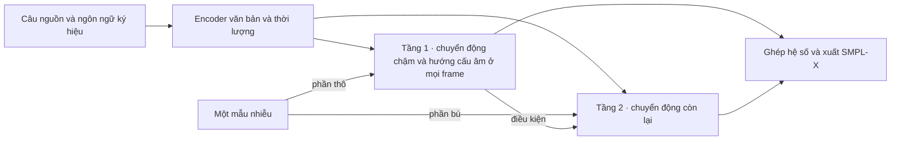

# Thiết kế flow phân cấp theo cấu âm cho Sign Language Production

**Đề xuất.** Sinh câu ký hiệu qua hai tầng. Tầng đầu sinh diễn tiến chậm của toàn bộ tư thế, đồng thời được giữ độ phân giải từng khung hình cho một số hướng chuyển động quan trọng với hai tay. Các hướng này được ước lượng từ dữ liệu train bằng vị trí tay so với thân, hướng lòng bàn tay, hình dạng ngón, khoảng cách giữa hai tay và tín hiệu hàm–mặt. Tầng sau sinh những biến thiên còn thiếu với điều kiện là câu nguồn và kết quả tầng đầu. Cả hai tầng đều lấy mẫu, cho phép mô hình biểu diễn nhiều cách ký cùng một câu.

**Lý do để thử.** Trên 48 bản tin PHOENIX tách riêng trong tập train, khi cung cấp chuyển động thật cho bộ mã hóa, thiết kế giữ được hướng lòng bàn tay với sai số **7,22°**. Một bộ lọc chỉ theo thời gian, với cùng khoảng **23,3% số hệ số**, cho **11,38°**. Tuy nhiên, PCA tái tạo vị trí đầu ngón trong hệ lòng bàn tay tốt hơn. Phép thử văn bản ở mục 5 cũng cho thấy từ ngữ dự báo cường độ chuyển động trong một khoảng thời gian dễ hơn dự báo dao động ở đúng thời điểm. **Chất lượng sinh từ văn bản và khả năng vượt benchmark vẫn là các giả thuyết thực nghiệm.**



## 1. MotionHiFlow giải quyết điều gì, bản chuyển sang SLP đang vướng ở đâu?

MotionHiFlow mã hóa chuỗi khớp bằng VAE có cấu trúc đồ thị, sau đó dùng TMDiT và Joint RoPE để sinh latent theo các lưới thời gian từ thưa đến dày. Tại ranh giới hai tầng, tác giả khôi phục ước lượng sạch, nội suy theo thời gian rồi trộn lại với nhiễu lấy từ cùng một mẫu ban đầu. Thí nghiệm chính dùng stride 4 trong VAE, sáu nhóm khớp và ba tỷ lệ $1/3,2/3,1$. HumanML3D và KIT-ML đo mức phù hợp giữa mô tả hành động và chuyển động toàn thân. Chúng cung cấp bằng chứng cho ý tưởng sinh dần, còn hiệu quả đối với một câu ký hiệu phải được đo trên SLP. [Li và cộng sự, CVPR 2026, mục 3.4–4.3](https://arxiv.org/pdf/2604.23264) · [Mã nguồn tác giả](https://github.com/ai-lh/MotionHiFlow)

Bản chuyển MotionHiFlow trong thư mục bên cạnh đã thay biểu diễn bằng VAE bốn phần thân/tay trái/tay phải/mặt, stride 2, dùng encoder mBART và dự đoán thời lượng từ văn bản. Ba tầng mặc định lấy 0,3/0,6/1,0 số bước **latent**. Chẳng hạn, trước làm tròn, tầng đầu chỉ có khoảng 15 vị trí cho 100 khung hình đầu ra. Bản mã tác giả để đối chiếu ở commit `e0a1605`. [Cấu hình bản chuyển](../motionhiflow_slp/config.yaml) · [Codec](../motionhiflow_slp/codec.py) · [Chuyển tầng](../motionhiflow_slp/pyramid.py) · [Scheduler của bản tác giả](../../third_party/MotionHiFlow/src/arch/dit/scheduler_flow_matching.py)

**Kết quả đã có của bản chuyển.** PHOENIX-2014T dev, 519 câu, seed 0. Ba nhánh dùng chung codec và thời lượng do một mô hình sinh dự đoán trước. Mỗi nhánh chọn một trong ba checkpoint 8k/16k/24k bằng DTW-JPE tay trên 66 câu dev thuộc các bản tin tách khỏi 453 câu còn lại. Bảng là kết quả trên toàn dev nên có cả phần dùng chọn checkpoint. Tỷ lệ động học là tốc độ/gia tốc tay sau lọc so với tham chiếu, giá trị đích bằng 1. [Báo cáo từng nhánh](../../outputs/jobs/motionhiflow_phoenix_improve/report.json) · [Quy tắc chia bản tin](../../configs/experiments/motionhiflow_slp/select_dev.py) · [Recipe](../../configs/experiments/motionhiflow_slp/phoenix.sh)

| Nhánh | Checkpoint | DTW-JPE thân ↓ | DTW-JPE tay ↓ | DTW-PA-JPE tay ↓ | Tốc độ / gia tốc tay | BLEU-4 dịch ngược ↑ |
|---|---:|---:|---:|---:|---:|---:|
| Ba tầng | 16k | 5,759 | 7,268 | 1,443 | 0,834 / 0,775 | 12,99 |
| Một tầng | 24k | 5,794 | 7,302 | 1,451 | 0,784 / 0,707 | 13,07 |
| Một tầng + loss FK ở đầu ra | 16k | 5,684 | 7,195 | 1,451 | 0,767 / 0,693 | 12,95 |

Ba tầng giữ tốc độ tốt nhất trong ba nhánh. Một tầng thắng sát nút trên phần chọn checkpoint, rồi nhánh thêm FK đạt lỗi tay thấp nhất trên toàn dev. Với **642 câu test**, nhánh FK ở 16k tự dự đoán độ dài, đạt DTW-JPE thân **5,306**, tay **6,789**, DTW-PA-JPE tay **1,371**. BLEU-4 của bộ dịch ngược nội bộ là **13,67** trên mẫu sinh và **11,33** trên pose thật. Chênh lệch này giới hạn cách diễn giải BLEU, nhất là đối với số, ngày và hướng trong dự báo thời tiết. [Checkpoint và chế độ thời lượng](../../outputs/jobs/motionhiflow_phoenix_improve/test_fk_single/meta.json) · [Hình học test](../../outputs/jobs/motionhiflow_phoenix_improve/test_fk_single/metrics.json) · [Dịch ngược và ví dụ test](../../outputs/jobs/motionhiflow_phoenix_improve/test_fk_single/bt_local.json)

Một phép chẩn đoán trước đó trên 96 câu dev của bản chuyển gốc cho DTW-JPE tay **7,666** khi sinh, **7,458** khi cấp độ dài thật và **1,029** khi mã hóa–giải mã chính pose thật. Trên phép đổi câu nguồn, BLEU-4 nội bộ giảm từ **8,64** xuống **1,54**. Mô hình có sử dụng văn bản. Khoảng cách lớn giữa tái tạo và sinh làm cho cách phân bổ thông tin *trong quá trình sinh* đáng kiểm tra trước khi tăng dung lượng codec. Các số ở đoạn này thuộc checkpoint và tập con khác với bảng 519 câu. [Đối chứng độ dài/codec](../../outputs/diagnostics/motionhiflow_phoenix_20261123/paired_probe.json) · [Đối chứng đổi câu](../../outputs/diagnostics/motionhiflow_phoenix_20261123/text_probe.json)

## 2. Cơ sở nghiên cứu bên ngoài và phạm vi đóng góp

Tra cứu có mục tiêu đến **25/11/2026**, theo các cụm “sign language production flow matching”, “sparse keyframe”, “adaptive temporal scheduling”, “semantic residual quantization”, “text-aligned pose tokenizer”, “articulatory timing”, “frequency-selective diffusion” và “subspace diffusion”. Đối chiếu bài gốc, bảng của tác giả và mã chấm điểm. Các nguồn được chọn bao quát text-to-pose liên tục, mô tả cấu âm và đánh giá độ trung thành với câu. Các báo cáo trong repo ở mục 1 chỉ mô tả đối chứng cần giải thích.

| Kết quả liên quan | Hệ quả đối với thiết kế |
|---|---|
| SLP-AA mô tả cấu hình tay, vị trí, hướng, tiếp xúc và quan hệ thời gian. Mertz và cộng sự đo được sự chuẩn bị sớm hình dạng tay trong một thí nghiệm nhỏ trên một người ký LSF. | Các kênh có thể chồng lấn theo thời gian. Giữ riêng phép đo quay lòng bàn tay và cử động ngón. Các khoảng cách hình học chỉ là đại lượng thay thế cho tiếp xúc. Bằng chứng LSF có phạm vi hẹp. [Hall và cộng sự, LREC 2022](https://aclanthology.org/2022.signlang-1.10/) · [Mertz và cộng sự, ISSP 2024](https://www.isca-archive.org/issp_2024/mertz24_issp.html) |
| T2S-GPT học độ dài mã theo mật độ thông tin. BLANC dùng nhiều tốc độ cho thân và tay, học thời lượng block và thời điểm kết thúc. | Lấy mẫu thích nghi và tăng tần số riêng cho tay đã có tiền lệ. Ở đây đối tượng được giữ ở từng frame là tổ hợp chuyển động xuyên nhiều khớp, học theo sai số của quan hệ cấu âm. [Yin và cộng sự, ACL 2024](https://aclanthology.org/2024.acl-long.183/) · [BLANC, bản tác giả 2026](https://arxiv.org/abs/2610.24109) |
| SignFlow đã dùng conditional flow matching cho SLP. SignSparK dùng FAST để lấy keyframe, huấn luyện CFM có điều kiện, và có chế độ text-to-pose suy luận với **0 keyframe**. SignNMFlow học đường nội suy trên đa tạp phép quay. | Cả flow cho SLP, điều kiện keyframe và hình học phép quay đều có đối chứng trực tiếp. Câu hỏi ở đây là những thành phần nào của một câu ký hiệu nên được sinh xong ở tầng đầu và được bảo toàn đến tầng cuối. [SignFlow, ICMI 2025](https://doi.org/10.1145/3716553.3750765) · [SignSparK, ECCV 2026, mục 3–4](https://arxiv.org/html/2603.10446v4) · [SignNMFlow, preprint 2026](https://arxiv.org/html/2609.33339v1) |
| SignSAM kết hợp nhiều độ phân giải thời gian trong bộ sinh liên tục, gloss-free. Rastgoo và cộng sự dùng lọc tần số trên đồ thị khớp, pooling thích nghi và hướng dẫn Fourier cho bài toán cá nhân hóa từ gloss. | Lọc theo tần số trong SLP đã có tiền lệ. Điểm cần chứng minh là việc *chọn hỗn hợp khớp bằng biến thiên của đại lượng FK* rồi khóa đúng các hệ số đã sinh mang lại lợi ích trong text-to-pose. [SignSAM, trang tác giả](https://kha-kim-thuy.github.io/SLP-Demo/) · [Rastgoo và cộng sự, IEEE TMM 2026](https://vbn.aau.dk/en/publications/hierarchical-graph-frequency-selective-diffusion-model-for-person/) |
| SOKE dùng tokenizer theo bộ phận và có biến thể tra từ điển. MaDiS dùng masked diffusion trên token, học đồng thời ở không gian token, latent và vật lý. | Chia nhánh tay/thân, bổ sung FK và đổi bộ sinh đều đã được nghiên cứu. Cần đối chứng cùng biểu diễn, cùng text encoder và cùng quyền truy cập dữ liệu. [SOKE, ICCV 2025](https://openaccess.thecvf.com/content/ICCV2025/html/Zuo_Signs_as_Tokens_A_Retrieval-Enhanced_Multilingual_Sign_Language_Generator_ICCV_2025_paper.html) · [MaDiS, bảng 1 và 3](https://arxiv.org/html/2601.19577v2) |
| SRVQ sinh mã nội dung trước rồi sinh mã dư động học. SIGNTOK dùng mục tiêu động học, căn chỉnh cấp câu và cấp từ để tổ chức latent liên tục. | “Ngữ nghĩa trước, chi tiết sau” là một đóng góp quá rộng. Cơ sở hình học dưới đây không có nhãn từ vựng. Khả năng giữ nghĩa phải thể hiện ở phép đổi câu và khả năng hiểu của người ký. [SRVQ, preprint tháng 11/2026](https://arxiv.org/abs/2611.06781v2) · [SIGNTOK, preprint tháng 11/2026](https://arxiv.org/abs/2611.23944v2) |
| Subspace Diffusion đã nghiên cứu thay đổi không gian con trong mô hình sinh. Hồi quy giảm hạng đã có nghiệm từ phân rã giá trị kỳ dị. | **Phần đóng góp đề xuất** là chọn các hướng nhanh bằng những quan hệ cấu âm đo từ FK, ghép chúng với phần chậm toàn thân trong một phép chiếu, rồi sinh flow bù trực giao có điều kiện văn bản. Giá trị của lựa chọn này có thể kiểm định bằng cách thay cơ sở học được bằng PCA và giữ mọi thứ khác cố định. [Jing và cộng sự, ECCV 2022](https://arxiv.org/abs/2205.01490) · [Izenman, 1975](https://www.sciencedirect.com/science/article/pii/0047259X75900421) |

## 3. Biểu diễn mà hai tầng sẽ sinh

Mỗi mẫu có câu nguồn $x$, ngôn ngữ ký hiệu $\ell$ và, khi huấn luyện, pose $X\in\mathbb R^{T\times133}$. Layout sau chuẩn hóa SOKE gồm 30 biến quay thân trên, 45 cho mỗi bàn tay, 3 cho hàm và 10 hệ số biểu cảm. PHOENIX dùng tiếng Đức → DGS, CSL-Daily dùng tiếng Trung → CSL, How2Sign dùng tiếng Anh → ASL. Phép thử đầu dùng PHOENIX đơn ngữ. Đầu vào suy luận là $(x,\ell)$ và hạt giống lấy mẫu. Cặp câu–pose trong train đủ để tạo tất cả mục tiêu bên dưới. [Loader và quy tắc crop](../../src/slp/data/sign_smplx.py) · [PHOENIX-2014T](https://www-i6.informatik.rwth-aachen.de/~koller/RWTH-PHOENIX-2014-T/) · [CSL-Daily](https://arxiv.org/abs/2105.12397) · [How2Sign](https://openaccess.thecvf.com/content/CVPR2021/html/Duarte_How2Sign_A_Large-Scale_Multimodal_Dataset_for_Continuous_American_Sign_Language_CVPR_2021_paper.html)

### 3.1. Học những hướng chuyển động cần giữ ở mọi frame

Dùng forward kinematics (FK) trên rig SMPL-X cố định của bộ chấm để lập vector quan sát $D(X_t)$ cho từng frame train. Bảng chỉ rõ cách dựng 96 chiều. Mỗi hướng trong cơ sở học được sau đó có thể kết hợp vai, cổ tay và nhiều ngón của cả hai bàn tay.

| Nhóm | Chiều | Phép đo |
|---|---:|---|
| Vị trí tay so với thân và tay còn lại | 6 | Vector từ trung điểm hai vai đến trung điểm hai cổ tay và vector từ cổ tay trái sang phải. Cặp này xác định cả hai cổ tay trong hệ quy chiếu đặt gốc ở vai. |
| Hướng lòng bàn tay | 12 | Hai vector đơn vị cho mỗi tay, dọc lòng bàn tay và pháp tuyến. Dựng trục ngang từ khớp bàn–ngón út đến khớp bàn–ngón trỏ, pháp tuyến từ tích có hướng của trục ngang với hướng cổ tay → gốc ngón giữa. Dùng cùng thứ tự điểm cho từng bên suốt tập dữ liệu. |
| Hình dạng bàn tay | 30 | Năm đầu ngón của mỗi tay trừ vị trí cổ tay, biểu diễn trong hệ trục gắn với chính lòng bàn tay đó. |
| Quan hệ hai tay và tay–mặt | 35 | 25 khoảng cách giữa năm đầu ngón trái và năm đầu ngón phải, cộng 10 khoảng cách từ đầu ngón đến mũi. |
| Hàm và mặt | 13 | Ba thành phần quay hàm và mười hệ số biểu cảm có trong bản fit. Chúng quan sát được một phần tín hiệu ngoài tay. Dữ liệu này thiếu điều khiển ánh mắt riêng và nhãn ngữ pháp trên khuôn mặt. |

Dùng các bàn tay 21 điểm từ bộ hồi quy mesh và mũi/vai từ cùng lần chạy FK. Chia mỗi cột quan sát cho độ lệch chuẩn trên train, sàn $10^{-4}$ trong đơn vị của cột. Nhân nhóm $g$ với $\sqrt{w_g/d_g}$ để nhóm 35 khoảng cách có tổng trọng số kiểm soát được. Trọng số ban đầu theo thứ tự bảng là $(1,1,1,1,0.5)$. Kiểm tra các frame có lòng bàn tay suy biến và ảnh hưởng của nhiễu fitting bằng cách tính lại kết quả sau lọc nhẹ. Việc lọc áp dụng riêng bên trong mỗi clip. [Rig và thứ tự khớp](../../src/slp/evaluation/smplx_fk.py) · [Phân tích chuyển động tay theo chuỗi khớp, LREC 2026](https://aclanthology.org/2026.lrec-1.751/)

Với mỗi độ dài $T$, lấy $q=\lceil T/8\rceil$ hàng đầu của DCT-II trực chuẩn, gồm cả hệ số hằng. Gọi $L_T$ là phép chiếu về các tần số ấy rồi biến đổi ngược sang frame, $H_T=I-L_T$. Làm trên từng câu trước padding. Ghép các ma trận $H_T X$ và $H_T D(X)$ của các câu train theo chiều frame thành $A$ và $B$. Với $N$ là tổng số frame, $d=133$, tính một lần

$$
S=A^\top A/N,\quad \lambda=0.01\,\mathrm{tr}(S)/d,\quad
W=(S+\lambda I)^{-1/2},\quad
V=\mathrm{leftSVD}_{r}\!\left(W A^\top B/N\right),\qquad r=16 .
$$

$V$ có $r$ cột trực chuẩn. Đây là cách tìm các hướng của pose đã làm trắng có ích cho **dự báo tuyến tính biến thiên nhanh** của các quan sát. Cụ thể, với hồi quy $AM\approx B$, hạng của $M$ giới hạn ở $r$ và phạt $\lambda\|M\|_F^2$, nghiệm được xác định bằng SVD trên khi loss dữ liệu chia cho $N$. PCA của $S$ ưu tiên phương sai pose và là đối chứng trực tiếp. FK phi tuyến, nên một hướng trực giao với $V$ vẫn có thể làm đổi hình dạng tay sau giải mã. Kiểm tra hiện tượng này bằng sai số FK thật ở mục 5.

### 3.2. Phép chuyển tầng và đại lượng được bảo toàn

Đặt $\mu$ bằng pose trung bình trên train, $Y=(X-\mu)W$ và $P_a=VV^\top$. Với mọi ma trận $Z$ kích thước $T\times d$, định nghĩa

$$
\mathcal P(Z)=L_T Z+H_T ZP_a,\qquad
\mathcal Q(Z)=H_T Z(I-P_a).
$$

$\mathcal P$ chứa diễn tiến chậm của *mọi* chiều và diễn tiến nhanh của $r$ hướng cấu âm. Chẳng hạn, khi hai cổ tay di chuyển chậm nhưng lòng bàn tay xoay nhanh, tầng đầu có thể biểu diễn cả hai nếu hướng xoay có thành phần trong $V$. $\mathcal Q$ còn $(T-q)(d-r)$ bậc tự do để sinh chi tiết. Hai phép chiếu tự liên hợp, lũy đẳng, có tích bằng 0 và tổng bằng đồng nhất. Do đó thêm bất kỳ vận tốc nào qua $\mathcal Q$ cũng giữ nguyên $L_T Y$ và $YV$. Do $H_T$ dùng toàn chuỗi, phiên bản đầu sinh ngoại tuyến ở cấp câu. Tính chất này đúng trong hệ số pose. Độ chính xác góc lòng bàn tay, tiếp xúc hay nội dung từ vựng vẫn phải đo.

Ví dụ với 128 frame, $q=16$, $r=16$. Tầng đầu nhận $16\times133+112\times16=3\,920$ hệ số độc lập trong tổng số $17\,024$. Tầng sau sinh 13 104 hệ số còn lại. Khi triển khai có thể lưu bằng tensor dày $T\times133$ và chiếu bằng DCT cùng hai phép nhân với $V,V^\top$. Số bậc tự do nhỏ tự nó chưa chứng minh tốc độ suy luận cao hơn.

## 4. Học có điều kiện văn bản và sinh câu ký hiệu

**Văn bản và thời lượng.** Encoder mBART cho các token của cả câu. Mỗi frame truy cập tất cả token bằng cross-attention, có embedding ngôn ngữ, chỉ số frame và tiến độ $t/\max(T-1,1)$. Cách này cho phép trật tự từ tiếng Đức khác trật tự ký trong DGS và cho phép hai tay hoạt động đồng thời. Một đầu hồi quy học $|\log\hat T-\log T|$. Khi sinh, làm tròn rồi chặn $\hat T$ trong miền 40–400 frame của protocol hiện tại. Trong các ablation có khóa độ dài, dùng cùng **độ dài dự đoán từ văn bản**. [Giao diện text hiện tại](../../src/slp/sign_text.py) · [Quy tắc độ dài](config.yaml)

**Một tín hiệu văn bản để thử.** Chia câu ký hiệu thành bốn khoảng liên tiếp gần bằng nhau trên trục thời gian chuẩn hóa. Với hướng $k$, tính $e_{bk}=\log(1+\operatorname{mean}_{t\in b}[(H_TYV)_{tk}^2])$. Bốn query ứng với bốn khoảng đọc token mBART rồi dự đoán $4\times r$ giá trị bằng đầu MLP với đầu ra softplus. Học bằng Huber sau chia độ lệch chuẩn train cho từng thành phần. Nhúng vector **dự đoán** của từng khoảng vào frame cùng khoảng ở tầng đầu, kể cả khi train. Đây là gợi ý mềm về cường độ, có ablation bỏ đầu này. Hai tầng vẫn nhận toàn văn bản và lấy mẫu pha chuyển động. Cơ sở thực nghiệm và giới hạn của tín hiệu này nằm ở mục 5.2.

**Hai trường vận tốc.** Gọi $s_P,s_Q$ là RMS trên train của từng thành phần chiếu, tính bằng căn của tổng bình phương chia tổng **số bậc tự do** tương ứng. Dùng sàn $10^{-6}$ cho hai hệ số tỉ lệ. Đặt $C=\mathcal P(Y)/s_P$, $R=\mathcal Q(Y)/s_Q$. Mẫu nhiễu ban đầu $E\sim\mathcal N(0,I)$ có cùng kích thước $Y$ trên các frame hợp lệ. Dùng $E_P=\mathcal P(E)$, $E_Q=\mathcal Q(E)$. Hai phần này độc lập vì trực giao và Gaussian. Mỗi tầng có thời gian flow riêng $u\sim U[0,1]$, khác với chỉ số frame vật lý $t$. Hai cặp huấn luyện có dạng

$$
C_u=(1-u)E_P+uC,\quad v_P^\star=C-E_P,\qquad
R_u=(1-u)E_Q+uR,\quad v_Q^\star=R-E_Q .
$$

Điều kiện $h$ gồm token văn bản, mã ngôn ngữ và, ở tầng đầu khi bật, gợi ý cường độ. Tầng đầu ước lượng $\mathcal P f_\theta(C_u,u,h)$, tầng sau ước lượng $\mathcal Q g_\theta(R_u,u,h,C)$. Đưa $C$ vào tầng sau như một chuỗi điều kiện có cùng trục thời gian. Loss của mỗi tầng là sai số bình phương vận tốc trên frame hợp lệ chia cho hạng phép chiếu của câu, rồi lấy trung bình theo câu. Bỏ các mẫu có hạng bằng 0 khỏi loss của tầng đó. Hai tầng dùng chung backbone Transformer với embedding phân biệt tầng, đầu chiếu đầu vào/ra riêng, một token chuyển động mỗi frame. Cấu hình đầu dùng width 384, 6 head, 9 block, mBART đóng băng, AdamW $2\cdot10^{-4}$ và EMA 0,999. Lấy một tầng với xác suất $1/2$ mỗi minibatch. Trong 10% mẫu train, thay token văn bản và gợi ý cường độ bằng điều kiện rỗng để học nhánh CFG. Giữ phần thô khi huấn luyện tầng sau. Tính loss thời lượng và đầu cường độ từ text đầy đủ trước bước dropout. Loss đầu tiên để thử là loss vận tốc + loss thời lượng, cộng $0,1$ lần loss cường độ khi bật đầu tương ứng. Đây là điểm xuất phát để so sánh. [Mục tiêu conditional flow matching](https://arxiv.org/abs/2210.02747)

**Suy luận.**

1. Mã hóa $(x,\ell)$, dự đoán $\hat T$ và cường độ theo khoảng nếu bật. Dựng $L_{\hat T},H_{\hat T}$, lấy một $E$ theo seed và ID câu. ID chỉ dùng để tái lập nhiễu.
2. Bắt đầu từ $E_P$, tích phân Euler 6 bước với vận tốc chiếu qua $\mathcal P$, thu $\hat C$. Chuyển tầng bằng cách cố định $\hat C$ và khởi tạo phần bù bằng $E_Q$ của cùng mẫu nhiễu.
3. Bắt đầu từ $E_Q$, tích phân Euler 6 bước với vận tốc chiếu qua $\mathcal Q$, điều kiện $(h,\hat C)$. Khi dùng CFG, lượt bỏ điều kiện chỉ bỏ thông tin từ văn bản, gồm cả gợi ý cường độ. Giữ mã ngôn ngữ ở cả hai lượt và giữ $\hat C$ khi ở tầng sau. Dùng hệ số CFG bằng 2 cho đối chứng đầu, chọn lại trên dev với cùng ngân sách ở mỗi nhánh. Xuất $\hat X=\mu+(s_P\hat C+s_Q\hat R)W^{-1}$ dưới dạng `[T,133]` chuẩn hóa SOKE.
4. So sánh ở tổng 12 bước, ghi cả số lượt gọi mạng có/không điều kiện, thời gian và VRAM thực. Với CFG khác 1, 12 bước tương ứng 24 lượt đánh giá nhánh mạng, kể cả khi gộp hai nhánh vào một batch. Nếu $q=T$, toàn bộ pose thuộc tầng đầu và có thể bỏ tầng bù.

MotionHiFlow cung cấp nguyên lý dùng một mẫu nhiễu xuyên các tầng và học các bài toán vận tốc đơn giản. Ở đây biến mới khi chuyển tầng chính là nhiễu trên phần bù trực giao. Cả hai tầng làm việc trên lưới thời gian đầu ra, với một đẳng thức rõ ràng về thông tin được giữ. Toàn bộ flow hoạt động trong tọa độ Euclid của tham số SMPL-X đã chuẩn hóa. Đường đi của nó có thể đi qua những vùng ít gặp trong dữ liệu, nhất là nơi biểu diễn axis-angle đổi nhánh. Cần kiểm tra góc quay, vận tốc khớp sau FK và các frame ngoại lệ.

**Sai lệch giữa train và suy luận.** Khi train, $R$ đi cùng $C$ của chính câu để học đúng phân phối có điều kiện. Khi sinh, sai sót ở $\hat C$ sẽ truyền tiếp và tầng sau bị giới hạn bởi $\mathcal Q$. Để định vị lỗi, đo riêng ba chế độ trên dev ở cùng độ dài chẩn đoán. Ba đầu ra tương ứng là $C_\mathrm{GT}+\hat R$ (năng lực tầng sau), $\hat C+R_\mathrm{GT}$ (lỗi tầng đầu, ghép đại số), và $\hat C+\hat R$ (sinh đủ hai tầng), có hoàn nguyên tỉ lệ trước khi cộng. Hai chế độ dùng một phần GT là phép can thiệp. Kết quả chính luôn dùng thời lượng và cả hai thành phần do mô hình dự đoán.

## 5. Hai phép thử đã chạy trên PHOENIX train

### 5.1. Cùng ngân sách, tầng đầu giữ được gì?

Đọc đúng 7 092 clip trong manifest train đã đóng gói, 643 bản tin. Sắp tên bản tin, hoán vị với NumPy `default_rng(23264)`, lấy 128 bản tin cho fit, 48 bản tin tiếp theo cho đánh giá. Mỗi bản tin chọn một clip ngẫu nhiên từ danh sách ID đã sắp. Tổng cộng 14 956 frame để ước lượng $W,V$ và 5 084 frame để đo. Giữ nguyên phép crop/chuẩn hóa của loader. Mỗi phương án chỉ nhận các hệ số tầng đầu **trích từ pose thật**, đặt phần bù bằng 0, hoàn nguyên về 133 chiều rồi chạy FK thật. Đo cùng frame, trung bình trong clip trước rồi trung bình 48 clip.

| Tầng đầu cung cấp cho bộ giải mã | Cổ tay so với vai (cm) ↓ | Đầu ngón trong hệ lòng tay (cm) ↓ | Góc pháp tuyến lòng tay (°) ↓ | Khoảng cách đầu ngón trái–phải, MAE (cm) ↓ | 21 điểm mỗi tay so với cổ tay (cm) ↓ | Hàm/mặt, MAE chuẩn hóa ↓ |
|---|---:|---:|---:|---:|---:|---:|
| Chỉ tần số thấp, tăng $q$ để khớp ngân sách | 2,131 | 1,335 | 11,38 | 2,877 | 2,088 | 0,213 |
| Tần số thấp + 16 hướng PCA của chuyển động nhanh | 3,314 | **0,718** | 14,33 | 3,998 | 2,309 | 0,211 |
| Tần số thấp + 16 hướng học theo quan hệ cấu âm | **1,776** | 0,940 | **7,22** | **1,655** | **1,239** | **0,180** |

Với phương án chỉ theo thời gian, lấy $q'=\operatorname{round}([qd+(T-q)r]/d)$. Số hệ số giữ lại trung bình là **23,298%** so với **23,296%** của hai phương án còn lại. So với đối chứng thời gian, chênh lệch sai số của 21 điểm tay là **−0,849 cm**, CI bootstrap ghép cặp 95% **từ −0,954 đến −0,745 cm**. So với PCA, sai số đầu ngón trong hệ lòng tay *tăng* **0,222 cm**, CI **từ 0,201 đến 0,243 cm**. Kết quả thứ hai quan trọng đối với những ký hiệu phân biệt bằng hình dạng ngón. Thay $r$ hay trọng số nhóm sẽ cần đánh giá lại trên các bản tin khác. Trong hai lần chạy float64, sai số khôi phục lớn nhất khi ghép cả hai thành phần đều dưới $5\times10^{-14}$. Phép thử này đánh giá bộ biểu diễn, chưa sử dụng văn bản để sinh pose.

### 5.2. Câu tiếng Đức dự báo được phần chuyển động nào?

Dùng đúng $W,V$ đã fit ở trên. Chọn **toàn bộ 547 clip** của 48 bản tin giữ lại làm mẫu đánh giá. Trên 6 545 clip thuộc các bản tin còn lại, so sánh ridge dùng số từ của câu với ridge thêm TF-IDF unigram/bigram. Cả hai cùng có hệ số chặn, $\log(1+\text{số từ})$ và bình phương của nó. Chọn hệ số regularization trên 96 bản tin hiệu chỉnh thuộc train, rồi fit lại trên 6 545 clip. Hai đích được xét là 64 giá trị cường độ $e_{bk}$ ở bốn khoảng, hoặc giá trị có dấu của 16 hệ số nhanh lấy trung bình trong 24 khoảng liên tiếp (384 giá trị). Tất cả đích được chuẩn hóa bằng thống kê của phần fit.

| Thêm từ và cặp từ vào mô hình chỉ có độ dài câu | Giảm MSE tương đối trên 547 clip | CI 95% theo bản tin |
|---|---:|---:|
| Dự báo cường độ ở bốn khoảng | **3,59%** | **2,15% đến 5,01%** |
| Dự báo hệ số có dấu ở 24 khoảng | **0,12%** | **0,03% đến 0,23%** |

Lợi ích đo được nhỏ và nhạy với regularization. Ở lần thử đầu cố định hệ số bằng 1, thêm từ làm MSE *tăng* tương ứng 3,19% và 10,21%. Bước hiệu chỉnh tiếp theo chọn trong $\{0.1,1,10,100,1000\}$ chỉ bằng dữ liệu train ngoài 48 bản tin. Hệ số chọn được cho mô hình chỉ dùng độ dài là 10 ở cả hai đích, còn mô hình có từ vựng chọn 10 cho cường độ và 100 cho hệ số có dấu. Đây là phân tích thăm dò cùng một miền thời tiết. Hai đích còn khác nhau về số chiều và mức gộp thời gian, nên chênh lệch này chưa xác lập giới hạn của text encoder. Vì vậy bản thử dùng cường độ như một gợi ý mềm, để flow lấy mẫu diễn tiến chi tiết và kiểm tra bằng đối chứng đổi câu. Mã ở phụ lục tái tạo bảng hình học và phép so sánh ridge đã hiệu chỉnh.

## 6. Thực nghiệm nào có thể xác nhận hoặc bác bỏ phương pháp?

### 6.1. Các đối chứng cần chạy theo thứ tự

| So sánh | Giữ cố định | Câu hỏi quyết định |
|---|---|---|
| Bản chuyển MotionHiFlow một tầng + FK và ba tầng so với CFM một tầng trực tiếp trên `[T,133]` | Manifest, rig, mBART, thời lượng, loss FK nếu bật ở cả hai nhánh được so, số mẫu sinh | Bao nhiêu thay đổi đến từ việc bỏ codec nén thời gian? So lại cả mốc lịch sử và mốc một tầng huấn luyện cùng recipe mới. |
| Hai tầng chỉ dùng $L_{q'}$ so với hai tầng dùng $L_q+H_qP_a$ | Cùng backbone hai tầng, cùng mức làm trắng, cùng ngân sách hệ số tầng đầu, cùng số bước | Giữ một số hướng ở mọi frame có ích hơn cấp toàn bộ ngân sách cho tần số thấp? |
| Hai tầng với $V_\mathrm{PCA}$, $V$ ngẫu nhiên trực chuẩn, hoặc $V$ theo quan hệ cấu âm | Cùng $r=16$, $q$, số tham số, noise theo ID, không bật đầu cường độ ở cả ba | Phần lợi ích nào thực sự đến từ việc chọn quan hệ tay–thân–mặt? Đo riêng hình dạng ngón để kiểm tra điểm PCA đã thắng. |
| Hai tầng với ngân sách tần số chia theo thân/tay trái/tay phải/mặt so với cơ sở theo quan hệ | Cùng backbone và tổng số hệ số. Trong đối chứng dùng low-pass riêng trên từng nhóm tọa độ gốc, chọn bốn ngưỡng trên train với ngân sách $\sum_g q_g d_g\approx qd+(T-q)r$. | Cơ sở kết hợp nhiều khớp có cải thiện phối hợp hai tay hơn việc ưu tiên riêng bàn tay? |
| $V$ theo quan hệ, có hoặc bỏ phép chiếu vận tốc tầng cuối | Cùng $C$, cùng kiến trúc và text | Bảo toàn cứng giúp hay khóa lỗi? Ở nhánh tự do dùng flow từ $\mathcal P(Y)+E$ đến $Y$ trong huấn luyện, thay phần thô bằng dự đoán khi sinh và cho mạng cập nhật mọi chiều. |
| Với/bỏ gợi ý cường độ từ văn bản | Cùng phép chiếu và seed | Mức dự báo yếu ở mục 5.2 có cải thiện mẫu sinh? Thử cùng gợi ý trên baseline một tầng để tách lợi ích của giám sát phụ. |
| Cùng nhiễu, đổi câu nguồn. Cùng câu, đổi nhiễu | Cố định độ dài dự đoán ban đầu cho phép đổi câu, dùng cặp câu cùng ngôn ngữ và gần độ dài | Hình học, ý nghĩa có đổi theo câu và độ đa dạng có tồn tại trong cùng câu? Loại câu đồng nghĩa khỏi tập câu đối chứng. |

Khởi đầu với lịch 24k update, batch hiệu dụng 32, snapshot ở 8k/16k/24k như thí nghiệm PHOENIX. Khớp số update, clip, ngân sách chọn checkpoint và tổng lượt đánh giá trường vận tốc. Một token cho mỗi frame và latent nhiều token của bản chuyển có chi phí khác nhau. Báo thêm số tham số học được, thời gian GPU huấn luyện, FLOPs và thời gian sinh mỗi clip ở cùng độ dài và batch nếu đo được. Ưu tiên so cùng backbone giữa các biến thể phép chiếu. Thử ba seed ghép cặp trên dev, năm seed cho bảng chính, báo từng seed và trung bình ± độ lệch chuẩn. [Protocol thí nghiệm trong workspace](../../docs/experiment_protocol.md)

### 6.2. Benchmark, ngữ nghĩa và tiêu chí quyết định

**Giao thức.** PHOENIX đơn ngữ là phép thử đầu, vì có đối chứng đã chạy và bộ chấm FK nhất quán. Dùng 7 092/519/642 mẫu của manifest đang có. Khóa recipe trên dev rồi lặp độc lập ở CSL-Daily. Với How2Sign ghi rõ manifest, phép lấy mẫu xuống 24 fps và ID bị loại. Cấu hình `how2sign_smplx_soke` dùng chỉ số theo floor và loại các clip fit lỗi đã liệt kê, `how2sign_smplx` dùng quy tắc MaDiS. Ghi rõ nguồn checkpoint encoder và tập tiền huấn luyện, tách kết quả đơn ngữ, đa ngữ và kết quả dùng từ điển. Khóa một mẫu sinh/ID/seed cho điểm chính. Đa mẫu chỉ dùng cho phép đo đa dạng. [Loader và cả hai protocol](../../src/slp/data/sign_smplx.py) · [Cấu hình How2Sign–SOKE](../../configs/data/how2sign_smplx_soke.yaml)

Các mốc sau là **số test PHOENIX do tác giả công bố**, để định cỡ mục tiêu. Thứ tự cột là JPE rồi PA-JPE. Một phép so ngang có giá trị cần khớp bộ fit, danh sách câu, nguồn thời lượng, tập tiền huấn luyện, phép căn chỉnh và evaluator. Khi chưa xác nhận được nguồn thời lượng của checkpoint công bố, ghi “chưa xác định” cạnh số paper. Điểm BLEU nội bộ ở mục 1 dùng một bộ dịch ngược khác.

| Công trình và chế độ | DTW-JPE thân / tay ↓ | DTW-PA-JPE thân / tay ↓ | Điều kiện để đọc số |
|---|---:|---:|---|
| SOKE, multi-head không từ điển | — | 6,16 / 1,85 | Mốc text-to-pose trong ablation của tác giả. [SOKE, bảng 2](https://openaccess.thecvf.com/content/ICCV2025/papers/Zuo_Signs_as_Tokens_A_Retrieval-Enhanced_Multilingual_Sign_Language_Generator_ICCV_2025_paper.pdf) |
| SignSparK, 0 keyframe lúc suy luận | 4,40 / 7,10 | 5,24 / 1,52 | Huấn luyện đa ngữ, có thêm một phần BOBSL. Bảng retrieval và bảng KF2P là các chế độ khác. [SignSparK, mục 4.2](https://arxiv.org/html/2603.10446v4) |
| MaDiS | 4,97 / 6,59 | — | Tiền huấn luyện phối hợp ba bộ dữ liệu, sau đó fine-tune theo từng bộ. Các cột SiBLEU trong bài đo token. [MaDiS, bảng 1](https://arxiv.org/html/2601.19577v2) |
| SignNMFlow, đơn ngữ | 4,37 / 5,57 | 3,85 / 1,07 | Mốc mạnh từ preprint, bản đa ngữ có hàng riêng. [SignNMFlow, bảng 1](https://arxiv.org/html/2609.33339v1) |

- **Chỉ số chính.** DTW-JPE tay theo SOKE, tính trung bình hai tay. Chi phí từng cặp frame được tính sau khi căn theo cổ tay tương ứng, DTW tích lũy chi phí tính bằng mét dọc đường căn chỉnh rồi lấy trung bình theo câu. Hai tay có đường DTW riêng. Vì vậy chỉ số chính ít thông tin về vị trí tay trong không gian ký và về phối hợp hai tay. Báo thêm DTW-JPE thân, DTW-PA-JPE tay/thân, độ dài dự đoán (MAE, bias theo tứ phân vị) và DTW chia độ dài đường đi. Với thân, ghi rõ PA fit trên toàn bộ joints hay biến thể `body_ua` fit trên 12 khớp thân trên. [Mã chấm gốc SOKE](https://github.com/2000ZRL/SOKE/blob/main/mGPT/metrics/t2m.py) · [Bộ chấm local](../../src/slp/evaluation/metrics.py)
- **Phép đo đúng cơ chế.** Dùng *một đường DTW chung* cho hai tay và thân, với chi phí là trung bình nhóm của vị trí cổ tay so với vai, tọa độ ngón trong lòng tay và pháp tuyến, chuẩn hóa từng nhóm bằng thống kê train. Trên cùng đường đó đọc sai số khoảng cách hai tay, sai số góc và hình dạng ngón. Kèm phép so ở tiến độ chuẩn hóa, tỷ lệ tốc độ/gia tốc tay, tỷ lệ biên độ chuyển động và sai số hàm/mặt. Đường chung hạn chế việc kéo lệch hai tay độc lập, còn đối chứng tiến độ phơi bày lỗi nhịp mà DTW có thể che. Báo chi phí mỗi bước bằng cm hoặc độ theo đại lượng, tách khỏi DTW tích lũy của bảng chính.
- **Độ trung thành với câu.** Chấm BLEU-4 và chrF dịch ngược của pose thật, pose tái tạo và pose sinh bằng cùng checkpoint, tokenizer và chế độ giải mã. Đo truy hồi đúng câu R@1 với bộ chấm đóng băng, độc lập với generator, ghi kích thước nhóm ứng viên và xử lý nhiều bản dịch tương đương. So câu đúng với câu tráo cùng chủ đề và độ dài, giữ cùng nhiễu. Báo riêng cặp đổi số, ngày, hướng, khẳng định/phủ định sau khi người biết DGS xác nhận cặp có ý nghĩa. PHOENIX từng có trường hợp chuyển động quá ít vẫn có điểm hình học cạnh tranh. [SLRTP 2025 Production Challenge](https://openaccess.thecvf.com/content/CVPR2025W/SLRTP/papers/Walsh_SLRTP2025_Sign_Language_Production_Challenge_Methodology_Results_and_Future_Work_CVPRW_2025_paper.pdf) · [Hong và Košecká, chẩn đoán conditional collapse](https://arxiv.org/abs/2606.01643)
- **Người dùng ngôn ngữ ký hiệu.** Với hai nhánh tốt nhất, dùng một tập câu có cả câu thời tiết lặp mẫu lẫn chi tiết dễ nhầm. Mời người Điếc thông thạo DGS xem avatar đã ẩn tên mô hình, ngẫu nhiên hóa thứ tự, đồng nhất camera và tốc độ phát. Cho người xem trả lời câu hỏi về nội dung *trước khi* cho xem câu nguồn. Sau đó chấm tự nhiên và so A/B có lựa chọn hòa. Báo kết quả theo câu và người chấm, tách đúng nội dung với đẹp chuyển động. Khi có bản video gốc được phép dùng, thêm điều kiện video/pose fit thật để thấy phần mất do rig. [Đánh giá người ký trong SignSparK](https://arxiv.org/html/2603.10446v4)

**Tiêu chí đưa ra trước lần train generator.** Mục tiêu thực dụng đầu tiên là giảm ít nhất **3%** DTW-JPE tay trên dev so với bản chuyển FK huấn luyện lại cùng điều kiện. Với mốc lịch sử 7,195 thì ngưỡng minh họa là khoảng **6,98**. Đồng thời yêu cầu chênh lệch ghép cặp so với đối chứng temporal cùng ngân sách có cận trên CI 95% dưới 0, và khoảng cách từ tỷ lệ tốc độ tay tới 1 tăng tối đa 0,05. Bootstrap ghép cặp theo bản tin và seed, lấy cùng tập bản tin cho hai hệ thống trong mỗi lần lấy mẫu rồi tính lại chênh lệch trung bình. Với BLEU, tính lại điểm corpus trên các câu được lấy mẫu. Công bố cả biến thiên giữa seed. Chỉ gán đóng góp **ngữ nghĩa** nếu phép phân biệt câu đúng/câu tráo hoặc độ hiểu của người ký cải thiện. Đây là ngưỡng quyết định nội bộ, chưa phải mức đã đạt.

**Cách xử lý kết quả âm.** Nếu oracle giữ hình học nhưng $\hat C$ sinh từ text làm hỏng lợi ích, ưu tiên thử tầng đầu với text encoder được fine-tune trong một đối chứng đồng ngân sách và kiểm tra ngữ nghĩa của $\hat C$ riêng. Nếu hai tầng với PCA hoặc temporal bắt kịp trên nhiều seed, thu hẹp tuyên bố về phép chiếu theo cấu âm. Nếu JPE giảm đồng thời tốc độ suy giảm hoặc người ký nhận nhầm từ, không kết luận chất lượng SLP tăng. Khi PHOENIX đạt tiêu chí, phép lặp trên CSL-Daily mới cho biết hiệu quả có chuyển sang ngôn ngữ ký hiệu khác hay không.

## 7. Điểm nối để hiện thực hóa trong workspace

| Thành phần | Công việc cụ thể |
|---|---|
| Dữ liệu và thống kê train | Giữ `MotionDataset`, ngôn ngữ, thứ tự `[T,133]`. Tính descriptor FK và DCT theo độ dài hợp lệ từng clip. Tích lũy hiệp phương sai theo batch trong float64, lưu $\mu,W,W^{-1},V,s_P,s_Q$, quy tắc $q(T)$, trọng số nhóm, hash của danh sách train và của rig/stats trong checkpoint. [Dữ liệu](data.py) · [Rig](../../src/slp/evaluation/smplx_fk.py) |
| Backbone và sampler | Nhánh thiết kế mới nhận pose trực tiếp, dùng token text, duration head, stage embedding và hai đầu vận tốc. Dựng các toán tử $\mathcal P,\mathcal Q$ theo `lengths` riêng, tính DCT và chiếu bằng fp32 hoặc fp64 ngoài autocast, dựng lại theo $\hat T$ khi sinh. Ghi version biểu diễn để load đúng checkpoint. [Transformer](model.py) · [Điểm vào fit/predict](method.py) |
| Kiểm tra chức năng | Với chuỗi dài 1, lẻ và khác độ dài trong cùng batch, kiểm tra $\mathcal P+\mathcal Q=I$, $\mathcal P\mathcal Q=0$, tính bất biến với padding và tái tạo khi dùng vận tốc oracle. Ở sampler, thay noise tầng cuối trong khi giữ tầng đầu rồi kiểm tra $\mathcal P(\hat Y)$ bằng nhau. Sau save/load, cùng text, seed và length phải cho cùng kết quả trong dung sai số. |
| Đánh giá sinh | Xuất `predictions.npz` theo ID và frame dự đoán, chấm qua runner chung. Mỗi run lưu manifest split, checkpoint/hash, scorer/hash, seed, chế độ duration, số bước và tập tune. Chọn checkpoint trên nhóm bản tin tune, dùng nhóm dev còn lại cho quyết định, khóa recipe trước khi chấm test. [Bộ chọn trên dev](../../configs/experiments/motionhiflow_slp/select_dev.py) · [Runner](../../scripts/run.py) |

**Ưu tiên triển khai.** Chạy trước cặp hai tầng cùng backbone và cùng ngân sách hệ số, với $V$ từ quan hệ cấu âm và với tầng đầu chỉ theo thời gian. Hai nhánh đều tắt gợi ý cường độ trong lượt này. Kiểm tra độ trung thành với câu và động học trên mẫu sinh ngay tại snapshot đầu tiên. Cặp này trả lời câu hỏi mà các phép oracle còn để ngỏ với chi phí thấp hơn quét toàn bộ hyperparameter.

Tài liệu được tổng hợp có hỗ trợ AI từ nguồn gốc bên ngoài và các phép đo CPU nêu rõ ở mục 5. Các bảng trong tài liệu ghi kết quả của bản chuyển và phép phân tích biểu diễn. Xem cách chạy kiến trúc đã hiện thực trong [README](README.md).

## Phụ lục. Tái lập hai phép đo train-only

<details>
<summary>Mã Python chạy từ thư mục gốc SLP với NumPy, SciPy, scikit-learn, PyTorch, smplx và các asset PHOENIX/SOKE</summary>

Lưu khối mã dưới đây vào một tệp tạm, rồi chạy bằng Python của workspace với `PYTHONPATH=src`. Mặc định dùng CPU. Bảng oracle dùng một clip mỗi bản tin giữ lại. Phép thử từ vựng sử dụng mọi clip trong cùng 48 bản tin ấy.

```python
from pathlib import Path

import numpy as np
import torch
from scipy import sparse
from scipy.fft import dct, idct
from scipy.linalg import solve
from sklearn.feature_extraction.text import TfidfVectorizer

from slp.data.sign_smplx import LazyPoses, _phoenix, load_stats
from slp.evaluation.smplx_fk import default_fk

torch.set_num_threads(3)
RANK = 16
N_FIT, N_HELD = 128, 48
TIPS = [4, 8, 12, 16, 20]
WEIGHTS = [1, 1, 1, 1, 0.5]
fk = default_fk("cpu")


def count(t):
    return (t + 7) // 8


def low(x, q):
    coefficients = dct(x, axis=0, norm="ortho")
    coefficients[q:] = 0
    return idct(coefficients, axis=0, norm="ortho")


def unit(v):
    return v / np.linalg.norm(v, axis=-1, keepdims=True).clip(1e-8)


def observe(x):
    body, left, right = (p.numpy().astype(np.float64) for p in fk(x, chunk=24))
    shoulders = (body[:, 16] + body[:, 17]) / 2
    wrists = np.stack((left[:, 0], right[:, 0]), axis=1)
    location = np.concatenate((wrists.mean(1) - shoulders, wrists[:, 1] - wrists[:, 0]), axis=1)
    axes, shapes = [], []
    for hand in (left, right):
        across = unit(hand[:, 5] - hand[:, 17])
        normal = unit(np.cross(across, hand[:, 9] - hand[:, 0]))
        along = np.cross(normal, across)
        frame = np.stack((across, along, normal), axis=-1)
        axes.append(np.stack((along, normal), axis=1))
        shapes.append((hand[:, TIPS] - hand[:, :1]) @ frame)
    axes, shapes = np.stack(axes, axis=1), np.stack(shapes, axis=1)
    tip_delta = left[:, TIPS, None] - right[:, None, TIPS]
    tip_dist = np.linalg.norm(tip_delta, axis=-1).reshape(len(x), -1)
    tips = np.concatenate((left[:, TIPS], right[:, TIPS]), axis=1)
    nose_dist = np.linalg.norm(tips - body[:, 55:56], axis=-1)
    distances = np.concatenate((tip_dist, nose_dist), axis=1)
    face = x[:, 120:]
    groups = [location, axes.reshape(len(x), -1), shapes.reshape(len(x), -1), distances, face]
    hands = np.stack((left - left[:, :1], right - right[:, :1]), axis=1)
    return groups, (wrists - shoulders[:, None], shapes, axes[:, :, 1], tip_dist, hands, face)


def fit_basis(seqs):
    observations = [observe(x)[0] for x in seqs]
    stds = [np.concatenate(g).std(0).clip(1e-4) for g in zip(*observations)]
    features = []
    for groups in observations:
        scaled = [v / s * np.sqrt(w / v.shape[1]) for v, s, w in zip(groups, stds, WEIGHTS)]
        features.append(np.concatenate(scaled, axis=1))
    a = np.concatenate([x - low(x, count(len(x))) for x in seqs])
    b = np.concatenate([x - low(x, count(len(x))) for x in features])
    cov = a.T @ a / len(a)
    eig, axes = np.linalg.eigh(cov)
    radius = np.sqrt(eig.clip(0) + 0.01 * cov.trace() / len(cov))
    white, unwhite = (axes / radius) @ axes.T, (axes * radius) @ axes.T
    u, _, _ = np.linalg.svd(white @ (a.T @ b / len(a)), full_matrices=False)
    return white, unwhite, u[:, :RANK], axes[:, -RANK:], stds[-1]


def geometry_errors(pred, target, face_std):
    wrist, shape, normal, dist, hand, face = pred
    w, s, n, d, h, f = target
    cos = (normal * n).sum(-1).clip(-1, 1)
    return np.array([100 * np.linalg.norm(wrist - w, axis=-1).mean(),
                     100 * np.linalg.norm(shape - s, axis=-1).mean(),
                     np.degrees(np.arccos(cos)).mean(), 100 * np.abs(dist - d).mean(),
                     100 * np.linalg.norm(hand - h, axis=-1).mean(),
                     (np.abs(face - f) / face_std).mean()])


def oracle(seqs, basis):
    white, unwhite, relation, pca, face_std = basis
    scores = {key: [] for key in ("time", "pca", "relation")}
    roundtrip, budgets = [], []
    for x in seqs:
        t, dim = x.shape
        q = count(t)
        n = q * dim + (t - q) * RANK
        qt = round(n / dim)
        budgets.append([n / (t * dim), qt / t])
        gt = observe(x)[1]
        scores["time"].append(geometry_errors(observe(low(x, qt))[1], gt, face_std))
        slow = low(x, q)
        fast = (x - slow) @ white
        for key, v in (("pca", pca), ("relation", relation)):
            kept = (fast @ v) @ v.T
            coarse = slow + kept @ unwhite
            residual = fast - kept
            np.testing.assert_allclose(residual @ v, 0, atol=1e-9)
            np.testing.assert_allclose(low(residual, q), 0, atol=1e-9)
            roundtrip.append(np.max(np.abs(coarse + residual @ unwhite - x)))
            scores[key].append(geometry_errors(observe(coarse)[1], gt, face_std))
    print("coarse budget (relation, time), maximum round-trip error",
          np.mean(budgets, axis=0), max(roundtrip))
    ids = np.random.default_rng(17).integers(len(seqs), size=(10000, len(seqs)))
    for key, values in scores.items():
        print(key, np.mean(values, axis=0))
        if key != "relation":
            delta = np.asarray(scores["relation"]) - values
            print("relation minus", key, "95% CI", np.quantile(delta[ids].mean(1), [.025, .975], axis=0))


def ridge_errors(texts, targets, fit, evaluate, alphas):
    y = (targets - targets[fit].mean(0)) / targets[fit].std(0).clip(1e-6)
    words = np.log1p([len(t.split()) for t in texts])
    sizes = np.stack((words, words**2), axis=1)
    sizes = (sizes - sizes[fit].mean(0)) / sizes[fit].std(0)
    base = sparse.csr_matrix(np.column_stack((np.ones(len(texts)), sizes)))
    tfidf = TfidfVectorizer(ngram_range=(1, 2), min_df=2, max_features=2048, sublinear_tf=True)
    tfidf.fit(texts[fit])
    lexical = sparse.hstack((base, tfidf.transform(texts)), format="csr")
    out = []
    for design in (base, lexical):
        z = design[fit]
        gram, rhs = (z.T @ z).toarray(), z.T @ y[fit]
        by_alpha = []
        for alpha in alphas:
            system = gram.copy()
            system.flat[::len(system) + 1] += alpha
            system[0, 0] -= alpha  # intercept
            beta = solve(system, rhs, assume_a="pos")
            err = (design[evaluate] @ beta - y[evaluate])**2
            split = 4 * RANK
            by_alpha.append(np.stack((err[:, :split].mean(1), err[:, split:].mean(1)), axis=1))
        out.append(by_alpha)
    return np.array(out)


def text_probe(poses, texts, group, held_keys, cal_keys, transform):
    targets = []
    for row in poses:
        x = row.astype(np.float64)
        z = (x - low(x, count(len(x)))) @ transform
        energy = [np.log1p(np.mean(v**2, axis=0)) for v in np.array_split(z, 4)]
        signed = [v.mean(0) for v in np.array_split(z, 24)]
        targets.append(np.concatenate(energy + signed))
    targets = np.stack(targets)
    held, cal = np.isin(group, held_keys), np.isin(group, cal_keys)
    alphas = np.array([.1, 1., 10., 100., 1000.])
    cal_errors = ridge_errors(texts, targets, ~(held | cal), cal, alphas)
    chosen = cal_errors.mean(2).argmin(1)
    errors = ridge_errors(texts, targets, ~held, held, alphas)
    print("clip counts (inner fit, calibration, held)", (~(held | cal)).sum(), cal.sum(), held.sum())
    print("fixed alpha=1 gain", 1 - errors[1, 1].mean(0) / errors[0, 1].mean(0))
    by_model = []
    for m in range(2):
        by_model.append(np.stack([errors[m, chosen[m, j], :, j] for j in range(2)], axis=1))
    paired = np.column_stack(by_model)
    sums = np.stack([paired[group[held] == k].sum(0) for k in held_keys])
    ids = np.random.default_rng(17).integers(len(sums), size=(10000, len(sums)))
    bs = sums[ids].sum(1)
    print("selected alphas", alphas[chosen], "relative gain", 1 - paired[:, 2:].sum(0) / paired[:, :2].sum(0))
    print("95% CI", np.quantile(1 - bs[:, 2:] / bs[:, :2], [.025, .975], axis=0))


def main():
    root = Path("data/processed/madis/Phoenix_2014T")
    rows = _phoenix(root, "train")
    mean, std = load_stats("third_party/SOKE/deps/stats")
    poses = LazyPoses([r[1] for r in rows], mean, std)
    names = [r[0]["name"] for r in rows]
    texts = np.array([r[0]["text"] for r in rows])
    group = np.array([k.rsplit("-", 1)[0] for k in names])
    rng = np.random.default_rng(23264)
    keys = np.array(sorted(set(group)))
    keys = keys[rng.permutation(len(keys))]
    selected = []
    for k in keys[:N_FIT + N_HELD]:
        candidates = sorted(np.flatnonzero(group == k), key=lambda i: names[i])
        selected.append(poses[rng.choice(candidates)].astype(np.float64))
    fit, held = selected[:N_FIT], selected[N_FIT:]
    print("rows, broadcasts, frames fit, frames held", len(rows), len(keys), sum(map(len, fit)), sum(map(len, held)))
    basis = fit_basis(fit)
    oracle(held, basis)
    end = N_FIT + N_HELD
    text_probe(poses, texts, group, keys[N_FIT:end], keys[end:end + 96], basis[0] @ basis[2])


if __name__ == "__main__":
    main()
```

</details>
